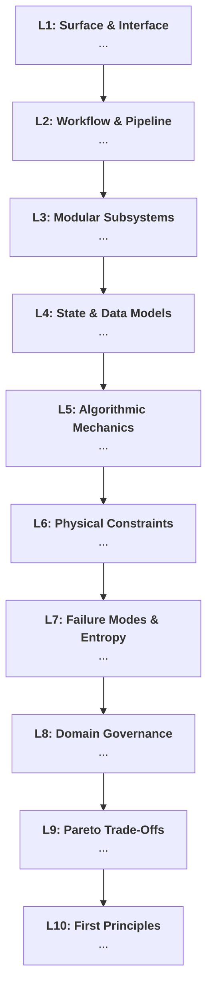

# 10-Level Deep Dimensional Analysis Skill (`new-5w1h`)

## Purpose & Philosophy

Most technical explanations remain stuck at the surface level—describing syntax, UI elements, or high-level steps without revealing *why* the system must be built that way, where its physical bottlenecks lie, or what mathematical and economic realities govern its design.

The `new-5w1h` skill equips the agent to perform an exhaustive, rigorous **10-Level Deep Root-Cause Deconstruction** of any concept, module, architecture, or technical decision by synthesizing two powerful analytical frameworks:
1. **The Recursive "Whys" Root-Cause Chain**: Each answer's underlying constraint or mechanism directly becomes the seed question for the next level ($Q_n \rightarrow Ans_n \rightarrow \text{Why } Ans_n \rightarrow Q_{n+1}$).
2. **The 5W1H Dimensional Matrix**: At every single depth level, grounding the explanation in all 6 dimensions—**What**, **Why**, **How**, **Where**, **Who**, and **When**—preventing hand-waving and vague generalizations.

---

## When to Activate

Trigger this skill whenever the user:
- Asks to understand a topic, concept, file, or architecture "10 levels deep".
- Requests a deep breakdown using "whys", "5W1H", or "first principles".
- Prompts with phrases like *"help me understand X deeply"*, *"break down X using 5W1H"*, or *"why do we need this file/system?"*.
- Wants to critically evaluate a complex architectural choice or uncover hidden system constraints.

---

## The 10-Level Progressive Depth Taxonomy

The analysis must progress monotonically down through 10 distinct abstraction planes. Never circle back or duplicate concepts across levels:

| Level | Abstraction Plane | Core Focus |
| :---: | :--- | :--- |
| **L1** | **Surface & User Interface** | Visible tooling, CLI commands, UI widgets, API entrypoints, immediate user ergonomics. |
| **L2** | **Workflow & Orchestration** | Execution lifecycle, pipeline stages, control flow, sequence of operations, request-response path. |
| **L3** | **Subsystems & Component Boundaries** | Decoupling, interfaces, adapters, contracts, service boundaries, and state isolation. |
| **L4** | **Data Models, Schemas & Memory State** | Data structures, serialization schemas, vector geometries, database tables, caching keys. |
| **L5** | **Algorithmic Mechanics & Logic** | Step-by-step algorithms, mathematical transformations, similarity metrics, heuristics. |
| **L6** | **Hardware & Physical Constraints** | CPU/GPU compute, memory bandwidth, network latency, token limits, disk I/O, cache line saturation. |
| **L7** | **Failure Modes & Entropy** | Silent degradations, race conditions, distribution shifts, edge cases, recovery fallbacks. |
| **L8** | **Domain Governance & Invariants** | Business logic, compliance, legal liability, data privacy, RBAC security, SLA guarantees. |
| **L9** | **Architectural Pareto Trade-Offs** | The design frontier: what was sacrificed (speed vs. accuracy, cost vs. quality), counterfactual alternatives. |
| **L10**| **Axiomatic First Principles** | Universal laws: Shannon information theory, computational complexity (P vs. NP), statistical physics, thermodynamics. |

---

## The 5W1H Dimensional Matrix (Applied at Every Level)

At each level of depth ($L_1$ through $L_{10}$), synthesize the findings across all six dimensions:

* **WHAT**: What is the precise entity, component, data structure, or mechanism active at this layer?
* **WHY**: Why does it exist or behave this way? (The causal bridge to the next recursive level).
* **HOW**: How does it execute under the hood (algorithm, protocol, state transition, formula)?
* **WHERE**: Where is this state or computation located (VRAM, CPU registers, stack frame, disk block, network socket)?
* **WHO**: Who/What is the actor, caller, responsible module, or affected consumer?
* **WHEN**: When is this invoked, at what lifecycle trigger, or under what operational conditions?

---

## Execution Protocol & Output Blueprint

When executing the analysis, format the output cleanly and consistently:

```markdown
# 🔬 10-Level Deep Dimensional Analysis: [Topic / Concept Name]

> **Executive Thesis**: [A concise 2-sentence synthesis defining the system at Level 1 and connecting it to its Level 10 First Principle.]

---

### Level 1: Surface & Interface (The Visible Entrypoint)
* **Q1:** [Direct question addressing the surface capability or visible symptom]
* **Ans 1:** [Crisp, high-impact answer]
* **5W1H Matrix:**
  * **What:** [Exact tool / UI element / CLI command]
  * **How:** [Mechanism of invocation]
  * **Where:** [Client port, terminal, browser, API surface]
  * **Who:** [User / developer persona]
  * **When:** [Invocation trigger or development phase]
* **The Recursive Pivot (Why Ans 1?):** [Causal bridge posing Question 2]

---

### Level 2: Workflow & Pipeline Orchestration
* **Q2:** [Question investigating the internal pipeline sequence]
* **Ans 2:** [Explanation of intermediate stages]
* **5W1H Matrix:**
  * **What:** ...
  * **Why:** ...
  * **How:** ...
  * **Where:** ...
  * **Who:** ...
  * **When:** ...
* **The Recursive Pivot (Why Ans 2?):** [Bridge posing Question 3]

...
[Continue monotonically through Level 9]
...

---

### Level 10: Axiomatic First Principles (Universal Laws)
* **Q10:** [The ultimate first-principles question]
* **Ans 10:** [The non-negotiable law of computation, information theory, or physics]
* **5W1H Matrix:**
  * **What:** [Universal law or theorem: Shannon Entropy, CAP Theorem, P vs NP, Von Neumann Bottleneck]
  * **Why:** [Why this constraint cannot be bypassed by any software engineering trick]
  * **How:** [Mathematical equation or physical principle]
  * **Where:** [Universal mathematical / physical substrate]
  * **Who:** [Applies universally across all computational architectures]
  * **When:** [In all conceivable operating conditions]

---

## 🗺️ Visual Synthesis: The 10-Level Progressive Funnel

```

---

## Core Guidelines for the Agent

1. **Strict Monotonic Progression**: Ensure each level moves strictly deeper into the physical, mathematical, or architectural substrate. Never repeat a previous level's rationale.
2. **Anchor in Concrete Code**: Whenever analyzing a codebase, link directly to symbols, configuration values, files (using `file:///` URLs), and specific line ranges.
3. **Quantify Constraints**: Avoid vague statements like *"improves speed"*. Quantify using big-$O$ complexity, token budgets ($\le 256$ tokens), memory allocations, or millisecond latency budgets.
4. **Counterfactual Rigor**: At Level 9 (Trade-Offs), always explain the catastrophic failure mode or cost explosion that would occur if the opposite design path were taken.
5. **Zero Token Bloat**: Maintain high information density. Use bolding, clear tabular layouts, and concise technical language.
