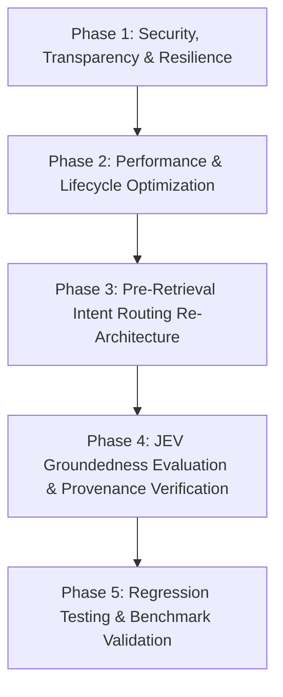

# Master Implementation Plan: JEV Robustness & Groundedness

**Document:** `plan.md`  
**Status:** Ready for Execution (Pending Decision Approval in `decisions.md`)  
**Target Repository:** `Company_Bot`  
**Auditor / Architect:** Antigravity AI Engineering  
**Version:** 1.0  

---

## 1. Objectives & Scope

This implementation plan resolves all 13 defects, vulnerabilities, and architectural gaps uncovered during the Phase 0 audit. It elevates the JEV subsystem from a basic regex-fallback mechanism to a high-accuracy, production-ready enterprise evaluation engine.

### Key Milestones:
1. **Security & Transparency:** Accurate provider attribution, expanded secret masking (AWS, GitHub, PEM), and Unicode-safe local filters.
2. **High-Performance Infrastructure:** Persistent HTTP connection pooling, circuit-breaker fault tolerance, and elimination of redundant rejection checks.
3. **Accurate Intent Routing:** Pre-retrieval intent classification so marginal chunks never hijack etiquette or out-of-domain queries.
4. **Claim-Level Groundedness:** Context-aware JEV evaluation that verifies generated answers against retrieved evidence before returning them to employees.
5. **Comprehensive Test Suite:** Unit, integration, adversarial, and mock provider failure tests.

---

## 2. Phase Breakdown & Execution Sequence



---

## Phase 1: Security, Transparency & Resilience (Priority 0)

**Goal:** Fix false security reporting, expand credential scrubbing, eliminate Unicode bypasses, and handle provider errors gracefully.

### Task 1.1: Fix Provider Attribution in Guardrails
- **Issue:** [`app/domain/services/guardrails.py:L116-L123, L185-L192`](file:///c:/Users/NehaSinaiBhangui/Company_Bot/app/domain/services/guardrails.py#L116-L123) hardcodes `provider="jev"` even when local regex fallback is used.
- **Changes:**
  - In `SecurityGuardrails.validate_input`: Read `actual_provider = jev_res.get("provider", "local")` and assign `provider=actual_provider`.
  - In `SecurityGuardrails.validate_output`: Track whether `check_output_safety` succeeded; set `provider="jev"` only if JEV actually evaluated the text; otherwise set `"local_fallback"` or `"local"`.
  - In `query_orchestrator.py:L330-L335`: Record `out_guard.provider` in `ChatResult` and conversation logs.
- **Files Modified:**
  - `app/domain/services/guardrails.py`
  - `app/use_cases/chat/query_orchestrator.py`

### Task 1.2: Explicit Status Handling & Logging in JevClient
- **Issue:** [`app/infrastructure/llm/jev_client.py:L148, L209, L266`](file:///c:/Users/NehaSinaiBhangui/Company_Bot/app/infrastructure/llm/jev_client.py#L148) silently ignores non-200 HTTP codes (402, 429, 500).
- **Changes:**
  - Check `resp.status_code != 200`:
    - Log explicit error: `logger.error("Jev API returned error status %d: %s", resp.status_code, resp.text[:200])`.
    - Handle 402 (Payment/Credits Exhausted): Log fatal configuration alert and increment metric.
    - Handle 429 (Rate Limit): Implement exponential backoff retry (1 retry with jitter, max 1.0s delay).
  - Return `{"is_safe": ..., "provider": "local_fallback", "failure_reason": f"HTTP_{resp.status_code}"}` on non-retryable errors.
- **Files Modified:**
  - `app/infrastructure/llm/jev_client.py`

### Task 1.3: Expand Secret Scrubbing Perimeter
- **Issue:** [`app/infrastructure/llm/jev_client.py:L33-L40`](file:///c:/Users/NehaSinaiBhangui/Company_Bot/app/infrastructure/llm/jev_client.py#L33-L40) misses AWS keys, GitHub tokens, GCP keys, and private keys.
- **Changes:**
  - Add regex patterns to `_SECRET_PATTERNS`:
    - AWS Key ID: `re.compile(r"\bAKIA[0-9A-Z]{16}\b")`
    - GitHub PATs: `re.compile(r"\bgh[pousr]_[A-Za-z0-9_]{36,255}\b")`
    - Google Cloud API keys: `re.compile(r"\bAIza[0-9A-Za-z-_]{35}\b")`
    - Slack Tokens: `re.compile(r"\bxox[baprs]-[0-9a-zA-Z-]{10,}\b")`
    - PEM Private Keys: `re.compile(r"-----BEGIN (?:[A-Z ]+)?PRIVATE KEY-----[\s\S]*?-----END (?:[A-Z ]+)?PRIVATE KEY-----")`
  - Ensure `sanitize_secrets_for_external_evaluation` is called on all outgoing texts.
- **Files Modified:**
  - `app/infrastructure/llm/jev_client.py`
  - `app/domain/services/guardrails.py`

### Task 1.4: Unicode Normalization & Prompt-Injection Hardening
- **Issue:** [`app/domain/services/guardrails.py:L22-L30`](file:///c:/Users/NehaSinaiBhangui/Company_Bot/app/domain/services/guardrails.py#L22-L30) vulnerable to homoglyphs, zero-width characters, and false positives.
- **Changes:**
  - Run `unicodedata.normalize('NFKC', text)` on all input queries before regex evaluation.
  - Remove zero-width characters: `re.sub(r"[\u200B-\u200D\uFEFF]", "", text)`.
  - Fix False Positives:
    - Change pattern `repeat\s+(everything|all)\s+above` to require context like `repeat\s+(everything|all)\s+(above|prior)\s*(instructions|prompts|system)`.
    - Guard SQL pattern to require actual execution commands rather than conversational queries.
- **Files Modified:**
  - `app/domain/services/guardrails.py`

### Task 1.5: Defensive Exception Handling in Orchestrator
- **Issue:** [`query_orchestrator.py:L386`](file:///c:/Users/NehaSinaiBhangui/Company_Bot/app/use_cases/chat/query_orchestrator.py#L386) calls `validate_input` without `try...except`.
- **Changes:**
  - Wrap `SecurityGuardrails.validate_input` in a defensive block:
    ```python
    try:
        input_guard = SecurityGuardrails.validate_input(question, jev_client=self.jev)
    except Exception as exc:
        logger.error("Critical failure during input guardrail: %s. Using local fallback.", exc)
        input_guard = SecurityGuardrails._local_validate_input(question)
    ```
- **Files Modified:**
  - `app/use_cases/chat/query_orchestrator.py`

---

## Phase 2: Performance & Lifecycle Optimization (Priority 0)

**Goal:** Cut 300ms+ latency, eliminate socket churn, and prevent thread starvation.

### Task 2.1: Persistent HTTP Client Connection Pool
- **Issue:** [`jev_client.py:L146, L207, L264`](file:///c:/Users/NehaSinaiBhangui/Company_Bot/app/infrastructure/llm/jev_client.py#L146) opens and closes `httpx.Client()` on every method call.
- **Changes:**
  - Initialize a singleton/persistent client on `JevClient.__init__`:
    ```python
    self._client = httpx.Client(
        timeout=httpx.Timeout(self.timeout, connect=3.0),
        limits=httpx.Limits(max_keepalive_connections=20, max_connections=50),
    )
    ```
  - Use `self._client.post(...)` instead of `with httpx.Client(...)`.
  - Add `close()` method to `JevClient` and register with FastAPI lifespan in `app/main.py`.
- **Files Modified:**
  - `app/infrastructure/llm/jev_client.py`
  - `app/main.py`

### Task 2.2: Circuit Breaker for JEV Outages
- **Changes:**
  - Add rolling failure tracking to `JevClient`:
    - Track consecutive failures (`consecutive_failures: int`, `circuit_open_until: float`).
    - If 3 consecutive requests time out or return 5xx: trip circuit for 60 seconds.
    - While circuit is open, immediately return local fallback (<0.1ms) instead of blocking for 8.0s.
- **Files Modified:**
  - `app/infrastructure/llm/jev_client.py`

### Task 2.3: Bypass Output Guardrail on Early Rejections
- **Issue:** [`query_orchestrator.py:L328-L332, L388`](file:///c:/Users/NehaSinaiBhangui/Company_Bot/app/use_cases/chat/query_orchestrator.py#L328-L332) validates the bot's static rejection message via JEV.
- **Changes:**
  - In `_finish`: Check if `res.get("is_rejection")` or if query was blocked at step 1. If true, skip `SecurityGuardrails.validate_output`.
- **Files Modified:**
  - `app/use_cases/chat/query_orchestrator.py`

### Task 2.4: Dependency Injection for JevClient
- **Issue:** [`query_orchestrator.py:L237`](file:///c:/Users/NehaSinaiBhangui/Company_Bot/app/use_cases/chat/query_orchestrator.py#L237) hardcodes `self.jev = JevClient()`.
- **Changes:**
  - Accept `jev_client: Optional[JevClient] = None` in `QueryOrchestrator.__init__`.
  - Default to singleton `get_jev_client()` factory if None.
- **Files Modified:**
  - `app/use_cases/chat/query_orchestrator.py`

---

## Phase 3: Evidence-Grounded Context Sufficiency Routing & Zero Hallucination (Priority 1)

**Goal:** Eliminate rigid pre-retrieval category misclassifications and eliminate hallucinations by verifying chunk answerability before LLM generation.

### Task 3.1: Holistic Maliciousness Safety Evaluation in JevClient
- **Enhancement:**
  - Upgrade `check_input_safety` from narrow threat keys to evaluating whether the entire query is malicious, adversarial, or harmful in ANY way (jailbreaks, prompt overrides, system prompt extraction, social engineering, payload delivery, or reconnaissance).
  - Upgrade `check_output_safety` to evaluate whether any confidential secrets, credentials, internal architecture, or system prompts were leaked in ANY way.
- **Files Modified:**
  - `app/infrastructure/llm/jev_client.py`
  - `app/domain/services/guardrails.py`

### Task 3.2: Implement `evaluate_context_sufficiency` in `JevClient`
- **Method Signature:**
  ```python
  def evaluate_context_sufficiency(
      self,
      question: str,
      context_chunks: List[str],
  ) -> Dict[str, Any]:
  ```
- **Execution:**
  1. Scrub secrets/PII from question and chunks.
  2. JEV evaluates:
     - `can_be_answered (bool)`: Can the question be factually answered using ONLY the provided chunks?
     - `relevant_chunk_indices (list[int])`: 0-indexed list of chunks containing the facts.
     - `is_etiquette (bool)`: Is this an interpersonal workplace communication or pronoun inquiry not specified in policy docs?
     - `reason (str)`: Justification.
  3. Include robust local fallback when offline.
- **Files Modified:**
  - `app/infrastructure/llm/jev_client.py`

### Task 3.3: Context Sufficiency Answerability Gate in Orchestrator
- **Changes in `query_orchestrator.py`:**
  - Remove brittle pre-retrieval category gate that guessed categories before querying ChromaDB.
  - Query ChromaDB and rerank candidates.
  - If `not selected_evidence`:
    - Run RBAC probe. If no unauthorized match, evaluate if etiquette $\rightarrow$ polite guidance with policy disclaimer; else return *"I could not find that information in the available documents."*
  - If `selected_evidence` is present:
    - Call `self.jev.evaluate_context_sufficiency(question, context_texts)`.
    - If `can_be_answered == False`:
      - **Zero Hallucination:** LLM is NOT called with irrelevant chunks.
      - If `is_etiquette == True`: Return polite guidance with explicit policy disclaimer.
      - Else: Return *"I could not find that information in the available documents."*
    - If `can_be_answered == True`:
      - Filter `selected_evidence` to `relevant_chunk_indices` (pruning distractor chunks).
      - Build prompt and generate answer.
      - Verify claim-level groundedness via `evaluate_groundedness`.
- **Files Modified:**
  - `app/use_cases/chat/query_orchestrator.py`

---

## Phase 4: JEV Groundedness Evaluation & Provenance Verification (Priority 1)

**Goal:** Verify generated answers against retrieved context chunks using JEV, stopping hallucinations and ensuring faithful citations.

*(Contingent on Approval of ADR-01 Option B in `decisions.md`)*

### Task 4.1: Implement `evaluate_groundedness` in `JevClient`
- **Method Signature:**
  ```python
  def evaluate_groundedness(
      self,
      question: str,
      context_chunks: List[str],
      answer: str,
  ) -> Dict[str, Any]:
  ```
- **Execution:**
  1. Scrub live secrets/PII from chunks and answer.
  2. Send prompt to JEV model (`llama-3.3-70b-versatile` or `llama-guard`):
     - Check: Does the answer contain any facts, numerical limits, or claims not supported by the context chunks?
     - Output JSON: `{"is_grounded": bool, "hallucination_score": float, "unsupported_claims": list, "supported_chunk_indices": list}`.
  3. Include local fallback: if API fails, fallback to lexical overlap / keyword verification.
- **Files Modified:**
  - `app/infrastructure/llm/jev_client.py`

### Task 4.2: Integrate Groundedness Gate in Orchestrator
- **Changes in `query_orchestrator.py`:**
  - After `_generate(messages)`:
    - If `selected_evidence` was used:
      - Call `self.jev.evaluate_groundedness(question, context_texts, answer)`.
      - If `is_grounded is False` and `hallucination_score > 0.5`:
        - Log warning with unsupported claims.
        - Trigger safe abstention:
          *"I found relevant company documentation, but could not verify all details with certainty. Please refer directly to the referenced policy or contact HR."*
      - Filter citations in `ProvenanceService` to highlight only `supported_chunk_indices`.
- **Files Modified:**
  - `app/use_cases/chat/query_orchestrator.py`
  - `app/use_cases/chat/provenance_service.py`

---

## Phase 5: Test Suite, Benchmarks & Validation

**Goal:** Establish regression coverage and benchmark performance.

### Task 5.1: Unit & Failure Mode Tests (`test_security_guardrails.py`)
- Test real provider reporting: Assert `provider == "local_fallback"` when JEV fails.
- Test HTTP 402, 429, 500 mock responses.
- Test AWS key, GitHub PAT, and PEM private key redaction.
- Test Unicode homoglyphs and leetspeak prompt injections.
- Test that legitimate queries (`repeat all above in summary`, `<script> in intranet`) pass without rejection.

### Task 5.2: Intent Routing Integration Tests (`test_intent_routing_pipeline.py`)
- Test that interpersonal queries (e.g. pronouns) route to etiquette even when Chroma returns loose matches.
- Test that unrelated queries (e.g. Python coding) do not trigger vector retrieval.

### Task 5.3: Groundedness & Provenance Tests (`test_groundedness_evaluation.py`)
- Test that an answer with fabricated leave days (e.g. 50 days when policy says 18) is rejected by groundedness evaluation.
- Test that faithful answers pass with correct citations.

---

## 3. Verification Commands & Acceptance Criteria

Execute the following commands to validate the implementation:

```powershell
# 1. Run unit security guardrail tests
pytest tests/unit/test_security_guardrails.py -v

# 2. Run new failure & provider attribution tests
pytest tests/unit/test_jev_provider_failures.py -v

# 3. Run intent routing tests
pytest tests/unit/test_query_intent_classifier.py -v

# 4. Run end-to-end RAG retrieval & groundedness tests
pytest tests/unit/test_retrieval_selection.py -v

# 5. Full test suite validation
pytest tests/unit/ -k "guardrails or jev or intent or retrieval" -v
```

### Acceptance Checklist:
- [ ] `GuardrailResult.provider` is `"jev"` only when API call succeeded; `"local_fallback"` on error.
- [ ] AWS keys (`AKIA...`) and GitHub tokens are scrubbed before external transmission.
- [ ] Leetspeak and Unicode homoglyphs are caught by local fallback.
- [ ] Legitimate queries containing `<script>` or `repeat all above` are not blocked.
- [ ] Interpersonal/pronoun queries route to etiquette without calling ChromaDB.
- [ ] JEV HTTP client reuses persistent connections.
- [ ] Hallucinated answers fail groundedness verification with clean abstention.

---

*Once `decisions.md` is approved, execution will start with Phase 1.*
