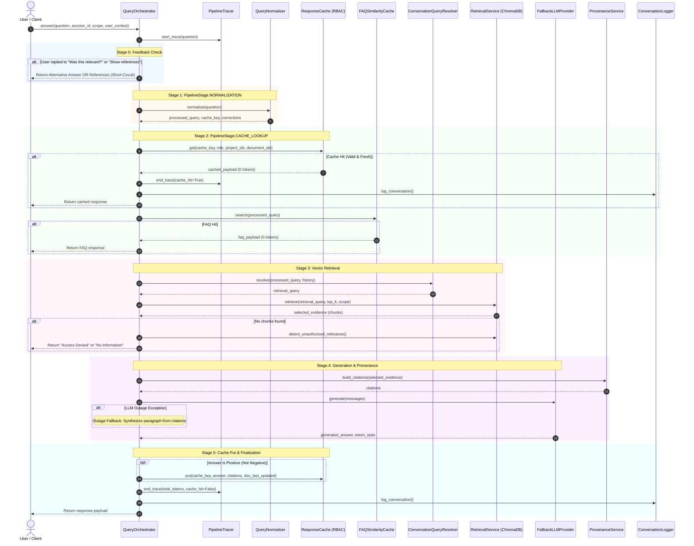

# Query Orchestrator: Comprehensive Architecture & Pipeline Guide
**File Under Review:** [`app/use_cases/chat/query_orchestrator.py`](file:///c:/DEV/Training_Projects/Training_Team_Project/Company_Bot/app/use_cases/chat/query_orchestrator.py)  
**Author:** Akaash Samson  
**Layer:** Application / Use Case Layer (Clean / Hexagonal Architecture)  
**Date:** October 1, 2026  

---

## 1. Executive Summary & Architectural Role

In KnowLayer's Clean / Hexagonal Architecture, [`QueryOrchestrator`](file:///c:/DEV/Training_Projects/Training_Team_Project/Company_Bot/app/use_cases/chat/query_orchestrator.py#L158-L219) serves as the **central application controller** for all conversational interactions. It coordinates across 10 distinct domain services, infrastructure adapters, and telemetry providers:

```
FastAPI Router / Teams Adapter / Streamlit
                   │
                   ▼
       ┌───────────────────────┐
       │   QueryOrchestrator   │
       └───────────┬───────────┘
                   │
    ┌──────────────┼──────────────┬──────────────┬──────────────┐
    ▼              ▼              ▼              ▼              ▼
[Normalizer]   [Caches]      [Retriever]    [LLM Provider] [Telemetry]
(NLP / Typos) (RBAC / FAQ)  (ChromaDB / RBAC) (OpenRouter/Groq) (Langfuse / Tracer)
```

The orchestrator guarantees:
1. **Deterministic Caching**: Normalizes queries before checking semantic caches to maximize cache hits.
2. **Strict RBAC Document Isolation**: Never returns cached or vector data belonging to projects or documents the caller is unauthorized to view.
3. **Grounded Provenance**: Automatically pairs generated answers with verified document citations (`source`, `section`, `text`).
4. **Resilience & Graceful Degradation**: Outage fallbacks that synthesize answers directly from retrieved documents if LLM providers are unavailable.
5. **Observability**: Records OpenTelemetry / Langfuse spans with pre-recorded nanosecond timestamps across every stage.

---

## 2. Dependency Injection & Collaborator Matrix

The `QueryOrchestrator` is initialized in [`QueryOrchestrator.__init__`](file:///c:/DEV/Training_Projects/Training_Team_Project/Company_Bot/app/use_cases/chat/query_orchestrator.py#L159-L219). Every collaborator is injected via interface abstractions, defaulting to standard concrete implementations:

| Collaborator | Parameter | Line | Default Concrete Class | Responsibility |
|---|---|---|---|---|
| **Query Normalizer** | `query_normalizer` | [`L195`](file:///c:/DEV/Training_Projects/Training_Team_Project/Company_Bot/app/use_cases/chat/query_orchestrator.py#L195) | [`QueryNormalizer`](file:///c:/DEV/Training_Projects/Training_Team_Project/Company_Bot/app/use_cases/chat/query_normalizer.py) | NLP cleaning, DP word splitting, typo correction, and canonical cache key generation. |
| **Pipeline Tracer** | `pipeline_tracer` | [`L198`](file:///c:/DEV/Training_Projects/Training_Team_Project/Company_Bot/app/use_cases/chat/query_orchestrator.py#L198) | [`PipelineTracer`](file:///c:/DEV/Training_Projects/Training_Team_Project/Company_Bot/app/infrastructure/observability/pipeline_tracer.py) | Emits OpenTelemetry / Langfuse spans for every pipeline stage. |
| **Response Cache** | `response_cache` | [`L186`](file:///c:/DEV/Training_Projects/Training_Team_Project/Company_Bot/app/use_cases/chat/query_orchestrator.py#L186) | `QualityAwareCache` / `InMemoryQualityAwareCache` | Semantic cache with RBAC role/project isolation and document timestamp invalidation. |
| **FAQ Similarity Cache** | `faq_cache` | [`L180-L183`](file:///c:/DEV/Training_Projects/Training_Team_Project/Company_Bot/app/use_cases/chat/query_orchestrator.py#L180-L183) | [`FAQSimilarityCache`](file:///c:/DEV/Training_Projects/Training_Team_Project/Company_Bot/app/infrastructure/faq/faq_similarity_cache.py) | Embedding-based vector similarity cache for frequent company questions. |
| **FAQ Store** | `faq_store` | [`L179`](file:///c:/DEV/Training_Projects/Training_Team_Project/Company_Bot/app/use_cases/chat/query_orchestrator.py#L179) | [`MongoFAQStore`](file:///c:/DEV/Training_Projects/Training_Team_Project/Company_Bot/app/infrastructure/faq/mongo_faq_store.py) | Persistent MongoDB storage for verified FAQ question-answer pairs. |
| **Session Memory** | `memory` | [`L214`](file:///c:/DEV/Training_Projects/Training_Team_Project/Company_Bot/app/use_cases/chat/query_orchestrator.py#L214) | [`SessionMemoryService`](file:///c:/DEV/Training_Projects/Training_Team_Project/Company_Bot/app/domain/services/session_memory_service.py) | Stores and loads multi-turn conversational history across turns. |
| **Query Resolver** | `query_resolver` | [`L215-L218`](file:///c:/DEV/Training_Projects/Training_Team_Project/Company_Bot/app/use_cases/chat/query_orchestrator.py#L215-L218) | [`ConversationQueryResolver`](file:///c:/DEV/Training_Projects/Training_Team_Project/Company_Bot/app/use_cases/chat/conversation_query_resolver.py) | Resolves conversational coreference / pronouns (e.g. "how do I apply for it?" → "how do I apply for maternity leave?"). |
| **Vector Retrieval** | `retrieval` | [`L177`](file:///c:/DEV/Training_Projects/Training_Team_Project/Company_Bot/app/use_cases/chat/query_orchestrator.py#L177) | [`RetrievalService`](file:///c:/DEV/Training_Projects/Training_Team_Project/Company_Bot/app/use_cases/chat/retrieval_service.py) | Queries ChromaDB for top-K chunks scoped by project and document IDs. |
| **Context Builder** | `context_builder` | [`L184`](file:///c:/DEV/Training_Projects/Training_Team_Project/Company_Bot/app/use_cases/chat/query_orchestrator.py#L184) | [`RAGContextBuilder`](file:///c:/DEV/Training_Projects/Training_Team_Project/Company_Bot/app/use_cases/chat/rag_context_builder.py) | Formats ground-truth chunks into system and user prompts. |
| **Provenance Service**| `provenance` | [`L178`](file:///c:/DEV/Training_Projects/Training_Team_Project/Company_Bot/app/use_cases/chat/query_orchestrator.py#L178) | [`ProvenanceService`](file:///c:/DEV/Training_Projects/Training_Team_Project/Company_Bot/app/use_cases/chat/provenance_service.py) | Extracts and standardizes citation models from retrieved metadata. |
| **LLM Provider** | `llm` | [`L210-L213`](file:///c:/DEV/Training_Projects/Training_Team_Project/Company_Bot/app/use_cases/chat/query_orchestrator.py#L210-L213) | [`FallbackLLMProvider`](file:///c:/DEV/Training_Projects/Training_Team_Project/Company_Bot/app/infrastructure/llm/fallback_llm_provider.py) | Primary provider (OpenRouter) with circuit-breaker fallback to Groq. |
| **Conversation Logger**| `conversation_logger`| [`L201-L208`](file:///c:/DEV/Training_Projects/Training_Team_Project/Company_Bot/app/use_cases/chat/query_orchestrator.py#L201-L208) | [`ConversationLogger`](file:///c:/DEV/Training_Projects/Training_Team_Project/Company_Bot/app/infrastructure/logging/conversation_logger.py) | Persists structured turn data into SQLite with employee ID resolution. |
| **Timestamp Lookup** | `document_timestamp_lookup`| [`L188`](file:///c:/DEV/Training_Projects/Training_Team_Project/Company_Bot/app/use_cases/chat/query_orchestrator.py#L188) | [`_default_doc_timestamp_lookup`](file:///c:/DEV/Training_Projects/Training_Team_Project/Company_Bot/app/use_cases/chat/query_orchestrator.py#L137-L155) | Fetches document `updated_at` from SQLite to detect stale cached responses. |

---

## 3. End-to-End Pipeline Sequence

When [`QueryOrchestrator.answer()`](file:///c:/DEV/Training_Projects/Training_Team_Project/Company_Bot/app/use_cases/chat/query_orchestrator.py#L266) is called, it executes the following sequential stages:



---

## 4. Detailed Stage Breakdown

### Stage 0: Feedback Interception & The Relevance Loop
* **Lines:** [`query_orchestrator.py:L364-L656`](file:///c:/DEV/Training_Projects/Training_Team_Project/Company_Bot/app/use_cases/chat/query_orchestrator.py#L364-L656)
* **Goal:** Detect if the incoming turn is feedback on the previous response.
* **Mechanism:**
  1. **Relevance Confirmations** ([`L602-L620`](file:///c:/DEV/Training_Projects/Training_Team_Project/Company_Bot/app/use_cases/chat/query_orchestrator.py#L602-L620)): If user confirms ("yes", "helpful"), the bot returns formatted document references.
  2. **Dissatisfaction & Cache Invalidation** ([`L428-L519`](file:///c:/DEV/Training_Projects/Training_Team_Project/Company_Bot/app/use_cases/chat/query_orchestrator.py#L428-L519)):
     If user says "not satisfied", "not relevant", or "wrong":
     * Evicts the previous query and its normalized cache key from `response_cache` ([`L437-L457`](file:///c:/DEV/Training_Projects/Training_Team_Project/Company_Bot/app/use_cases/chat/query_orchestrator.py#L437-L457)).
     * Evicts from `faq_cache` ([`L459-L466`](file:///c:/DEV/Training_Projects/Training_Team_Project/Company_Bot/app/use_cases/chat/query_orchestrator.py#L459-L466)).
     * **First Dissatisfaction:** Calls LLM to generate an alternative answer from the retrieved chunks ([`L520-L578`](file:///c:/DEV/Training_Projects/Training_Team_Project/Company_Bot/app/use_cases/chat/query_orchestrator.py#L520-L578)).
     * **Second Dissatisfaction:** Directly displays the raw document citations for user inspection ([`L470-L498`](file:///c:/DEV/Training_Projects/Training_Team_Project/Company_Bot/app/use_cases/chat/query_orchestrator.py#L470-L498)).

---

### Stage 1: Query Normalization (`PipelineStage.NORMALIZATION`)
* **Lines:** [`query_orchestrator.py:L658-L670`](file:///c:/DEV/Training_Projects/Training_Team_Project/Company_Bot/app/use_cases/chat/query_orchestrator.py#L658-L670)
* **Goal:** Canonicalize raw input text before querying caches or retrieval.
* **Code:**
  ```python
  with self._stage_ctx(PipelineStage.NORMALIZATION, input_metadata={"raw_query": question}) as norm_span:
      normalized_result = self.query_normalizer.normalize(question)
      processed_query = normalized_result.normalized_query
      cache_key = normalized_result.cache_key
      query_corrections.extend(getattr(normalized_result, "corrections_made", []))
  ```
* **Output:**
  * `processed_query`: Corrected spelling (e.g. `howareyou` → `how are you`).
  * `cache_key`: Canonical prefix (e.g. `how many leaves do i get` → `what_is_the_leave_balance`).

---

### Stage 2: RBAC Semantic Cache & FAQ Lookup (`PipelineStage.CACHE_LOOKUP`)
* **Lines:** [`query_orchestrator.py:L671-L840`](file:///c:/DEV/Training_Projects/Training_Team_Project/Company_Bot/app/use_cases/chat/query_orchestrator.py#L671-L840)
* **Goal:** Instantly return verified responses with zero LLM cost and latency (<50ms).
* **RBAC Resolution:**
  Extracts `caller_role`, `caller_roles`, `is_admin_flag`, `caller_project_ids`, and `caller_document_ids` from `authorization_scope` or `user_context` ([`L673-L702`](file:///c:/DEV/Training_Projects/Training_Team_Project/Company_Bot/app/use_cases/chat/query_orchestrator.py#L673-L702)).
* **Document Freshness Gate:**
  Passes `document_timestamp_lookup` into `response_cache.get(...)`. If any cited document was modified after the cache entry was created, the cache entry is invalidated.
* **Negative Response Rejection:**
  Checks `is_negative_response(ans)` ([`L746-L755`](file:///c:/DEV/Training_Projects/Training_Team_Project/Company_Bot/app/use_cases/chat/query_orchestrator.py#L746-L755)). Never returns cached answers that say *"I could not find that information"*.

---

### Stage 3: Conversational Resolution & Vector Retrieval (`PipelineStage.VECTOR_RETRIEVAL`)
* **Lines:** [`query_orchestrator.py:L844-L885`](file:///c:/DEV/Training_Projects/Training_Team_Project/Company_Bot/app/use_cases/chat/query_orchestrator.py#L844-L885)
* **Goal:** Retrieve the most semantically relevant chunks from ChromaDB under strict RBAC constraints.
* **Query Resolution:**
  ```python
  retrieval_query = self.query_resolver.resolve(processed_query, conversation_history)
  ```
* **Contract:** Always returns dictionaries containing standardized keys:
  * `id`: Chunk ID
  * `text`: Chunk text
  * `score`: Similarity score (`1.0 - distance`)
  * `distance`: Raw cosine distance
  * `metadata`: Source, section, project ID, document ID

---

### Stage 4: Unauthorized Access Probing
* **Lines:** [`query_orchestrator.py:L886-L909`](file:///c:/DEV/Training_Projects/Training_Team_Project/Company_Bot/app/use_cases/chat/query_orchestrator.py#L886-L909) and [`L1228-L1273`](file:///c:/DEV/Training_Projects/Training_Team_Project/Company_Bot/app/use_cases/chat/query_orchestrator.py#L1228-L1273)
* **Goal:** Detect if the user's answer exists in documents they do not have permissions for.
* **Behavior:**
  If authorized retrieval yielded 0 chunks, calls `_probe_unauthorized_relevance(...)`.
  * If hit in another project: Returns a template message pointing to the project manager:
    > *"Relevant information exists in a project document that you do not currently have access to. Please contact [Manager], the manager of [Project], to request access."*
  * **Zero Content Leakage:** Never generates an LLM answer or displays snippet text from the forbidden document.

---

### Stage 5: Context Building & Prompt Construction
* **Lines:** [`query_orchestrator.py:L910-L943`](file:///c:/DEV/Training_Projects/Training_Team_Project/Company_Bot/app/use_cases/chat/query_orchestrator.py#L910-L943)
* **Goal:** Construct strict, hallucination-resistant prompts with explicit ground-truth instructions.
* **Citations Built:**
  ```python
  citations = self.provenance.build_citations(selected_evidence)
  ```

---

### Stage 6: LLM Generation & Outage Fallback (`PipelineStage.LLM_GENERATION`)
* **Lines:** [`query_orchestrator.py:L945-L1009`](file:///c:/DEV/Training_Projects/Training_Team_Project/Company_Bot/app/use_cases/chat/query_orchestrator.py#L945-L1009)
* **Goal:** Generate a natural language response using OpenRouter / Groq.
* **Outage Fallback Resilience ([`L958-L991`](file:///c:/DEV/Training_Projects/Training_Team_Project/Company_Bot/app/use_cases/chat/query_orchestrator.py#L958-L991)):**
  If `LLMProviderError` occurs (e.g. rate limits, provider outages):
  ```python
  paragraph_parts = []
  for c in citations[:3]:
      text = c.get("text", "").strip()
      if text:
          paragraph_parts.append(cleaned)
  fallback_answer = " ".join(paragraph_parts).strip()
  ```
  The user still receives an accurate, grounded answer assembled from top citations even during full LLM outages!

---

### Stage 7: Quality Gate & Semantic Caching
* **Lines:** [`query_orchestrator.py:L1010-L1105`](file:///c:/DEV/Training_Projects/Training_Team_Project/Company_Bot/app/use_cases/chat/query_orchestrator.py#L1010-L1105)
* **Negative Response Guardrail:**
  If the LLM says *"I could not find that information"*, caching is skipped (`not is_negative`).
* **Metadata Attachment:**
  Extracts all `document_ids`, `project_ids`, and resolves `doc_last_updated` timestamps via SQLite lookup before calling `response_cache.put(...)`.

---

### Stage 8: Telemetry, Memory, and Turn Finalization (`_finish`)
* **Lines:** [`query_orchestrator.py:L307-L362`](file:///c:/DEV/Training_Projects/Training_Team_Project/Company_Bot/app/use_cases/chat/query_orchestrator.py#L307-L362)
* **Responsibilities:**
  1. Enforces `is_latest: True` and attaches `corrections` list.
  2. Saves multi-turn question & answer into `SessionMemoryService.add_turn(...)`.
  3. Closes pipeline trace with total token counts via `pipeline_tracer.end_trace(...)`.
  4. Appends audit record to database via `ConversationLogger`.
  5. Stores state in `_last_interaction` and `_pending_citations` for subsequent feedback turns.

---

## 5. Catalog of Unused, Dead, and Legacy Code

During detailed code audit, the following legacy, dead, or redundant code paths were identified:

### 1. In-Memory Process-Global Dictionaries
* **Locations:**
  * `_pending_citations: dict[str, list]` ([`L68`](file:///c:/DEV/Training_Projects/Training_Team_Project/Company_Bot/app/use_cases/chat/query_orchestrator.py#L68))
  * `_last_interaction: dict[str, dict]` ([`L70`](file:///c:/DEV/Training_Projects/Training_Team_Project/Company_Bot/app/use_cases/chat/query_orchestrator.py#L70))
  * `_alternative_answer_given: dict[str, bool]` ([`L72`](file:///c:/DEV/Training_Projects/Training_Team_Project/Company_Bot/app/use_cases/chat/query_orchestrator.py#L72))
  * `_asked_references_confirm: dict[str, bool]` ([`L74`](file:///c:/DEV/Training_Projects/Training_Team_Project/Company_Bot/app/use_cases/chat/query_orchestrator.py#L74))
* **Why it is an Architectural Smell:**
  These variables live on the module's global Python heap. In a multi-worker production setup (e.g. Uvicorn with multiple workers or Kubernetes pods), requests for the same session routed to different workers will miss this state.
* **Recommendation:**
  Move interaction state into [`SessionMemoryService`](file:///c:/DEV/Training_Projects/Training_Team_Project/Company_Bot/app/domain/services/session_memory_service.py) where it is persisted across workers.

---

### 2. Dead `generate_faqs()` Method
* **Location:** [`query_orchestrator.py:L1177-L1202`](file:///c:/DEV/Training_Projects/Training_Team_Project/Company_Bot/app/use_cases/chat/query_orchestrator.py#L1177-L1202)
* **Code:**
  ```python
  def generate_faqs(self):
      if hasattr(self.faq_cache, "load"):
          cached = self.faq_cache.load()
      if hasattr(self.faq_cache, "get"):
          cached = self.faq_cache.get()
      if hasattr(self.faq_cache, "read"):
          cached = self.faq_cache.read()
  ```
* **Why it is Dead:**
  1. `FAQSimilarityCache` does not have `.load()`, `.get()`, or `.read()`. It only implements `.search()`, `.add()`, and `.delete()`.
  2. `generate_faqs()` is never called anywhere in the active codebase (`app/`, `streamlit_app/`, or scripts).
* **Recommendation:** Remove or deprecate in Phase 4.

---

### 3. Legacy References Confirmation Handlers
* **Locations:**
  * `_last_assistant_asked_references_confirm(...)` ([`L128-L134`](file:///c:/DEV/Training_Projects/Training_Team_Project/Company_Bot/app/use_cases/chat/query_orchestrator.py#L128-L134))
  * `asked_refs_confirm` block ([`L383-L422`](file:///c:/DEV/Training_Projects/Training_Team_Project/Company_Bot/app/use_cases/chat/query_orchestrator.py#L383-L422))
  * Legacy References follow-up block ([`L622-L656`](file:///c:/DEV/Training_Projects/Training_Team_Project/Company_Bot/app/use_cases/chat/query_orchestrator.py#L622-L656))
* **Why it is Legacy:**
  In early Phase 1/Phase 2, the assistant asked: *"Would you like to see the source references?"*. In Phase 3, this was replaced with the standardized relevance gate: `RELEVANCE_PROMPT` (*"Was this response relevant to your question?"*). Lines 622–656 remain only to prevent regressions in old test mocks.

---

### 4. Redundant String Replacement Patches
* **Locations:**
  * [`L757-L758`](file:///c:/DEV/Training_Projects/Training_Team_Project/Company_Bot/app/use_cases/chat/query_orchestrator.py#L757-L758)
  * [`L1140-L1141`](file:///c:/DEV/Training_Projects/Training_Team_Project/Company_Bot/app/use_cases/chat/query_orchestrator.py#L1140-L1141)
* **Code:**
  ```python
  if "Would you like to see the references for this?" in answer:
      answer = answer.replace("Would you like to see the references for this?", RELEVANCE_PROMPT)
  ```
* **Why it is Redundant:**
  All system prompts and cache entries have already been migrated to use `RELEVANCE_PROMPT`. This was a temporary monkey-patch during the Phase 2 → Phase 3 transition.

---

### 5. Defensive Duck-Typing Fallbacks
* **Locations:**
  * [`L718-L722`](file:///c:/DEV/Training_Projects/Training_Team_Project/Company_Bot/app/use_cases/chat/query_orchestrator.py#L718-L722) (`except TypeError:` fallback to `get(cache_key)`)
  * [`L1095-L1098`](file:///c:/DEV/Training_Projects/Training_Team_Project/Company_Bot/app/use_cases/chat/query_orchestrator.py#L1095-L1098) (`except TypeError:` fallback to `put(cache_key, payload)`)
* **Why it is Redundant:**
  Both `QualityAwareCache` and `LangCacheAdapter` now adhere strictly to the `CachePort` abstract interface defined in [`app/domain/ports/cache.py`](file:///c:/DEV/Training_Projects/Training_Team_Project/Company_Bot/app/domain/ports/cache.py). The `TypeError` exception handlers are legacy shims from when cache adapters took different argument signatures.

---

## 6. Summary of Key Method Signatures

| Method | Visibility | Line | Purpose |
|---|---|---|---|
| `__init__(...)` | Public | [`L159`](file:///c:/DEV/Training_Projects/Training_Team_Project/Company_Bot/app/use_cases/chat/query_orchestrator.py#L159) | Dependency injection of all 12 services and adapters. |
| `answer(...)` | Public | [`L266`](file:///c:/DEV/Training_Projects/Training_Team_Project/Company_Bot/app/use_cases/chat/query_orchestrator.py#L266) | Core RAG pipeline entry point. |
| `_stage_ctx(stage)` | Protected | [`L220`](file:///c:/DEV/Training_Projects/Training_Team_Project/Company_Bot/app/use_cases/chat/query_orchestrator.py#L220) | Context manager for OpenTelemetry stage tracing. |
| `_finish(res)` | Internal | [`L307`](file:///c:/DEV/Training_Projects/Training_Team_Project/Company_Bot/app/use_cases/chat/query_orchestrator.py#L307) | Turn completion: records telemetry, logs to DB, adds turn to memory. |
| `_faq_search(q)` | Protected | [`L1205`](file:///c:/DEV/Training_Projects/Training_Team_Project/Company_Bot/app/use_cases/chat/query_orchestrator.py#L1205) | Queries `FAQSimilarityCache` with semantic embeddings. |
| `_retrieve(q, **kw)` | Protected | [`L1211`](file:///c:/DEV/Training_Projects/Training_Team_Project/Company_Bot/app/use_cases/chat/query_orchestrator.py#L1211) | Queries `RetrievalService` with RBAC filters. |
| `_generate(msgs)` | Protected | [`L1217`](file:///c:/DEV/Training_Projects/Training_Team_Project/Company_Bot/app/use_cases/chat/query_orchestrator.py#L1217) | Calls `FallbackLLMProvider` with session tracking. |
| `_probe_unauthorized_relevance(...)` | Protected | [`L1228`](file:///c:/DEV/Training_Projects/Training_Team_Project/Company_Bot/app/use_cases/chat/query_orchestrator.py#L1228) | Probes if unassigned/other project documents match the query. |
| `_access_denied_response(hit)` | Protected | [`L1247`](file:///c:/DEV/Training_Projects/Training_Team_Project/Company_Bot/app/use_cases/chat/query_orchestrator.py#L1247) | Generates non-leaking referral message to the project manager. |
