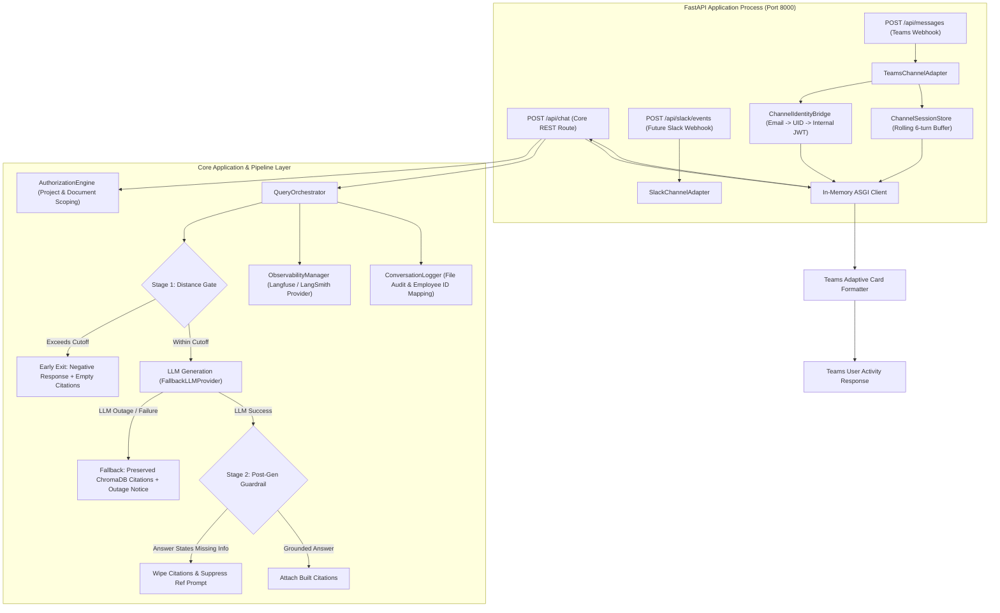

# KnowLayer V3 Architectural Enhancements & Feature Implementation Plan

**Author:** Akaash Samson  
**Scope:** V3 Architecture, Channel Integration, Reliability Fallbacks, Observability, and Containerization  
**Target Delivery:** KnowLayer V3  

---

## 1. Executive Summary & Goals

This document outlines the architectural enhancements and feature implementations proposed for **KnowLayer V3**. The primary objectives are:

1. **Pluggable Multi-Channel Integration (Microsoft Teams & Slack Ready):** Decouple the presentation layer by introducing an extensible Channel Adapter Layer that allows Microsoft Teams, future Slack bots, and other chat interfaces to interact with the core KnowLayer business logic without duplicating route handling, authorization, or logging.
2. **Enterprise User Identity & RBAC Bridge:** Seamlessly resolve authenticated enterprise identities (Teams/Slack corporate email) to KnowLayer user records, enforcing full SQL-backed role-based access control (RBAC), project/document scoping, and audit logging.
3. **Resilient LLM Fallback (Evidence Preservation):** Ensure that if the generative AI model is unavailable or encounters an error, the system gracefully degrades by delivering the relevant policy excerpts and citations retrieved by ChromaDB, rather than returning an empty or failed response.
4. **Citation Grounding Guardrails:** Prevent hallucinations where the model claims information is missing but still attaches citations or asks to show references. Implement a two-stage guardrail (pre-LLM retrieval distance gate and post-LLM response detection).
5. **Pluggable Token Observability & Self-Hosted Langfuse:** Decouple token tracking from individual LLM clients into a unified observability provider architecture. Support self-hosted Langfuse alongside LangSmith as first-class, configurable alternatives.
6. **End-User Token Privacy:** Restrict technical token metrics to observability platforms and administrator views, keeping end-user chat interfaces clean and distraction-free.
7. **Production Containerization:** Provide a production-ready `Dockerfile` and `docker-compose.yml` to orchestrate the backend API, Streamlit UI, self-hosted Langfuse server, and supporting databases.

---

## 2. End-to-End System Architecture



---

## 3. Detailed Component Specifications

### 3.1. Pluggable Channel Architecture & Microsoft Teams Integration

#### 3.1.1. Motivation & Architectural Decision
Directly wiring third-party chat SDKs into core routers causes tight coupling and duplicate logic. The channel architecture adopts a **Driving Adapter Pattern**:
- All UI channels (Teams, future Slack, etc.) communicate with the core system through `POST /api/chat`.
- In-process channel adapters use an in-memory ASGI client (`httpx.AsyncClient(transport=ASGITransport(app=fastapi_app))`). This eliminates external network latency (sub-millisecond execution) while ensuring that all request validation, authentication, authorization, and logging pipelines run identically for all clients.
- All webhook endpoints are mounted on the **same FastAPI process and port (8000)**.

#### 3.1.2. Channel Components
- **`BaseChannelAdapter` (`app/infrastructure/channels/base.py`):**
  Defines the abstract interface for all chat platform adapters:
  - `initialize(app: FastAPI) -> None`: Mounts platform-specific webhook routes onto the FastAPI application.
  - `handle_message(message: ChannelMessage) -> ChannelResponse`: Standardized message lifecycle.
  - `format_response(result: dict) -> Any`: Renders channel-specific output (e.g. Adaptive Cards).
- **`ChannelSessionStore` (`app/infrastructure/channels/session_store.py`):**
  Teams and Slack webhooks send only the latest message (no history). The adapter maintains a thread-safe, in-memory sliding buffer of the last 6 turns per `{channel}:{conversation_id}`. This populates `conversation_history` in `ChatRequest` so `ConversationQueryResolver` can resolve pronouns ("it", "that") in multi-turn chats.
- **`ChannelIdentityBridge` (`app/infrastructure/channels/identity_bridge.py`):**
  Enterprise users in Microsoft 365 or Slack are authenticated by their corporate identity.
  1. The adapter extracts the user's verified corporate email / User Principal Name (UPN) from `ctx.activity.from_property`.
  2. Queries the database (`uow.users.get_by_email(email)`).
  3. If registered and active: mints a short-lived internal JWT signed with `AUTH_SECRET_KEY` containing `{"sub": user.uid}`.
  4. Passes `Authorization: Bearer <internal_jwt>` to `POST /api/chat`.
  5. If unregistered: replies with a friendly card informing the user that their corporate account is not enrolled in KnowLayer.
- **`ChannelRegistry` (`app/infrastructure/channels/registry.py`):**
  Inspects environment flags (`TEAMS_ENABLED=true`, `SLACK_ENABLED=false`) during FastAPI lifespan startup and initializes the active adapters. Adding a new channel in the future requires creating an adapter class without modifying `main.py`.
- **`TeamsAdaptiveCardFormatter` (`app/infrastructure/channels/teams/formatter.py`):**
  Preserves the core citations data structure (`{source, section, text}`). Formats the resulting answer into a modern Teams Adaptive Card with an expandable section or action button to display citations cleanly.

---

### 3.2. Resilient LLM Fallback (Document Citation Preservation)

#### 3.2.1. Problem
When the primary and secondary LLM providers fail (network timeout, rate limiting, provider outage), `QueryOrchestrator` or `chat.py` previously caught `LLMProviderError` and returned a generic failure message with empty citations (`citations: []`). However, ChromaDB vector retrieval had already successfully found relevant policy document chunks.

#### 3.2.2. Solution Pipeline
1. In `QueryOrchestrator.answer()`, evidence retrieval executes first:
   ```python
   selected_evidence = self._retrieve(retrieval_query, **retrieval_kwargs)
   ```
2. The LLM generation call is wrapped in a dedicated exception handler:
   ```python
   try:
       answer = self._generate(messages, session_id=session_id)
   except (LLMProviderError, Exception) as llm_error:
       if selected_evidence:
           citations = self.provenance.build_citations(selected_evidence)
           return _finish({
               "answer": (
                   "Our AI generation service is temporarily unavailable. However, relevant "
                   "information was found in the following documents. Please refer to the "
                   "citations below for details:"
               ),
               "citations": citations,
               "cache_hit": False,
               "tokens": None,
           })
       return _finish({
           "answer": "Our AI generation service is temporarily unavailable, and no matching documents were found.",
           "citations": [],
           "cache_hit": False,
           "tokens": None,
       })
   ```
3. During an outage, `defer_citations` is bypassed so users receive citations immediately without requiring a non-functional AI follow-up turn.

---

### 3.3. Two-Stage Citation Grounding Guardrail

#### 3.3.1. Problem
ChromaDB vector search always returns top-$k$ nearest chunks even if the question is completely irrelevant or out-of-domain. The system prompt also unconditionally asked the model: *"End with: 'Would you like to see the references for this?'"*. Consequently, when the LLM correctly responded *"I could not find that information in the available documents"*, irrelevant citations were still attached.

#### 3.3.2. Two-Stage Guardrail Architecture
- **Stage 1: Pre-LLM Retrieval Distance Gate (`RetrievalService`):**
  - If the top retrieved chunk distance exceeds `RAG_DISTANCE_THRESHOLD`, the retrieval service returns an empty list (`[]`).
  - `QueryOrchestrator` immediately exits with the standard negative response without calling the LLM, eliminating unnecessary latency and token costs.
- **Stage 2: Post-LLM Response Guardrail (`QueryOrchestrator` & `RAGContextBuilder`):**
  - Prompt adjustment in `RAGContextBuilder`: Explicitly instruct the model: *"If information is not found in the context, state that you could not find that information. DO NOT offer references or ask 'Would you like to see the references for this?' when information is missing."*
  - Output inspection in `QueryOrchestrator`:
    ```python
    _NO_INFO_PATTERN = re.compile(
        r"(could not find that information|not found in the available documents|"
        r"not mentioned in the (provided|available) documents|"
        r"no information (is|was) provided|does not contain information)",
        re.IGNORECASE,
    )
    ```
  - If the generated answer matches `_NO_INFO_PATTERN`:
    - Citations are explicitly cleared (`citations = []`).
    - Pending citations for the session are discarded (`_pending_citations.pop(session_id, None)`).
    - Any trailing reference prompts inadvertently generated by the LLM are stripped from the answer text.

---

### 3.4. Pluggable Observability Layer & Self-Hosted Langfuse

#### 3.4.1. Motivation & Decoupling
Token tracking and tracing are currently coupled directly to OpenRouter's response structure, while Groq does not record tokens. Observability will be refactored into a pluggable provider architecture:
- `BaseObservabilityProvider` protocol defining `record_llm_call()`, `create_trace()`, `end_trace()`.
- Two interchangeable, first-class implementations:
  - `LangfuseProvider`: Connects to self-hosted Langfuse (`http://langfuse-server:3000`).
  - `LangsmithProvider`: Connects to LangSmith when configured.
  - `NoOpObservabilityProvider`: Fallback when tracing is disabled.
- Selected via `.env`: `OBSERVABILITY_PROVIDER=langfuse` or `OBSERVABILITY_PROVIDER=langsmith`.

#### 3.4.2. Standardized LLM Token Protocol
- `GroqClient` will parse the `usage` block from Groq's OpenAI-compatible JSON response (`prompt_tokens`, `completion_tokens`, `total_tokens`) and set `self._last_tokens`.
- Direct calls to `get_token_tracker()` and `langsmith` inside `OpenRouterClient.generate()` will be removed. All providers emit standardized `TokenUsage` objects to `ObservabilityManager`.

---

### 3.5. End-User Token Visibility Separation

#### 3.5.1. Requirements
- Regular employees should see clean, professional answers without technical token stats (`📊 Tokens used: 150P + 50C = 200T`).
- Detailed telemetry must remain fully captured in Langfuse / LangSmith for engineers and managers.
- Administrators can view token stats in an administrative dashboard.

#### 3.5.2. Changes
- In `streamlit_app/app.py`: Remove `_format_token_info(tokens)` from chat bubble messages. Move sidebar token usage metrics behind an admin check (`if st.session_state.get("is_admin"): ...`).
- In `app/api/routes/chat.py`: Set `tokens = None` in `ChatResponse` unless `principal.is_admin` is True.

---

### 3.6. Production Containerization & Docker Compose

#### 3.6.1. Dockerfile
A multi-stage / clean Python 3.12-slim container:
- Installs necessary OS build packages (`curl`, `build-essential`).
- Leverages Docker layer caching: copies `requirements.txt` and runs `pip install` before copying source code.
- Exposes port `8000` (FastAPI) and port `8501` (Streamlit).

#### 3.6.2. docker-compose.yml
Orchestrates the entire KnowLayer ecosystem:
1. **`knowlayer-api`:**
   - Image built from root `Dockerfile`.
   - Command: `uvicorn app.main:app --host 0.0.0.0 --port 8000`.
   - Ports: `8000:8000`.
   - Volumes: `./instance:/app/instance`, `./.chroma:/app/.chroma`, `./conversation_logs:/app/conversation_logs`, `./input:/app/input`.
   - Health check on `/health`.
2. **`knowlayer-ui`:**
   - Streamlit frontend connecting to `http://knowlayer-api:8000`.
   - Ports: `8501:8501`.
   - Depends on `knowlayer-api` (healthy).
3. **`langfuse-server`:**
   - Self-hosted Langfuse UI and API (`ghcr.io/langfuse/langfuse:2`).
   - Ports: `3000:3000` (verified free on system).
   - Depends on `langfuse-db`.
4. **`langfuse-db`:**
   - PostgreSQL 16 image dedicated to Langfuse telemetry storage.
   - Persistent Docker volume: `langfuse_pgdata`.

*(Note: MongoDB is omitted from the default stack to accommodate teammate work transitioning towards Redis LangCache).*

---

## 4. File Impact Matrix & Team Boundary Guide

To ensure smooth integration and prevent merge conflicts across team branches:

| File Path | Action | Layer / Responsibility | Teammate Conflict Risk & Coordination |
|:---|:---|:---|:---|
| `app/infrastructure/channels/base.py` | **NEW** | Channel abstraction & data classes | **Zero Risk** (Isolated new module) |
| `app/infrastructure/channels/session_store.py` | **NEW** | Rolling turn memory for channels | **Zero Risk** (Isolated new module) |
| `app/infrastructure/channels/identity_bridge.py` | **NEW** | Corporate email to KnowLayer JWT bridge | **Zero Risk** (Isolated new module) |
| `app/infrastructure/channels/registry.py` | **NEW** | Channel discovery & lifespan loader | **Zero Risk** (Isolated new module) |
| `app/infrastructure/channels/teams/adapter.py` | **NEW** | Microsoft Teams FastAPIAdapter handler | **Zero Risk** (Isolated new module) |
| `app/infrastructure/channels/teams/formatter.py` | **NEW** | Teams Adaptive Card citation builder | **Zero Risk** (Isolated new module) |
| `app/infrastructure/observability/provider.py` | **NEW** | Base observability protocol | **Zero Risk** (Isolated new module) |
| `app/infrastructure/observability/langfuse_provider.py` | **NEW** | Self-hosted Langfuse integration | **Zero Risk** (Isolated new module) |
| `app/infrastructure/observability/langsmith_provider.py` | **NEW** | LangSmith configurable alternative | **Zero Risk** (Isolated new module) |
| `app/infrastructure/observability/manager.py` | **NEW** | Observability dispatch manager | **Zero Risk** (Isolated new module) |
| `Dockerfile` | **NEW** | Application container build file | **Zero Risk** (New file) |
| `.dockerignore` | **NEW** | Container build exclusion list | **Zero Risk** (New file) |
| `docker-compose.yml` | **NEW** | Orchestration file (API, UI, Langfuse) | **Zero Risk** (New file) |
| `app/infrastructure/llm/groq_client.py` | **MODIFY** | Parse token usage from Groq response | Low (Standardizes token return) |
| `app/infrastructure/llm/openrouter_client.py` | **MODIFY** | Decouple direct telemetry calls | Low (Emits standard tokens) |
| `app/infrastructure/llm/fallback_llm_provider.py` | **MODIFY** | Standardize provider token interface | Low |
| `app/use_cases/chat/rag_context_builder.py` | **MODIFY** | Prompt instruction on missing info | Low |
| `app/use_cases/chat/retrieval_service.py` | **MODIFY** | Retrieval distance threshold exit | Low |
| `streamlit_app/app.py` | **MODIFY** | Remove token string from chat bubbles | Low |
| `app/api/routes/chat.py` | **MODIFY** | Omit tokens for non-admin principals | Low |
| `app/main.py` | **MODIFY** | Mount channel registry in lifespan | Low |
| `requirements.txt` | **MODIFY** | Add `microsoft-teams`, `langfuse` | Low |
| `.env.example` | **MODIFY** | Add Teams & Langfuse env templates | Low |
| `app/use_cases/chat/query_orchestrator.py` | **MODIFY** | Fallback citations + guardrail checks | **Coordinate with Team** (Shared pipeline file) |

---

## 5. Step-by-Step Implementation & Verification Tasks

### Task 1: Pluggable Channel Layer & Teams Integration
- [ ] Create `app/infrastructure/channels/base.py` defining `BaseChannelAdapter`, `ChannelMessage`, `ChannelResponse`.
- [ ] Create `app/infrastructure/channels/session_store.py` implementing thread-safe LRU buffer for multi-turn chats.
- [ ] Create `app/infrastructure/channels/identity_bridge.py` resolving corporate email to `uid` and signing internal JWT.
- [ ] Create `app/infrastructure/channels/teams/adapter.py` and `formatter.py` integrating Teams SDK with Adaptive Cards.
- [ ] Create `app/infrastructure/channels/registry.py` and mount in `app/main.py` lifespan.
- [ ] **Verification:** Unit tests simulating Teams webhook activity; verify in-memory ASGI call to `/api/chat` returns expected Adaptive Card.

### Task 2: LLM Outage Citation Fallback
- [ ] Update `app/use_cases/chat/query_orchestrator.py` to wrap `_generate()` in an exception handler preserving `selected_evidence`.
- [ ] Return graceful outage response with extracted citations directly attached.
- [ ] **Verification:** Unit test mocking `LLMProviderError` when ChromaDB returns evidence; verify HTTP 200 with citations and fallback message.

### Task 3: Two-Stage Citation Grounding Guardrail
- [ ] Update prompt instructions in `app/use_cases/chat/rag_context_builder.py`.
- [ ] Add distance cutoff check in `app/use_cases/chat/retrieval_service.py`.
- [ ] Add `_NO_INFO_PATTERN` post-generation inspection in `app/use_cases/chat/query_orchestrator.py` to clear citations and strip reference prompts.
- [ ] **Verification:** Test ungrounded query; verify citations array is empty and response contains no dangling reference offer.

### Task 4: Pluggable Observability & Self-Hosted Langfuse
- [ ] Create `BaseObservabilityProvider` protocol and implementations (`LangfuseProvider`, `LangsmithProvider`).
- [ ] Implement `ObservabilityManager` driven by `OBSERVABILITY_PROVIDER` setting.
- [ ] Update `GroqClient` to extract `usage` token data.
- [ ] Decouple `OpenRouterClient` from hardcoded trackers.
- [ ] **Verification:** Test LLM calls under `OBSERVABILITY_PROVIDER=langfuse`; verify telemetry spans recorded without errors.

### Task 5: End-User Token Visibility Separation
- [ ] Update `streamlit_app/app.py` to hide token metrics in user bubbles and restrict sidebar metrics to admins.
- [ ] Update `app/api/routes/chat.py` to return `tokens=None` for non-admin users.
- [ ] **Verification:** Test chat endpoint as regular user; verify `tokens` is null in JSON payload.

### Task 6: Dockerization & Orchestration
- [ ] Create `Dockerfile` with Python 3.12-slim and layer-cached dependencies.
- [ ] Create `.dockerignore`.
- [ ] Create `docker-compose.yml` including `knowlayer-api`, `knowlayer-ui`, `langfuse-server`, and `langfuse-db`.
- [ ] **Verification:** Validate with `docker compose config`; start stack and verify health on port 8000 and port 3000.
