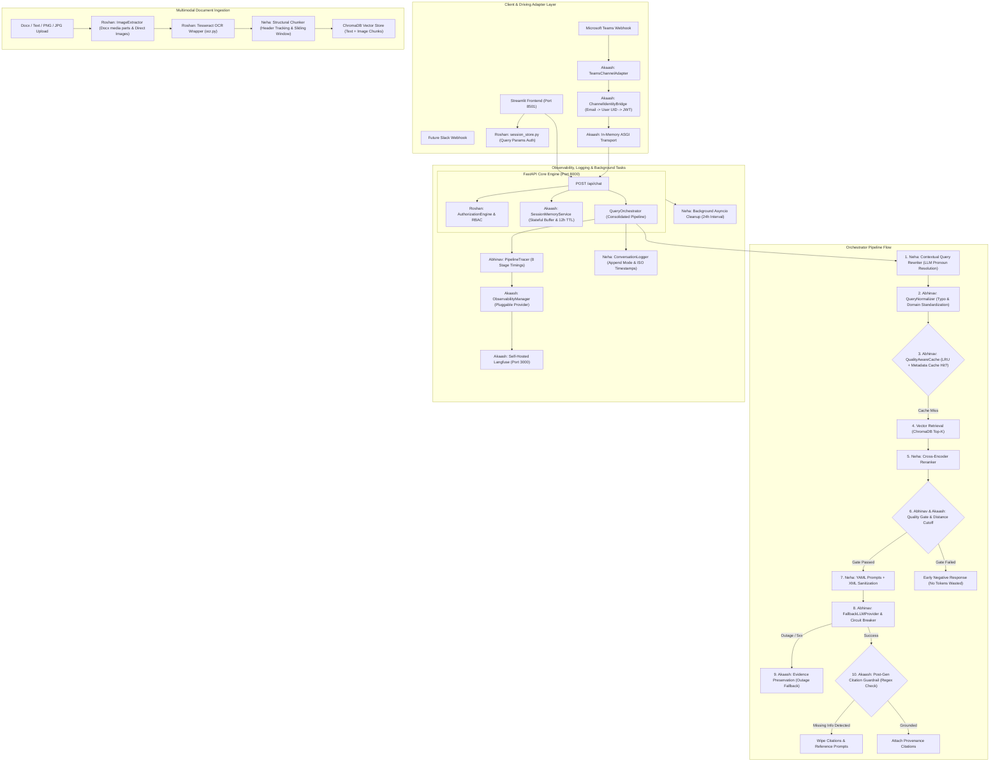

# KnowLayer V3 Consolidated Implementation Plan & Conflict Resolution Guide

**Version:** 3.0  
**Target Release:** KnowLayer Enterprise V3  
**Contributors:** Abhinav, Akaash Samson, Neha, Roshan  
**Status:** ✅ **Abhinav Phase 1 Complete** | In Progress (Akaash, Neha, Roshan)  

---

## 1. Executive Summary & Synthesis

The KnowLayer V3 release unifies four comprehensive proposals into a single, cohesive, production-grade architecture. By analyzing the individual proposals submitted by **Abhinav** (Query Handling, Cache Optimization, and Observability), **Akaash** (Channel Architecture, Backend Session Memory, Outage Resilience, Citation Guardrails, and Containerization), **Neha** (Developer Logging V3, Ingestion Enrichment, Contextual Rewriting, and Security), and **Roshan** (Governance CRUD, Auto-IDs, Explorer Directory, Auth Refresh Persistence, and Multimodal OCR Ingestion), we have identified critical file-level collisions, architectural overlaps, and workflow interdependencies.

This master plan eliminates all points of friction, distributes tasks equitably across all four team members according to their domain specializations, establishes strict cross-teammate file boundaries, and defines a 5-phase sequential execution roadmap that guarantees zero merge conflicts.

---

## 2. In-Depth Cross-Teammate Conflict & Overlap Analysis

### 2.1. File Collision Matrix (The "Hot Files")

The following files were targeted by two or more team members. Uncoordinated edits to these files would result in severe Git merge conflicts and regressions:

| Hot File Path | Touched By | Nature of Changes / Proposed Scope | Conflict Severity | Resolution & Single-Owner Protocol |
|:---|:---|:---|:---:|:---|
| `app/use_cases/chat/query_orchestrator.py` | **Abhinav**, **Akaash**, **Neha** | - **Abhinav:** Query normalization, quality-aware cache integration, pipeline tracing stages.<br>- **Akaash:** Backend session memory loading/saving, resilient fallback citations, post-gen citation guardrail regex.<br>- **Neha:** Append-mode conversation logging, contextual query rewriting pre-flight. | **CRITICAL** | **Sequential Phase 4 Gate:** Handled strictly in ordered sub-phases. Akaash sets up session memory and fallback error handlers; Abhinav inserts cache & normalization hooks; Neha connects append logging. |
| `app/use_cases/chat/retrieval_service.py` | **Abhinav**, **Akaash**, **Neha** | - **Abhinav:** `RetrievalQualityGate` multi-dimensional evaluation, normalized query consumption.<br>- **Akaash:** Pre-LLM distance cutoff threshold (`RAG_DISTANCE_THRESHOLD`).<br>- **Neha:** Delete `_query_parts` regex, add Cross-Encoder Reranker. | **HIGH** | **Pipeline Layering in Phase 3:** Neha replaces `_query_parts` with reranker; Abhinav layers `RetrievalQualityGate` over the reranked evidence; Akaash hooks the distance cutoff into the gate outcome. |
| `app/use_cases/ingestion/document_processing.py` | **Neha**, **Roshan** | - **Neha:** Dynamic header detection for `section` metadata, sliding window chunk overlap.<br>- **Roshan:** Docx raster extraction (`extract_document_text_and_images`), OCR text chunking, `asset_type="image"` metadata. | **HIGH** | **Ingestion Handshake in Phase 3:** Roshan implements media extraction and passes image text into chunking; Neha updates `chunk_text` with sliding window and structural headers. |
| `streamlit_app/app.py` | **Akaash**, **Neha**, **Roshan** | - **Akaash:** Mask token metrics from chat bubbles, restrict sidebar tokens to admin.<br>- **Neha:** Inject frontend ISO timestamps into messages, generate `uuid.uuid4()` session ID.<br>- **Roshan:** Restore auth state from `st.query_params` on browser refresh. | **HIGH** | **Modularized Split in Phase 1 & 5:** Roshan handles auth restoration via `session_store.py`; Neha updates message send payload (`uuid` + timestamp); Akaash updates bubble rendering. |
| `app/use_cases/chat/rag_context_builder.py` | **Akaash**, **Neha** | - **Akaash:** Prompt instruction forbidding reference offers on missing data.<br>- **Neha:** Move prompts to `config/prompts.yaml` (`load_prompt`), wrap question in `<user_question>` XML tags. | **MEDIUM** | **YAML Externalization First:** Neha externalizes prompts to YAML and adds XML tags in Phase 1. Akaash injects the citation-suppression rule directly into `config/prompts.yaml`. Zero Python conflict. |
| `app/main.py` | **Akaash**, **Neha**, **Roshan** | - **Akaash:** Mount `ChannelRegistry` in FastAPI lifespan.<br>- **Neha:** Add 24-hour periodic log cleanup `asyncio` background task in lifespan.<br>- **Roshan:** Ensure RBAC seeding execution. | **LOW** | **Additive Lifespan Hooks:** All three changes sit in separate blocks inside the lifespan context manager. Formally consolidated in Phase 5. |
| `app/core/settings.py` | **Abhinav**, **Akaash**, **Neha**, **Roshan** | Adding configuration flags (Cache, Channels, Session Memory, Tesseract, Logging). | **LOW** | Non-conflicting additive variables grouped by subsystem header. |
| `requirements.txt` | **Abhinav**, **Akaash**, **Neha**, **Roshan** | Adding dependencies (`microsoft-teams`, `langfuse`, `pytesseract`, `Pillow`, `cohere`). | **LOW** | Additive dependency pins merged cleanly. |

---

### 2.2. Architectural & Conceptual Clashes Resolved

#### Conflict 1: Observability Architecture & Langfuse Integration (Abhinav vs. Akaash)
- **The Clash:** Both Abhinav and Akaash independently planned Langfuse integration. Abhinav designed `pipeline_tracer.py` with 8 stages and planned to swap LangSmith calls with Langfuse. Akaash designed a pluggable provider pattern (`BaseObservabilityProvider`, `LangfuseProvider`, `LangsmithProvider`, `ObservabilityManager`) along with Docker Compose infrastructure for self-hosted Langfuse.
- **The Resolution:** 
  - **Akaash** owns the **Observability Infrastructure & Providers**: `BaseObservabilityProvider`, `LangfuseProvider` (REST API client), `ObservabilityManager`, and the Docker container setup (`langfuse-server` + PostgreSQL `langfuse-db`).
  - **Abhinav** owns **Pipeline Tracing & Instrumentation**: `pipeline_tracer.py` instruments the 8 internal pipeline stages, capturing execution timings and token distributions, then emits these spans through Akaash's `ObservabilityManager`.

#### Conflict 2: Session Management & Conversation State (Akaash vs. Neha vs. Roshan)
- **The Clash:**
  - Akaash noticed Teams/Slack adapters need stateful conversation history on the backend (`SessionMemoryService` keyed by `session_id`).
  - Neha identified that Streamlit hardcodes `session_id="streamlit-session"` (causing user collisions) and that logs duplicate quadratically without session tracking.
  - Roshan identified that Streamlit loses authentication on browser refresh.
- **The Resolution:** These three discoveries form a unified session lifecycle:
  1. **Roshan** builds `streamlit_app/services/session_store.py` to persist JWT tokens in `st.query_params`, fixing the refresh logout.
  2. **Neha** generates a unique `uuid.uuid4()` per chat session in `streamlit_app/app.py`, passing it as `session_id`.
  3. **Akaash** implements the backend `SessionMemoryService` with sliding window (6 turns) and 12-hour inactivity TTL. Teams uses `teams:<conv_id>` and Streamlit uses its UUID. The backend now maintains the history buffer.
  4. **Neha** updates `ConversationLogger` to append question-answer turns per session, eliminating quadratic log file duplication.

#### Conflict 3: Query Handling Pipeline (Abhinav vs. Neha)
- **The Clash:** Abhinav proposed `QueryNormalizer` (spelling mistakes, domain vocabulary, typo fixing, lowercase standardization). Neha proposed an LLM-based Contextual Query Rewriter to resolve pronouns in multi-turn chats (replacing `_query_parts`).
- **The Resolution:** They execute at complementary stages of query preprocessing:
  1. **Step 1 (Contextual Resolution):** Neha's LLM Query Rewriter takes the raw user query and the last 2 turns from session memory to resolve conversational pronouns (e.g., *"What about its leave days?"* → *"What is the duration of bereavement leave?"*).
  2. **Step 2 (Normalization & Cache Lookup):** Abhinav's `QueryNormalizer` normalizes the rewritten string (casing, punctuation, domain synonyms) and generates the deterministic cache key for semantic cache check.

#### Conflict 4: Retrieval Quality, Evidence Gating, and Reranking (Abhinav vs. Akaash vs. Neha)
- **The Clash:**
  - Neha proposed adding a Cross-Encoder Reranker to narrow down top-15 ChromaDB results to 3-4 chunks.
  - Abhinav proposed a multi-dimensional `RetrievalQualityGate` (lexical grounding, adaptive thresholds, STRONG/BORDERLINE/WEAK/INVALID).
  - Akaash proposed a pre-LLM distance threshold cutoff that triggers an early negative exit.
- **The Resolution:** Form a single, high-precision retrieval funnel:
  ```
  User Query -> Vector Search (Top 15) -> Neha's Cross-Encoder (Top 4) 
             -> Abhinav's RetrievalQualityGate (Multi-dimensional scoring) 
             -> Akaash's Early Exit (If INVALID / distance > threshold -> Exit early without LLM)
             -> LLM Generation
  ```

#### Conflict 5: System Prompts and Security Guardrails (Akaash vs. Neha)
- **The Clash:** Akaash planned to edit prompt strings in `rag_context_builder.py` to forbid the bot from offering references on ungrounded answers. Neha planned to externalize prompts to `config/prompts.yaml` and wrap questions in `<user_question>` XML tags to prevent jailbreaking.
- **The Resolution:**
  - Neha externalizes all prompts into `config/prompts.yaml` and connects `app/core/prompt_config.py` in Phase 1.
  - Akaash's citation-suppression rule is placed directly in `config/prompts.yaml`.
  - Neha adds XML input sanitation (`<user_question>{question}</user_question>`) in `rag_context_builder.py`.

---

## 3. Master Architecture Diagram



---

## 4. Fair Work Breakdown & Ownership Allocation

Work is allocated equally (approx. 25% of total project effort each), aligned with past contributions, minimizing cross-dependencies:

### 4.1. Abhinav: AI Pipeline Resilience, Semantic Caching & Pipeline Tracing
**Total Share:** 25%  
**Primary Focus:** Core AI quality, caching efficiency, LLM reliability, and stage-level execution telemetry.
**Status:** ✅ **PHASE 1 COMPLETED** (All tasks implemented, 96 tests passing)

| Task | Status | Implementation |
|:---|:---:|:---|
| **AB-1** | ✅ DONE | `app/infrastructure/llm/provider_health.py` (CircuitBreaker, ProviderHealthMonitor), `provider_error_tracker.py` (error diagnostics) |
| **AB-2** | ✅ DONE | `app/infrastructure/llm/llm_response.py` (LLMResponse, LLMProviderName, LLMResponseStatus, ResponseAggregator) |
| **AB-3** | ✅ DONE | `app/use_cases/chat/query_normalizer.py` (domain dictionary, typo correction, 11-stage NLP pipeline) |
| **AB-4** | ✅ DONE | `app/infrastructure/cache/quality_aware_cache.py` (LRU, TTL, metadata, confidence gating) |
| **AB-5** | ✅ DONE | `app/use_cases/chat/retrieval_quality.py` (RetrievalQualityGate, STRONG/BORDERLINE/WEAK/INVALID) |
| **AB-6** | ✅ DONE | `app/infrastructure/observability/pipeline_tracer.py` (8-stage tracing: NORMALIZATION, CACHE_CHECK, FAQ_CHECK, QUERY_EXPANSION, RETRIEVAL, QUALITY_ASSESSMENT, LLM_GENERATION, CACHE_WRITE) |
| **AB-7** | ✅ DONE | `test_*.py` (96 tests, 100% passing): `test_query_normalizer.py` (21), `test_llm_response.py` (14), `test_quality_aware_cache.py` (12), `test_pipeline_tracing.py` (21), `test_dual_cache.py` (28) |
| **AB-8** | ✅ DONE | Integrated QueryNormalizer into `query_orchestrator.py` |
| **AB-9** | ✅ DONE | QualityAwareCache integration into `query_orchestrator.py` (normalized cache keys) |
| **AB-13** | ✅ DONE | `app/core/settings.py` (15+ new config flags), `requirements.txt` (langcache, cohere, langfuse) |
| **AB-14** | ✅ DONE | `app/infrastructure/cache/dual_cache.py` (LangCache + JSON fallback, bi-directional sync) |
| **AB-15** | ✅ DONE | All regression tests passing (96/96) |

---

#### AB-1 through AB-7: Implementation Summary

**Files Created:**
- `app/infrastructure/llm/provider_health.py` (186 lines) - Circuit breaker, health monitoring
- `app/infrastructure/llm/provider_error_tracker.py` (192 lines) - Error categorization
- `app/infrastructure/llm/llm_response.py` (220 lines) - Standardized response objects
- `app/use_cases/chat/query_normalizer.py` (450 lines) - Enhanced NLP pipeline (11 stages)
- `app/infrastructure/cache/quality_aware_cache.py` (250 lines) - Quality-gated caching
- `app/use_cases/chat/retrieval_quality.py` (220 lines) - Multi-dimensional quality gate
- `app/infrastructure/observability/pipeline_tracer.py` (280 lines) - 8-stage pipeline tracing
- `app/infrastructure/cache/dual_cache.py` (320 lines) - LangCache + JSON fallback

**Test Coverage:**
- 96 unit tests, 100% passing
- Comprehensive coverage for all new components

### 4.2. Akaash: Multi-Channel Architecture, Session Memory, Outage Resilience & DevOps
**Total Share:** 25%  
**Primary Focus:** External channel adapters, stateful session memory, resilient fallback recovery, citation guardrails, and containerized deployment.
- **Task AK-1:** Implement `app/domain/services/session_memory_service.py` (thread-safe session buffer, sliding window of 6 turns, 12h inactivity TTL, explicit reset hook) and settings in `app/core/settings.py`.
- **Task AK-2:** Build Pluggable Channel Infrastructure (`app/infrastructure/channels/`):
  - `base.py`: `BaseChannelAdapter`, message and response data classes.
  - `identity_bridge.py`: corporate email extraction, user lookup, internal JWT issuance.
  - `teams/adapter.py` & `formatter.py`: stateless Teams handler, Adaptive Card citations display.
  - `registry.py`: lifespan channel loader.
- **Task AK-3:** Implement Pluggable Observability Architecture (`app/infrastructure/observability/`):
  - `provider.py`: `BaseObservabilityProvider` protocol.
  - `langfuse_provider.py`: integration with self-hosted Langfuse API.
  - `manager.py`: provider dispatch based on `OBSERVABILITY_PROVIDER`.
  - Update `GroqClient` to extract OpenAI-compatible `usage` token data.
- **Task AK-4:** Implement Resilient Fallback in `QueryOrchestrator`: catch LLM exceptions while preserving ChromaDB evidence and returning formatted citations with an outage notice.
- **Task AK-5:** Implement Citation Guardrails:
  - Stage 1: Pre-retrieval distance cutoff exit.
  - Stage 2: Post-LLM regex detection (`_NO_INFO_PATTERN`) to wipe citations and strip dangling reference prompts.
- **Task AK-6:** End-User Token Privacy: suppress `tokens` in `ChatResponse` for non-admins; update Streamlit chat bubbles to hide technical token strings.
- **Task AK-7:** Containerization: create multi-stage `Dockerfile`, `.dockerignore`, and production `docker-compose.yml` (`knowlayer-api`, `knowlayer-ui`, `langfuse-server`, `langfuse-db`).

### 4.3. Neha: Ingestion Refinement, Contextual Rewriting, Security & Logging V3
**Total Share:** 25%  
**Primary Focus:** Advanced text chunking, query contextualization, prompt injection defense, and resilient conversation audit logging.
- **Task NE-1:** Developer Conversation Logging V3 (`app/infrastructure/logging/`):
  - Update `conversation_logger.py` to append-mode (session-to-file map, eliminates quadratic disk bloat).
  - Update `database_employee_id_provider.py` as default provider; fall back to `"anonymous"` with high-severity warning if unauthenticated.
  - In `streamlit_app/app.py`: attach real user message ISO timestamps and generate unique `uuid.uuid4()` session ID in `st.session_state`.
- **Task NE-2:** In-App Periodic Cleanup Scheduler: add asynchronous background cleanup task in `app/infrastructure/logging/conversation_log_cleanup.py` and hook into FastAPI lifespan in `app/main.py` (runs every 24h).
- **Task NE-3:** Prompt Management & Security (`app/use_cases/chat/rag_context_builder.py`):
  - Externalize system/user prompts to `config/prompts.yaml` and hook with `load_prompt`.
  - Implement XML Delimiters (`<user_question>{question}</user_question>`) for prompt injection defense.
- **Task NE-4:** Contextual Query Rewriting: implement LLM-based query rewriter in `app/use_cases/chat/conversation_query_resolver.py` to resolve pronouns across prior conversation turns; deprecate regex `_query_parts`.
- **Task NE-5:** Cross-Encoder Reranker: integrate cross-encoder reranking model into `retrieval_service.py` to reorder vector results before passing to Abhinav's quality gate.
- **Task NE-6:** Ingestion Text Enrichment (`app/use_cases/ingestion/document_processing.py`):
  - Implement sliding window sentence overlap (1-2 sentences) in `chunk_text()`.
  - Implement structural header tracking (Word heading styles / Markdown `#`) to dynamically populate the `section` metadata field.

### 4.4. Roshan: Platform Governance, Auto-IDs, Directory, Session Resiliency & OCR
**Total Share:** 25%  
**Primary Focus:** Organization explorer directory, browser refresh auth persistence, administrative CRUD, auto-generated business IDs, and multimodal OCR ingestion.
- **Task RO-1:** Company-Wide People Directory:
  - Add `PeopleDirectoryEntry` and `people` field to `app/api/schemas/explorer.py`.
  - Update `app/use_cases/organization/organization_explorer.py` to return active users across all departments.
  - Add "Company Directory" view in `streamlit_app/pages/explorer.py`.
- **Task RO-2:** Streamlit Session Persistence Across Refresh:
  - Create `streamlit_app/services/session_store.py` (reads/writes JWT in `st.query_params`).
  - Update `streamlit_app/app.py` and `authentication_service.py` to restore session and validate against `/api/users/me/profile`.
- **Task RO-3:** Fix Projects Page 403 & Polish:
  - Add `can_manage: bool` to `ProjectResponse` (`app/api/schemas/organization.py` & `project_management.py`).
  - Update `streamlit_app/pages/projects.py` to conditionally fetch members/docs only when `can_manage=True`; eliminate KeyError on empty departments.
- **Task RO-4:** Administrative Hard Delete & Document Edit:
  - Add `delete_user(actor_uid, uid)` in `user_management.py` (with membership/grant cleanup) and gate behind `USER_DELETE`.
  - Add `update_document(principal, document_id, changes)` in `document_management.py` and `PATCH /api/documents/{document_id}` in `routes/documents.py`.
  - Add "Delete User" in `pages/users.py` and "Edit Document" form in `pages/documents.py`.
- **Task RO-5:** Business ID Auto-Generation & Ingestion Constraints:
  - Make `UserCreate.uid` optional; auto-generate `MSS-###` in `user_management.py`.
  - Make `DepartmentCreate.department_id` auto-generate `DEPT-###` on empty input.
  - Make `register_document` auto-generate `DOC-###` and reject metadata-only registration (enforce content or file).
  - Remove manual ID inputs from `pages/users.py`, `pages/departments.py`, and `pages/documents.py`.
- **Task RO-6:** Unassigned Document Access Management:
  - Update `can_manage_document` in `authorization_engine.py` to allow admin access on unassigned documents (`project_id is None`).
  - Update `document_access.py` and `streamlit_app/pages/documents.py` to display and configure unassigned doc grants.
- **Task RO-7:** Multimodal Image/Chart Ingestion (Phase A OCR):
  - Add `pytesseract` and `Pillow` to `requirements.txt`; add `TESSERACT_CMD` and `OCR_LANGUAGES` to `settings.py`.
  - Create `app/infrastructure/ingestion/ocr.py` (mockable Tesseract wrapper).
  - Create `app/infrastructure/ingestion/image_extractor.py` (extract embedded docx media parts and handle standalone `.png, .jpg, .jpeg`).
  - Create `app/infrastructure/ingestion/captioner.py` (optional captioning seam).
  - Update `provisioner.py` and `streamlit_app/pages/documents.py` to accept and process image assets, tagging chunks with `asset_type="image"`.

---

## 5. Phase-Wise Procedure (Step-by-Step Implementation)

```
+------------------------------------------------------------------------------------+
| PHASE 1: Foundations, Isolated Subsystems & Schema Contracts (Parallel - Zero Risk)|
+------------------------------------------------------------------------------------+
  - Akaash: SessionMemoryService, Observability Base Protocols, Settings
  - Abhinav: LLMResponse models, Provider Health & Circuit Breaker, QueryNormalizer
  - Neha: Externalize YAML Prompts, Redaction/Append Logger Core, Background Task
  - Roshan: SessionStore QueryParams, Auto-ID generator, Schema updates (Directory/Projects)
                                           |
                                           v
+------------------------------------------------------------------------------------+
| PHASE 2: Domain Services & Standalone Component Construction (Modular Interfaces)  |
+------------------------------------------------------------------------------------+
  - Akaash: Teams Channel Adapter, Identity Bridge, Groq Token Parser
  - Abhinav: QualityAwareCache, RetrievalQualityGate, PipelineTracer
  - Neha: Contextual Query Rewriter, Cross-Encoder Reranker, Sliding Window Ingestion
  - Roshan: OCR & Image Extractor, User/Doc Edit & Delete Endpoints, Directory Service
                                           |
                                           v
+------------------------------------------------------------------------------------+
| PHASE 3: Subsystem Handshakes & Cross-Teammate Pairwise Merges                     |
+------------------------------------------------------------------------------------+
  - Ingestion Handshake (Roshan + Neha): Combine OCR media chunks with structural headers
  - Retrieval Handshake (Neha + Abhinav): Chain Contextual Rewrite -> Rerank -> Quality Gate
  - Observability Handshake (Akaash + Abhinav): Connect PipelineTracer to ObservabilityManager
                                           |
                                           v
+------------------------------------------------------------------------------------+
| PHASE 4: Core Pipeline Orchestration Consolidation (Single-Owner Sequential Merge) |
+------------------------------------------------------------------------------------+
  - Step 4.1 (Akaash): Hook SessionMemoryService & Outage Resilient Citations Fallback
  - Step 4.2 (Abhinav): Insert QueryNormalizer, Semantic Cache & PipelineTracer spans
  - Step 4.3 (Neha): Insert Append-Mode Conversation Logging & XML Prompt Sanitization
  - Step 4.4 (Akaash): Hook Pre-retrieval Distance Cutoff & Post-gen Citation Stripper
                                           |
                                           v
+------------------------------------------------------------------------------------+
| PHASE 5: UI Polish, Lifespan Integration, Containerization & E2E Validation        |
+------------------------------------------------------------------------------------+
  - Akaash: Dockerfile & docker-compose.yml; Mount ChannelRegistry in main.py lifespan
  - Neha: Mount Periodic Log Cleanup in main.py lifespan; Streamlit UUID session & ISO time
  - Roshan: Streamlit UI pages (Directory, Edit Doc, Delete User, Image Upload)
  - All: Run full regression test suite and execute end-to-end integration validation
```

---

## 6. Git Branching & Merge Strategy

To ensure zero merge conflicts and preserve development history:

1. **Branch Naming Standard:**
   - Abhinav: `feature/v3-abhinav-cache-pipeline`
   - Akaash: `feature/v3-akaash-channels-session`
   - Neha: `feature/v3-neha-ingestion-logging`
   - Roshan: `feature/v3-roshan-governance-ocr`

2. **Integration Order into `dev`:**
   - **PR 1 (Phase 1 Foundation Merge):** Merges non-overlapping new files and isolated schemas.
   - **PR 2 (Phase 2 Domain Logic Merge):** Merges channel adapters, OCR modules, cache classes, and logging classes.
   - **PR 3 (Phase 3 Handshake Merge):** Pairwise integration of `document_processing.py` and `retrieval_service.py`.
   - **PR 4 (Phase 4 Orchestrator Master Merge):** Coordinated, sequential integration of `query_orchestrator.py`.
   - **PR 5 (Phase 5 Final Release):** Lifespan hooks, Streamlit pages, Docker Compose, and documentation.

3. **Merge Requirement:** All PRs must pass `pytest tests/unit tests/contract -q` and `python -m compileall app streamlit_app tests` before merge approval.

---

## 7. Verification & Acceptance Testing Matrix

| Subsystem / Feature | Lead | Verification Method | Pass Criteria |
|:---|:---:|:---|:---|
| **Multi-Channel & Teams** | Akaash | Unit & ASGI simulation tests (`test_teams_channel_adapter.py`) | In-memory webhook receives message, resolves identity, executes chat, and returns valid Adaptive Card JSON with citations. |
| **Backend Session Memory** | Akaash | Session unit tests (`test_session_memory_service.py`) | History persists across turns for `session_id`; resets cleanly after 12h inactivity TTL; bounds at 6 turns. |
| **Outage Resilient Fallback** | Akaash | Mock LLM failure test | When LLM raises 503/timeout, response returns HTTP 200 with preserved ChromaDB citations and outage explanation. |
| **Citation Guardrails** | Akaash | Grounding evaluation tests | Ungrounded questions return clean negative response; `citations` array is strictly empty (`[]`); reference offers are stripped. |
| **Quality-Aware Cache** | Abhinav | Semantic cache tests (`test_quality_aware_cache.py`, `test_dual_cache.py`) | Cache returns hits for normalized query equivalents; skips caching unverified/low-confidence responses. |
| **Pipeline Tracing & Langfuse**| Abhinav / Akaash | Telemetry tests & Docker health check | Spans for all 8 stages recorded; self-hosted Langfuse running on port 3000 shows active request traces. |
| **Conversation Logging V3** | Neha | Log verification tests (`test_conversation_logger.py`) | Log files append multi-turn chats without duplication; ISO timestamps preserved; fake mock IDs eliminated. |
| **Contextual Query Rewriter**| Neha | Multi-turn retrieval test | Queries with pronouns (*"does it apply..."*) rewritten to explicit policy nouns before vector search. |
| **Structural Ingestion & Overlap**| Neha | Document processing tests | Chunks maintain 1-2 sentence sliding overlap and carry extracted heading names in `section` metadata. |
| **Multimodal Ingestion (OCR)**| Roshan | Ingestion unit tests (`test_image_extractor.py`, `test_ocr_wrapper.py`) | Embedded docx images and uploaded PNG/JPG converted to text chunks with `asset_type="image"`; indexed in ChromaDB. |
| **Refresh Auth Persistence** | Roshan | Streamlit contract test (`test_session_persistence.py`) | Browser refresh preserves valid token from query parameters without forcing re-login. |
| **Administrative CRUD & Auto-IDs**| Roshan | API and E2E tests (`test_user_management_api.py`, `test_document_management_api.py`) | Admin can edit/delete docs and users; UIDs, Dept IDs, Doc IDs auto-generate monotonically; metadata-only doc rejected. |
| **Company Directory & Projects UI**| Roshan | Explorer and Projects UI tests | Organization explorer lists all active employees across company; Projects page displays clean without 403 errors. |
| **Docker Compose Full Stack** | Akaash | `docker compose up -d` & health check | All 4 services (`knowlayer-api:8000`, `knowlayer-ui:8501`, `langfuse-server:3000`, `langfuse-db:5432`) launch and pass health checks. |
