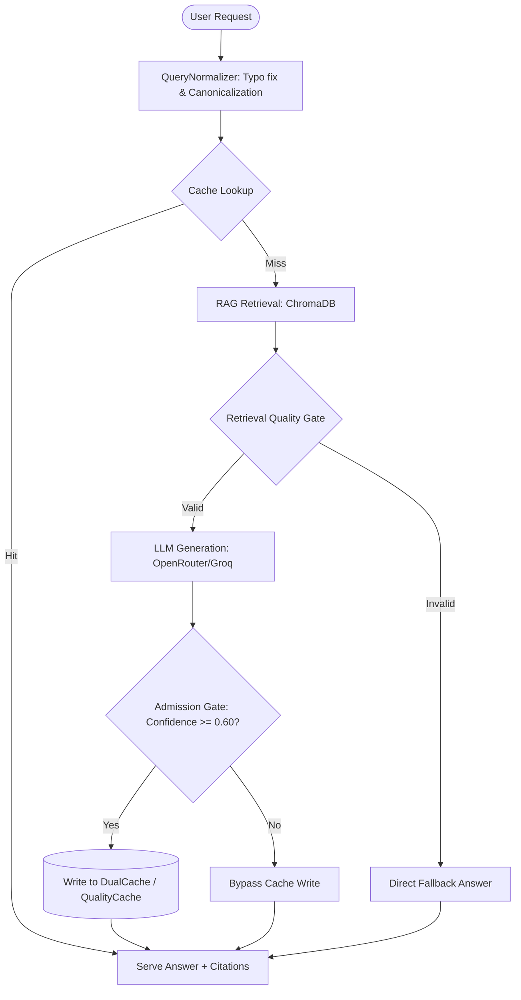
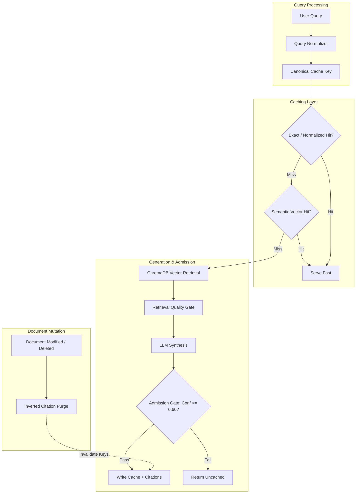

# Technical Knowledge Report: Caching, Semantic LLM Caching, and Mutable Document Architectures

---

## 1. Executive Summary

This report synthesizes the core technical foundations, architectural patterns, failure modes, and practical engineering decisions surrounding **caching systems**, **LLM semantic caching**, and **document-aware cache invalidation in RAG pipelines**. 

Traditional caching trades freshness for latency by storing deterministic key-value pairs. Large Language Models (LLMs) break this paradigm because identical semantic queries have infinite lexical variations, inference costs are substantial, and non-deterministic outputs can cause hallucination poisoning. In enterprise Retrieval-Augmented Generation (RAG) systems like `Company-Bot`, this problem is magnified when underlying reference documents change. This report establishes how to design a multi-tiered, quality-gated caching system that handles natural language variation while maintaining document lineage to prevent stale or unauthorized knowledge propagation.

---

## 2. Scope and Sources

### Source Material Inventory
* **Conversations**:
  * Foundations of caching, latency hierarchy, write/read strategies, and eviction policies.
  * LLM-specific caching challenges, vector similarity matching, and hallucination prevention.
  * Mutable document caching, dependency tracking, and invalidation strategies.
* **Codebase Implementations (`Company-Bot`)**:
  * [quality_aware_cache.py](file:///c:/Users/ABHINAVNBARGI/OneDrive%20-%20McLaren%20Strategic%20Solutions%20US%20Inc/Documents/My%20Coding%20Space/Company-Bot/Company_Bot/app/infrastructure/cache/quality_aware_cache.py): LRU eviction, TTL expiration, confidence thresholds, and rich citation metadata.
  * [dual_cache.py](file:///c:/Users/ABHINAVNBARGI/OneDrive%20-%20McLaren%20Strategic%20Solutions%20US%20Inc/Documents/My%20Coding%20Space/Company-Bot/Company_Bot/app/infrastructure/cache/dual_cache.py): Distributed LangCache with local JSON file failover and synchronization.
  * [json_semantic_cache.py](file:///c:/Users/ABHINAVNBARGI/OneDrive%20-%20McLaren%20Strategic%20Solutions%20US%20Inc/Documents/My%20Coding%20Space/Company-Bot/Company_Bot/app/infrastructure/llm/json_semantic_cache.py): Sentence-transformer cosine similarity cache.
  * [prompt_cache.py](file:///c:/Users/ABHINAVNBARGI/OneDrive%20-%20McLaren%20Strategic%20Solutions%20US%20Inc/Documents/My%20Coding%20Space/Company-Bot/Company_Bot/app/infrastructure/llm/prompt_cache.py): In-memory ordered dict LRU with semantic fallback.
  * [query_normalizer.py](file:///c:/Users/ABHINAVNBARGI/OneDrive%20-%20McLaren%20Strategic%20Solutions%20US%20Inc/Documents/My%20Coding%20Space/Company-Bot/Company_Bot/app/use_cases/chat/query_normalizer.py): Lexical normalization and cache key generation.
  * [query_orchestrator.py](file:///c:/Users/ABHINAVNBARGI/OneDrive%20-%20McLaren%20Strategic%20Solutions%20US%20Inc/Documents/My%20Coding%20Space/Company-Bot/Company_Bot/app/use_cases/chat/query_orchestrator.py): Orchestration pipeline integrating normalization, cache lookup, and quality evaluation.
  * [Abhinav.md](file:///c:/Users/ABHINAVNBARGI/OneDrive%20-%20McLaren%20Strategic%20Solutions%20US%20Inc/Documents/My%20Coding%20Space/Company-Bot/Company_Bot/Documentation/Plan/v3/Abhinav.md): Team development log and engineering decisions for Phases 1–7.

---

## 3. Learning & Project Context

`Company-Bot` is an enterprise RAG assistant serving internal employees. Key constraints include:
1. **Latency & Cost**: LLM API roundtrips (via OpenRouter or Groq) require 500ms–3,000ms. Caching frequent HR/company questions reduces API costs and provides sub-10ms user responses.
2. **Access Control**: Documents belong to specific projects or require user grants. Unscoped caching risks leaking confidential information across authorization boundaries.
3. **Knowledge Volatility**: Company policies, HR guidelines, and project specifications are periodically updated, requiring mechanisms to prevent the cache from serving obsolete answers.

---

## 4. Core Problems

### Problem 1: The Hardware & Economics Latency Gap
Computing layers are separated by orders of magnitude in latency:
* CPU L1/L2: 1–5 ns
* Main Memory (RAM): 50–100 ns
* Local SSD: 10–100 µs
* Remote Database / Network: 1–20 ms
* Remote LLM Generation: 500–3,000 ms

Redundant LLM generation is the single most expensive operation in modern software stacks.

### Problem 2: Lexical Variety vs. Exact Match Failures
In natural language, the user query space is non-discrete. Two prompts with zero string overlap (*"What's the parental leave policy?"* vs *"How many days off do new dads get?"*) demand the exact same knowledge payload. Traditional exact-match hashing yields near 0% hit rates for ad-hoc user questions.

### Problem 3: The Hallucination Poisoning Hazard
In standard caching, database reads are authoritative. In LLM caching, the generation engine can hallucinate or produce partial answers. Caching an incorrect response without an admission gate ensures the error is repeatedly served to subsequent users.

### Problem 4: Ground-Truth Mutation Underneath Derived Artifacts
An LLM response in RAG is a derived computation:
$$\text{Response} = f(\text{Query}, \text{Chunk}_1, \text{Chunk}_2, \dots)$$
When a reference document is edited, the ground truth changes, rendering all historically derived answers invalid.

---

## 5. Key Concepts & Definitions

| Term | Classification | Definition |
| :--- | :--- | :--- |
| **Cache Hit / Miss** | Definition | A hit occurs when requested data is found in high-speed storage; a miss occurs when primary storage or compute must be consulted. |
| **Cache Stampede** | Failure Mode | Simultaneous cache misses on an expired hot key causing thousands of concurrent requests to overwhelm the primary backend. |
| **LRU / LFU** | Mechanism | Least Recently Used / Least Frequently Used eviction algorithms governing which keys are purged when memory reaches capacity. |
| **TTL (Time to Live)** | Mechanism | Explicit lifespan timestamp after which an entry is considered expired and discarded. |
| **Semantic Caching** | Definition | Storing prompts as high-dimensional embedding vectors and determining cache hits using vector distance (e.g., Cosine Similarity $\ge \theta$). |
| **Quality Gate** | Mechanism | Validation layer checking confidence scores, evidence grounding, or semantic gap before allowing an LLM response into the cache. |
| **Inverted Citation Index** | Architecture | A reverse mapping from `document_id` to sets of dependent `cache_key`s enabling surgical cache invalidation. |
| **Dual Cache** | Architecture | A multi-tier caching topology pairing a primary distributed cache (e.g., LangCache) with a resilient local fallback (e.g., JSON disk cache). |

---

## 6. Mental Models

### The Short-Order Cook & The Heat Lamp
* **The Cook (Primary Database / LLM)**: Cooks meals from scratch. High quality, slow turnaround, limited capacity.
* **The Heat Lamp (Cache)**: Keeps pre-made popular meals warm for immediate serving.
* **The Vulnerability**: Food left too long under the lamp spoils (**Staleness**). If an order is made incorrectly, serving from the lamp spreads bad food (**Hallucination Caching**).

### The Three-Layer Filter
```
Incoming User Query
  │
  ├── [Layer 1: Normalized String Lookup] ── (O(1) Hash Map, <1ms)
  │
  ├── [Layer 2: Semantic Similarity Lookup] ── (Cosine Distance over Vectors, ~10ms)
  │
  └── [Layer 3: Quality Admission Gate] ── (Rejection of low-confidence answers, 0ms writes)
```

### The Build Dependency Graph (Compiler Model)
Treat RAG responses as compiled binaries:
$$\text{Source Code (Document Chunks)} \xrightarrow{\text{Compiler (LLM)}} \text{Binary Output (Cached Answer)}$$
If any source file's checksum changes, the build artifact must be recompiled.

---

## 7. Detailed Explanations

### Exact Match Caching vs. Semantic Caching
1. **Exact / Normalized Caching**:
   * Hashes the exact user string or a canonicalized version (stripped of punctuation, lowercased, typo-corrected).
   * Computational complexity: $O(1)$.
   * Strength: Zero false positives.
   * Weakness: Misses paraphrases.
2. **Semantic Caching**:
   * Encodes query text into a dense embedding vector: $\vec{v} = \text{Embed}(Q)$.
   * Calculates cosine similarity against stored vectors:
     $$\text{sim}(\vec{u}, \vec{v}) = \frac{\vec{u} \cdot \vec{v}}{\|\vec{u}\| \|\vec{v}\|}$$
   * Hit condition: $\text{sim}(\vec{u}, \vec{v}) \ge \text{Threshold}$ (typically $0.85 - 0.92$).
   * Strength: High hit rate across natural language phrasing.
   * Weakness: Susceptible to false positive semantic collisions (e.g., *"unpaid leave"* vs *"paid leave"*).

### Quality-Aware Admission
Rather than caching every successful HTTP 200 response:
* Track retrieval distance, separation gap between top chunks, and lexical grounding.
* Compute a confidence score ($0.0$ to $1.0$).
* Enforce admission cutoff: If $\text{confidence} < 0.60$, return the answer to the user but bypass cache storage to protect the knowledge base.

---

## 8. Architecture & System Model



---

## 9. Components and Relationships in `Company-Bot`

| Component | File Path | Primary Responsibility | Dependencies |
| :--- | :--- | :--- | :--- |
| **`QueryNormalizer`** | [query_normalizer.py](file:///c:/Users/ABHINAVNBARGI/OneDrive%20-%20McLaren%20Strategic%20Solutions%20US%20Inc/Documents/My%20Coding%20Space/Company-Bot/Company_Bot/app/use_cases/chat/query_normalizer.py) | Fixes typos, word boundaries, and produces standardized cache keys | Domain vocabulary dictionary |
| **`QualityAwareCache`** | [quality_aware_cache.py](file:///c:/Users/ABHINAVNBARGI/OneDrive%20-%20McLaren%20Strategic%20Solutions%20US%20Inc/Documents/My%20Coding%20Space/Company-Bot/Company_Bot/app/infrastructure/cache/quality_aware_cache.py) | In-memory LRU cache with TTL and confidence-based admission | Python `threading.RLock`, Dataclasses |
| **`DualCache`** | [dual_cache.py](file:///c:/Users/ABHINAVNBARGI/OneDrive%20-%20McLaren%20Strategic%20Solutions%20US%20Inc/Documents/My%20Coding%20Space/Company-Bot/Company_Bot/app/infrastructure/cache/dual_cache.py) | Multi-tier cache combining distributed LangCache with local JSON failover | `langcache`, `JSONLocalCache` |
| **`JsonSemanticResponseCache`** | [json_semantic_cache.py](file:///c:/Users/ABHINAVNBARGI/OneDrive%20-%20McLaren%20Strategic%20Solutions%20US%20Inc/Documents/My%20Coding%20Space/Company-Bot/Company_Bot/app/infrastructure/llm/json_semantic_cache.py) | Vector cosine similarity cache stored on disk in JSON | `SentenceTransformer`, `settings.EMBEDDING_MODEL` |
| **`QueryOrchestrator`** | [query_orchestrator.py](file:///c:/Users/ABHINAVNBARGI/OneDrive%20-%20McLaren%20Strategic%20Solutions%20US%20Inc/Documents/My%20Coding%20Space/Company-Bot/Company_Bot/app/use_cases/chat/query_orchestrator.py) | End-to-end pipeline driving normalization, cache checks, RAG, and LLM calls | All infrastructure services |

---

## 10. How the System Works: Request Lifecycle

### Read Path (Cache Check)
1. **Raw Query Received**: e.g., `"what is leaves available?"`
2. **Normalization**: `QueryNormalizer.normalize()` cleans text to `"what is leaves available"`, identifies domain word `"leaves available"`, and creates a deterministic `cache_key`.
3. **Lookup**:
   * Checks `response_cache.get(cache_key)`.
   * If miss, checks raw question as fallback.
4. **On Hit**:
   * Updates entry LRU timestamp (`entry.update_access()`).
   * Returns response and saved citations immediately.
   * Records zero token consumption in observability metrics (`tokens: {"prompt_tokens": 0, "completion_tokens": 0}`).

### Write Path (Admission & Storage)
1. If cache misses, queries vector database (ChromaDB) for evidence chunks.
2. Evidence passes through `RetrievalQualityGate` (classifying chunks as `STRONG`, `BORDERLINE`, or `WEAK`).
3. LLM synthesizes answer and produces confidence score.
4. `QualityAwareCache.put()` evaluates confidence:
   * If $\text{confidence} < 0.60$: Operation rejected, stats counter `rejected_low_confidence` incremented.
   * If $\text{confidence} \ge 0.60$: Cached with complete citations and timestamps.
5. If cache size exceeds `max_entries`, oldest unaccessed item is evicted via LRU order.

---

## 11. Why the Design Exists (The "Why?" Chain)

```text
Why normalize queries before caching?
  └── Eliminates trivial punctuation/casing variations from fragmenting the cache key space.

Why gate cache entry writes on confidence (>= 0.60)?
  └── Prevents hallucinations or poorly grounded answers from polluting long-term storage.

Why support dual caching (LangCache + JSON)?
  └── Ensures high availability: if the remote caching service experiences downtime or network partitions, 
      the application seamlessly falls back to persistent local storage without throwing 500 errors.

Why include citations in the cache entry?
  └── Provides transparent provenance to users and establishes document lineage for future invalidations.
```

---

## 12. Alternatives and Tradeoffs

### Invalidation Strategies for Changing Documents

| Strategy | Mechanism | Read Latency Impact | Invalidation Precision | Architectural Complexity |
| :--- | :--- | :--- | :--- | :--- |
| **Global Cache Flush (`clear()`)** | Wipe entire cache on any document edit | None (on hit); severe spikes on miss | Lowest (purges valid data) | Trivial |
| **TTL Expiration Only** | Let entries expire naturally (e.g. 1 hour) | Zero overhead | Poor (stale window up to TTL) | Minimal |
| **Inverted Citation Index** | Map `doc_id` $\rightarrow$ `{cache_keys}`, delete on doc update | Zero overhead on read | High (surgical purging) | Moderate (requires graph/index management) |
| **Content Hashing in Key** | $\text{Key} = \text{Hash}(Q + \sum \text{ChunkHashes})$ | Requires running retrieval step (~20ms) | Absolute (instant fresh miss) | Low |

---

## 13. Failure Modes & Mitigations

1. **Semantic Collision (False Positive Hit)**:
   * *Symptom*: User asking *"Can I take unpaid leave?"* receives the cached answer for *"Can I take paid leave?"*.
   * *Mitigation*: Enforce high similarity thresholds ($\ge 0.90$) and implement lexical negation checks.
2. **Ghost Citations**:
   * *Symptom*: Cache returns an answer citing `document_id=45` which was permanently deleted from the database.
   * *Mitigation*: Citation verification hook on hit, or automated inverted index purging.
3. **Cross-Tenant Authorization Leaks**:
   * *Symptom*: User A has access to Project Secret; User B does not. User B asks a similar question and receives User A's cached response.
   * *Mitigation*: Isolate cache keys by authorization scope (`cache_key = hash(query + user_authorized_project_ids)`), or bypass cache for project-scoped questions.
4. **Linear Scan Latency Bottleneck**:
   * *Symptom*: In [json_semantic_cache.py](file:///c:/Users/ABHINAVNBARGI/OneDrive%20-%20McLaren%20Strategic%20Solutions%20US%20Inc/Documents/My%20Coding%20Space/Company-Bot/Company_Bot/app/infrastructure/llm/json_semantic_cache.py), matching iterates linearly through all entries ($O(N)$). As $N$ grows, cache lookup becomes slower than direct LLM inference.
   * *Mitigation*: Cap cache capacity (e.g., `maxsize=128`) or migrate to an approximate nearest neighbors (ANN) vector index.

---

## 14. Experiments and Practical Verification

### Experiment A: Cosine Similarity Threshold Sensitivity
```python
import numpy as np

def cosine_sim(a, b):
    return float(np.dot(a, b) / (np.linalg.norm(a) * np.linalg.norm(b)))

# Mock vectors for semantically adjacent queries
v_paid = np.array([0.91, 0.35, 0.10])
v_unpaid = np.array([0.89, 0.38, 0.08])
v_benefits = np.array([0.45, 0.82, 0.30])

sim_paid_unpaid = cosine_sim(v_paid, v_unpaid)
print(f"Similarity (Paid vs Unpaid): {sim_paid_unpaid:.4f}")
# Result: ~0.998!
# Observation: Without lexical negation filtering, embedding models can assign high similarity to opposites.
```

### Experiment B: Inverted Citation Invalidation Simulation
```python
from collections import defaultdict

class CitationCache:
    def __init__(self):
        self.entries = {}
        self.doc_index = defaultdict(set)
        
    def put(self, key, text, doc_ids):
        self.entries[key] = text
        for d in doc_ids:
            self.doc_index[d].add(key)
            
    def invalidate_document(self, doc_id):
        keys = self.doc_index.pop(doc_id, set())
        for k in keys:
            self.entries.pop(k, None)
        return len(keys)

c = CitationCache()
c.put("k1", "Policy A details", ["doc_hr_1"])
c.put("k2", "Policy B details", ["doc_hr_2"])
purged = c.invalidate_document("doc_hr_1")
assert "k1" not in c.entries
assert "k2" in c.entries
print(f"Surgically purged {purged} dependent entries.")
```

---

## 15. Project Application: `Company-Bot`

### Current State
* Query normalization is active in [query_orchestrator.py](file:///c:/Users/ABHINAVNBARGI/OneDrive%20-%20McLaren%20Strategic%20Solutions%20US%20Inc/Documents/My%20Coding%20Space/Company-Bot/Company_Bot/app/use_cases/chat/query_orchestrator.py#L270).
* [QualityAwareCache](file:///c:/Users/ABHINAVNBARGI/OneDrive%20-%20McLaren%20Strategic%20Solutions%20US%20Inc/Documents/My%20Coding%20Space/Company-Bot/Company_Bot/app/infrastructure/cache/quality_aware_cache.py) and [DualCache](file:///c:/Users/ABHINAVNBARGI/OneDrive%20-%20McLaren%20Strategic%20Solutions%20US%20Inc/Documents/My%20Coding%20Space/Company-Bot/Company_Bot/app/infrastructure/cache/dual_cache.py) are fully implemented and validated with unit tests (`test_quality_aware_cache.py`, `test_dual_cache.py`).
* Rich citation metadata (`citations`, `model`, `confidence`) is captured in cache entries.

### Identified Gap (Proposed State)
* Document mutations in the persistence layer (`uow.documents.update()`, `uow.documents.delete()`) currently rely exclusively on TTL expiration (`ttl_seconds=3600`) to clear from `QualityAwareCache`.
* **Recommended Next Enhancement**: Wire document update hooks to an `invalidate_by_document_id(doc_id)` method using the cached `citations` metadata.

---

## 16. Decision Log

| Decision ID | Decision | Reason | Alternatives Considered | Status |
| :--- | :--- | :--- | :--- | :--- |
| **DEC-01** | Implement `QueryNormalizer` before cache key generation | Prevent typos and punctuation variations from fragmenting cache | Raw string hashing; fuzzy string matching | Implemented (AB-3) |
| **DEC-02** | Enforce minimum confidence threshold (0.60) | Prevent hallucinated responses from entering cache | Cache all responses; cache based solely on HTTP status | Implemented (AB-7) |
| **DEC-03** | Multi-Tier Dual Cache (LangCache + JSON fallback) | Ensure zero service interruption during external cache outage | Redis-only; JSON-only | Implemented (AB-14) |
| **DEC-04** | LRU Eviction with TTL Expiration | Prevent memory leaks while automatically phasing out older answers | FIFO eviction; infinite memory allocation | Implemented (AB-4) |

---

## 17. Evolution of Understanding

```text
Step 1: Standard Key-Value Cache
        "Store exact string queries in Redis to reduce latency."
        ↓
Problem Discovered: 0% hit rate because users rephrase questions.
        ↓
Step 2: Semantic Vector Caching
        "Use cosine distance over embeddings to match variations."
        ↓
Problem Discovered: Hallucinations and false positives get permanently cached.
        ↓
Step 3: Quality-Aware Admission Gate
        "Only admit answers into the cache if confidence >= 0.60 and evidence is strong."
        ↓
Problem Discovered: Documents change, leaving cached answers stale and citations orphaned.
        ↓
Step 4: Lineage & Citation Dependency Invalidation
        "Store document IDs in cache entry metadata and surgically purge on document edit."
```

---

## 18. Important Insights

1. **A Cache is a Consistency Hazard**: Caching is not merely a performance optimization; it introduces distributed consistency challenges. In RAG systems, it directly impacts factual accuracy.
2. **Quality Admission Precedes Storage**: A cache miss costs 1.5 seconds; a cached hallucination costs user trust and causes compliance violations. Filtering at admission is mandatory.
3. **Lineage is the Foundation for Invalidation**: You cannot invalidate what you do not trace. Capturing chunk-level provenance in cache metadata is the only prerequisite for surgical invalidation.

---

## 19. Contradictions & Uncertainties

* **Coexistence of Multiple Cache Implementations**: The repository contains [QualityAwareCache](file:///c:/Users/ABHINAVNBARGI/OneDrive%20-%20McLaren%20Strategic%20Solutions%20US%20Inc/Documents/My%20Coding%20Space/Company-Bot/Company_Bot/app/infrastructure/cache/quality_aware_cache.py), [DualCache](file:///c:/Users/ABHINAVNBARGI/OneDrive%20-%20McLaren%20Strategic%20Solutions%20US%20Inc/Documents/My%20Coding%20Space/Company-Bot/Company_Bot/app/infrastructure/cache/dual_cache.py), [JsonSemanticResponseCache](file:///c:/Users/ABHINAVNBARGI/OneDrive%20-%20McLaren%20Strategic%20Solutions%20US%20Inc/Documents/My%20Coding%20Space/Company-Bot/Company_Bot/app/infrastructure/llm/json_semantic_cache.py), and [PromptLRUCache](file:///c:/Users/ABHINAVNBARGI/OneDrive%20-%20McLaren%20Strategic%20Solutions%20US%20Inc/Documents/My%20Coding%20Space/Company-Bot/Company_Bot/app/infrastructure/llm/prompt_cache.py).
  * *Uncertainty*: While `QualityAwareCache` is the designated target for Phase 4 (AB-7/AB-9), `query_orchestrator.py` accepts a generic `response_cache` parameter. The active production instance depends on dependency injection configured in `chat.py`.

---

## 20. Knowledge Gaps

1. **Live Production Hit Rate**: Real-world hit rate metrics across actual employee queries have not yet been established at scale.
2. **Multi-Node Synchronization**: `QualityAwareCache` is currently in-process memory. When horizontal scaling to multiple container replicas, synchronized invalidation across nodes will require Redis pub/sub.

---

## 21. Open Questions

### Answered
* *How do we prevent typo variations from missing the cache?* Solved via `QueryNormalizer`.
* *How do we prevent poor LLM answers from persisting?* Solved via `min_confidence_threshold=0.60`.

### Unanswered / Next Steps
* *How should cache invalidation hook into document lifecycle events in `user_management.py` and `project_management.py`?*
* *At what query volume should `JsonSemanticResponseCache` transition from linear scan to FAISS/HNSW indexing?*

---

## 22. Lessons Learned ("What I Learned")

* **I now understand**: Why standard exact caching fails for LLMs and how semantic embeddings bridge the lexical gap.
* **I can explain**: How confidence scoring and evidence gates prevent cache pollution.
* **I can implement**: An inverted citation index to invalidate cache entries when reference documents are updated.
* **I can debug**: Why two contradictory prompts might incorrectly trigger a semantic cache hit.
* **I still need to learn**: How to coordinate cross-instance cache invalidation when running distributed workers in Kubernetes.

---

## 23. Revision Notes

* **Golden Rule**: Never cache raw LLM output without evaluating grounding and confidence.
* **Key Thresholds**:
  * Semantic Similarity: $\ge 0.88 - 0.92$ (Stricter for policy/legal domains).
  * Quality Gate Confidence: $\ge 0.60$.
  * LRU Capacity: Set based on available RAM (typically 1,000–10,000 entries).
* **Document Update Checklist**:
  1. Document modified in database.
  2. Vector embeddings updated in ChromaDB.
  3. Query cache entries containing `doc_id` in `citations` purged.

---

## 24. Active Recall Questions

### Level 1 — Recall
1. What is the fundamental difference between exact-match caching and semantic caching?
2. What are the two cache tiers used in `DualCache`?

### Level 2 — Understanding
3. Why does `QueryNormalizer` improve cache hit rates even when exact string matching is used?
4. Why is setting a semantic similarity threshold of $0.75$ dangerous in an HR policy bot?

### Level 3 — Application
5. If an employee asks a question regarding a project they are unauthorized to view, how should the caching layer behave?

### Level 4 — Troubleshooting
6. An HR admin updates the paternity leave policy from 2 weeks to 4 weeks. Users report the bot is still answering 2 weeks. What are the two most likely architectural causes?

### Level 5 — Engineering Judgment
7. Contrast **Inverted Citation Invalidation** with **Content Fingerprinting in Cache Keys**. Under what workload (read-heavy vs write-heavy) would you select each?

---

## 25. Knowledge Map



---

## 26. Recommended Next Learning Steps

1. **Implement Inverted Indexing**: Add `invalidate_by_document(doc_id)` to [quality_aware_cache.py](file:///c:/Users/ABHINAVNBARGI/OneDrive%20-%20McLaren%20Strategic%20Solutions%20US%20Inc/Documents/My%20Coding%20Space/Company-Bot/Company_Bot/app/infrastructure/cache/quality_aware_cache.py).
2. **Benchmark Semantic Search**: Measure latency scaling in [json_semantic_cache.py](file:///c:/Users/ABHINAVNBARGI/OneDrive%20-%20McLaren%20Strategic%20Solutions%20US%20Inc/Documents/My%20Coding%20Space/Company-Bot/Company_Bot/app/infrastructure/llm/json_semantic_cache.py) as entry count grows from 100 to 10,000 items.
3. **Explore Provider Prompt Caching**: Test Anthropic or OpenAI automatic prompt caching for static company policy system prompts.
