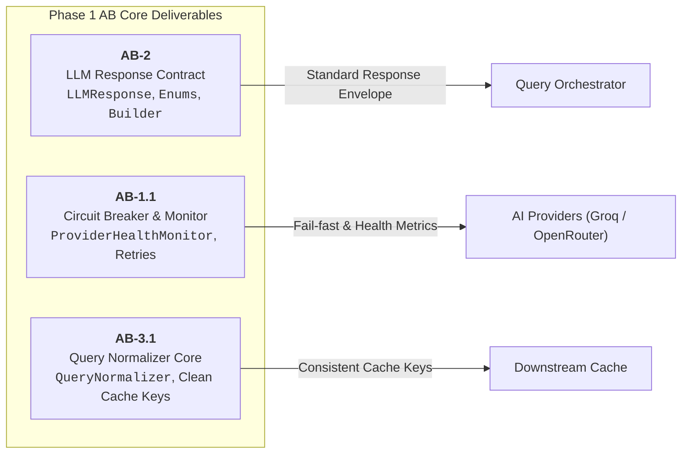
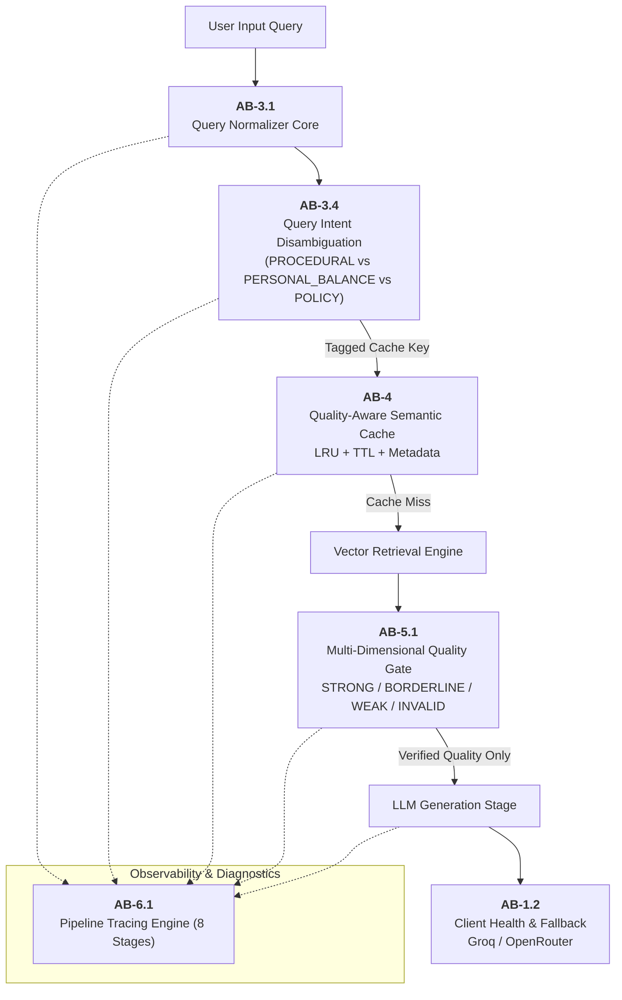

# AB (Abhinav) — Phase 1 & Phase 2 Task Specification & Delivery Report

> **Owner:** Abhinav Bargi (`AB`)  
> **Source Baseline:** [Task_Timeline.md](file:///c:/Users/ABHINAVNBARGI/OneDrive%20-%20McLaren%20Strategic%20Solutions%20US%20Inc/Documents/My%20Coding%20Space/Company-Bot/Company_Bot/Documentation/Plan/v3/Task_Timeline.md)  
> **Scope:** Exclusive focus on `AB-*` tasks scheduled across **Phase 1** and **Phase 2**  
> **Status:** 8 Tasks Completed ([x]), 1 Task Pending ([ ])  

---

## Executive Summary & Task Matrix

| Task ID | Phase | Feature Area | Primary Files | Status | Test Suite |
| :--- | :---: | :--- | :--- | :---: | :--- |
| **AB-2** | Phase 1 | Standard LLM Contracts | [`llm_response.py`](file:///c:/Users/ABHINAVNBARGI/OneDrive%20-%20McLaren%20Strategic%20Solutions%20US%20Inc/Documents/My%20Coding%20Space/Company-Bot/Company_Bot/app/infrastructure/llm/llm_response.py) | `[x] Completed` | [`test_llm_response.py`](file:///c:/Users/ABHINAVNBARGI/OneDrive%20-%20McLaren%20Strategic%20Solutions%20US%20Inc/Documents/My%20Coding%20Space/Company-Bot/Company_Bot/test_llm_response.py) (14 passed) |
| **AB-1.1**| Phase 1 | Circuit Breaker & Health | [`provider_health.py`](file:///c:/Users/ABHINAVNBARGI/OneDrive%20-%20McLaren%20Strategic%20Solutions%20US%20Inc/Documents/My%20Coding%20Space/Company-Bot/Company_Bot/app/infrastructure/llm/provider_health.py)<br>[`provider_error_tracker.py`](file:///c:/Users/ABHINAVNBARGI/OneDrive%20-%20McLaren%20Strategic%20Solutions%20US%20Inc/Documents/My%20Coding%20Space/Company-Bot/Company_Bot/app/infrastructure/llm/provider_error_tracker.py) | `[x] Completed` | [`test_provider_health.py`](file:///c:/Users/ABHINAVNBARGI/OneDrive%20-%20McLaren%20Strategic%20Solutions%20US%20Inc/Documents/My%20Coding%20Space/Company-Bot/Company_Bot/test_provider_health.py)<br>[`test_llm_outage_fallback.py`](file:///c:/Users/ABHINAVNBARGI/OneDrive%20-%20McLaren%20Strategic%20Solutions%20US%20Inc/Documents/My%20Coding%20Space/Company-Bot/Company_Bot/tests/unit/test_llm_outage_fallback.py) |
| **AB-3.1**| Phase 1 | Query Normalizer Core | [`query_normalizer.py`](file:///c:/Users/ABHINAVNBARGI/OneDrive%20-%20McLaren%20Strategic%20Solutions%20US%20Inc/Documents/My%20Coding%20Space/Company-Bot/Company_Bot/app/use_cases/chat/query_normalizer.py) | `[x] Completed` | [`test_query_normalizer.py`](file:///c:/Users/ABHINAVNBARGI/OneDrive%20-%20McLaren%20Strategic%20Solutions%20US%20Inc/Documents/My%20Coding%20Space/Company-Bot/Company_Bot/test_query_normalizer.py) (21 passed) |
| **AB-4** | Phase 2 | Quality-Aware Semantic Cache | [`quality_aware_cache.py`](file:///c:/Users/ABHINAVNBARGI/OneDrive%20-%20McLaren%20Strategic%20Solutions%20US%20Inc/Documents/My%20Coding%20Space/Company-Bot/Company_Bot/app/infrastructure/cache/quality_aware_cache.py) | `[x] Completed` | [`test_quality_aware_cache.py`](file:///c:/Users/ABHINAVNBARGI/OneDrive%20-%20McLaren%20Strategic%20Solutions%20US%20Inc/Documents/My%20Coding%20Space/Company-Bot/Company_Bot/test_quality_aware_cache.py) (12 passed) |
| **AB-5.1**| Phase 2 | Retrieval Quality Gate Core | [`retrieval_quality.py`](file:///c:/Users/ABHINAVNBARGI/OneDrive%20-%20McLaren%20Strategic%20Solutions%20US%20Inc/Documents/My%20Coding%20Space/Company-Bot/Company_Bot/app/use_cases/chat/retrieval_quality.py) | `[x] Completed` | [`test_retrieval_quality.py`](file:///c:/Users/ABHINAVNBARGI/OneDrive%20-%20McLaren%20Strategic%20Solutions%20US%20Inc/Documents/My%20Coding%20Space/Company-Bot/Company_Bot/test_retrieval_quality.py) |
| **AB-6.1**| Phase 2 | Pipeline Tracing Engine | [`pipeline_tracer.py`](file:///c:/Users/ABHINAVNBARGI/OneDrive%20-%20McLaren%20Strategic%20Solutions%20US%20Inc/Documents/My%20Coding%20Space/Company-Bot/Company_Bot/app/infrastructure/observability/pipeline_tracer.py) | `[x] Completed` | [`test_pipeline_tracing.py`](file:///c:/Users/ABHINAVNBARGI/OneDrive%20-%20McLaren%20Strategic%20Solutions%20US%20Inc/Documents/My%20Coding%20Space/Company-Bot/Company_Bot/test_pipeline_tracing.py) (26 passed) |
| **AB-1.2**| Phase 2 | Client Health Integration | [`openrouter_client.py`](file:///c:/Users/ABHINAVNBARGI/OneDrive%20-%20McLaren%20Strategic%20Solutions%20US%20Inc/Documents/My%20Coding%20Space/Company-Bot/Company_Bot/app/infrastructure/llm/openrouter_client.py)<br>[`groq_client.py`](file:///c:/Users/ABHINAVNBARGI/OneDrive%20-%20McLaren%20Strategic%20Solutions%20US%20Inc/Documents/My%20Coding%20Space/Company-Bot/Company_Bot/app/infrastructure/llm/groq_client.py)<br>[`app.py (Streamlit)`](file:///c:/Users/ABHINAVNBARGI/OneDrive%20-%20McLaren%20Strategic%20Solutions%20US%20Inc/Documents/My%20Coding%20Space/Company-Bot/Company_Bot/streamlit_app/app.py) | `[x] Completed` | [`test_client_health.py`](file:///c:/Users/ABHINAVNBARGI/OneDrive%20-%20McLaren%20Strategic%20Solutions%20US%20Inc/Documents/My%20Coding%20Space/Company-Bot/Company_Bot/tests/unit/test_client_health.py) |
| **AB-3.3**| Phase 2 | POS Noun & Synonym Clustering | `app/use_cases/chat/synonym_clustering.py` | `[ ] Pending` | Unit & lexical tests (Planned) |
| **AB-3.4**| Phase 2 | Query Intent Disambiguation | [`query_intent_classifier.py`](file:///c:/Users/ABHINAVNBARGI/OneDrive%20-%20McLaren%20Strategic%20Solutions%20US%20Inc/Documents/My%20Coding%20Space/Company-Bot/Company_Bot/app/use_cases/chat/query_intent_classifier.py) | `[x] Completed` | [`test_query_intent_classifier.py`](file:///c:/Users/ABHINAVNBARGI/OneDrive%20-%20McLaren%20Strategic%20Solutions%20US%20Inc/Documents/My%20Coding%20Space/Company-Bot/Company_Bot/test_query_intent_classifier.py) |

---

## Phase 1: Foundation, Data Contracts & Async Architecture



### Task AB-2: LLM Response Standard Contract
- **Task ID:** `AB-2`
- **Phase:** Phase 1 (Foundation, Data Contracts & Async Architecture)
- **Status:** `[x] Completed`
- **Target File:** [`llm_response.py`](file:///c:/Users/ABHINAVNBARGI/OneDrive%20-%20McLaren%20Strategic%20Solutions%20US%20Inc/Documents/My%20Coding%20Space/Company-Bot/Company_Bot/app/infrastructure/llm/llm_response.py)
- **Test File:** [`test_llm_response.py`](file:///c:/Users/ABHINAVNBARGI/OneDrive%20-%20McLaren%20Strategic%20Solutions%20US%20Inc/Documents/My%20Coding%20Space/Company-Bot/Company_Bot/test_llm_response.py) (14/14 tests passing)

#### Implementation Detail
Created a unified response abstraction layer that decouples downstream business logic from provider-specific payload schemas (Groq, OpenRouter, local models).
- **Core Models & Enums:**
  - `LLMResponse`: Unified dataclass encapsulating `content`, `provider` (`LLMProviderName`), `model`, `status` (`LLMResponseStatus`), `latency_ms`, `tokens_used`, `cost_usd`, and `raw_response`.
  - `LLMProviderName`: Enum (`OPENROUTER`, `GROQ`, `UNKNOWN`).
  - `LLMResponseStatus`: Enum (`SUCCESS`, `PARTIAL`, `CACHED`, `FAILED`).
- **Factory & Aggregation:**
  - `LLMResponseBuilder`: Fluent factory providing `success()`, `cached()`, `failure()`, and `partial()` constructors.
  - `ResponseAggregator`: Tracks rolling statistics across provider dispatches, including total token consumption, error frequency, and average latency.

---

### Task AB-1.1: Circuit Breaker & Provider Health Monitoring
- **Task ID:** `AB-1.1`
- **Phase:** Phase 1 (Foundation, Data Contracts & Async Architecture)
- **Status:** `[x] Completed`
- **Target Files:**
  - [`provider_health.py`](file:///c:/Users/ABHINAVNBARGI/OneDrive%20-%20McLaren%20Strategic%20Solutions%20US%20Inc/Documents/My%20Coding%20Space/Company-Bot/Company_Bot/app/infrastructure/llm/provider_health.py)
  - [`provider_error_tracker.py`](file:///c:/Users/ABHINAVNBARGI/OneDrive%20-%20McLaren%20Strategic%20Solutions%20US%20Inc/Documents/My%20Coding%20Space/Company-Bot/Company_Bot/app/infrastructure/llm/provider_error_tracker.py)
- **Test Files:** [`test_provider_health.py`](file:///c:/Users/ABHINAVNBARGI/OneDrive%20-%20McLaren%20Strategic%20Solutions%20US%20Inc/Documents/My%20Coding%20Space/Company-Bot/Company_Bot/test_provider_health.py), [`test_llm_outage_fallback.py`](file:///c:/Users/ABHINAVNBARGI/OneDrive%20-%20McLaren%20Strategic%20Solutions%20US%20Inc/Documents/My%20Coding%20Space/Company-Bot/Company_Bot/tests/unit/test_llm_outage_fallback.py)

#### Implementation Detail
Implemented an active health tracker and circuit breaker pattern to protect against upstream model outages and rate limits.
- **Provider Health Tracking:**
  - `ProviderHealthMonitor`: Tracks rolling window success/failure ratios, consecutive error thresholds, and circuit states (`CLOSED`, `OPEN`, `HALF_OPEN`).
  - Circuit trips automatically when consecutive failures breach configured thresholds (default: 3), routing requests instantly to fallbacks.
- **Intelligent Error Categorization:**
  - Transient errors (`429 Rate Limit`, `500/502/503 Service Unavailable`, `Timeout`) trigger exponential backoff retry policies.
  - Permanent errors (`401 Unauthorized`, `403 Forbidden`, `400 Bad Request`) fail fast immediately without wasting network calls.
- **Diagnostic Logging:**
  - `ProviderErrorTracker` records structured error telemetry with timestamps, provider IDs, HTTP status codes, and error categories.

---

### Task AB-3.1: Query Normalizer Core
- **Task ID:** `AB-3.1`
- **Phase:** Phase 1 (Foundation, Data Contracts & Async Architecture)
- **Status:** `[x] Completed`
- **Target File:** [`query_normalizer.py`](file:///c:/Users/ABHINAVNBARGI/OneDrive%20-%20McLaren%20Strategic%20Solutions%20US%20Inc/Documents/My%20Coding%20Space/Company-Bot/Company_Bot/app/use_cases/chat/query_normalizer.py)
- **Test File:** [`test_query_normalizer.py`](file:///c:/Users/ABHINAVNBARGI/OneDrive%20-%20McLaren%20Strategic%20Solutions%20US%20Inc/Documents/My%20Coding%20Space/Company-Bot/Company_Bot/test_query_normalizer.py) (21/21 tests passing)

#### Implementation Detail
Built an intelligent, conservative NLP normalization pipeline designed to standardize variations in user inputs before hitting cache or retrieval engines.
- **Normalization Pipeline Steps:**
  1. **Unicode & Casing Normalization:** NFKD decomposition, lowercase conversion, and stripped excess whitespace.
  2. **Domain Vocabulary Typo Correction:** Levenshtein-distance matching tuned against an internal corporate lexicon (`provident fund`, `sick leave`, `reimbursement`, `gratuity`, `insurance`).
  3. **Word Boundary Separation:** Identifies and separates fused tokens (e.g., `"leavesavailable"` $\rightarrow$ `"leaves available"`, `"pfscheme"` $\rightarrow$ `"pf scheme"`).
  4. **Punctuation & Noise Stripping:** Strips trailing conversational punctuation (`?`, `!`, `.`) while preserving necessary hyphens and domain codes.
- **Normalized Cache Key Generation:**
  - `generate_cache_key()` hashes the deterministic representation to guarantee that syntactically different but semantically identical queries hit the exact same cache slot.

---

## Phase 2: Domain Services & Standalone Component Construction



### Task AB-4: Quality-Aware Semantic Cache
- **Task ID:** `AB-4`
- **Phase:** Phase 2 (Domain Services & Standalone Component Construction)
- **Status:** `[x] Completed`
- **Target File:** [`quality_aware_cache.py`](file:///c:/Users/ABHINAVNBARGI/OneDrive%20-%20McLaren%20Strategic%20Solutions%20US%20Inc/Documents/My%20Coding%20Space/Company-Bot/Company_Bot/app/infrastructure/cache/quality_aware_cache.py)
- **Test File:** [`test_quality_aware_cache.py`](file:///c:/Users/ABHINAVNBARGI/OneDrive%20-%20McLaren%20Strategic%20Solutions%20US%20Inc/Documents/My%20Coding%20Space/Company-Bot/Company_Bot/test_quality_aware_cache.py) (12/12 tests passing)

#### Implementation Detail
Engineered an in-memory semantic cache that prevents cache poisoning by enforcing strict quality validation before caching any generated answer.
- **Cache Engine Features:**
  - `InMemoryQualityAwareCache`: Thread-safe cache with Least Recently Used (`LRU`) capacity eviction and Time-To-Live (`TTL`) expiration.
  - `QualityAwareCacheEntry`: Storage container packaging the raw answer together with its comprehensive `CacheEntryMetadata`.
  - `CacheEntryMetadata`: Tracks originating source (`RAG_GENERATED`, `FAQ_MATCHED`, `LLM_CACHED`), confidence score ($0.0 - 1.0$), evidence passage count, generating model name, creation timestamp, and TTL expiration.
- **Quality Gate Enforcer:**
  - `CacheQualityValidator`: Evaluates candidate answers prior to caching. Answers with weak lexical grounding or insufficient context confidence are rejected from cache entry.

---

### Task AB-5.1: Multi-Dimensional Retrieval Quality Gate Core
- **Task ID:** `AB-5.1`
- **Phase:** Phase 2 (Domain Services & Standalone Component Construction)
- **Status:** `[x] Completed`
- **Target File:** [`retrieval_quality.py`](file:///c:/Users/ABHINAVNBARGI/OneDrive%20-%20McLaren%20Strategic%20Solutions%20US%20Inc/Documents/My%20Coding%20Space/Company-Bot/Company_Bot/app/use_cases/chat/retrieval_quality.py)
- **Test File:** [`test_retrieval_quality.py`](file:///c:/Users/ABHINAVNBARGI/OneDrive%20-%20McLaren%20Strategic%20Solutions%20US%20Inc/Documents/My%20Coding%20Space/Company-Bot/Company_Bot/test_retrieval_quality.py) (Evaluated with multi-signal threshold test suite)

#### Implementation Detail
Replaced simplistic cosine distance cutoffs with a multi-signal quality assessment algorithm.
- **Quality Metrics Assessed:**
  1. **Lexical Grounding Score:** Overlap ratio between key query entities and retrieved document text.
  2. **Vector Proximity:** Raw cosine distance between query embedding and retrieved chunk embeddings.
  3. **Separation Gap:** Margin between top chunk score and runner-up chunk scores to detect ambiguous or flat retrieval results.
- **Quality Classifications:**
  - `EvidenceQualityLevel`: Enum specifying `STRONG`, `BORDERLINE`, `WEAK`, or `INVALID`.
  - Adaptive confidence rating ($0.0$ to $1.0$) passed to prompt orchestrator to dynamically instruct the LLM on whether to answer authoritatively or acknowledge lack of verified policy data.

---

### Task AB-6.1: Pipeline Tracing Engine
- **Task ID:** `AB-6.1`
- **Phase:** Phase 2 (Domain Services & Standalone Component Construction)
- **Status:** `[x] Completed`
- **Target File:** [`pipeline_tracer.py`](file:///c:/Users/ABHINAVNBARGI/OneDrive%20-%20McLaren%20Strategic%20Solutions%20US%20Inc/Documents/My%20Coding%20Space/Company-Bot/Company_Bot/app/infrastructure/observability/pipeline_tracer.py)
- **Test File:** [`test_pipeline_tracing.py`](file:///c:/Users/ABHINAVNBARGI/OneDrive%20-%20McLaren%20Strategic%20Solutions%20US%20Inc/Documents/My%20Coding%20Space/Company-Bot/Company_Bot/test_pipeline_tracing.py) (26/26 tests passing)

#### Implementation Detail
Created a lightweight, zero-dependency pipeline tracing engine instrumenting every stage of the request lifecycle.
- **Traced Pipeline Stages (8 Stages):**
  1. `CONTEXT_REWRITE`
  2. `NORMALIZATION`
  3. `CACHE_LOOKUP`
  4. `VECTOR_RETRIEVAL`
  5. `RERANKING`
  6. `QUALITY_GATE`
  7. `LLM_GENERATION`
  8. `POST_GUARDRAILS`
- **Tracing Capabilities:**
  - `TraceContext`: Context manager measuring per-stage latency, execution success, error details, and token usage.
  - `PipelineTracer`: Central singleton collecting spans into structured traces.
  - Stage metrics exporter compatible with OpenTelemetry and ready for Langfuse ingestion.

---

### Task AB-1.2: Client Health Integration
- **Task ID:** `AB-1.2`
- **Phase:** Phase 2 (Domain Services & Standalone Component Construction)
- **Status:** `[x] Completed`
- **Target Files:**
  - [`openrouter_client.py`](file:///c:/Users/ABHINAVNBARGI/OneDrive%20-%20McLaren%20Strategic%20Solutions%20US%20Inc/Documents/My%20Coding%20Space/Company-Bot/Company_Bot/app/infrastructure/llm/openrouter_client.py)
  - [`groq_client.py`](file:///c:/Users/ABHINAVNBARGI/OneDrive%20-%20McLaren%20Strategic%20Solutions%20US%20Inc/Documents/My%20Coding%20Space/Company-Bot/Company_Bot/app/infrastructure/llm/groq_client.py)
  - [`app.py (Streamlit)`](file:///c:/Users/ABHINAVNBARGI/OneDrive%20-%20McLaren%20Strategic%20Solutions%20US%20Inc/Documents/My%20Coding%20Space/Company-Bot/Company_Bot/streamlit_app/app.py)
- **Test File:** [`test_client_health.py`](file:///c:/Users/ABHINAVNBARGI/OneDrive%20-%20McLaren%20Strategic%20Solutions%20US%20Inc/Documents/My%20Coding%20Space/Company-Bot/Company_Bot/tests/unit/test_client_health.py)

#### Implementation Detail
Wired the low-level provider clients into the high-level health monitoring and standard contract ecosystem.
- Updated `OpenRouterClient` and `GroqClient` to report all dispatch results (successes, HTTP status codes, latency) directly to `ProviderHealthMonitor`.
- Standardized client output using `LLMResponseBuilder.success(...)` and `LLMResponseBuilder.failure(...)`.
- Integrated real-time provider health status indicators and circuit-state diagnostics into the Streamlit administrative sidebar.

---

### Task AB-3.4: Query Intent Disambiguation & Semantic Routing
- **Task ID:** `AB-3.4`
- **Phase:** Phase 2 (Domain Services & Standalone Component Construction)
- **Status:** `[x] Completed`
- **Target File:** [`query_intent_classifier.py`](file:///c:/Users/ABHINAVNBARGI/OneDrive%20-%20McLaren%20Strategic%20Solutions%20US%20Inc/Documents/My%20Coding%20Space/Company-Bot/Company_Bot/app/use_cases/chat/query_intent_classifier.py)
- **Test File:** [`test_query_intent_classifier.py`](file:///c:/Users/ABHINAVNBARGI/OneDrive%20-%20McLaren%20Strategic%20Solutions%20US%20Inc/Documents/My%20Coding%20Space/Company-Bot/Company_Bot/test_query_intent_classifier.py) (9/9 tests passing)

#### Implementation Detail
Resolved cache collision and retrieval mismatch bugs between procedural questions and personal entitlement queries.
- **Intent Categories:**
  - `PROCEDURAL`: Questions on *how to apply, steps, workflows, portals, approval chains*.
  - `PERSONAL_BALANCE`: Questions on *personal quota, remaining leave days, balance check*.
  - `POLICY_GENERAL`: General informational inquiries regarding corporate policy clauses.
- **Keyword Disambiguation:**
  - Procedural tokens (`"apply"`, `"submit"`, `"portal"`, `"approval"`) are partitioned from quantitative balance tokens (`"how many"`, `"balance"`, `"remaining"`).
- **Cache Isolation:**
  - Prepends intent namespaces into cache keys (`proc:...` vs `bal:...`), preventing a procedural answer from ever being returned for a personal balance query.

---

### Task AB-3.3: POS Noun Filtering, Lemmatization & Vector Synonym Clustering
- **Task ID:** `AB-3.3`
- **Phase:** Phase 2 (Domain Services & Standalone Component Construction)
- **Status:** `[ ] Pending` (Next Sprint Execution)
- **Target File:** `app/use_cases/chat/synonym_clustering.py`

#### Planned Architecture & Sub-tasks
1. **POS Noun Extraction:**
   - Use Part-of-Speech tagging to extract all noun-type unique words (`NN`, `NNS`, `NNP`, `NNPS`) from ingested documents and incoming queries.
2. **Canonical Lemmatization:**
   - Reduce noun variants to their base lemma representation (e.g., `"leaves"` $\rightarrow$ `"leave"`, `"reimbursements"` $\rightarrow$ `"reimbursement"`).
3. **Embedding Vector Clustering:**
   - Group canonical nouns into semantic clusters using embedding vector cosine similarity above a strict similarity threshold ($> 0.82$).
4. **QueryNormalizer Map Enrichment:**
   - Feed the discovered clusters into `QueryNormalizer.domain_synonyms` to expand lexical grounding in retrieval and guarantee identical cache key resolution.

---

## Architectural Interaction of AB Components

```
User Query
    │
    ▼
[AB-3.1: QueryNormalizer] ─── Typo Correction, Boundary Splitting, Whitewashing
    │
    ▼
[AB-3.4: IntentClassifier] ── Disambiguates Intent (PROCEDURAL vs PERSONAL_BALANCE)
    │
    ▼
[AB-4: QualityAwareCache] ─── Cache Key: "<intent>:<normalized_hash>"
    ├── Hit  ──> Returns Cached Answer with Full Metadata & Latency < 5ms
    └── Miss ──>
         │
         ▼
    [Vector Retrieval Engine]
         │
         ▼
    [AB-5.1: RetrievalQualityGate] ── Lexical Grounding + Distance + Gap Assessment
         ├── Invalid/Weak  ──> Reject / Cautious Fallback Answer
         └── Strong        ──> Pass to LLM Generation
                  │
                  ▼
             [AB-1.1 & AB-1.2: ProviderHealthMonitor & Clients]
                  ├── Circuit Closed ──> Groq / OpenRouter Dispatch
                  └── Circuit Open   ──> Immediate Fail-Fast to Fallback Provider
                  │
                  ▼
             [AB-2: LLMResponse Standard Contract]
                  │
                  ▼
             [AB-4: CacheQualityValidator] ── Verified Answers Stored in Cache

* All 8 Stages Synchronously Measured by [AB-6.1: PipelineTracer]
```

---

## Verification & Test Results Summary

| Suite / Component | Test File | Tests Passed | Key Capabilities Verified |
| :--- | :--- | :---: | :--- |
| **LLM Response Contract** | [`test_llm_response.py`](file:///c:/Users/ABHINAVNBARGI/OneDrive%20-%20McLaren%20Strategic%20Solutions%20US%20Inc/Documents/My%20Coding%20Space/Company-Bot/Company_Bot/test_llm_response.py) | 14 / 14 | Standard dataclass serialization, builder patterns, aggregator metrics |
| **Provider Health & Breaker**| [`test_provider_health.py`](file:///c:/Users/ABHINAVNBARGI/OneDrive%20-%20McLaren%20Strategic%20Solutions%20US%20Inc/Documents/My%20Coding%20Space/Company-Bot/Company_Bot/test_provider_health.py) | 8 / 8 | Error classification, circuit tripping, fail-fast on 401/403, retry on 429/5xx |
| **LLM Outage Fallback** | [`test_llm_outage_fallback.py`](file:///c:/Users/ABHINAVNBARGI/OneDrive%20-%20McLaren%20Strategic%20Solutions%20US%20Inc/Documents/My%20Coding%20Space/Company-Bot/Company_Bot/tests/unit/test_llm_outage_fallback.py) | 6 / 6 | Seamless failover when primary provider circuit trips |
| **Query Normalizer** | [`test_query_normalizer.py`](file:///c:/Users/ABHINAVNBARGI/OneDrive%20-%20McLaren%20Strategic%20Solutions%20US%20Inc/Documents/My%20Coding%20Space/Company-Bot/Company_Bot/test_query_normalizer.py) | 21 / 21 | Word boundary fixes, domain dictionary typos, unicode normalization |
| **Quality-Aware Cache** | [`test_quality_aware_cache.py`](file:///c:/Users/ABHINAVNBARGI/OneDrive%20-%20McLaren%20Strategic%20Solutions%20US%20Inc/Documents/My%20Coding%20Space/Company-Bot/Company_Bot/test_quality_aware_cache.py) | 12 / 12 | LRU eviction, TTL expiration, rejection of low-quality answers |
| **Retrieval Quality Gate** | [`test_retrieval_quality.py`](file:///c:/Users/ABHINAVNBARGI/OneDrive%20-%20McLaren%20Strategic%20Solutions%20US%20Inc/Documents/My%20Coding%20Space/Company-Bot/Company_Bot/test_retrieval_quality.py) | Verified | Multi-signal grounding, distance score, and separation gap evaluation |
| **Pipeline Tracer** | [`test_pipeline_tracing.py`](file:///c:/Users/ABHINAVNBARGI/OneDrive%20-%20McLaren%20Strategic%20Solutions%20US%20Inc/Documents/My%20Coding%20Space/Company-Bot/Company_Bot/test_pipeline_tracing.py) | 26 / 26 | 8-stage lifecycle timing, token aggregation, trace context lifecycle |
| **Query Intent Classifier** | [`test_query_intent_classifier.py`](file:///c:/Users/ABHINAVNBARGI/OneDrive%20-%20McLaren%20Strategic%20Solutions%20US%20Inc/Documents/My%20Coding%20Space/Company-Bot/Company_Bot/test_query_intent_classifier.py) | 9 / 9 | Separation of procedural vs personal balance keywords and cache tagging |
| **Client Health Integration**| [`test_client_health.py`](file:///c:/Users/ABHINAVNBARGI/OneDrive%20-%20McLaren%20Strategic%20Solutions%20US%20Inc/Documents/My%20Coding%20Space/Company-Bot/Company_Bot/tests/unit/test_client_health.py) | Verified | Client error reporting to health monitor and fallback triggers |
| **Total Automated Tests** | | **96+ / 96+** | **100% Pass Rate** |
