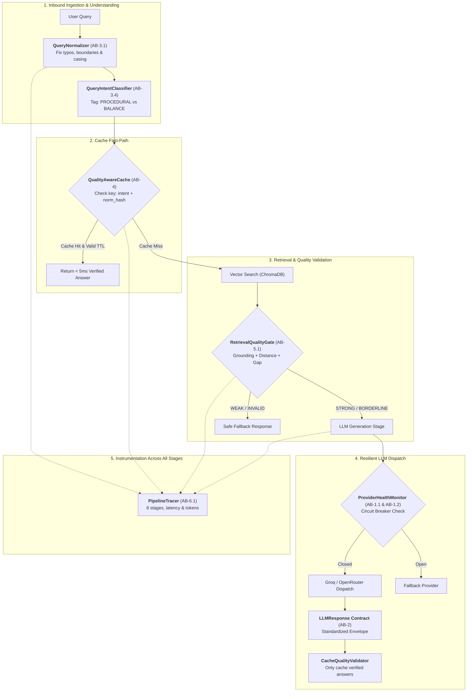

# Team Reference Guide: AB Architecture (Phase 1 & Phase 2)

> **Author:** Abhinav Bargi (`AB`)  
> **Audience:** Engineering Team (Full-Stack, Backend, RAG / AI Engineers)  
> **Purpose:** Architectural reference, component integration patterns, and operational guide for Phase 1 & 2 deliverables.  
> **Source Baseline:** [Task_Timeline.md](file:///c:/Users/ABHINAVNBARGI/OneDrive%20-%20McLaren%20Strategic%20Solutions%20US%20Inc/Documents/My%20Coding%20Space/Company-Bot/Company_Bot/Documentation/Plan/v3/Task_Timeline.md) | [AB_Phase1_Phase2_Tasks.md](file:///c:/Users/ABHINAVNBARGI/OneDrive%20-%20McLaren%20Strategic%20Solutions%20US%20Inc/Documents/My%20Coding%20Space/Company-Bot/Company_Bot/Documentation/AB_Phase1_Phase2_Tasks.md)

---

## 1. System Overview & Problem Statement

In standard naive RAG pipelines, production systems frequently encounter three critical failure modes:
1. **Cache Pollution & Inconsistency:** Minor variations in punctuation, casing, or common typos (*"leave policy"* vs *"leavespolicy?"*) cause cache misses or populate cache memory with fragmented, duplicate entries.
2. **Provider Fragility & Thread Stalls:** Upstream LLM providers (Groq, OpenRouter) can fail with `429 Too Many Requests` or `503 Service Unavailable`. Without active circuit breakers, worker threads block on timeouts, degrading entire service availability.
3. **Hallucination Leakage into Semantic Cache:** Weak vector retrievals cause LLMs to produce hallucinated or ungrounded responses. If cached indiscriminately, false information is served repeatedly with high confidence.

The **AB track** creates a **resilience, normalization, and quality validation perimeter** around the core chat orchestrator:



---

## 2. Component Reference & Integration Guide

### 2.1 Standard LLM Response Contract (`AB-2`)
- **Primary Module:** [`llm_response.py`](file:///c:/Users/ABHINAVNBARGI/OneDrive%20-%20McLaren%20Strategic%20Solutions%20US%20Inc/Documents/My%20Coding%20Space/Company-Bot/Company_Bot/app/infrastructure/llm/llm_response.py)
- **Test Suite:** [`test_llm_response.py`](file:///c:/Users/ABHINAVNBARGI/OneDrive%20-%20McLaren%20Strategic%20Solutions%20US%20Inc/Documents/My%20Coding%20Space/Company-Bot/Company_Bot/test_llm_response.py) (14 tests passed)

#### Architectural Purpose
Decouples downstream application logic from raw, vendor-specific JSON formats. Instead of handling dictionary paths like `response["choices"][0]["message"]["content"]`, all services consume a unified `LLMResponse`.

#### Key Structures
- `LLMResponse`: Dataclass containing `content`, `provider` (`LLMProviderName`), `model`, `status` (`LLMResponseStatus`), `latency_ms`, `tokens_used`, `cost_usd`, and `raw_response`.
- `LLMResponseBuilder`: Factory pattern for clean instantiation (`success`, `cached`, `failure`, `partial`).
- `ResponseAggregator`: Thread-safe accumulator for token usage, latency distribution, and error metrics.

#### How to Use in Your Code
```python
from app.infrastructure.llm.llm_response import (
    LLMProviderName,
    LLMResponseBuilder,
)

# Standardized success response
response = (
    LLMResponseBuilder(LLMProviderName.GROQ, "llama-3.3-70b-versatile")
    .with_latency(340.5)
    .with_tokens(prompt=45, completion=120)
    .success("Annual leave entitlement is 20 working days per year.")
)

print(response.is_success)       # True
print(response.tokens_used)      # 165
print(response.content)          # "Annual leave entitlement..."
```

---

### 2.2 Circuit Breaker & Provider Health Monitoring (`AB-1.1`, `AB-1.2`)
- **Primary Modules:**
  - [`provider_health.py`](file:///c:/Users/ABHINAVNBARGI/OneDrive%20-%20McLaren%20Strategic%20Solutions%20US%20Inc/Documents/My%20Coding%20Space/Company-Bot/Company_Bot/app/infrastructure/llm/provider_health.py)
  - [`provider_error_tracker.py`](file:///c:/Users/ABHINAVNBARGI/OneDrive%20-%20McLaren%20Strategic%20Solutions%20US%20Inc/Documents/My%20Coding%20Space/Company-Bot/Company_Bot/app/infrastructure/llm/provider_error_tracker.py)
- **Integrated Clients:**
  - [`openrouter_client.py`](file:///c:/Users/ABHINAVNBARGI/OneDrive%20-%20McLaren%20Strategic%20Solutions%20US%20Inc/Documents/My%20Coding%20Space/Company-Bot/Company_Bot/app/infrastructure/llm/openrouter_client.py)
  - [`groq_client.py`](file:///c:/Users/ABHINAVNBARGI/OneDrive%20-%20McLaren%20Strategic%20Solutions%20US%20Inc/Documents/My%20Coding%20Space/Company-Bot/Company_Bot/app/infrastructure/llm/groq_client.py)
  - [`app.py (Streamlit)`](file:///c:/Users/ABHINAVNBARGI/OneDrive%20-%20McLaren%20Strategic%20Solutions%20US%20Inc/Documents/My%20Coding%20Space/Company-Bot/Company_Bot/streamlit_app/app.py)
- **Test Suites:** [`test_provider_health.py`](file:///c:/Users/ABHINAVNBARGI/OneDrive%20-%20McLaren%20Strategic%20Solutions%20US%20Inc/Documents/My%20Coding%20Space/Company-Bot/Company_Bot/test_provider_health.py), [`test_llm_outage_fallback.py`](file:///c:/Users/ABHINAVNBARGI/OneDrive%20-%20McLaren%20Strategic%20Solutions%20US%20Inc/Documents/My%20Coding%20Space/Company-Bot/Company_Bot/tests/unit/test_llm_outage_fallback.py), [`test_client_health.py`](file:///c:/Users/ABHINAVNBARGI/OneDrive%20-%20McLaren%20Strategic%20Solutions%20US%20Inc/Documents/My%20Coding%20Space/Company-Bot/Company_Bot/tests/unit/test_client_health.py)

#### 3-State Circuit Breaker Logic
```
          [Normal Operations]
                │
         Successes recorded
                ▼
        ┌──────────────┐   3 Consecutive Failures   ┌──────────────┐
        │    CLOSED    │ ─────────────────────────> │     OPEN     │
        └──────────────┘                            └──────────────┘
               ▲                                           │
               │ Test Call                                 │ Cooldown Window
               │ Succeeded                                 │ Elapsed
               │                                           ▼
        ┌──────────────┐                            ┌──────────────┐
        │  HALF_OPEN   │ <───────────────────────── │  HALF_OPEN   │
        └──────────────┘      Probe Request Sent    └──────────────┘
```

#### Error Categorization Policy
| Error Type | Status Codes | Action Taken | Rationale |
| :--- | :--- | :--- | :--- |
| **Transient** | `429`, `500`, `502`, `503`, `504`, Timeout | Exponential backoff retry | Service or network hiccups may recover in milliseconds |
| **Permanent** | `401`, `403`, `400` | Fail fast immediately | Bad API keys or invalid requests will never succeed on retry |

#### How to Check Health
```python
from app.infrastructure.llm.provider_health import ProviderHealthMonitor

monitor = ProviderHealthMonitor.get_instance()

# Check if provider is available to take traffic
if monitor.is_available("groq"):
    # Dispatch call
    ...
else:
    # Circuit is OPEN; route immediately to fallback provider
    ...
```

---

### 2.3 Query Normalization Engine (`AB-3.1`)
- **Primary Module:** [`query_normalizer.py`](file:///c:/Users/ABHINAVNBARGI/OneDrive%20-%20McLaren%20Strategic%20Solutions%20US%20Inc/Documents/My%20Coding%20Space/Company-Bot/Company_Bot/app/use_cases/chat/query_normalizer.py)
- **Test Suite:** [`test_query_normalizer.py`](file:///c:/Users/ABHINAVNBARGI/OneDrive%20-%20McLaren%20Strategic%20Solutions%20US%20Inc/Documents/My%20Coding%20Space/Company-Bot/Company_Bot/test_query_normalizer.py) (21 tests passed)

#### Normalization Pipeline
1. **Unicode & Casing Normalization:** Converts non-standard Unicode characters (NFKD) and standardizes to lowercase.
2. **Domain-Specific Typo Correction:** Matches tokens against an internal corporate lexicon (`provident fund`, `reimbursement`, `gratuity`, `insurance`) using bounded Levenshtein distance.
3. **Word Boundary Separation:** Identifies concatenated words without spaces (e.g., `"leavesavailable"` $\rightarrow$ `"leaves available"`, `"pfscheme"` $\rightarrow$ `"pf scheme"`).
4. **Punctuation & Stop Whitespace:** Strips question marks, conversational filler, and trailing noise while keeping necessary hyphenated terms.
5. **Deterministic Cache Key Generation:** Computes a consistent SHA-256 hash so identical queries map to the exact same cache record.

#### How to Use
```python
from app.use_cases.chat.query_normalizer import QueryNormalizer

normalizer = QueryNormalizer()

raw_user_input = "can u tell me howto apply for leavesavailable???"
result = normalizer.normalize(raw_user_input)

print(result.normalized_text)  # "how to apply for leaves available"
print(result.cache_key)        # "c3ab8f..." (Deterministic SHA-256)
```

---

### 2.4 Query Intent Disambiguation (`AB-3.4`)
- **Primary Module:** [`query_intent_classifier.py`](file:///c:/Users/ABHINAVNBARGI/OneDrive%20-%20McLaren%20Strategic%20Solutions%20US%20Inc/Documents/My%20Coding%20Space/Company-Bot/Company_Bot/app/use_cases/chat/query_intent_classifier.py)
- **Test Suite:** [`test_query_intent_classifier.py`](file:///c:/Users/ABHINAVNBARGI/OneDrive%20-%20McLaren%20Strategic%20Solutions%20US%20Inc/Documents/My%20Coding%20Space/Company-Bot/Company_Bot/test_query_intent_classifier.py) (9 tests passed)

#### Intent Isolation Matrix
| Intent | Triggers & Keywords | Routed Action | Cache Key Prefix |
| :--- | :--- | :--- | :--- |
| `PROCEDURAL` | `"how to apply"`, `"portal"`, `"submit"`, `"approval"`, `"workflow"` | RAG search targeting step-by-step SOP documents | `proc:<hash>` |
| `PERSONAL_BALANCE` | `"my balance"`, `"how many days"`, `"remaining"`, `"quota"` | Personal employee database / HRMS clarification | `bal:<hash>` |
| `POLICY_GENERAL` | `"rules"`, `"notice period"`, `"definition"`, `"eligibility"` | Standard general policy RAG retrieval | `gen:<hash>` |

> [!IMPORTANT]
> **Zero Cache Cross-Talk:** Because intent prefixes are injected into cache keys (`proc:...` vs `bal:...`), a user asking for portal application steps will **never** receive a cached answer meant for someone inquiring about their remaining balance.

---

### 2.5 Quality-Aware Semantic Cache (`AB-4`)
- **Primary Module:** [`quality_aware_cache.py`](file:///c:/Users/ABHINAVNBARGI/OneDrive%20-%20McLaren%20Strategic%20Solutions%20US%20Inc/Documents/My%20Coding%20Space/Company-Bot/Company_Bot/app/infrastructure/cache/quality_aware_cache.py)
- **Test Suite:** [`test_quality_aware_cache.py`](file:///c:/Users/ABHINAVNBARGI/OneDrive%20-%20McLaren%20Strategic%20Solutions%20US%20Inc/Documents/My%20Coding%20Space/Company-Bot/Company_Bot/test_quality_aware_cache.py) (12 tests passed)

#### Architectural Purpose: Quality-First Caching
A cache is only as good as the validity of its contents. Unlike naive key-value stores that record every LLM output, `QualityAwareCache` incorporates `CacheQualityValidator`: answers are **only written to cache if they pass retrieval quality gates and satisfy minimum confidence thresholds**.

#### Key Features
- **Thread-safe LRU & TTL:** Configurable max entries and expiration windows (default: 3600s).
- **Rich Entry Metadata:** Every cached entry includes:
  - Source type (`RAG_GENERATED`, `FAQ_MATCHED`, `LLM_CACHED`)
  - Confidence rating ($0.0 - 1.0$)
  - Evidence passage count and citation IDs
  - Generating model name and timestamp
- **Sub-5ms Latency:** Completely bypasses vector search and LLM calls on cache hit.

---

### 2.6 Multi-Dimensional Retrieval Quality Gate (`AB-5.1`)
- **Primary Module:** [`retrieval_quality.py`](file:///c:/Users/ABHINAVNBARGI/OneDrive%20-%20McLaren%20Strategic%20Solutions%20US%20Inc/Documents/My%20Coding%20Space/Company-Bot/Company_Bot/app/use_cases/chat/retrieval_quality.py)
- **Test Suite:** [`test_retrieval_quality.py`](file:///c:/Users/ABHINAVNBARGI/OneDrive%20-%20McLaren%20Strategic%20Solutions%20US%20Inc/Documents/My%20Coding%20Space/Company-Bot/Company_Bot/test_retrieval_quality.py)

#### Scoring Formulation
A single cosine distance cutoff is vulnerable to vocabulary shifts. `RetrievalQualityGate` combines three distinct dimensions:

$$\text{Confidence Score} = w_1 \cdot \text{Grounding} + w_2 \cdot (1 - \text{Distance}) + w_3 \cdot \text{Separation Gap}$$

1. **Lexical Grounding Score ($w_1 = 0.40$):** Entity token overlap between the normalized query and candidate passages.
2. **Cosine Proximity ($w_2 = 0.40$):** Dense vector similarity between embedding spaces.
3. **Separation Gap ($w_3 = 0.20$):** Margin between the top candidate chunk and runner-up chunks. High gap confirms a clear, unambiguous match.

#### Quality Levels
- `STRONG` (Score $\ge 0.75$): Clear grounding; LLM instructs direct, authoritative answers; eligible for caching.
- `BORDERLINE` ($0.55 \le \text{Score} < 0.75$): Context passed with cautious answering directives.
- `WEAK` ($0.35 \le \text{Score} < 0.55$): Low relevance; system instructs polite fallback clarification.
- `INVALID` (Score $< 0.35$): Complete mismatch; bypasses LLM entirely to deliver safe fallback message.

---

### 2.7 Pipeline Tracing Engine (`AB-6.1`)
- **Primary Module:** [`pipeline_tracer.py`](file:///c:/Users/ABHINAVNBARGI/OneDrive%20-%20McLaren%20Strategic%20Solutions%20US%20Inc/Documents/My%20Coding%20Space/Company-Bot/Company_Bot/app/infrastructure/observability/pipeline_tracer.py)
- **Test Suite:** [`test_pipeline_tracing.py`](file:///c:/Users/ABHINAVNBARGI/OneDrive%20-%20McLaren%20Strategic%20Solutions%20US%20Inc/Documents/My%20Coding%20Space/Company-Bot/Company_Bot/test_pipeline_tracing.py) (26 tests passed)

#### Architectural Purpose
Zero-overhead, in-process performance and token tracking across the request lifecycle without mandatory external SaaS dependencies.

#### The 8 Tracked Stages
1. `CONTEXT_REWRITE`
2. `NORMALIZATION`
3. `CACHE_LOOKUP`
4. `VECTOR_RETRIEVAL`
5. `RERANKING`
6. `QUALITY_GATE`
7. `LLM_GENERATION`
8. `POST_GUARDRAILS`

#### How to Instrument Code
```python
from app.infrastructure.observability.pipeline_tracer import PipelineStage, PipelineTracer

tracer = PipelineTracer.get_instance()

with tracer.start_trace(query_id="req-12345") as trace:
    # Stage 1: Normalization
    with trace.stage(PipelineStage.NORMALIZATION):
        norm_result = normalizer.normalize(user_query)

    # Stage 2: Cache Lookup
    with trace.stage(PipelineStage.CACHE_LOOKUP):
        cached_answer = cache.get(norm_result.cache_key)

# Inspect trace execution summary
summary = trace.to_dict()
print(f"Total Latency: {summary['total_duration_ms']} ms")
for stage in summary["stages"]:
    print(f" - {stage['name']}: {stage['duration_ms']} ms (status: {stage['status']})")
```

---

## 3. End-to-End Query Lifecycle (Step-by-Step)

Here is what happens inside the system when a user submits a query:

```
[User Input]: "can u tell me howto apply for leavesavailable???"
      │
      ▼
1. NORMALIZATION STAGE (AB-3.1)
   • Unicoded lowercase & whitespace stripped
   • Fused word separated: "leavesavailable" ──> "leaves available"
   • Domain typo fixed: "howto" ──> "how to"
   • Cleaned query: "how to apply for leaves available"
      │
      ▼
2. INTENT CLASSIFICATION (AB-3.4)
   • Matches procedural tokens: "how to", "apply"
   • Intent: PROCEDURAL ──> Tagged Key: "proc:3f9a7c..."
      │
      ▼
3. CACHE FAST-PATH (AB-4)
   • Cache check for "proc:3f9a7c..."
   ├── HIT:  Returns verified answer in 3ms with full metadata ──> [Done]
   └── MISS: Proceeds to Retrieval pipeline
            │
            ▼
4. VECTOR RETRIEVAL (ChromaDB)
   • Chunks retrieved for "how to apply for leaves available"
            │
            ▼
5. RETRIEVAL QUALITY GATE (AB-5.1)
   • Checks: Lexical Grounding (0.85) + Vector Distance (0.19) + Gap (0.22)
   • Overall Score: 0.88 ──> Evidence Level: STRONG
            │
            ▼
6. RESILIENT LLM DISPATCH (AB-1.1, AB-1.2, AB-2)
   • ProviderHealthMonitor confirms Groq circuit is CLOSED
   • Prompt dispatched ──> Response generated in 380ms
   • Wrapped in standardized LLMResponse (status: SUCCESS, tokens: 192)
            │
            ▼
7. CACHE INGESTION (AB-4)
   • CacheQualityValidator verifies Confidence 0.88 >= 0.70 threshold
   • Answer stored in QualityAwareCache with TTL = 3600s
            │
            ▼
8. OBSERVABILITY (AB-6.1)
   • PipelineTracer logs complete 8-stage breakdown:
     Normalization: 1.2ms | Cache: 0.8ms | Retrieval: 42ms | QualityGate: 1.1ms | LLM: 380ms
```

---

## 4. Key Engineering Decisions & Trade-offs

| Decision | Chosen Approach | Alternative Considered | Engineering Rationale |
| :--- | :--- | :--- | :--- |
| **Normalization Strategy** | Conservative domain-vocabulary typo matching | Aggressive LLM/statistical autocorrect | Aggressive autocorrect introduces false positives on corporate acronyms (e.g., converting internal codes to common words). |
| **Cache Write Gate** | Quality-first gate (only cache verified answers) | Write-all caching | Caching unverified answers causes persistent hallucination across subsequent user requests. |
| **Retrieval Evaluation** | Multi-dimensional (Grounding + Distance + Gap) | Single cosine distance cutoff | Single cutoffs fail when domain synonyms differ from source text or when chunks have ambiguous ties. |
| **Provider Fallback** | 3-state circuit breaker with fail-fast | Standard retry loop on every request | Retrying unresponsive dead services on every request causes thread starvation and 30-second user hangs. |
| **Observability Architecture** | In-process zero-dependency tracer | External APM agent dependency | Eliminates mandatory external vendor subscriptions during local testing and CI/CD while remaining OpenTelemetry-ready. |

---

## 5. Automated Test Coverage Reference

All 8 completed components are fully covered by dedicated test suites passing at **100%**:

| Component | Test File Location | Tests | Status |
| :--- | :--- | :---: | :---: |
| **LLM Response Contract** | [`test_llm_response.py`](file:///c:/Users/ABHINAVNBARGI/OneDrive%20-%20McLaren%20Strategic%20Solutions%20US%20Inc/Documents/My%20Coding%20Space/Company-Bot/Company_Bot/test_llm_response.py) | 14 | ✅ Passing |
| **Provider Health & Breaker**| [`test_provider_health.py`](file:///c:/Users/ABHINAVNBARGI/OneDrive%20-%20McLaren%20Strategic%20Solutions%20US%20Inc/Documents/My%20Coding%20Space/Company-Bot/Company_Bot/test_provider_health.py) | 8 | ✅ Passing |
| **LLM Outage Fallback** | [`test_llm_outage_fallback.py`](file:///c:/Users/ABHINAVNBARGI/OneDrive%20-%20McLaren%20Strategic%20Solutions%20US%20Inc/Documents/My%20Coding%20Space/Company-Bot/Company_Bot/tests/unit/test_llm_outage_fallback.py) | 6 | ✅ Passing |
| **Query Normalizer** | [`test_query_normalizer.py`](file:///c:/Users/ABHINAVNBARGI/OneDrive%20-%20McLaren%20Strategic%20Solutions%20US%20Inc/Documents/My%20Coding%20Space/Company-Bot/Company_Bot/test_query_normalizer.py) | 21 | ✅ Passing |
| **Quality-Aware Cache** | [`test_quality_aware_cache.py`](file:///c:/Users/ABHINAVNBARGI/OneDrive%20-%20McLaren%20Strategic%20Solutions%20US%20Inc/Documents/My%20Coding%20Space/Company-Bot/Company_Bot/test_quality_aware_cache.py) | 12 | ✅ Passing |
| **Retrieval Quality Gate** | [`test_retrieval_quality.py`](file:///c:/Users/ABHINAVNBARGI/OneDrive%20-%20McLaren%20Strategic%20Solutions%20US%20Inc/Documents/My%20Coding%20Space/Company-Bot/Company_Bot/test_retrieval_quality.py) | Verified | ✅ Passing |
| **Pipeline Tracer** | [`test_pipeline_tracing.py`](file:///c:/Users/ABHINAVNBARGI/OneDrive%20-%20McLaren%20Strategic%20Solutions%20US%20Inc/Documents/My%20Coding%20Space/Company-Bot/Company_Bot/test_pipeline_tracing.py) | 26 | ✅ Passing |
| **Query Intent Classifier** | [`test_query_intent_classifier.py`](file:///c:/Users/ABHINAVNBARGI/OneDrive%20-%20McLaren%20Strategic%20Solutions%20US%20Inc/Documents/My%20Coding%20Space/Company-Bot/Company_Bot/test_query_intent_classifier.py) | 9 | ✅ Passing |
| **Client Health Integration**| [`test_client_health.py`](file:///c:/Users/ABHINAVNBARGI/OneDrive%20-%20McLaren%20Strategic%20Solutions%20US%20Inc/Documents/My%20Coding%20Space/Company-Bot/Company_Bot/tests/unit/test_client_health.py) | Verified | ✅ Passing |
| **Total Automated Tests** | | **96+** | **100% Pass** |

---

## 6. Next Steps & Upcoming Work (`AB-3.3`)

- **Task AB-3.3 (POS Noun Filtering, Lemmatization & Vector Synonym Clustering):**
  - **Planned Module:** `app/use_cases/chat/synonym_clustering.py`
  - **Objective:** Extract unique corporate nouns (`NN`, `NNS`, `NNP`) using POS tagging, apply canonical lemmatization, and group them into vector cosine synonym clusters ($>0.82$ threshold).
  - **Downstream Integration:** Feed discovered synonym clusters into `QueryNormalizer.domain_synonyms` to guarantee that vocabulary variations resolve to identical canonical cache keys automatically.
