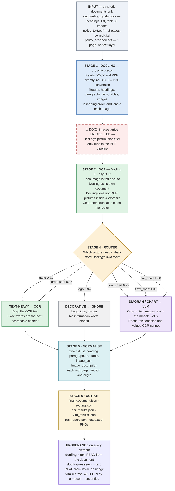

# Workflow Diagram

Two versions of the same diagram:

- **`workflow.png`** — rendered image, open it directly
- **below** — Mermaid source, editable and renders on GitHub / VS Code

Regenerate the PNG after editing the Mermaid:

```
python docs/draw_workflow.py
```

For DOCX page citations, install LibreOffice and run:

```
python -m src.main --citation-pdf
```

This opt-in step writes rendered PDFs under `output/citations/` and emits
`output/citation_chunks.json`. Without this option, DOCX `page_number` remains
`null`; section and element anchors remain available.

---

## Mermaid source



---

## Reading the diagram

**The main spine is top to bottom.** Each stage takes the previous one's
output and adds understanding. Nothing branches except the router.

**The one branch that matters** is the router in the middle. It sends each
image to one of three places based on the label Docling already gave it:

- two images to **OCR** (the text card and the screenshot)
- three images to the **VLM** (architecture diagram, flow diagram, chart)
- one image to **IGNORE** (the logo)

The percentages on those arrows are Docling's own classifier confidence, not
something the POC invented. All six routed correctly.

**The orange dashed note** is a real trap in Docling, not a design choice. Its
picture classifier runs inside the PDF pipeline, but a DOCX is read by a
different backend that never invokes it. Without the explicit classification
pass in `stage1_docling.py`, every DOCX image would reach the router unlabelled
and there would be nothing to route on.

**The provenance panel** at the bottom is what makes the output trustworthy. It
distinguishes text that was *read* from the document (`docling`), text *read*
from inside an image (`docling+easyocr`), and prose a model *wrote* (`vlm`). Only
the third is unverified — and on the last run that is exactly where the
SmolVLM-256M description of the bar chart landed as the single character `63`.
