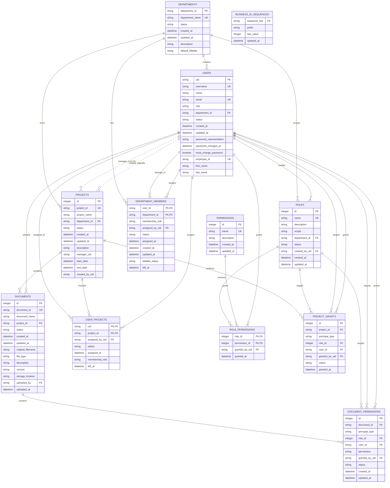

# KnowLayer SQLite Database ERD

This is the complete entity-relationship view of the application SQLite database at `instance/knowlayer.db`.

- **12 application tables** are shown below.
- `sqlite_sequence` is an internal SQLite table created for `AUTOINCREMENT` and is intentionally omitted.
- Solid relationship lines represent declared SQLite foreign keys.
- Dashed lines represent application-level references that are stored as IDs but are not declared foreign keys.
- `PK` = primary key, `FK` = foreign key, `UK` = unique key, `NN` = not null.
- Conversation history is stored as JSON files under `conversation_logs/`; it is not part of this SQLite schema.

## Complete ER Diagram

## Relationship Inventory

| Parent          | Child                    | FK column                               | Cardinality  | Delete behavior | Notes                                      |
| --------------- | ------------------------ | --------------------------------------- | ------------ | --------------- | ------------------------------------------ |
| `departments` | `users`                | `users.department_id`                 | 1 to 0..N    | default         | Primary department on a user.              |
| `departments` | `projects`             | `projects.department_id`              | 1 to 0..N    | default         | Project department.                        |
| `departments` | `roles`                | `roles.department_id`                 | 1 to 0..N    | default         | Used for department-scoped roles.          |
| `departments` | `department_members`   | `department_members.department_id`    | 1 to 0..N    | `CASCADE`     | Department membership junction.            |
| `users`       | `department_members`   | `department_members.user_id`          | 1 to 0..N    | `CASCADE`     | User membership junction.                  |
| `users`       | `user_projects`        | `user_projects.uid`                   | 1 to 0..N    | default         | Project membership junction.               |
| `projects`    | `user_projects`        | `user_projects.project_id`            | 1 to 0..N    | default         | Project membership junction.               |
| `projects`    | `documents`            | `documents.project_id`                | 1 to 0..N    | default         | Nullable: documents may be unassigned.     |
| `users`       | `documents`            | `documents.uploaded_by`               | 1 to 0..N    | default         | Nullable uploader audit reference.         |
| `roles`       | `role_permissions`     | `role_permissions.role_id`            | 1 to 0..N    | `CASCADE`     | RBAC junction.                             |
| `permissions` | `role_permissions`     | `role_permissions.permission_id`      | 1 to 0..N    | `CASCADE`     | RBAC junction.                             |
| `users`       | `role_permissions`     | `role_permissions.granted_by_uid`     | 1 to 0..N    | default         | Nullable audit reference.                  |
| `documents`   | `document_permissions` | `document_permissions.document_id`    | 1 to 0..N    | `CASCADE`     | Document access grants.                    |
| `roles`       | `document_permissions` | `document_permissions.role_id`        | 1 to 0..N    | `CASCADE`     | Used only when`principal_type = 'role'`. |
| `users`       | `document_permissions` | `document_permissions.user_id`        | 1 to 0..N    | `CASCADE`     | Used only when`principal_type = 'user'`. |
| `users`       | `document_permissions` | `document_permissions.granted_by_uid` | 1 to 0..N    | default         | Nullable audit reference.                  |
| `projects`    | `project_grants`       | `project_grants.project_id`           | 1 to 0..N    | `CASCADE`     | Project access grants.                     |
| `roles`       | `project_grants`       | `project_grants.role_id`              | 1 to 0..N    | `CASCADE`     | Used only when`principal_type = 'role'`. |
| `users`       | `project_grants`       | `project_grants.user_id`              | 1 to 0..N    | `CASCADE`     | Used only when`principal_type = 'user'`. |
| `users`       | `project_grants`       | `project_grants.granted_by_uid`       | 1 to 0..N    | default         | Nullable audit reference.                  |
| `users`       | `roles`                | `roles.created_by_uid`                | 1 to 0..N    | default         | Nullable audit reference.                  |
| `users`       | `projects`             | `projects.manager_uid`                | logical only | n/a             | Stored ID; no declared FK in current ORM.  |
| `users`       | `projects`             | `projects.created_by_uid`             | logical only | n/a             | Stored ID; no declared FK in current ORM.  |

## Table Constraints

- `user_projects` has composite primary key `(uid, project_id)` and `uq_user_project`.
- `department_members` has composite primary key `(user_id, department_id)`.
- `role_permissions` has composite primary key `(role_id, permission_id)`.
- `document_permissions` has `uq_document_permission` over `(document_id, principal_type, role_id, user_id, permission)`.
- `project_grants` has `uq_project_grant` over `(project_id, principal_type, role_id, user_id)`.
- `document_permissions` and `project_grants` require `principal_type` to be `role` or `user`, with exactly one of `role_id` and `user_id` populated.
- The application enables `PRAGMA foreign_keys=ON` on SQLAlchemy SQLite connections. A standalone SQLite connection defaults to reporting `PRAGMA foreign_keys=0` unless it enables the pragma itself.

## Non-SQLite Persistence

Conversation records are written separately as employee-scoped JSON files in `conversation_logs/`. They have no database foreign keys and are intentionally outside this ERD. Chroma stores vector retrieval data separately from SQLite as well.
