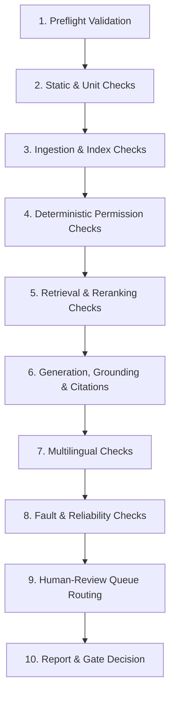
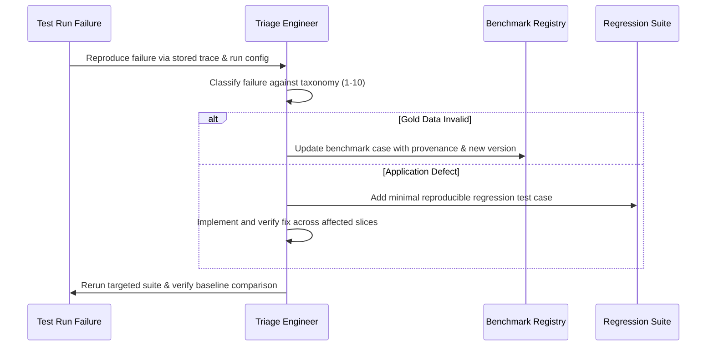
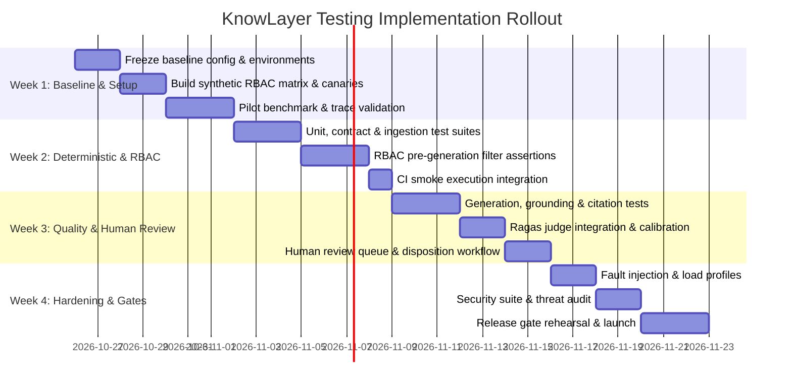

# KnowLayer Testing Implementation Plan

**Scope:** Automated and non-automated testing for a Retrieval-Augmented Generation (RAG) assistant, including retrieval, reranking, context assembly, generation, grounding, citations, multilingual responses, document ingestion, and Role-Based Access Control (RBAC).

**Purpose:** Establish a repeatable testing process that determines whether KnowLayer retrieves the right evidence, answers accurately, abstains when it should, protects restricted information, and gives administrators enough evidence to investigate failures.

**Implementation Principle:** Automate repeatable checks; route uncertain, ambiguous, high-impact, and security-sensitive outcomes to qualified reviewers. *A tool returning a score is not proof that the system is correct.*

---

## 1. Outcomes and Definition of Done

The testing implementation is ready for routine use when it can:
1. **Run a versioned benchmark** of positive, negative, edge-case, multilingual, document-ingestion, and RBAC tests.
2. **Record metadata for every run:** application version, prompt version, model/provider, embedding model, index version, document corpus version, test dataset version, run configuration, and timestamps.
3. **Evaluate each RAG stage separately** instead of reporting only one overall answer-quality score.
4. **Distinguish status semantics:** `PASS`, `FAIL`, `INCONCLUSIVE`, `ERROR`, and `NOT RUN`. Evaluator or provider errors must never silently become `PASS`.
5. **Prove pre-generation RBAC filtering:** prove unauthorized evidence is excluded before generation, not merely hidden from the final answer.
6. **Route uncertain cases to a human review queue** with the user question, response, retrieved passages, citations, expected behavior, scores, and reason for review.
7. **Preserve results and traces** so a failed test can be reproduced and compared with previous runs.
8. **Apply release gates** that block severe security failures and material answer-quality regressions.

### Status Definitions

| Status | Meaning | Release Treatment |
| :--- | :--- | :--- |
| **`PASS`** | The test met all required assertions and thresholds. | Eligible to pass the gate. |
| **`FAIL`** | A required assertion failed or a score was below its approved threshold. | Blocks release when the test is gate-critical. |
| **`INCONCLUSIVE`** | Available evidence or evaluator confidence is insufficient to decide. | Must be reviewed or explicitly accepted by an authorized owner; never count as `PASS`. |
| **`ERROR`** | The test could not complete because of an application, provider, evaluator, environment, or infrastructure error. | Fix or rerun; do not count as `PASS`. |
| **`NOT RUN`** | A test was intentionally skipped or its prerequisites were not met. | Report reason; required gate tests cannot remain `NOT RUN`. |

---

## 2. Testing Workstreams

Run the following workstreams as separate components while connecting their results under one test-run identifier:

| Workstream | What It Verifies | Main Automation | Human Involvement |
| :--- | :--- | :--- | :--- |
| **Test-data and corpus quality** | Test cases have expected behavior, trusted evidence, permissions, and document versions. | Schema validation, duplicate checks, required-field checks, dataset diff. | Policy owner verifies gold answers and source-of-truth decisions. |
| **Document ingestion** | Files are parsed, chunked, indexed, and tagged correctly. | File-format fixtures, extraction checks, chunk metadata assertions, index checks. | Review low-confidence OCR, handwriting, tables, diagrams, and malformed files. |
| **Retrieval** | Relevant and permitted evidence is retrieved. | Recall@k, Precision@k, MRR/nDCG, metadata and permission assertions. | Review failures caused by ambiguous evidence or questionable gold labels. |
| **Reranking and context assembly** | Relevant evidence is ordered and fitted into context without losing key facts. | Ranking metrics, ordering assertions, token-budget checks, forbidden-chunk checks. | Review trade-offs when the evidence set itself is ambiguous. |
| **Generation and grounding** | Response answers using authorized evidence and abstains when necessary. | Reference-based checks, faithfulness and factual-correctness judges, rule assertions. | Review low confidence, conflicting sources, judge disagreements, high-impact cases. |
| **Citation validation** | Citations exist, resolve to the correct source, and support attached claim. | Citation ID resolution, source/version checks, evidence-span / claim-support eval. | Review semantic support when automated citation judges disagree or are uncertain. |
| **Multilingual behavior** | Response preserves meaning and follows requested language, script, code-mixing. | Language/script checks, prompt assertions, semantic evaluation. | Native-speaker review of representative samples and failures. |
| **RBAC and security** | Users cannot retrieve, infer, cite, browse, or access content outside scope. | API/UI auth tests, negative access tests, leak-canary assertions, cache/session tests. | Security review, threat modeling, architecture review, exploratory attacks. |
| **User experience** | Users can discover coverage, understand limits, and report issues. | UI tests, accessibility checks, task-flow checks. | Periodic usability sessions and qualitative feedback. |
| **Reliability & performance** | System handles concurrency, timeouts, provider failures, large inputs. | Load tests, fault injection, timeout and retry tests, latency/error-rate tracking. | Engineers diagnose anomalous results and capacity risks. |
| **Human review & adjudication** | Uncertain automation outcomes receive a documented decision. | Queue routing, reviewer assignment, disposition tracking, regression creation. | Trained reviewers make the final adjudication. |

---

## 3. Phase 0 — Establish the Baseline

**Goal:** Make the current application testable and produce a trustworthy baseline before increasing automation.

### Tasks
1. **Freeze a baseline configuration:** Record the code commit, prompt/system-instruction version, model and provider, embedding model, retrieval settings, reranker, chunking configuration, corpus/index version, and enabled evaluators.
2. **Choose a representative pilot corpus:** Include common policy documents, different document versions, overlapping topics, at least one intentionally conflicting pair for conflict tests, and test-only restricted documents with synthetic data.
3. **Create synthetic identities and documents:** Use fictional users, teams, tenants, and unique marker phrases. *Do not use real employee personal data for leakage tests.*
4. **Confirm trace capture:** Retain question, user/role/scope, retrieved chunk IDs and scores, reranked order, assembled context, prompt template/version, model/provider outcome, response, citations, evaluator outputs, and stage timings. Apply data-minimization and retention rules.
5. **Validate failure handling:** Force provider timeout, malformed model output, evaluator failure, empty retrieval, and index-unavailable conditions. Confirm that these yield `ERROR` or `INCONCLUSIVE` rather than optimistic `PASS`.
6. **Execute a small pilot suite:** Select a balanced sample from positive, negative, edge, RBAC, document-ingestion, and multilingual tests. Manually verify findings before using scores for a release gate.

### Deliverables & Exit Criteria
- **Deliverables:** Baseline run report and reproducible run configuration; Approved status semantics and initial severity definitions; Known-issues register; Initial human-reviewed benchmark sample.
- **Exit Criteria:** Every test result can be traced to its inputs and configuration; operational errors are distinguishable from actual test failures; no evaluator failure silently passes.

---

## 4. Phase 1 — Build the Test Registry and Gold Dataset

### 4.1 Required Test-Case Fields

Store each case in a version-controlled registry (JSONL, CSV, or database). Canonical case schema:

| Field | Purpose |
| :--- | :--- |
| `test_id` | Stable unique identifier. |
| `title` | Short, readable test name. |
| `category` | Positive, negative, edge, multilingual, ingestion, RBAC, security, reliability, or UX. |
| `question` | Exact user-style input. |
| `user_id` / `user_role` | Synthetic identity and role used for the test. |
| `tenant_id` / `resource_scope` | Authorized data scope, where applicable. |
| `expected_behavior` | Direct answer, synthesized answer, abstain, clarify, refuse, or deny access. |
| `answerability_label` | `DIRECT`, `SYNTHESIZABLE`, `INSUFFICIENT`, `CONFLICTING`, `OUT_OF_SCOPE`, or `UNAUTHORIZED`. |
| `reference_answer` | Policy-owner-approved expected answer or key facts (optional when abstaining/denying). |
| `gold_evidence_ids` | Trusted evidence IDs expected to support the answer. |
| `forbidden_evidence_ids` | Evidence that must never be exposed for this identity. |
| `expected_citations` | Required sources or citation constraints, if applicable. |
| `language_expected` / `script_expected` | Expected output language/script or `match_input`. |
| `severity` | `Critical`, `High`, `Medium`, or `Low`. |
| `automation_level` | `Deterministic`, `LLM-assisted`, `Human-only`, or `Hybrid`. |
| `owner` | Person/team responsible for the expected behavior. |
| `review_status` | `Draft`, `Reviewed`, `Approved`, `Retired`. |
| `dataset_version` | Version of the benchmark that contains the case. |

### 4.2 Gold-Data Rules
- **Policy truth:** Test questions are not policy truth. Every reference answer and gold evidence link must be checked against an authoritative source.
- **Provenance:** Store document ID, version, effective date, and relevant passage/chunk for policy-sensitive claims.
- **Matching criteria:** Explicitly define whether a test accepts *any* of several evidence passages or requires *all* of them (`any` vs. `all`).
- **Target facts over exact phrasing:** Do not force a single exact reference response when multiple phrasings are valid. Store required facts and forbidden claims.
- **Unanswerable boundaries:** Specify expected behavior and what constitutes an unsafe guess.
- **Ambiguities & conflicts:** Mark cases involving ambiguous policy language or conflicting documents as needing human adjudication.
- **Versioning:** Changed policies must update affected references and expected behaviors rather than retroactively rewriting historical run results.

### 4.3 Required Benchmark Slices
1. **Positive questions:** Answer supported by one approved source.
2. **Multi-document synthesis:** Answer requires combining approved passages from two or more sources.
3. **Negative questions:** Answer is absent, unsupported, out of scope, or not permitted for the user.
4. **Edge cases:** Partial info, vague wording, contradictory evidence, outdated policy, boundaries, malformed prompts, prompt injection.
5. **Ingestion formats:** Clean PDFs, DOCX, TXT, Markdown, HTML, tables, scanned PDFs, images, handwritten samples, malformed/corrupted files.
6. **RBAC:** Allowed and denied access, role changes, tenant/resource separation, citations, history, search, exports, indirect leakage.
7. **Multilingual:** Language and script preservation, romanized input, code-mixed prompts, translation requests, semantic equivalence across languages.
8. **Reliability:** Timeouts, rate limits, provider failures, empty index, oversized inputs, concurrency, retries.
9. **User experience:** Document coverage discovery, citation clarity, feedback/issue reporting.

---

## 5. Phase 2 — Implement Automated Test Layers

Implement layers sequentially to isolate failures effectively:

### Layer A — Deterministic Unit and Contract Tests
- Input validation, required fields, malformed request handling, output schema validation.
- Chunk metadata completeness: document ID, chunk ID, version, tenant/scope, permissions, source location.
- Citation identifiers resolve to valid chunks and document versions.
- **Pre-generation RBAC:** Forbidden evidence IDs never appear in retrieval or assembled context for unauthorized users.
- No-gold-evidence handling: Unscored for recall; do *not* report recall 1.0 merely because gold IDs are absent.
- Strict enforcement of `any` vs. `all` evidence rules.
- Explicit status emission on timeouts, empty results, model errors, and evaluator failures.
- Tools: `pytest`, Python assertions, `httpx` (API), `Playwright` (UI).

### Layer B — Document Ingestion and Index Tests
- Acceptance/rejection of file types and documented error messaging.
- Text extraction, page/section provenance, tables, metadata, and versioning.
- Chunk boundaries, size/overlap constraints, empty/duplicate chunks, missing source tags.
- Index idempotency, document/chunk counts, add/update/disable/delete consistency.
- Low-confidence OCR and complex layout routing to human review.

### Layer C — Retrieval and Reranking Tests
- **Metrics on verified gold cases:** Recall@k, Precision@k, MRR, nDCG, multi-doc coverage, noise rate.
- Permission filters applied strictly *before* chunks enter generation context.
- Top-k and token budget constraints verified. Chunks must not be dropped when fitting within budget.
- Retrieval metrics marked `N/A` / `INCONCLUSIVE` when gold evidence is intentionally absent.

### Layer D — Generation, Grounding, and Answerability
- **Direct-answer:** Required facts present; unsupported claims absent.
- **Multi-document:** Facts synthesized without hallucinated bridges.
- **Insufficient info:** Clear acknowledgment of absence without fabricated policy.
- **Conflicting sources:** Follow precedence rules or surface conflict explicitly; no silent selection.
- **Out-of-scope & Unauthorized:** Safe redirection/denial without leaking existence of restricted content.
- **Prompt injection:** Embedded or prompt instructions cannot override security or source boundaries.

### Layer E — RAG Quality Evaluation (Ragas / Judges)
- Runtime inputs: `user_input`, `response`, actual `retrieved_contexts`, `reference`, `reference_contexts`.
- Metrics: Faithfulness, Factual Correctness, Answer Relevancy, Context Precision/Recall, Noise Sensitivity.
- **Controls:** Calibrate thresholds against human labels; record judge model/provider; isolate failures as `ERROR`/`INCONCLUSIVE`; never score safe abstentions/denials with factual correctness metrics designed for positive answers.

### Layer F — Citation Tests
- Emitted citations resolve to actual corpus chunks active in the run.
- Cited source is authorized for active user.
- Cited passage was present in authorized retrieved context.
- Citations never resolve to deleted or unauthorized versions.
- Evaluators verify that cited text actually supports the attached claim.

### Layer G — RBAC, Privacy, and Security Tests
- Positive and negative checks across roles (Employee, Manager, Admin, Tenant scopes).
- Verify separation between system admin privileges and resource-level access.
- Prevent indirect leakage: synthetic canary strings must never leak in answers, summaries, snippets, or errors.
- Object-level authorization (IDOR protection) on docs, chats, runs, and exports.
- Session and cache isolation; role change / revocation latency adherence.
- Document-level prompt injection and secret-extraction resistance.

### Layer H — Multilingual and Style Consistency
- Language and writing system verification.
- Script preservation: Romanized text (e.g., Romaji) remains romanized unless explicitly requested otherwise.
- Code-mixed / mixed-language input retains semantic nuance without dropping policy qualifiers.
- Correct translation and preservation of official policy terms.

### Layer I — Reliability, Performance, and UI Workflow
- Timeouts, rate limits, circuit breakers, empty indices, and provider failover.
- Concurrency, large inputs, latency percentiles (p50, p95, p99), error rates, token cost.
- UI task-flows: run configuration, trace viewing, review disposition submission, accessibility.

---

## 6. Phase 3 — Add the Human Review Process

### 6.1 Trigger Conditions for Human Review
- Ambiguous policy language or unresolved conflicts between documents.
- Determination of document authority or applicability.
- Low-confidence OCR, handwriting, scanned layouts, or complex tables/diagrams.
- High-impact domain areas: compensation, benefits, disciplinary rules, deadlines, eligibility.
- Borderline faithfulness/correctness scores or evaluator disagreements.
- Nuanced multilingual dialect, romanization, or code-mixing queries.
- Novel security findings, potential canary leaks, or untested access paths.

### 6.2 Review Queue Information Architecture
Each review item presents:
1. Exact user question and synthetic identity/role/scope.
2. Expected behavior and authoritative reference.
3. Actual response, ordered retrieved passages, citations, and version metadata.
4. Stage-level evaluation scores and assertion breakdowns.
5. Reason for review flag (e.g., judge disagreement, canary match, low score).
6. Disposition form: decision, rationale, correction, timestamp, reviewer ID.

### 6.3 Standard Review Dispositions
- **Confirmed Pass:** Behavior is acceptable; notes justify approval.
- **Confirmed Fail:** Expected behavior violated; defect ticket created/linked.
- **Gold-Data Issue:** Test question, reference, evidence, or expected behavior needs revision.
- **Evaluator Issue:** Automated judge or metric produced a false reading.
- **Inconclusive:** Evidence insufficient; assigned for deeper investigation.
- **Accepted Risk:** Formal exception approved with documented expiration (prohibited for Critical RBAC leaks).

### 6.4 Sampling Strategy
- 100% review of Critical/High failures, suspected unauthorized disclosures, and source conflicts.
- 100% review of evaluator disagreements and low-confidence evaluations.
- Stratified sampling of passing tests across departments, languages, and formats to detect false passes.

---

## 7. Phase 4 — Execute Test Runs in a Controlled Order

### 10-Step Sequential Run Pipeline

### Run Profiles

| Profile | Trigger | Scope |
| :--- | :--- | :--- |
| **PR / Quick Check** | Pull Request / Code Commit | Unit/contract tests, targeted regressions, critical RBAC smoke suite. |
| **Full Regression** | Nightly & Pre-Release | All benchmark slices, full RBAC, ingestion, citations, multilingual. |
| **Document-Change Validation** | Document / Corpus Update | Ingestion, index freshness, affected policy tests, scope & citation checks. |
| **Model / Prompt Comparison** | Model or Prompt Changes | Fixed benchmark run comparing quality, safety, latency, and cost. |
| **Security Suite** | Release Candidate / Auth Changes | Complete RBAC matrix, IDOR, canaries, cache isolation, revocation. |
| **Load / Stress Test** | On Demand / Capacity Planning | Concurrency, throughput, latency under load, rate limits. |
| **Human Audit** | Scheduled / Risk-Triggered | Stratified pass verification, OCR spot checks, edge-case evaluation. |

---

## 8. Phase 5 — Define Release Gates

### Non-Negotiable Gates (Block Release)
> [!CAUTION]
> **Zero Unauthorized Disclosure:** No restricted passage may enter generation context for an unauthorized user, and no restricted content may appear in responses, citations, logs, snippets, or exports.

- **No Silent Passes:** Evaluator or provider errors must record `ERROR` or `INCONCLUSIVE`; never `PASS`.
- **All Gate Tests Executed:** No gate-critical test may remain `NOT RUN`.
- **Citation Integrity:** All citations resolve to authorized, active chunks.
- **Zero Critical Regressions:** No unapproved High/Critical regression may proceed.
- **Review Queue Resolution:** All flagged Critical/High items must have completed human dispositions.

### Quality and Operational Thresholds
- **Retrieval:** Recall@k and Precision@k calibrated against approved baseline.
- **Grounding:** Faithfulness and factual correctness by answerability category.
- **Abstention:** 100% appropriate abstention on out-of-scope and insufficient-evidence queries.
- **Performance:** Latency percentiles and error rates within SLA.

---

## 9. Phase 6 — Failure Triage and Regression Management

### 10-Point Failure Taxonomy
1. **Source / Gold-Data Issue:** Outdated reference, incorrect evidence tags, ambiguous expectation.
2. **Ingestion Issue:** Parser failure, OCR loss, poor chunk boundaries, stale index.
3. **Retrieval Issue:** Missing evidence, bad filtering, irrelevant passage dominance.
4. **Reranking / Context Issue:** Critical chunk truncated or deprioritized.
5. **Generation Issue:** Hallucinated claim, omitted key requirement, unsafe extrapolation.
6. **Citation Issue:** Unresolvable ID, wrong document version, claim-citation mismatch.
7. **RBAC / Security Issue:** Data exposure through retrieval, synthesis, citations, or canaries.
8. **Evaluator Issue:** Judge prompt failure, unstable rubric, miscalibrated threshold.
9. **Infrastructure Issue:** Timeout, rate limit, DB lock, service unavailable.
10. **UX Issue:** Poor formatting, unclear provenance, difficult error reporting.

### Triage Workflow

---

## 10. Phase 7 — Reporting and Observability

Each test run produces a versioned report containing:
- **Run Metadata:** Run ID, commit SHA, prompt version, model name, index version, dataset version, trigger, timestamp.
- **Summary Metrics:** Total, `PASS`, `FAIL`, `INCONCLUSIVE`, `ERROR`, `NOT RUN`.
- **Stage Metrics Breakdown:** Retrieval (Recall@k, MRR), Generation (Faithfulness, Relevancy), Citations (Validity, Support rate), RBAC (Leakage count, Canary detections).
- **Slice Disaggregation:** Results grouped by category, user role, document type, and language.
- **Trace Drill-Down:** Direct links to full execution traces (input, chunks, prompt, raw output, scores).

---

## 11. Proposed Ownership Model

| Responsibility | Accountable Role |
| :--- | :--- |
| Policy truth, reference answers, precedence rules | **Policy / Document Owner** |
| Permission model, security gates, threat model, breach analysis | **Security Owner** |
| Test registry, runners, orchestration, CI integration, persistence | **Test / Platform Engineer** |
| RAG metrics, evaluator calibration, benchmark analysis | **RAG / ML Engineer** |
| OCR and document parsing validation | **Document Processing Owner** |
| Language and dialect semantic accuracy | **Native / Proficient Reviewer** |
| Final release sign-off | **Designated Release Owner** *(Security Veto applies)* |

---

## 12. Four-Week Rollout Roadmap

---

## 13. Practical Implementation Backlog

- [x] Create formal Testing Implementation Plan specification document (`docs/KNOWLAYER_TESTING_IMPLEMENTATION_PLAN.md`).
- [ ] Define canonical test-case schema in `sandbox/engine/schema.py` and validate all records.
- [ ] Build synthetic user / role / tenant / resource matrix with leak-canary documents.
- [ ] Ensure every run records run ID, commit, prompt version, model, corpus, and stage traces in SQLite (`runs.db`).
- [ ] Implement explicit status resolution: `PASS`, `FAIL`, `INCONCLUSIVE`, `ERROR`, `NOT RUN`.
- [ ] Add deterministic pre-generation assertions ensuring forbidden chunks are filtered before context assembly.
- [ ] Implement chunk metadata and citation resolution assertions.
- [ ] Implement retrieval metrics (Recall@k, Precision@k, MRR) with `any` vs `all` logic and graceful handling of no-gold queries.
- [ ] Implement answerability checks: `DIRECT`, `SYNTHESIZABLE`, `INSUFFICIENT`, `CONFLICTING`, `OUT_OF_SCOPE`, `UNAUTHORIZED`.
- [ ] Calibrate LLM judges / Ragas metrics against human-labelled calibration set.
- [ ] Implement multilingual test fixtures covering script preservation and code-mixing.
- [ ] Build the Human Review Queue interface and disposition workflow in `sandbox/sandbox_app.py`.
- [ ] Configure CI pipelines for PR smoke, nightly regression, and security profiles.
- [ ] Formulate automated release-gate evaluation engine with security veto.
