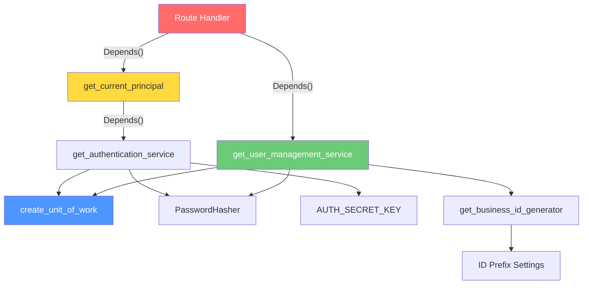
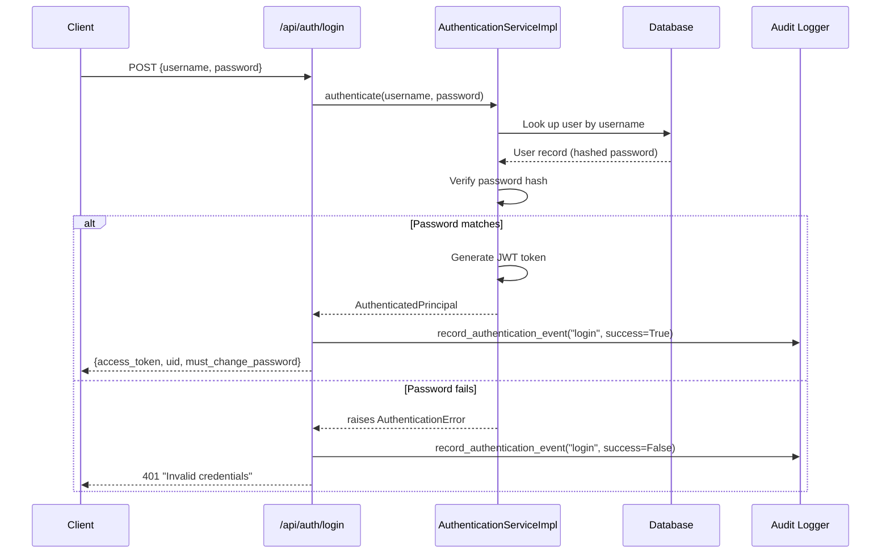
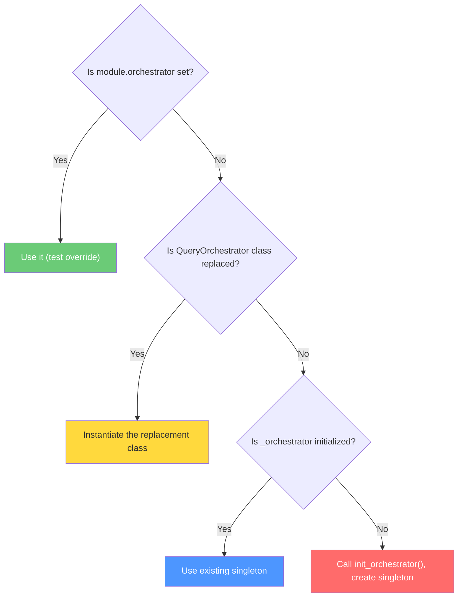
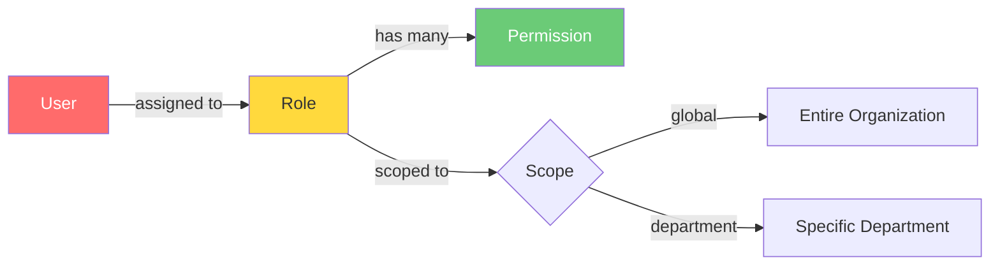
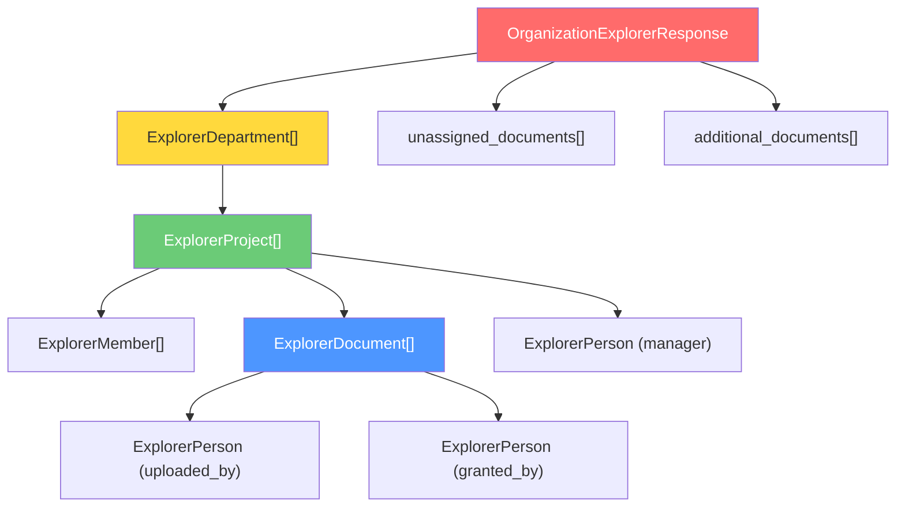
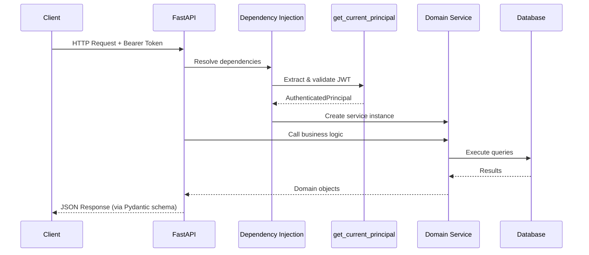

# 🔬 Code-Grinder Deep Dive: `app/api` — The API Layer

> **Mode**: Topic Driller — we go deep, we go wide, we don't stop until every concept is chewed up and spit out as understanding.

---

## 📂 What Are We Looking At?

```
app/api/
├── dependencies.py          ← The Dependency Injection hub (the BRAIN)
├── routes/                  ← HTTP endpoint definitions (the MOUTH)
│   ├── authentication.py
│   ├── chat.py
│   ├── documents.py
│   ├── explorer.py
│   ├── organization.py
│   ├── roles.py
│   └── tokens.py
└── schemas/                 ← Request/Response data shapes (the CONTRACT)
    ├── authentication.py
    ├── chat.py
    ├── documents.py
    ├── explorer.py
    ├── organization.py
    ├── profile.py
    └── roles.py
```

This is a **FastAPI REST API** layer following a classic **3-tier separation**:

| Folder | Responsibility | Analogy |
|--------|---------------|---------|
| `schemas/` | Define *what* data looks like coming in and going out | The **menu** — what you can order and what you'll get |
| `routes/` | Define *what happens* when an HTTP request hits a URL | The **kitchen** — processes the order |
| `dependencies.py` | Wire up *who does the work* (services, auth, DB) | The **supply chain** — where ingredients come from |

---

## 🧩 Section 1: `dependencies.py` — The Dependency Injection Hub

[dependencies.py](file:///c:/Users/abhin/OneDrive/Documents/MY%20Coding%20Space/Learning%20Topics/New%20folder/Company_Bot/app/api/dependencies.py)

### What IS Dependency Injection?

Imagine you're a chef. Instead of going to the farm yourself to get eggs, someone **hands you** the eggs when you need them. That's DI. Your route functions don't create their own database connections or services — they **declare what they need**, and FastAPI **injects** it.

### The Pattern in This File

Every function here is a **factory** — it creates and returns a service object:

```python
# PATTERN: Factory function → creates service → injected into routes via Depends()
def get_user_management_service():
    return UserManagementService(
        create_unit_of_work,           # ← DB transaction factory
        PasswordHasher(),              # ← bcrypt password hashing
        business_id_generator=get_business_id_generator()  # ← ID generation
    )
```

### The Dependency Graph



### The Two Authentication Dependencies — CRITICAL DIFFERENCE

```python
# STRICT — throws 401 if not authenticated. Used for admin/management routes.
def get_current_principal(request, authentication_service):
    principal = getattr(request.state, "principal", None)
    if principal is None:
        # Try extracting from Bearer token
        authorization = request.headers.get("Authorization", "")
        if authorization.lower().startswith("bearer "):
            principal = service.resolve_token(authorization[7:].strip())
    if principal is None:
        raise HTTPException(status_code=401)  # ← HARD FAIL
    return principal

# LENIENT — returns None if not authenticated. Used for chat (anonymous allowed).
def get_chat_principal(request, authentication_service):
    try:
        return get_current_principal(request, authentication_service)
    except HTTPException:
        return None  # ← SOFT FAIL, anonymous access OK
```

> [!IMPORTANT]
> This is a **critical design decision**: the chat endpoint allows unauthenticated users (returns `None`), while every other endpoint requires a valid JWT token. The chat route then builds a restricted `AuthorizationScope` for anonymous users.

### All 13 Factory Functions

| Factory | What It Creates | Used By |
|---------|----------------|---------|
| `get_business_id_generator` | Generates `EMP-001`, `DEPT-001` style IDs | Users, Projects, Documents |
| `get_authentication_service` | JWT token creation/validation + password verification | Auth routes |
| `get_current_principal` | Extracts authenticated user from JWT | **Almost everything** |
| `get_chat_principal` | Same but allows `None` (anonymous) | Chat route only |
| `get_unit_of_work` | Raw database transaction wrapper | Direct DB access |
| `get_authorization_service` | Checks "can this user do this thing?" | Chat authorization |
| `get_user_management_service` | CRUD for users + departments | Organization routes |
| `get_project_management_service` | CRUD for projects | Organization routes |
| `get_membership_management_service` | Assign/revoke project members | Organization routes |
| `get_department_membership_service` | Assign/revoke department members | Organization routes |
| `get_role_management_service` | CRUD for roles + permissions (RBAC) | Roles routes |
| `get_document_management_service` | Register/delete documents + trigger ingestion | Document routes |
| `get_document_access_service` | Grant/revoke document-level access | Document routes |
| `get_project_access_service` | Grant/revoke project-level access | Organization routes |
| `get_profile_service` | Aggregated "my profile" view | Profile route |
| `get_organization_explorer_service` | Full org tree view | Explorer route |

### 🧠 Drill Question #1
> **Why does `get_document_access_service` use a lazy import (`from app.domain.services.authorization_engine import AuthorizationEngine` inside the function body) instead of importing at the top?**
>
> **Answer**: To avoid circular imports. `AuthorizationEngine` likely depends on persistence modules that also import from the domain layer. By deferring the import to runtime, the module-level import cycle is broken.

---

## 🔐 Section 2: Authentication Routes

[authentication.py (routes)](file:///c:/Users/abhin/OneDrive/Documents/MY%20Coding%20Space/Learning%20Topics/New%20folder/Company_Bot/app/api/routes/authentication.py) · [authentication.py (schemas)](file:///c:/Users/abhin/OneDrive/Documents/MY%20Coding%20Space/Learning%20Topics/New%20folder/Company_Bot/app/api/schemas/authentication.py)

### The Login Flow — Step by Step



### Schema Breakdown

```python
# INPUT: What the client sends
class LoginRequest(BaseModel):
    username: str = Field(min_length=1)   # Can't be empty
    password: str = Field(min_length=1)   # Can't be empty

# OUTPUT: What the client gets back
class LoginResponse(BaseModel):
    access_token: str              # JWT token for subsequent requests
    token_type: str = "bearer"     # Always "bearer" (OAuth2 convention)
    uid: str                       # User's unique identifier
    must_change_password: bool = False  # Force password change on first login

# INPUT: Change password (self or admin-initiated)
class ChangePasswordRequest(BaseModel):
    current_password: str | None   # Required for self-change, None for admin
    new_password: str = Field(min_length=8)  # Minimum 8 chars enforced
    uid: str | None = None         # If set AND different from caller → admin change
```

### The Change Password Dual-Path Logic

```python
@router.post("/change-password", status_code=status.HTTP_204_NO_CONTENT)
def change_password(payload, principal, service):
    if payload.uid and payload.uid != principal.uid:
        # PATH A: Admin changing someone else's password
        # No current_password needed — admin override
        service.admin_change_password(principal, payload.uid, payload.new_password)
    else:
        # PATH B: User changing their own password
        # MUST provide current_password for verification
        if not payload.current_password:
            raise AuthenticationError("Current password is required")
        service.change_password(principal, payload.current_password, payload.new_password)
```

> [!TIP]
> The `204 No Content` status means "it worked, but there's nothing to send back." This is the correct HTTP semantic for mutation operations that don't produce a resource.

### 🧠 Drill Question #2
> **What happens if an admin sends a `ChangePasswordRequest` with `uid` set to their own UID?**
>
> **Answer**: The condition `payload.uid != principal.uid` is `False`, so it falls through to Path B (self-change), requiring `current_password`. The admin is treated as a regular user changing their own password — which is correct behavior!

---

## 💬 Section 3: The Chat Route — The Heart of the Bot

[chat.py (routes)](file:///c:/Users/abhin/OneDrive/Documents/MY%20Coding%20Space/Learning%20Topics/New%20folder/Company_Bot/app/api/routes/chat.py) · [chat.py (schemas)](file:///c:/Users/abhin/OneDrive/Documents/MY%20Coding%20Space/Learning%20Topics/New%20folder/Company_Bot/app/api/schemas/chat.py)

This is the **most complex** route file in the entire API layer. Let's dissect it piece by piece.

### The Orchestrator Pattern

```python
_DefaultQueryOrchestrator = QueryOrchestrator  # Save original class reference
_orchestrator: QueryOrchestrator | None = None  # Module-level singleton
orchestrator: QueryOrchestrator | None = None   # Override point for testing
```

Three variables, one purpose: **allow the orchestrator to be swapped at runtime** (for testing or hot-reloading). The resolution order is:



### Authorization Scoping for Chat

```python
if principal is not None:
    # AUTHENTICATED USER: Build scope from their actual permissions
    scope = authorization.authorization_scope(principal, request.project_id)
    if request.project_id is not None and scope.project_ids == [] and not scope.document_ids:
        raise HTTPException(status_code=403, detail="Access denied")
else:
    # ANONYMOUS USER: Can only see unassigned (public) documents
    scope = AuthorizationScope(
        is_admin=False,
        project_ids=[],
        document_ids=None,
        include_unassigned=True  # ← Key: can see orphaned/public docs
    )
```

> [!WARNING]
> The anonymous scope with `include_unassigned=True` means any document **not assigned to a project** is visible to unauthenticated users. This is intentional for public-facing FAQ/policy bots but could be a security concern if sensitive docs are uploaded without project assignment.

### The Dynamic `answer()` Call — Signature Inspection

This is the most **clever** (and arguably over-engineered) part:

```python
answer_sig = inspect.signature(active_orchestrator.answer)
kwargs = {}
if "conversation_history" in answer_sig.parameters:
    kwargs["conversation_history"] = history
if "authorization_scope" in answer_sig.parameters:
    kwargs["authorization_scope"] = scope
if "session_id" in answer_sig.parameters:
    kwargs["session_id"] = request.session_id
# ... etc
```

**Why?** Because different orchestrator implementations may accept different parameters. Instead of requiring a rigid interface, this uses **duck typing with runtime introspection**. A minimal orchestrator only needs `answer(question)`, while a full one can accept history, scope, session, citations, and user context.

### The `asyncio.to_thread()` Bridge

```python
result = await asyncio.to_thread(
    active_orchestrator.answer,
    request.question,
    **kwargs,
)
```

The orchestrator's `answer()` method is **synchronous** (blocking I/O to LLM providers), but FastAPI runs in an **async** event loop. `asyncio.to_thread()` moves the blocking call to a thread pool, preventing it from freezing the entire server.

### Chat Schemas

```python
class ChatMessage(BaseModel):
    role: Literal["user", "assistant"]  # Only these two values allowed
    content: str = Field(..., min_length=1)

class ChatRequest(BaseModel):
    question: str                       # The user's question
    session_id: str = "default-session" # Groups conversations together
    project_id: str | None              # Scope to a specific project's docs
    conversation_history: list[ChatMessage] | None  # Prior messages for context
    defer_citations: bool | None        # Skip citation retrieval for speed

class ChatResponse(BaseModel):
    session_id: str
    answer: str                         # The LLM's response
    citations: list[Citation]           # Source documents referenced
    cache_hit: bool                     # Was this served from cache?
    matched_faq: str | None             # If a pre-built FAQ matched
    similarity: float | None            # How closely the FAQ matched
    tokens: TokenUsageInfo | None       # Cost tracking
```

### 🧠 Drill Question #3
> **Why does the chat route use `asyncio.to_thread()` instead of just making the orchestrator async?**
>
> **Answer**: The orchestrator calls external LLM APIs using synchronous HTTP clients (likely `requests` or similar). Rewriting the entire LLM pipeline to be async would be a massive refactor. `to_thread()` is a pragmatic bridge that keeps the event loop responsive without requiring an async rewrite of the domain layer.

---

## 📄 Section 4: Document Routes — CRUD + Access Control

[documents.py (routes)](file:///c:/Users/abhin/OneDrive/Documents/MY%20Coding%20Space/Learning%20Topics/New%20folder/Company_Bot/app/api/routes/documents.py) · [documents.py (schemas)](file:///c:/Users/abhin/OneDrive/Documents/MY%20Coding%20Space/Learning%20Topics/New%20folder/Company_Bot/app/api/schemas/documents.py)

### The Unified Error Handler Pattern

Every route file repeats this pattern:

```python
def _error(error):
    if isinstance(error, ConflictError):   return HTTPException(status_code=409, ...)
    if isinstance(error, NotFoundError):   return HTTPException(status_code=404, ...)
    if isinstance(error, ForbiddenError):  return HTTPException(status_code=403, ...)
    return HTTPException(status_code=400, ...)  # Catch-all
```

This maps **domain exceptions** to **HTTP status codes**. The domain layer throws business errors; the API layer translates them to HTTP semantics.

| Domain Exception | HTTP Status | Meaning |
|-----------------|-------------|---------|
| `ConflictError` | `409 Conflict` | Duplicate resource (e.g., document ID already exists) |
| `NotFoundError` | `404 Not Found` | Resource doesn't exist |
| `ForbiddenError` | `403 Forbidden` | User lacks permission |
| Everything else | `400 Bad Request` | Generic client error |

### The Dual Document Creation Paths

```python
# PATH 1: Create document without a project
@router.post("/documents")
def create_document(payload):
    return service.register_document(principal, **payload.model_dump())

# PATH 2: Create document within a project (project_id from URL)
@router.post("/projects/{project_id}/documents")
def create_project_document(project_id, payload):
    return service.register_document(
        principal,
        project_id=project_id,
        **payload.model_dump(exclude={"project_id"})  # ← Avoid conflict!
    )
```

> [!NOTE]
> `model_dump(exclude={"project_id"})` prevents the `project_id` from the request body from conflicting with the one from the URL path. The URL always wins.

### Document Access Control (Grant-Based)

```python
class DocumentAccessGrantCreate(BaseModel):
    principal_type: str = Field(pattern="^(role|user)$")  # Who gets access
    role_id: int | None          # If principal_type == "role"
    user_id: str | None          # If principal_type == "user"
    permission: str = "read"     # "read", etc.
```

The system supports **two types of access grants**:
- **User-based**: "User EMP-001 can read Document DOC-005"
- **Role-based**: "Anyone with role 'Engineering Lead' can read Document DOC-005"

---

## 🏢 Section 5: Organization Routes — The Largest File

[organization.py (routes)](file:///c:/Users/abhin/OneDrive/Documents/MY%20Coding%20Space/Learning%20Topics/New%20folder/Company_Bot/app/api/routes/organization.py) · [organization.py (schemas)](file:///c:/Users/abhin/OneDrive/Documents/MY%20Coding%20Space/Learning%20Topics/New%20folder/Company_Bot/app/api/schemas/organization.py) · [profile.py (schemas)](file:///c:/Users/abhin/OneDrive/Documents/MY%20Coding%20Space/Learning%20Topics/New%20folder/Company_Bot/app/api/schemas/profile.py)

### 367 lines covering the entire org hierarchy. Here's the route map:

```
DEPARTMENTS                              USERS
├── POST   /departments                  ├── POST   /users
├── GET    /departments                  ├── GET    /users
├── GET    /departments/{id}             ├── GET    /users/{uid}
├── PATCH  /departments/{id}             ├── PATCH  /users/{uid}
├── POST   /departments/{id}/members     ├── DELETE /users/{uid}
├── GET    /departments/{id}/members     ├── GET    /users/{uid}/memberships
├── PATCH  /departments/{id}/members/{uid}  └── GET /users/me/profile
└── DELETE /departments/{id}/members/{uid}

PROJECTS
├── POST   /projects
├── GET    /projects
├── GET    /projects/{id}
├── PATCH  /projects/{id}
├── GET    /projects/{id}/members
├── POST   /projects/{id}/members/{uid}
├── DELETE /projects/{id}/members/{uid}
├── POST   /projects/{id}/members/me/leave
├── GET    /projects/{id}/access
├── POST   /projects/{id}/access
└── DELETE /project-access/{grant_id}
```

### The Create vs. Update Schema Pattern

```python
# CREATE: All required fields present, optional fields have defaults
class UserCreate(BaseModel):
    uid: str = Field(min_length=1)          # REQUIRED
    name: str = Field(min_length=1)         # REQUIRED
    email: EmailStr                         # REQUIRED + validated
    role: str = Field(min_length=1)         # REQUIRED
    department_id: str = Field(min_length=1) # REQUIRED
    initial_password: str | None = None     # Optional (auto-generated?)

# UPDATE: ALL fields optional — only send what you want to change
class UserUpdate(BaseModel):
    name: str | None = None
    email: EmailStr | None = None
    role: str | None = None
    department_id: str | None = None
    status: str | None = Field(pattern="^(active|inactive)$")  # Validated enum
```

The update route then does:

```python
@router.patch("/users/{uid}")
def update_user(uid, payload, principal, service):
    return service.update_user(
        principal.uid,
        uid,
        payload.model_dump(exclude_unset=True)  # ← KEY: only includes fields the client actually sent
    )
```

> [!IMPORTANT]
> `exclude_unset=True` is the **magic** of partial updates. If the client sends `{"name": "New Name"}`, the dict will be `{"name": "New Name"}` — not `{"name": "New Name", "email": None, "role": None, ...}`. This prevents accidentally nullifying fields.

### The `model_config = ConfigDict(from_attributes=True)` Line

Every response schema has this:

```python
class UserResponse(BaseModel):
    model_config = ConfigDict(from_attributes=True)
    uid: str
    name: str
    ...
```

This tells Pydantic: "Instead of expecting a dict, accept an **ORM model** (SQLAlchemy object) and read its attributes directly." Without this, you'd have to manually convert DB objects to dicts before returning them.

### The Profile Endpoint — An Aggregation View

```python
@router.get("/users/me/profile")
def get_my_profile(principal, service):
    return ProfileResponse(**service.get_profile(principal))
```

The [ProfileResponse](file:///c:/Users/abhin/OneDrive/Documents/MY%20Coding%20Space/Learning%20Topics/New%20folder/Company_Bot/app/api/schemas/profile.py) schema assembles data from **6 different sources** into one payload:

```python
class ProfileResponse(BaseModel):
    user: ProfileUser           # Basic user info
    department: ProfileDepartment | None  # Their department
    billable_status: str | None  # Billing classification
    projects: list[ProfileProject]  # All projects with membership details
    documents: list[ProfileDocument]  # All accessible documents
    roles: list[ProfileRole]    # Assigned RBAC roles
    permissions: list[str]      # Effective permission strings
```

### 🧠 Drill Question #4
> **What's the difference between `DELETE /users/{uid}` and the endpoint name `deactivate_user`?**
>
> **Answer**: It's a **soft delete**. Despite using the `DELETE` HTTP verb (semantically "remove this resource"), the actual implementation calls `service.deactivate_user()`, which sets the user's status to "inactive" rather than permanently removing them. This preserves audit trails, membership history, and data integrity.

---

## 🛡️ Section 6: Roles & RBAC Routes

[roles.py (routes)](file:///c:/Users/abhin/OneDrive/Documents/MY%20Coding%20Space/Learning%20Topics/New%20folder/Company_Bot/app/api/routes/roles.py) · [roles.py (schemas)](file:///c:/Users/abhin/OneDrive/Documents/MY%20Coding%20Space/Learning%20Topics/New%20folder/Company_Bot/app/api/schemas/roles.py)

### The RBAC Model



### Permission Naming Convention

```python
class PermissionCreate(BaseModel):
    name: str = Field(pattern="^[A-Z][A-Z0-9_]*$")  # e.g., MANAGE_USERS, VIEW_DOCUMENTS
```

Permissions follow `SCREAMING_SNAKE_CASE` — this is a **hard constraint** enforced by regex. Examples: `MANAGE_USERS`, `VIEW_REPORTS`, `EDIT_DOCUMENTS`.

### Role Scoping

```python
class RoleCreate(BaseModel):
    scope: str = Field(default="global", pattern="^(global|department)$")
    department_id: str | None   # Required when scope == "department"
    permission_ids: list[int]   # Permissions to attach at creation time
```

- **Global role**: "Admin" — applies everywhere
- **Department role**: "Engineering Lead" — only applies within a specific department

### The Effective Permissions Endpoint

```python
@router.get("/users/{uid}/permissions")
def get_user_permissions(uid, principal, service):
    return UserPermissionsResponse(
        uid=uid,
        permissions=service.effective_permissions(principal.uid, uid)
    )
```

This **aggregates** all permissions from all roles assigned to a user, de-duplicates them, and returns a flat list of permission strings. This is what the authorization engine actually checks against.

---

## 📊 Section 7: Token Usage Metrics

[tokens.py (routes)](file:///c:/Users/abhin/OneDrive/Documents/MY%20Coding%20Space/Learning%20Topics/New%20folder/Company_Bot/app/api/routes/tokens.py)

This is a **monitoring/observability** API — no schemas needed because it returns raw dicts.

### Endpoints Map

| Endpoint | What It Tells You |
|----------|-------------------|
| `GET /api/tokens/stats` | Overall totals + cache hit rate |
| `GET /api/tokens/by-model` | Cost breakdown per LLM model |
| `GET /api/tokens/by-session` | Usage per chat session |
| `GET /api/tokens/by-provider` | OpenRouter vs. Groq comparison |
| `GET /api/tokens/recent?limit=50` | Recent individual LLM calls |
| `GET /api/tokens/session/{id}` | Deep dive into one session |
| `GET /api/tokens/model/{name}` | Deep dive into one model |
| `POST /api/tokens/clear` | Reset all tracking data |

> [!WARNING]
> The `/clear` endpoint has **no authentication check**! Any client can wipe the token history. In production, this should be protected by `Depends(get_current_principal)` with an admin check.

### 🧠 Drill Question #5
> **Why does the tokens router NOT use `Depends(get_current_principal)`?**
>
> **Answer**: This is likely an oversight or a deliberate choice for development convenience. Token metrics are operational data, not user-facing content. In production, you'd want to gate this behind admin authentication.

---

## 🌳 Section 8: The Organization Explorer

[explorer.py (routes)](file:///c:/Users/abhin/OneDrive/Documents/MY%20Coding%20Space/Learning%20Topics/New%20folder/Company_Bot/app/api/routes/explorer.py) · [explorer.py (schemas)](file:///c:/Users/abhin/OneDrive/Documents/MY%20Coding%20Space/Learning%20Topics/New%20folder/Company_Bot/app/api/schemas/explorer.py)

The smallest route file (20 lines) but backed by the **richest schema** — a complete organizational tree:



This single endpoint returns the **entire org structure** visible to the authenticated user — departments, their projects, each project's members and documents, with full metadata. It's designed to power a tree-view UI.

---

## 🎯 Master Drill — Putting It All Together

### The Request Lifecycle



### Key Patterns Summary

| Pattern | Where Used | Why |
|---------|-----------|-----|
| Dependency Injection via `Depends()` | Every route | Testability, separation of concerns |
| Factory functions for services | `dependencies.py` | Fresh instances per request, avoid state leaks |
| `model_dump(exclude_unset=True)` | All PATCH routes | Correct partial updates |
| `ConfigDict(from_attributes=True)` | All response schemas | Direct ORM → JSON serialization |
| Domain exceptions → HTTP codes | `_error()` helper | Clean separation of concerns |
| `asyncio.to_thread()` | Chat route | Bridge sync LLM calls to async server |
| Lazy imports | Access services | Break circular import chains |
| Module-level singleton | Chat orchestrator | Expensive to initialize, reuse across requests |

---

## 🔥 Final Boss Questions

**Q1**: If you wanted to add a new route that lets users search documents by content, which files would you need to modify and in what order?

> **A**: (1) Add `DocumentSearchRequest` and `DocumentSearchResponse` to `schemas/documents.py` → (2) Add `get_document_search_service()` to `dependencies.py` → (3) Add `@router.get("/documents/search")` to `routes/documents.py` → (4) The actual search logic lives in the use_case/domain layer, not in `app/api`.

**Q2**: What would break if you removed `from_attributes=True` from `UserResponse`?

> **A**: FastAPI would try to treat the SQLAlchemy model object as a dict, fail to find keys, and throw a `ValidationError`. The response serialization would completely break.

**Q3**: Why does the chat route use `inspect.signature()` instead of just passing all kwargs?

> **A**: Backward compatibility. If someone writes a minimal orchestrator with just `answer(question)`, passing unknown kwargs would cause a `TypeError`. Signature inspection ensures only supported parameters are passed.
