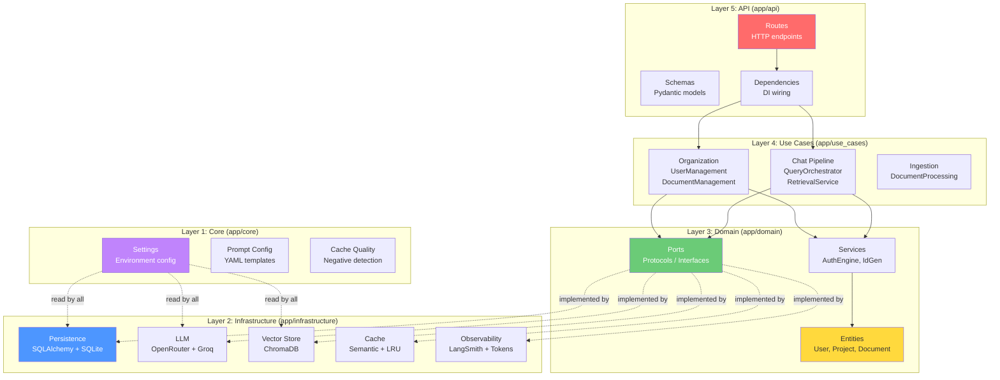
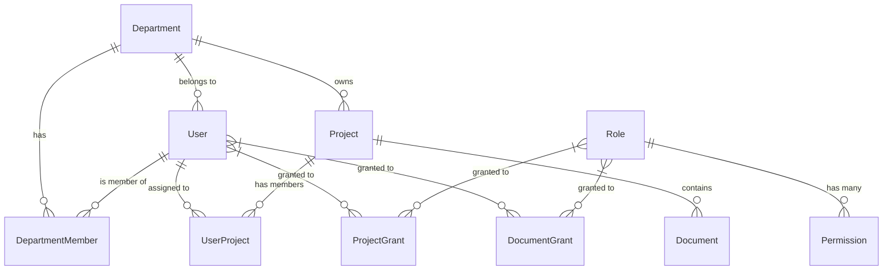
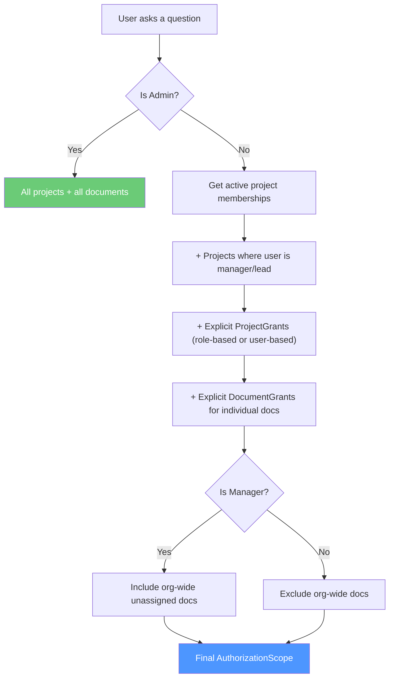
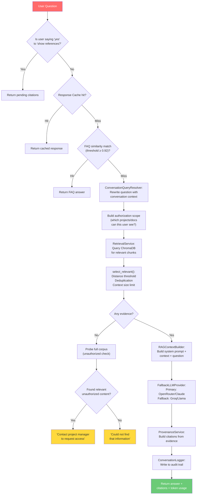
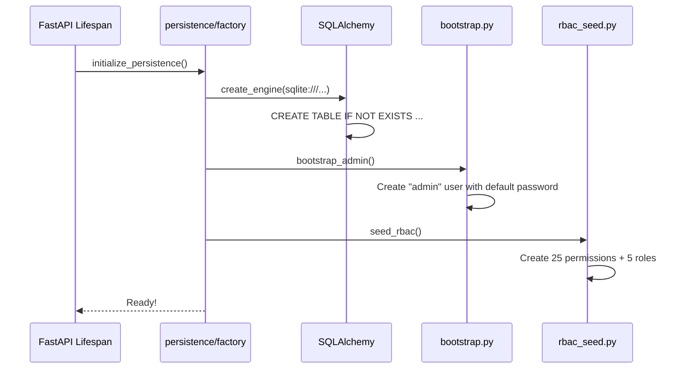
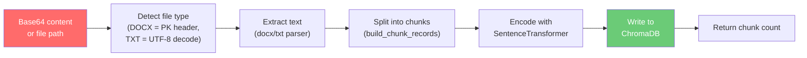
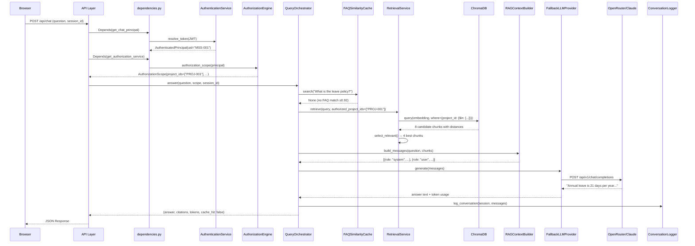

# 🏗️ Code-Grinder Deep Dive: Every Layer of KnowLayer

> **Mode**: Topic Driller — dissecting the full architecture, layer by layer, from the absolute bottom to the very top.

---

## 🗺️ The Big Picture First

This application is called **KnowLayer** — an enterprise knowledge management bot built with **FastAPI** (Python). It follows **Hexagonal Architecture** (Ports & Adapters), which means the business logic at the center knows *nothing* about databases, HTTP, or LLM APIs.



### The Dependency Rule (THE Cardinal Law)

```
Outer layers → may depend on → Inner layers ✅
Inner layers → must NEVER depend on → Outer layers ❌
```

| Layer | Depends On | NEVER Depends On |
|-------|-----------|-----------------|
| Core | Nothing | Everything |
| Domain | Core | Infrastructure, API |
| Use Cases | Domain, Core | Infrastructure (directly)* |
| Infrastructure | Domain, Core | API, Use Cases |
| API | Everything above | Nothing below it |

> [!WARNING]
> *The use_cases layer in this project slightly violates the pure hexagonal rule — `QueryOrchestrator` directly imports `ChromaVectorStore`, `OpenRouterClient`, etc. from infrastructure. In a strict hexagonal architecture, these would be injected through the Ports. This is a pragmatic trade-off: it keeps the wiring simple at the cost of some coupling.*

---

## 🟣 Layer 1: Core (`app/core`) — The Configuration Bedrock

[settings.py](file:///c:/Users/abhin/OneDrive/Documents/MY%20Coding%20Space/Learning%20Topics/New%20folder/Company_Bot/app/core/settings.py) · [prompt_config.py](file:///c:/Users/abhin/OneDrive/Documents/MY%20Coding%20Space/Learning%20Topics/New%20folder/Company_Bot/app/core/prompt_config.py) · [cache_quality.py](file:///c:/Users/abhin/OneDrive/Documents/MY%20Coding%20Space/Learning%20Topics/New%20folder/Company_Bot/app/core/cache_quality.py)

### What "Core" Means

Core is the **absolute foundation** — constants, environment variables, and pure functions that every other layer reads from. It depends on *nothing* in the application. If you break core, you break everything.

### `settings.py` — The Nerve Center (113 lines)

Every tunable parameter in the entire application lives here. It reads from `.env` via `python-dotenv`:

```python
load_dotenv()  # ← First line of real execution. Loads .env file.

BASE_DIR = Path(__file__).resolve().parent.parent.parent  # → project root
```

**Configuration categories:**

| Category | Settings | Purpose |
|----------|----------|---------|
| **RAG Tuning** | `RAG_DISTANCE_THRESHOLD=0.60`, `RAG_CANDIDATE_COUNT=8`, `RAG_MAX_EVIDENCE=4`, `RAG_MAX_CONTEXT_CHARS=12000` | Controls how many document chunks are retrieved, quality cutoffs, and context window limits |
| **LLM Providers** | `OPENROUTER_API_KEY`, `GROQ_API_KEY`, `LLM_MODEL` (Claude 3.5 Sonnet), `GROQ_MODEL` (Llama 3.1) | Primary + fallback LLM configuration |
| **Database** | `DATABASE_URL=sqlite:///./instance/knowlayer.db` | SQLAlchemy connection string |
| **Auth** | `AUTH_SECRET_KEY`, `AUTH_TOKEN_EXPIRE_MINUTES=480` (8 hours), `DEFAULT_USER_PASSWORD=ChangeMe123!` | JWT signing and default credentials |
| **Business IDs** | `EMPLOYEE_ID_PREFIX=MSS`, `DEPARTMENT_ID_PREFIX=DEPT`, `PROJECT_ID_PREFIX=PROJ`, `DOCUMENT_ID_PREFIX=DOC` | Human-readable ID prefixes like `MSS-001`, `PROJ-003` |
| **Caching** | `LLM_CACHE_SIZE=128`, `FAQ_SIMILARITY_THRESHOLD=0.92`, `LLM_CACHE_SIMILARITY_THRESHOLD=0.70` | Multiple cache layers with different thresholds |
| **Observability** | `LANGCHAIN_TRACING_V2`, `LANGCHAIN_API_KEY` | LangSmith integration toggle |
| **Logging** | `CONVERSATION_LOG_DIR`, `CONVERSATION_LOG_RETENTION_DAYS=30` | Conversation audit trail |

> [!IMPORTANT]
> Notice the **three different similarity thresholds** — this is intentional tiered caching:
> - `FAQ_SIMILARITY_THRESHOLD=0.92` — Very strict. Only near-exact FAQ matches bypass the LLM.
> - `LLM_CACHE_SIMILARITY_THRESHOLD=0.70` — Moderate. Similar-enough questions reuse cached LLM responses.
> - `RAG_DISTANCE_THRESHOLD=0.60` — Permissive. Retrieves any remotely relevant document chunks.

### `prompt_config.py` — Externalized LLM Prompts (17 lines)

```python
_PROMPTS_PATH = BASE_DIR / "config" / "prompts.yaml"

@lru_cache(maxsize=None)  # ← Infinite cache: read YAML once, never again
def load_prompt(name: str) -> str:
    with _PROMPTS_PATH.open("r") as prompts_file:
        prompts = yaml.safe_load(prompts_file)
    return prompts["prompts"][name]["system"]
```

**Why this matters**: System prompts live in a YAML file, not hardcoded in Python. You can change the bot's personality without touching code. The `lru_cache` ensures the file is read exactly once per process lifetime.

### `cache_quality.py` — The Negative Response Gatekeeper (71 lines)

This is a **pure function** (no side effects, no dependencies) that prevents garbage from being cached:

```python
def is_negative_response(text: str | None) -> bool:
    """Return True if the text represents a refusal or missing-info response."""
    if text is None:
        return True     # None → never cache
    if not text.strip():
        return True     # Empty → never cache

    # Check against 7 different regex patterns:
    # 1. "could not find / unable to locate..."
    # 2. "no relevant information / no details..."
    # 3. "not found in the documents / not mentioned in..."
    # 4. "does not contain / doesn't provide..."
    # 5. "relevant information exists... you do not have access"
    # 6. "no specific document references are available"
    # 7. "neither the provided documents nor..."
    return any(pattern.search(normalized) for pattern in _NEGATIVE_RESPONSE_PATTERNS)
```

> [!TIP]
> This prevents a **poisoned cache** scenario: if the LLM says "I can't find that info" for a question, and you cache it, then every future user asking the same question gets a "can't find it" response — even after the document has been uploaded. The quality gate blocks this entirely.

### 🧠 Drill Question — Core
> **Q: If you changed `RAG_DISTANCE_THRESHOLD` from 0.60 to 0.30, what would happen?**
>
> **A**: The retrieval system would become *much stricter*. Only document chunks with cosine distance ≤ 0.30 (very close semantic matches) would be accepted as evidence. Most queries would return "I could not find that information" because the threshold is too tight. Conversely, raising it to 0.90 would accept almost everything, leading to irrelevant context being fed to the LLM.

---

## 🟡 Layer 2: Domain (`app/domain`) — The Pure Business Core

```
app/domain/
├── entities/           ← Data classes (the NOUNS of the business)
│   ├── organization_models.py
│   ├── document_models.py
│   └── conversation_log.py
├── ports/              ← Protocols/Interfaces (the CONTRACTS)
│   ├── unit_of_work.py
│   ├── organization_repositories.py
│   ├── document_repository.py
│   ├── sequence_repository.py
│   ├── authentication_service.py
│   ├── authorization_service.py
│   ├── retrieval.py
│   ├── session_store.py
│   └── observability.py
└── services/           ← Business rules (the VERBS / LOGIC)
    ├── authentication_service.py
    ├── authorization_engine.py (442 lines — the BIGGEST domain file)
    ├── authorization_service.py
    ├── business_id_generator.py
    ├── llm_provider.py
    ├── organization_errors.py
    ├── permission_catalog.py
    └── session_memory_service.py
```

### Entities — The Nouns of Your Business

[organization_models.py](file:///c:/Users/abhin/OneDrive/Documents/MY%20Coding%20Space/Learning%20Topics/New%20folder/Company_Bot/app/domain/entities/organization_models.py) · [document_models.py](file:///c:/Users/abhin/OneDrive/Documents/MY%20Coding%20Space/Learning%20Topics/New%20folder/Company_Bot/app/domain/entities/document_models.py)

These are **plain Python dataclasses** — no ORM, no framework, no dependencies:

```python
@dataclass(slots=True)  # ← slots=True: faster attribute access, less memory
class User:
    uid: str
    name: str
    email: str
    role: str                        # "Admin", "Manager", "Developer", etc.
    department_id: str
    status: str = "active"           # "active" | "inactive" (soft delete)
    password_representation: str = "" # PBKDF2 hash, never plaintext
    must_change_password: bool = False
    employee_id: Optional[str] = None # Business ID like "MSS-001"
```

**The full entity hierarchy:**



**RAG pipeline entities** (in `document_models.py`):

| Entity | What It Represents |
|--------|-------------------|
| `DocumentSource` | A raw file (PDF, DOCX, TXT) loaded into the system |
| `DocumentChunk` | One segment of a document, split for embedding |
| `VectorRecord` | Metadata about a stored embedding in ChromaDB |
| `QuerySession` | A user's question + retrieval state |
| `RetrievedEvidence` | A chunk matched during RAG retrieval |
| `AnswerResponse` | The LLM's final answer + citations |

### Ports — The Contracts (Interfaces)

[unit_of_work.py](file:///c:/Users/abhin/OneDrive/Documents/MY%20Coding%20Space/Learning%20Topics/New%20folder/Company_Bot/app/domain/ports/unit_of_work.py) · [organization_repositories.py](file:///c:/Users/abhin/OneDrive/Documents/MY%20Coding%20Space/Learning%20Topics/New%20folder/Company_Bot/app/domain/ports/organization_repositories.py)

Ports use Python's `Protocol` (structural typing) — they define **what operations must exist** without specifying **how**:

```python
class UnitOfWork(Protocol):
    users: UserRepository
    departments: DepartmentRepository
    projects: ProjectRepository
    documents: DocumentRepository
    memberships: MembershipRepository
    department_members: DepartmentMemberRepository
    roles: RoleRepository
    permissions: PermissionRepository
    project_grants: ProjectGrantRepository
    document_grants: DocumentGrantRepository
    sequences: SequenceRepository

    def __enter__(self) -> "UnitOfWork": ...
    def __exit__(self, exc_type, exc_value, traceback) -> None: ...
    def commit(self) -> None: ...
    def rollback(self) -> None: ...
```

> [!IMPORTANT]
> **Unit of Work** is a design pattern from Domain-Driven Design. It wraps a database transaction: all changes within a `with uow:` block either **all succeed** (commit) or **all fail** (rollback). It holds references to all 11 repositories so the business logic can access everything through a single entry point.

**Repository port example** (a contract any database adapter must fulfill):

```python
class UserRepository(Protocol):
    def get_by_uid(self, uid: str) -> User | None: ...
    def get_by_username(self, username: str) -> User | None: ...
    def get_by_email(self, email: str) -> User | None: ...
    def get_by_employee_id(self, employee_id: str) -> User | None: ...
    def list(self) -> Sequence[User]: ...
    def save(self, user: User) -> User: ...
    def delete(self, uid: str) -> None: ...
```

**Other key ports:**

| Port | What It Abstracts |
|------|------------------|
| `RetrievalPort` | Any vector search backend (Chroma, Pinecone, etc.) |
| `SessionStorePort` | Chat session storage (in-memory, Redis, SQL) |
| `LLMProvider` | Any LLM backend (OpenRouter, Groq, local) |
| `ObservabilityPort` | Any tracing backend (LangSmith, Langfuse, Phoenix) |
| `AuthenticationService` | Login + password verification contract |
| `AuthorizationService` | Permission checking contract |
| `SequenceRepository` | Atomic counter for business ID generation |

### Domain Services — The Business Rules

#### The Authorization Engine (442 lines!) — The Brain of Permissions

[authorization_engine.py](file:///c:/Users/abhin/OneDrive/Documents/MY%20Coding%20Space/Learning%20Topics/New%20folder/Company_Bot/app/domain/services/authorization_engine.py)

This is the **single most important** file in the entire domain layer. Every "can this user do this?" decision flows through here:

```python
@dataclass(frozen=True, slots=True)
class AuthorizationScope:
    """What documents a user can see in RAG retrieval."""
    is_admin: bool = False
    project_ids: list[str] | None = None   # None = unrestricted (admin)
    document_ids: list[str] | None = None  # Explicit per-document grants
    include_unassigned: bool = False        # Can see org-wide documents?
```

**The access resolution logic** for determining what a non-admin user can access:



**Key methods in AuthorizationEngine:**

| Method | What It Decides |
|--------|----------------|
| `is_admin(principal)` | Is this user an admin? |
| `has_permission(principal, "DOCUMENT_UPLOAD")` | Does user have a specific RBAC permission? |
| `can_manage_project(principal, project_id)` | Can user edit/delete this project? |
| `can_read_document(principal, document_id)` | Can user see this document? |
| `can_upload_document(principal, project_id)` | Can user add documents here? |
| `authorization_scope(principal)` | Full scope object for RAG retrieval filtering |
| `project_access_contact(project_id)` | Get manager name for "request access" messages |

#### The Permission Catalog — RBAC Seed Data

[permission_catalog.py](file:///c:/Users/abhin/OneDrive/Documents/MY%20Coding%20Space/Learning%20Topics/New%20folder/Company_Bot/app/domain/services/permission_catalog.py)

Defines 25 permissions and 5 initial roles:

| Role | Permissions | Scope |
|------|------------|-------|
| **Admin** | `*` (all 25) | Global |
| **Manager** | 18 permissions (everything except DELETE and admin ops) | Global |
| **Developer** | 8 permissions (view + document CRUD) | Global |
| **Tester** | 5 permissions (view + query only) | Global |
| **Solution Architect** | 11 permissions (view + documents + project create) | Global |

#### Business ID Generator — `MSS-001`, `PROJ-003`, `DOC-042`

[business_id_generator.py](file:///c:/Users/abhin/OneDrive/Documents/MY%20Coding%20Space/Learning%20Topics/New%20folder/Company_Bot/app/domain/services/business_id_generator.py)

```python
def next(self, uow, key: str) -> str:
    # On first call: seed counter from highest existing ID in DB
    if uow.sequences.get(sequence.key) is None:
        uow.sequences.initialize(
            sequence.key,
            sequence.prefix,
            highest_existing_suffix(sequence.existing_ids(uow), sequence.prefix),
        )
    # Atomically increment and return
    value = uow.sequences.allocate(sequence.key)
    return f"{sequence.prefix}-{value:03d}"  # → "MSS-001", "PROJ-042"
```

> [!NOTE]
> The generator is **concurrent-safe** (atomic SQL `UPDATE ... RETURNING`) and **gap-proof** — deleting entity `MSS-005` doesn't make `005` available again. The counter only ever increases.

#### Domain Errors — Clean Exception Hierarchy

[organization_errors.py](file:///c:/Users/abhin/OneDrive/Documents/MY%20Coding%20Space/Learning%20Topics/New%20folder/Company_Bot/app/domain/services/organization_errors.py)

```python
class OrganizationError(Exception): ...  # Base
class NotFoundError(OrganizationError): ...  # → HTTP 404
class ConflictError(OrganizationError): ...  # → HTTP 409
class ForbiddenError(OrganizationError): ...  # → HTTP 403
class AuthenticationError(OrganizationError): ...  # → HTTP 401
class PersistenceError(OrganizationError): ...  # → HTTP 500
```

The API layer catches these and translates to HTTP status codes. The domain layer never imports `HTTPException`.

### 🧠 Drill Question — Domain
> **Q: Why does `AuthorizationScope` have both `project_ids` and `document_ids` fields? Why not just `project_ids`?**
>
> **A**: Because access isn't always through project membership. A user can receive a **direct DocumentGrant** — "User X can read Document Y" — even if they're not a member of the project that owns Document Y. The `document_ids` field captures these explicit per-document grants that bypass the project hierarchy. Without it, directly-granted documents would be invisible in RAG retrieval.

---

## 🟢 Layer 3: Use Cases (`app/use_cases`) — The Application Logic

```
app/use_cases/
├── chat/               ← The RAG pipeline
│   ├── query_orchestrator.py    (505 lines — THE central file)
│   ├── retrieval_service.py     (321 lines — vector search + ranking)
│   ├── rag_context_builder.py   (builds LLM prompts from chunks)
│   ├── query_normalizer.py      (query rewriting/expansion)
│   ├── query_intent_classifier.py (classifies user intent)
│   ├── conversation_query_resolver.py (multi-turn context)
│   ├── retrieval_quality.py     (evidence quality scoring)
│   ├── provenance_service.py    (builds citation objects)
│   └── session_memory.py        (session state management)
├── organization/       ← CRUD for the org hierarchy
│   ├── user_management.py
│   ├── department_membership.py
│   ├── project_management.py
│   ├── membership_management.py
│   ├── document_management.py
│   ├── document_access.py
│   ├── project_access.py
│   ├── role_management.py
│   ├── organization_explorer.py
│   └── profile.py
└── ingestion/          ← Document processing
    ├── document_processing.py
    └── informational_word_extractor.py
```

### The Chat Pipeline — `QueryOrchestrator.answer()`

[query_orchestrator.py](file:///c:/Users/abhin/OneDrive/Documents/MY%20Coding%20Space/Learning%20Topics/New%20folder/Company_Bot/app/use_cases/chat/query_orchestrator.py)

This is the **heart** of the application — where a user question becomes an answer. Here's the full pipeline:



**The 7 stages in code order:**

| Stage | Code | What It Does |
|-------|------|-------------|
| 0. Reference follow-up | Lines 181-201 | If user says "yes"/"sure" after bot asked "show references?", return the pending citations |
| 1. Response cache | Lines 203-236 | LRU cache of recent question→answer pairs |
| 2. FAQ similarity | Lines 238-280 | Semantic search against known FAQs (threshold: 0.92) |
| 3. Query resolution | Line 283 | Rewrite the question using conversation history for multi-turn context |
| 4. Retrieval | Lines 284-318 | ChromaDB vector search with authorization scoping |
| 5. LLM generation | Lines 320-354 | Build prompt → call LLM → extract token usage |
| 6. Logging | Lines 170-178 | Persist the conversation for audit |

### The Retrieval Service — Smart Vector Search

[retrieval_service.py](file:///c:/Users/abhin/OneDrive/Documents/MY%20Coding%20Space/Learning%20Topics/New%20folder/Company_Bot/app/use_cases/chat/retrieval_service.py)

This isn't a simple "query ChromaDB, return top-k." It does **query expansion**, **authorization filtering**, **relevance ranking**, **deduplication**, and **context bounding**:

**Query Expansion** — a single question generates multiple search queries:

```python
# "What are the leave policies?" generates:
# 1. "What are the leave policies?"                  (original)
# 2. "annual leave entitlement"                       (auto-expanded)
# 3. ...any comma/semicolon-split sub-parts
```

**Authorization-Aware Filtering** — the Chroma `$where` filter:

```python
# Non-admin user with project access + document grants:
where_filter = {
    "$or": [
        {"project_id": {"$in": ["PROJ-001", "PROJ-003", "unassigned"]}},
        {"document_id": {"$in": ["DOC-007", "DOC-012"]}},
    ]
}
```

**Relevance Ranking** (`select_relevant`) — 5 filtering stages:

1. **Deduplication**: Remove identical text chunks
2. **Distance threshold**: Reject chunks with cosine distance > 0.60
3. **Relaxed top-1**: Accept the best chunk even if slightly above threshold, IF it's clearly separated from #2
4. **Query part coverage**: Ensure each sub-query gets at least one chunk represented
5. **Context size cap**: Stop adding chunks when total exceeds 12,000 characters

**The Unauthorized Content Probe** — a security feature:

```python
def detect_unauthorized_relevance(self, query_text, authorized_project_ids, ...):
    """Run an UNRESTRICTED query, then check if good matches exist
    OUTSIDE the user's scope. If so, tell them content exists
    but they need to request access."""
```

This prevents a frustrating UX: instead of "I can't find anything" (which might be wrong), the system says *"relevant info exists in a project you don't have access to — contact the manager."*

### Organization Use Cases — CRUD with Business Rules

[user_management.py](file:///c:/Users/abhin/OneDrive/Documents/MY%20Coding%20Space/Learning%20Topics/New%20folder/Company_Bot/app/use_cases/organization/user_management.py)

Every organization use case follows the same structure:

```python
class UserManagementService:
    def __init__(self, unit_of_work_factory, password_hasher, business_id_generator):
        self.unit_of_work_factory = unit_of_work_factory  # DB transaction factory
        self.password_hasher = password_hasher              # bcrypt-like hashing
        self.business_id_generator = business_id_generator  # MSS-001 generator

    def create_user(self, actor_uid, uid, name, email, role, department_id, ...):
        with self.unit_of_work_factory() as uow:  # ← Open transaction
            # 1. AUTHORIZE: Is the actor allowed to do this?
            actor = uow.users.get_by_uid(actor_uid)
            if actor.role.casefold() != "admin" and actor.department_id != department_id:
                raise ForbiddenError("User is outside manager scope")

            # 2. VALIDATE: Check for conflicts
            if uow.users.get_by_uid(uid) or uow.users.get_by_email(email):
                raise ConflictError("User UID or email already exists")

            # 3. GENERATE: Auto-generate business ID if not provided
            employee_id = employee_id or self.business_id_generator.next(uow, "user")

            # 4. CREATE: Build entity and persist
            user = User(uid, name, email, role, department_id, ...)
            uow.users.save(user)
            uow.commit()  # ← All-or-nothing
            return user
```

**The 4-step pattern** repeated across ALL organization use cases:

```
AUTHORIZE → VALIDATE → EXECUTE → COMMIT
```

### 🧠 Drill Question — Use Cases
> **Q: In `QueryOrchestrator.answer()`, what happens if both the primary LLM (OpenRouter/Claude) AND the fallback LLM (Groq/Llama) fail?**
>
> **A**: The `FallbackLLMProvider.generate()` raises `LLMProviderError("Both primary and fallback LLM providers failed.")`. This propagates up to the chat route handler, which catches it and returns a graceful response: *"I'm having trouble reaching the AI provider right now. Please try again in a moment."* — the user never sees a stack trace.

---

## 🔵 Layer 4: Infrastructure (`app/infrastructure`) — The Real World

```
app/infrastructure/
├── persistence/        ← SQLAlchemy + SQLite (the database)
│   ├── factory.py
│   ├── rbac_seed.py
│   ├── sqlalchemy/     ← ORM models, session, unit of work
│   ├── sqlite/         ← SQLite-specific adapters
│   └── migrations/     ← Schema migrations
├── llm/                ← LLM provider clients
│   ├── openrouter_client.py    (8KB — primary LLM)
│   ├── groq_client.py          (2KB — fallback LLM)
│   ├── fallback_llm_provider.py (primary → fallback chain)
│   ├── llm_response.py         (19KB — response parsing)
│   ├── prompt_cache.py          (5KB — LRU prompt cache)
│   ├── json_semantic_cache.py   (5KB — semantic similarity cache)
│   ├── provider_health.py       (15KB — health monitoring)
│   └── provider_error_tracker.py (18KB — error tracking)
├── vector/             ← ChromaDB vector store
│   └── chroma_client.py
├── cache/              ← Multi-layer caching
│   ├── dual_cache.py          (16KB)
│   └── quality_aware_cache.py (50KB — the biggest file!)
├── authentication/     ← Password hashing + admin bootstrap
│   ├── password_hasher.py
│   └── bootstrap.py
├── ingestion/          ← Document upload + embedding pipeline
│   └── provisioner.py
├── session/            ← Chat session storage
│   └── in_memory_store.py
├── faq/                ← FAQ caching backends
│   ├── faq_similarity_cache.py
│   ├── json_faq_cache.py
│   └── mongo_faq_store.py
├── document/           ← File loading
│   └── local_document_loader.py
├── audit/              ← Authentication event logging
│   └── authentication_events.py
├── observability/      ← Tracing + monitoring (10 files!)
│   ├── token_tracker.py
│   ├── pipeline_tracer.py
│   ├── langsmith_integration.py
│   ├── langfuse_provider.py
│   ├── phoenix_provider.py
│   ├── null_provider.py
│   ├── manager.py
│   ├── provider.py
│   └── tracer.py
└── logging/            ← Conversation audit + employee ID resolution
    ├── conversation_logger.py
    ├── conversation_log_cleanup.py
    ├── database_employee_id_provider.py
    └── mock_employee_id_provider.py
```

### Persistence — SQLAlchemy + SQLite + Unit of Work

[factory.py](file:///c:/Users/abhin/OneDrive/Documents/MY%20Coding%20Space/Learning%20Topics/New%20folder/Company_Bot/app/infrastructure/persistence/factory.py)

```python
@lru_cache(maxsize=1)  # ← Singleton: only one DB connection pool per process
def get_session_factory():
    engine, session_factory = create_engine_and_session_factory(database_url)
    initialize_database(engine)          # Create tables if missing
    bootstrap_admin(...)                 # Create default admin user
    seed_rbac(...)                       # Seed permissions + roles
    return session_factory

def initialize_persistence(session_factory_factory=get_session_factory):
    """Called during FastAPI startup. Retries 3 times with 500ms delay."""
    for attempt in range(1, 4):
        try:
            session_factory_factory()
            return
        except Exception:
            time.sleep(0.5)
    raise RuntimeError("Failed to initialize persistence")
```

**Startup sequence:**



### LLM Infrastructure — The Dual-Provider Failover

[fallback_llm_provider.py](file:///c:/Users/abhin/OneDrive/Documents/MY%20Coding%20Space/Learning%20Topics/New%20folder/Company_Bot/app/infrastructure/llm/fallback_llm_provider.py)

```python
class FallbackLLMProvider(LLMProvider):
    def generate(self, messages):
        # 1. Check prompt cache first
        cached = self.cache.get(messages)
        if cached is not None:
            return cached  # ← Zero tokens, zero latency

        try:
            # 2. Try primary (OpenRouter → Claude 3.5 Sonnet)
            response = self.primary.generate(messages)
        except LLMProviderError:
            # 3. Primary failed → try fallback (Groq → Llama 3.1)
            try:
                response = self.fallback.generate(messages)
            except LLMProviderError:
                # 4. Both failed → propagate error
                raise LLMProviderError("Both providers failed")

        # 5. Cache successful response
        self.cache.put(messages, response)
        return response
```

### Vector Store — ChromaDB with Cosine Similarity

[chroma_client.py](file:///c:/Users/abhin/OneDrive/Documents/MY%20Coding%20Space/Learning%20Topics/New%20folder/Company_Bot/app/infrastructure/vector/chroma_client.py)

```python
class ChromaVectorStore:
    def __init__(self, collection_name="hr_policy_docs"):
        self.client = chromadb.PersistentClient(path=".chroma")
        self.collection = self.client.get_or_create_collection(
            name=collection_name,
            metadata={"hnsw:space": "cosine"},  # ← Cosine distance metric
        )
        self.embedding_model = SentenceTransformer("all-MiniLM-L6-v2")  # 384-dim embeddings
```

**Embedding model**: `all-MiniLM-L6-v2` — a small, fast model (22M parameters) that produces 384-dimensional vectors. Good for semantic search, not for generation.

### Password Security — PBKDF2-SHA256

[password_hasher.py](file:///c:/Users/abhin/OneDrive/Documents/MY%20Coding%20Space/Learning%20Topics/New%20folder/Company_Bot/app/infrastructure/authentication/password_hasher.py)

```python
class PasswordHasher:
    algorithm = "pbkdf2_sha256"
    iterations = 310_000  # OWASP recommended minimum

    def hash(self, password: str) -> str:
        salt = secrets.token_bytes(16)  # 128-bit random salt
        digest = hashlib.pbkdf2_hmac("sha256", password.encode(), salt, self.iterations)
        return "$".join((self.algorithm, str(self.iterations), b64(salt), b64(digest)))
        # → "pbkdf2_sha256$310000$<salt>$<hash>"

    def verify(self, password: str, encoded: str) -> bool:
        # Constant-time comparison via hmac.compare_digest (timing-attack safe)
        return hmac.compare_digest(actual, expected)
```

### Document Ingestion — Upload → Chunk → Embed → Store

[provisioner.py](file:///c:/Users/abhin/OneDrive/Documents/MY%20Coding%20Space/Learning%20Topics/New%20folder/Company_Bot/app/infrastructure/ingestion/provisioner.py)



### Session Store — Thread-Safe In-Memory

[in_memory_store.py](file:///c:/Users/abhin/OneDrive/Documents/MY%20Coding%20Space/Learning%20Topics/New%20folder/Company_Bot/app/infrastructure/session/in_memory_store.py)

```python
class InMemorySessionStore(SessionStorePort):
    """Implements the SessionStorePort protocol from the domain layer."""
    def __init__(self):
        self._store: Dict[str, SessionData] = {}
        self._lock = threading.Lock()  # Thread-safe for concurrent requests

    def purge_expired(self, max_age_hours: float) -> int:
        # Cleans up sessions older than max_age_hours
        cutoff = datetime.now(timezone.utc) - timedelta(hours=max_age_hours)
        expired = [sid for sid, data in self._store.items() if data.last_activity < cutoff]
        for sid in expired:
            del self._store[sid]
        return len(expired)
```

> [!NOTE]
> This is in-memory only — sessions are lost on server restart. The `SessionStorePort` protocol means you could swap this for Redis or SQL without touching any business logic.

### 🧠 Drill Question — Infrastructure
> **Q: The `quality_aware_cache.py` file is 50KB — the largest file in the entire project. Why would a cache need to be that complex?**
>
> **A**: It's a **semantic similarity cache** with quality gating. It doesn't just do key→value lookup — it embeds every cached question, finds the nearest neighbors, checks if the similarity exceeds a threshold, validates that the cached response isn't a "negative response" (using `cache_quality.py`), and manages cache eviction. It's essentially a mini vector database + quality filter + LRU eviction policy all in one module.

---

## 🔴 Layer 5: API (`app/api`) — The HTTP Interface

> This layer was covered in detail in the [previous deep-dive](file:///C:/Users/abhin/.gemini/antigravity-ide/brain/dca6bda9-2f26-4bac-8906-b784d5114f94/api_layer_deep_dive.md). Here's the summary view of how it connects to everything below.

### The Wiring — How API Connects to Use Cases

```python
# dependencies.py: Wire infrastructure → use cases → routes

def get_user_management_service():
    return UserManagementService(
        create_unit_of_work,        # Infrastructure: persistence
        PasswordHasher(),           # Infrastructure: authentication
        business_id_generator=...   # Domain: ID generation
    )
```

The API layer's ONLY job: translate HTTP → domain calls → HTTP responses. It never contains business logic.

---

## 🎬 Layer 0: `main.py` — The Startup Orchestrator

[main.py](file:///c:/Users/abhin/OneDrive/Documents/MY%20Coding%20Space/Learning%20Topics/New%20folder/Company_Bot/app/main.py)

```python
@asynccontextmanager
async def lifespan(app: FastAPI):
    # STARTUP:
    cleanup_service.cleanup_expired_logs()    # 1. Clean old conversation logs
    initialize_persistence(get_session_factory) # 2. DB schema + admin + RBAC
    init_orchestrator()                         # 3. Load embedding model + ChromaDB
    yield                                       # ← Server is running
    # SHUTDOWN:
    logger.info("Lifespan: shutdown.")

app = FastAPI(title="KnowLayer API", lifespan=lifespan)
app.include_router(chat_router)          # /api/chat, /api/faqs
app.include_router(tokens_router)        # /api/tokens/*
app.include_router(organization_router)  # /api/departments/*, /api/users/*, /api/projects/*
app.include_router(explorer_router)      # /api/explorer/organization
app.include_router(documents_router)     # /api/documents/*
app.include_router(authentication_router) # /api/auth/*
app.include_router(roles_router)         # /api/roles/*, /api/permissions/*
```

---

## 🔥 The Complete Request Lifecycle — End to End

Let's trace a single chat question from HTTP to answer:



---

## 📊 Layer Statistics

| Layer | Files | Total Lines | Biggest File | Purpose |
|-------|-------|-------------|-------------|---------|
| **Core** | 3 | ~200 | `settings.py` (113) | Configuration |
| **Domain** | 18 | ~900 | `authorization_engine.py` (442) | Business rules |
| **Use Cases** | 21 | ~2,500 | `query_orchestrator.py` (505) | Application workflows |
| **Infrastructure** | 30+ | ~5,000+ | `quality_aware_cache.py` (~1,300) | External integrations |
| **API** | 15 | ~1,200 | `organization.py` (367) | HTTP interface |

---

## 🧪 Master Quiz — Cross-Layer Understanding

**Q1: A new document is uploaded. Trace the data flow across ALL layers.**
> Routes (`documents.py`) → Schema validation (`DocumentCreate`) → Use case (`DocumentManagementService.register_document`) → Domain entity (`Document`) → Infrastructure persistence (SQLAlchemy save) → Infrastructure ingestion (`provisioner.py` → extract text → chunk → embed) → ChromaDB vector store.

**Q2: Why does the domain layer use `Protocol` classes instead of `ABC` (Abstract Base Classes)?**
> `Protocol` enables **structural typing** (duck typing with type checking). Any class that has the right methods automatically satisfies the protocol — no inheritance required. This means the infrastructure layer doesn't need to `import` or `inherit from` domain ports, reducing coupling. `ABC` requires explicit inheritance (`class Impl(ABC)`), which creates a hard dependency.

**Q3: What happens if someone deploys this app and forgets to set `AUTH_SECRET_KEY` in `.env`?**
> It falls back to `"change-this-development-secret"`. Every JWT token would be signed with this public default, meaning anyone who reads the source code could forge valid authentication tokens for any user. This is a **critical security vulnerability** in production.

**Q4: Why does `QueryOrchestrator.__init__` accept so many optional parameters (12!)?**
> Testability. Every dependency can be replaced with a mock/stub for unit testing. In production, all defaults are used (`retrieval or RetrievalService()`, `llm or FallbackLLMProvider(...)`, etc.). In tests, you inject fakes: `QueryOrchestrator(llm=FakeLLM(), retrieval=FakeRetrieval())`. This is **constructor injection** — the purest form of dependency injection.

**Q5: Where exactly is the boundary between "use case" and "domain service"?**
> **Domain services** contain rules that are true regardless of the application (e.g., "an admin can see all projects" — that's a business rule). **Use cases** orchestrate those rules into workflows specific to this application (e.g., "when a user asks a question, check cache → retrieve → generate → log" — that's an application workflow). The domain service `AuthorizationEngine` knows *what* a user can access; the use case `QueryOrchestrator` decides *when and how* to apply that knowledge.
