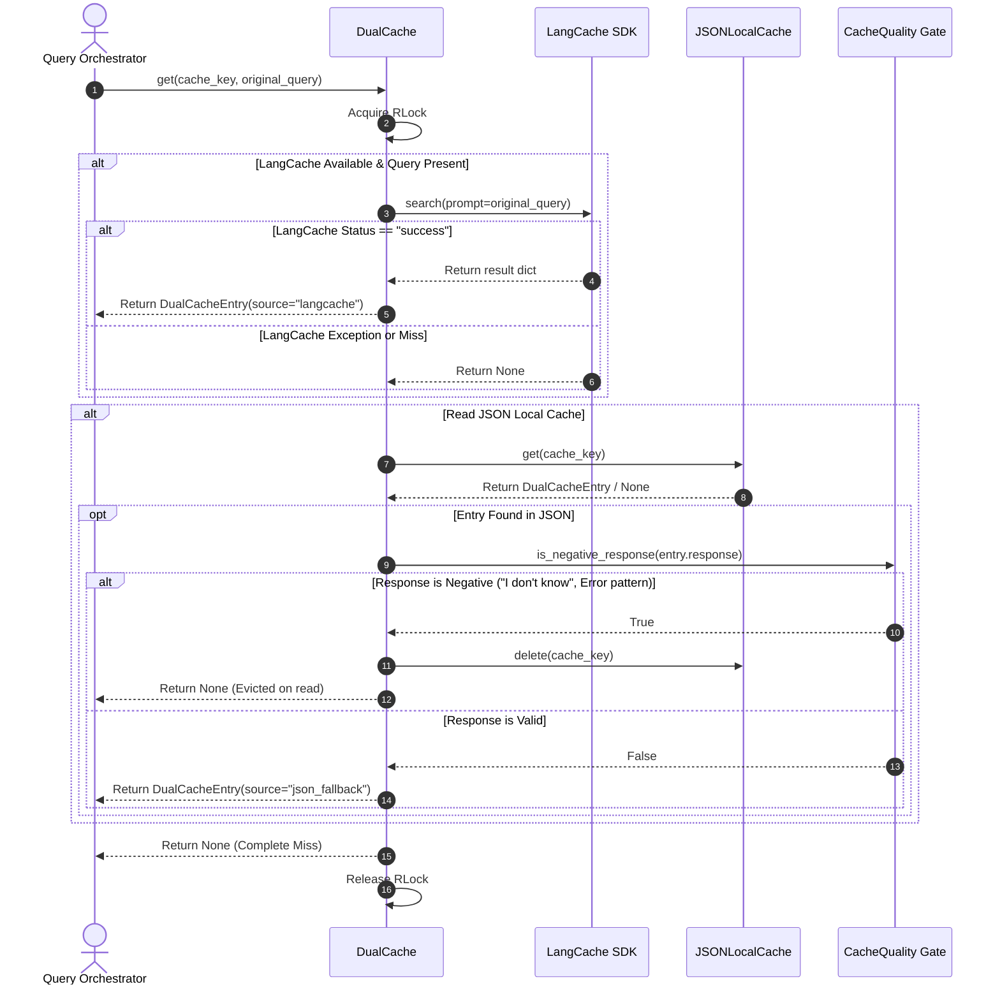
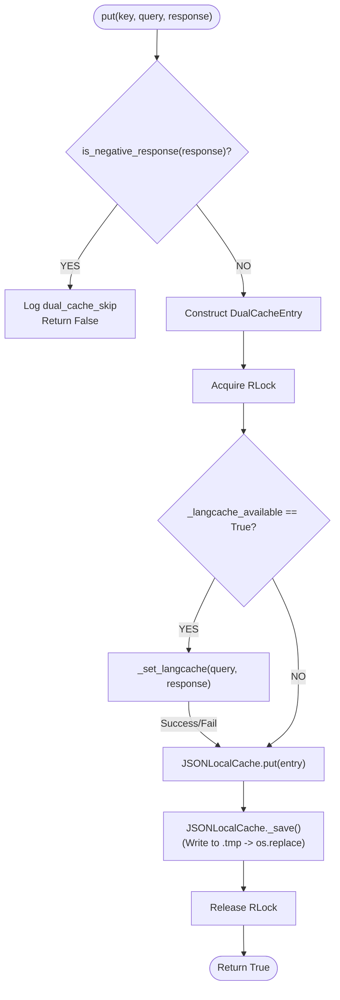

# LangCache & DualCache Architecture Deep Dive Driller

> **Topic Focus**: Distributed Semantic Caching with `LangCache`, Local Resilience via `JSONLocalCache`, Tiered Failover, Synchronization, and Quality Gate Integration.
> **Primary Source File**: [`app/infrastructure/cache/dual_cache.py`](file:///c:/Users/abhin/OneDrive/Documents/MY%20Coding%20Space/Learning%20Topics/New%20folder/Company_Bot/app/infrastructure/cache/dual_cache.py)
> **Secondary Source File**: [`app/core/cache_quality.py`](file:///c:/Users/abhin/OneDrive/Documents/MY%20Coding%20Space/Learning%20Topics/New%20folder/Company_Bot/app/core/cache_quality.py)

---

## 1. Territory & Component Map

The `DualCache` system sits at **Level 4** of Company_Bot's multi-tiered caching architecture. While Level 1–3 caches (`InMemoryQualityAwareCache`, `PromptLRUCache`) operate entirely in RAM with strict TTLs and exact prompt hashing, `DualCache` bridges **remote distributed semantic vector matching** with **durable disk-backed fallback**.

```
┌─────────────────────────────────────────────────────────────────────────────┐
│                      COMPANY_BOT CACHING HIERARCHY                          │
├─────────────────────────────────────────────────────────────────────────────┤
│ Level 1: InMemoryQualityAwareCache   (C.R.E.A.T.E. validation, TTL=3600s)   │
│ Level 2: PromptLRUCache              (Exact prompt match, memory bounds)    │
│ Level 3: Dynamic Context Window Cache(Token budgeting, window truncation)   │
│ Level 4: DualCache (THIS MODULE)                                           │
│   ├── Primary: LangCache             (Distributed Semantic Search via API)  │
│   └── Secondary: JSONLocalCache      (Disk-backed persistent JSON storage)  │
│ Level 5: Storage Layer               (VectorDB / Document Store)            │
└─────────────────────────────────────────────────────────────────────────────┘
```

### Component Responsibility Matrix

| Component | Responsibility | Concurrency Guard | Primary Failure Mode | Mitigation |
| :--- | :--- | :--- | :--- | :--- |
| `LangCache` | External service providing semantic embedding similarity search for queries. | Handled by HTTP client / SDK network socket pool. | Network latency, outage, missing API key, rate limit. | Silent catch, fallback to `JSONLocalCache`. |
| `JSONLocalCache` | Local, persistent, disk-backed key-value store for exact string matches. | `threading.RLock()` per instance. | Disk write error, process crash during write, corrupted JSON. | Atomic write via temporary file + `os.replace()`. |
| `DualCache` | Orchestrator combining primary semantic cache with local JSON fallback & background sync. | `threading.RLock()` per instance. | Sync thread exceptions, invalid cache reads. | Negative response eviction filter, daemon sync thread. |
| `DualCacheEntry` | Dataclass defining standardized cache metadata payload. | Immutable per-request object creation. | Schema mismatch during serialization. | `to_dict()` and `**kwargs` unpacking constructor. |

---

## 2. Mental Model & Core Concepts

### A. What is LangCache?
`LangCache` is a managed, distributed semantic caching service designed specifically for LLM applications. Unlike traditional key-value stores (e.g., Redis exact string key matching), `LangCache`:
1. **Embeds input prompts** into dense vector spaces.
2. **Performs vector distance searches** (cosine similarity / HNSW indexing) against previously stored prompt vectors.
3. **Returns cached LLM completions** if the semantic distance between the incoming prompt and a cached prompt falls below a similarity threshold (e.g., `"How do I request PTO?"` matches `"What is the process for taking paid time off?"`).

### B. The DualCache Paradigm: Primary Semantic + Local Fallback
In high-availability enterprise environments, relying solely on an external cloud service for caching creates a **single point of failure** (SPOF). If `LangCache` is unreachable, API response times degrade or queries fail outright.

`DualCache` solves this through a **Hybrid Architecture**:
- **Read Path**: Check `LangCache` first (semantic similarity match). If it misses or fails, fall back to `JSONLocalCache` (exact key match).
- **Write Path**: Write to `LangCache` for global cross-instance semantic availability, AND write to `JSONLocalCache` for local zero-network redundancy.

```
                  ┌─────────────────────────────────────┐
                  │ Incoming Request: get(key, query)   │
                  └──────────────────┬──────────────────┘
                                     │
                         Is LangCache available?
                                /         \
                             YES           NO
                             /               \
              ┌─────────────▼────────────┐    └─────────────┐
              │ LangCache.search(query)  │                  │
              └─────────────┬────────────┘                  │
                            │                               │
                      Hit or Miss?                          │
                      /          \                          │
                   HIT            MISS                      │
                   /                \                       │
     ┌────────────▼──────────┐   ┌───▼──────────────────────▼──┐
     │ Return LangCache      │   │ JSONLocalCache.get(key)     │
     │ DualCacheEntry        │   └──────────────┬──────────────┘
     └───────────────────────┘                  │
                                           Hit or Miss?
                                          /            \
                                       HIT              MISS
                                       /                  \
                        Is entry negative response?    Return None
                             /               \
                           YES                NO
                           /                    \
             ┌────────────▼───────────┐    ┌─────▼──────────────────┐
             │ Evict entry from disk  │    │ Return JSON            │
             │ Return None            │    │ DualCacheEntry         │
             └────────────────────────┘    └────────────────────────┘
```

### C. 3-Tier Graceful Degradation Matrix
The system determines its operation mode dynamically at runtime across 3 isolation layers:

| Layer | Condition | Behavior |
| :--- | :--- | :--- |
| **Tier 1: Package Unavailable** | `import langcache` raises `ImportError` | `LANGCACHE_AVAILABLE = False`. Log warning once at startup. Operates strictly in JSON-only mode. No crash. |
| **Tier 2: Missing Configuration** | `langcache_config` is empty or `None` | `self._langcache_available = False`. Bypasses LangCache SDK initialization entirely. Operates in JSON-only mode. |
| **Tier 3: Runtime Network Failure** | `langcache.search()` or `set()` throws Exception | Exception caught silently with `logger.debug`. Request fails over instantly to `JSONLocalCache`. Cache stats reflect degradation. |

---

## 3. Annotated Code Breakdown

### A. Module Setup & Import Safety
```python
# app/infrastructure/cache/dual_cache.py

import json
import logging
import os
import threading
import time
from dataclasses import dataclass, field
from pathlib import Path
from typing import Any, Optional

from app.core.cache_quality import is_negative_response

logger = logging.getLogger(__name__)

# ← Try-except import guard allows application execution even if langcache package is missing from dependencies
try:
    from langcache import LangCache
    LANGCACHE_AVAILABLE = True
except ImportError:
    LANGCACHE_AVAILABLE = False
    logger.warning("langcache not available, using JSON fallback only")
```

---

### B. DualCacheEntry Data Transfer Object
```python
@dataclass
class DualCacheEntry:
    """Cache entry for dual-cache system."""
    cache_key: str                            # ← Hash or unique identifier for exact lookups
    original_query: str                       # ← Raw prompt used for semantic vector searching
    response: str                             # ← LLM generated completion text
    confidence: float = 0.0                   # ← Retrieval/generation confidence score (0.0 - 1.0)
    source: str = "semantic_cache"            # ← Origin indicator ("langcache", "json_fallback", "rag_generated")
    evidence_count: int = 0                   # ← Number of RAG context chunks supporting the completion
    model: str = ""                           # ← LLM model name (e.g. "claude-3.5-sonnet")
    citations: list[dict] = field(default_factory=list) # ← Document metadata citations
    created_at: float = field(default_factory=time.time) # ← POSIX timestamp of creation
    metadata: dict[str, Any] = field(default_factory=dict) # ← Extensible telemetry/debug metadata
    
    def to_dict(self) -> dict:
        """Convert entry to JSON-serializable dictionary."""
        return {
            "cache_key": self.cache_key,
            "original_query": self.original_query,
            "response": self.response,
            "confidence": self.confidence,
            "source": self.source,
            "evidence_count": self.evidence_count,
            "model": self.model,
            "citations": self.citations,
            "created_at": self.created_at,
            "metadata": self.metadata,
        }
```

---

### C. JSONLocalCache Atomic Operations
```python
class JSONLocalCache:
    """JSON file-based local cache for fallback and sync."""
    
    def __init__(self, file_path: str):
        self.file_path = Path(file_path)
        self._cache: dict[str, DualCacheEntry] = {}
        self._lock = threading.RLock() # ← Reentrant lock enables methods (e.g. put) to call internal helpers without deadlocking
        
        # ← Auto-create parent directory structure (e.g., data/) if missing
        self.file_path.parent.mkdir(parents=True, exist_ok=True)
        self._load()
        logger.info("json_local_cache initialized path=%s", file_path)
    
    def _load(self) -> None:
        """Load cache from JSON file on disk into RAM."""
        if not self.file_path.exists():
            return
        try:
            with open(self.file_path, 'r') as f:
                data = json.load(f)
            for key, value in data.items():
                self._cache[key] = DualCacheEntry(**value) # ← Deserializes raw dict back into strongly typed dataclass
            logger.info("json_local_cache loaded entries=%d", len(self._cache))
        except Exception as e:
            logger.error("json_local_cache load failed: %s", e) # ← Log error without crashing startup

    def _save(self) -> None:
        """Save cache to JSON file atomically."""
        try:
            data = {key: entry.to_dict() for key, entry in self._cache.items()}
            
            # ← Atomic Write Pattern:
            # 1. Write content to a process-unique temporary file (incorporates PID)
            temp_path = self.file_path.with_name(f"{self.file_path.name}.{os.getpid()}.tmp")
            with open(temp_path, 'w', encoding='utf-8') as f:
                json.dump(data, f, indent=2)
            
            # 2. Perform atomic OS-level file replacement (POSIX rename / Win32 ReplaceFile)
            # Prevents partial file corruption if process is interrupted during write
            os.replace(temp_path, self.file_path)
            
            logger.debug("json_local_cache saved entries=%d", len(self._cache))
        except Exception as e:
            logger.error("json_local_cache save failed: %s", e)
```

---

### D. DualCache Initialization & Background Sync
```python
class DualCache:
    def __init__(
        self,
        langcache_config: Optional[dict] = None,
        json_fallback_path: Optional[str] = None,
        enable_sync: bool = True,
        sync_interval: float = 60.0,
    ):
        self._langcache_config = langcache_config or {}
        self._enable_sync = enable_sync
        self._sync_interval = sync_interval
        
        self._langcache: Optional[Any] = None
        self._langcache_available = False
        
        # ← Guard initialization against both package availability and config existence
        if LANGCACHE_AVAILABLE and langcache_config:
            try:
                self._langcache = LangCache(
                    server_url=langcache_config.get("server_url"),
                    cache_id=langcache_config.get("cache_id"),
                    api_key=langcache_config.get("api_key"),
                )
                self._langcache_available = True
                logger.info("dual_cache langcache initialized")
            except Exception as e:
                logger.warning("dual_cache langcache init failed: %s", e)
        
        self._json_cache = JSONLocalCache(
            json_fallback_path or "data/semantic_cache.json"
        )
        self._lock = threading.RLock()
        
        if enable_sync:
            self._start_sync_thread()

    def _start_sync_thread(self) -> None:
        """Start background sync thread."""
        def sync_loop():
            while True:
                time.sleep(self._sync_interval) # ← Sleep first to allow startup settling
                try:
                    self._sync_json_to_langcache()
                except Exception as e:
                    logger.error("dual_cache sync failed: %s", e)
        
        # ← daemon=True ensures thread terminates automatically when Python main thread exits
        thread = threading.Thread(target=sync_loop, daemon=True)
        thread.start()
        logger.info("dual_cache sync_thread started interval=%.0fs", self._sync_interval)
```

---

### E. DualCache Read, Write, and Negative Response Eviction
```python
    def get(self, cache_key: str, original_query: str = "") -> Optional[DualCacheEntry]:
        with self._lock:
            # Step 1: Try primary LangCache semantic search
            if self._langcache_available and original_query:
                langcache_result = self._search_langcache(original_query)
                if langcache_result:
                    logger.debug("dual_cache hit=langcache key=%s", cache_key)
                    return DualCacheEntry(
                        cache_key=cache_key,
                        original_query=original_query,
                        response=langcache_result.get("response", ""),
                        source="langcache",
                    )
            
            # Step 2: Try JSON fallback exact key match
            json_entry = self._json_cache.get(cache_key)
            if json_entry:
                # ← Negative Response Quality Filter: Check if cached answer is a failure/error message
                if is_negative_response(json_entry.response):
                    logger.info("dual_cache_evict reason=cached_negative_response key=%s", cache_key)
                    self._json_cache.delete(cache_key) # ← Lazy eviction on read!
                    json_entry = None
                else:
                    logger.debug("dual_cache hit=json key=%s", cache_key)
                    return json_entry
            
            logger.debug("dual_cache miss key=%s", cache_key)
            return None

    def put(
        self,
        cache_key: str,
        original_query: str,
        response: str,
        confidence: float = 0.0,
        source: str = "semantic_cache",
        evidence_count: int = 0,
        model: str = "",
        citations: Optional[list[dict]] = None,
        metadata: Optional[dict[str, Any]] = None,
    ) -> bool:
        # ← Pre-write quality gate: Reject negative/refusal responses before polluting any cache tier
        if is_negative_response(response):
            logger.info("dual_cache_skip reason=negative_response key=%s", cache_key)
            return False

        entry = DualCacheEntry(
            cache_key=cache_key,
            original_query=original_query,
            response=response,
            confidence=confidence,
            source=source,
            evidence_count=evidence_count,
            model=model,
            citations=citations or [],
            metadata=metadata or {},
        )
        
        with self._lock:
            success = False
            
            # ← Dual Write Tier 1: Write to LangCache if available (semantic index)
            if self._langcache_available:
                try:
                    if self._set_langcache(original_query, response):
                        success = True
                        logger.debug("dual_cache write=langcache key=%s", cache_key)
                except Exception as e:
                    logger.warning("dual_cache langcache write failed: %s", e)
            
            # ← Dual Write Tier 2: ALWAYS write to JSON fallback disk cache for resilience
            try:
                self._json_cache.put(entry)
                success = True
                logger.debug("dual_cache write=json key=%s", cache_key)
            except Exception as e:
                logger.error("dual_cache json write failed: %s", e)
            
            return success
```

---

### F. Global Double-Checked Locking Singleton Pattern
```python
# Global singleton instance holder
_dual_cache: Optional[DualCache] = None
_dual_cache_lock = threading.Lock()


def get_dual_cache(
    langcache_config: Optional[dict] = None,
    json_fallback_path: Optional[str] = None,
) -> DualCache:
    """Get the global dual-cache instance using Double-Checked Locking."""
    global _dual_cache
    
    # ← Check 1: Fast path read without acquiring lock (avoids contention during normal execution)
    if _dual_cache is None:
        with _dual_cache_lock:
            # ← Check 2: Thread-safe re-verification after acquiring lock (prevents race conditions)
            if _dual_cache is None:
                _dual_cache = DualCache(
                    langcache_config=langcache_config,
                    json_fallback_path=json_fallback_path,
                )
    
    return _dual_cache
```

---

## 4. Architectural Flowcharts

### A. DualCache Read (`get`) Execution Sequence



---

### B. DualCache Write (`put`) Execution Sequence



---

## 5. Data Structures & File Storage Schema

### A. DualCacheEntry JSON Storage Format (`data/semantic_cache.json`)

```json
{
  "company_bot:faq:pto_policy": {
    "cache_key": "company_bot:faq:pto_policy",
    "original_query": "How many days of paid time off do employees get annually?",
    "response": "Full-time employees receive 20 days of paid time off per calendar year, accrued monthly at a rate of 1.67 days.",
    "confidence": 0.95,
    "source": "rag_generated",
    "evidence_count": 4,
    "model": "claude-3.5-sonnet",
    "citations": [
      {
        "doc_id": "hr_policy_2026.pdf",
        "page": 14,
        "chunk_id": "hr_policy_2026_c14"
      }
    ],
    "created_at": 1790500000.123,
    "metadata": {
      "department": "HR",
      "tenant_id": "corp_standard"
    }
  }
}
```

### B. Atomic Write File Dynamics

```
[Disk State Before Write]
data/semantic_cache.json (Active File - intact for concurrent readers)

[Step 1: Write to Temp File]
data/semantic_cache.json.14028.tmp (Writing complete JSON tree...)

[Step 2: OS Atomic Replacement]
os.replace("data/semantic_cache.json.14028.tmp", "data/semantic_cache.json")
                  │
                  ▼
[Disk State After Write]
data/semantic_cache.json (Updated atomically in a single file-system operation)
```

---

## 6. Cross-Cutting Engineering Patterns

| Pattern | Implementation in `dual_cache.py` | Architectural Value |
| :--- | :--- | :--- |
| **Reentrant Locking (`RLock`)** | `self._lock = threading.RLock()` in `DualCache` and `JSONLocalCache`. | Allows a thread to acquire the lock multiple times without deadlocking (e.g., `put()` calling `_save()` or `_sync_json_to_langcache()` calling `to_dict()`). |
| **Atomic File Operations** | `os.replace(temp_path, self.file_path)` | Guarantees file integrity on POSIX and Windows filesystems. Prevents zero-byte corruption if power is cut or the process crashes mid-write. |
| **Lazy Read Eviction** | `is_negative_response(json_entry.response)` in `get()` | Purges stale or low-quality negative completions (e.g., "I apologize, but I could not find information...") from disk automatically during read lookups. |
| **Quality Gating** | Pre-write check `if is_negative_response(response): return False` | Prevents transient system errors, upstream API rate limits, or empty context completions from polluting the semantic cache space. |
| **Graceful Degradation** | `try...except ImportError` + dynamic bool flags | Eliminates hard system startup dependencies on third-party SaaS vendors. The application operates continuously even if `langcache` is uninstalled or offline. |
| **Double-Checked Locking Singleton** | `get_dual_cache()` global factory function | Eliminates thread lock contention on routine singleton lookups while guaranteeing thread-safe single instantiation at startup. |

---

## 7. Deep-Dive Drill Questions & Solutions

### Question 1: Why does `DualCache` use a double write strategy (LangCache + JSON) rather than a write-through strategy (LangCache write, JSON only on LangCache failure)?

**Answer:**
A pure write-through strategy (writing to local storage only when the primary remote service fails) introduces three severe operational vulnerabilities:
1. **Asymmetric Cache State**: If LangCache succeeds but the network drops later during a read, the local fallback cache would be empty—causing a cache miss and forcing an expensive LLM call.
2. **Zero Local Persistence**: If the server restarts while LangCache is reachable, local disk cache has no record of past responses.
3. **Synchronization Overhead**: By always writing to `JSONLocalCache`, local storage serves as an immutable local write-ahead record of entries that can be periodically reconciled via the background daemon sync thread (`_sync_json_to_langcache`).

---

### Question 2: What happens if `langcache.search()` raises a network timeout during `get()`? Trace the exact execution path and exception handling.

**Answer:**
1. The client calls `dual_cache.get(cache_key="faq_1", original_query="PTO policy")`.
2. `DualCache` acquires `self._lock`.
3. Since `self._langcache_available` is `True`, it enters `_search_langcache(original_query)`.
4. `self._langcache.search(prompt=original_query)` is invoked and raises a `requests.exceptions.Timeout` or `ConnectionError`.
5. The `except Exception as e:` block inside `_search_langcache()` catches the exception, logs `logger.debug("langcache search failed: %s", e)`, and returns `None`.
6. Execution returns seamlessly to `get()`. `langcache_result` evaluates to `None`.
7. `get()` proceeds immediately to Step 2: `json_entry = self._json_cache.get(cache_key)`.
8. If found in JSON, it checks `is_negative_response()`, logs `dual_cache hit=json`, and returns the entry.
9. Total impact: The network timeout causes a slight latency spike on that specific call, but zero exception propagation to the caller and graceful fallback to disk.

---

### Question 3: How does `JSONLocalCache._save()` prevent corrupting `semantic_cache.json` if the OS runs out of disk space or the process is killed mid-write?

**Answer:**
`JSONLocalCache._save()` uses the **Atomic Temporary File Replacement** pattern:
```python
temp_path = self.file_path.with_name(f"{self.file_path.name}.{os.getpid()}.tmp")
with open(temp_path, 'w', encoding='utf-8') as f:
    json.dump(data, f, indent=2)
os.replace(temp_path, self.file_path)
```
- Writing occurs entirely to `semantic_cache.json.<PID>.tmp`.
- If disk space exhausts or `SIGKILL` occurs during `json.dump()`, only the `.tmp` file is truncated or corrupted. The original `semantic_cache.json` remains completely untouched.
- `os.replace()` is an atomic operation backed by the OS kernel (`rename()` on POSIX, `ReplaceFile()` on Windows). It switches the directory node pointer atomically—guaranteeing that readers either see the complete old file or the complete new file, never a partial write.

---

### Question 4: Explain the difference between `DualCache` (Level 4) and `InMemoryQualityAwareCache` (Level 1) regarding eviction policies and retrieval semantics.

**Answer:**

| Attribute | `InMemoryQualityAwareCache` (Level 1) | `DualCache` (Level 4) |
| :--- | :--- | :--- |
| **Storage Medium** | Volatile RAM (`dict` in memory). | Remote Vector Index (`LangCache`) + Local Disk (`JSONLocalCache`). |
| **Retrieval Semantics** | Exact prompt hash / normalized key matching. | **Semantic Similarity** (Vector Distance) via LangCache + exact key fallback. |
| **Eviction Policy** | Time-To-Live (TTL) expiration + LRU capacity bounds + C.R.E.A.T.E. quality validator. | **Lazy Read Eviction** via `is_negative_response()` + background sync reconciliation. |
| **Cross-Process Sharing**| Process-isolated (lost on process restart). | **Cross-Instance & Persistent** (LangCache shares across instances, JSON persists on disk). |

---

### Question 5: Why is the background sync thread initialized with `daemon=True` in `_start_sync_thread()`? What are the tradeoffs?

**Answer:**
```python
thread = threading.Thread(target=sync_loop, daemon=True)
```
- **Why `daemon=True`**: In Python, the interpreter will not exit upon main thread completion (or application shutdown via Uvicorn/FastAPI) as long as non-daemon threads are running. A non-daemon infinite loop thread (`while True: time.sleep(60)`) would hang the entire process exit sequence during deployment redeploys or process shutdowns.
- **Tradeoff**: A `daemon=True` thread is abruptly killed by the OS the instant all non-daemon main threads exit. If the sync thread is in the middle of executing `_sync_json_to_langcache()`, its execution is interrupted immediately without completing. Because `_sync_json_to_langcache()` is idempotent and non-critical (LangCache is an optimization, while JSON is already durable on disk), losing an in-flight sync operation on shutdown is completely safe and acceptable.

---

### Question 6: What is the purpose of the `is_negative_response()` filter in `put()` and `get()`? Give concrete examples of input strings that trigger it.

**Answer:**
`is_negative_response()` (from [`app/core/cache_quality.py`](file:///c:/Users/abhin/OneDrive/Documents/MY%20Coding%20Space/Learning%20Topics/New%20folder/Company_Bot/app/core/cache_quality.py)) acts as a **Quality Gate Filter** to prevent caching hallucinated refusals, empty answers, or transient error messages.

**Regex Patterns Matched**:
1. `"I don't know"` / `"I do not have enough information"`
2. `"I apologize, but I am unable to..."`
3. `"No relevant documents found"`
4. `"An error occurred while processing..."`

**Impact in `put()`**:
If an LLM fails to find context and responds *"I am unable to answer based on the provided documents"*, `put()` catches this via `is_negative_response()`, logs `dual_cache_skip`, and aborts writing. This prevents caching negative answers so that when relevant documents are added later, future queries won't hit a cached failure response.

**Impact in `get()`**:
If a negative response somehow bypassed write gating in an earlier version and exists on disk, `get()` detects it upon retrieval, logs `dual_cache_evict`, deletes it from `JSONLocalCache`, and returns a cache miss (`None`)—forcing the system to re-query the pipeline.

---

### Question 7: Trace the Thread Safety mechanics of `get_dual_cache()` during concurrent initialization by 10 Uvicorn worker threads.

**Answer:**
`get_dual_cache()` implements **Double-Checked Locking**:

```python
def get_dual_cache(langcache_config=None, json_fallback_path=None) -> DualCache:
    global _dual_cache
    if _dual_cache is None:                     # Check 1 (Unlocked)
        with _dual_cache_lock:                   # Lock Acquisition
            if _dual_cache is None:             # Check 2 (Locked)
                _dual_cache = DualCache(...)
    return _dual_cache
```

1. **Phase 1 (Initial Startup - 10 threads enter simultaneously)**:
   - All 10 threads evaluate `_dual_cache is None` (Check 1) to `True`.
   - All 10 threads attempt `with _dual_cache_lock:`.
2. **Phase 2 (Winner thread)**:
   - Thread 1 acquires `_dual_cache_lock`. Threads 2–10 block waiting for the lock.
   - Thread 1 evaluates Check 2 (`_dual_cache is None` -> `True`).
   - Thread 1 instantiates `DualCache(...)`, assigns global `_dual_cache`, and exits the lock context.
3. **Phase 3 (Waiting threads 2–10)**:
   - Thread 2 acquires `_dual_cache_lock`.
   - Thread 2 evaluates Check 2 (`_dual_cache is None` -> NOW `False` because Thread 1 set it).
   - Thread 2 skips instantiation and exits the lock context.
   - Threads 3–10 repeat this lock step and skip instantiation.
4. **Phase 4 (Steady State - millions of subsequent requests)**:
   - All incoming requests evaluate Check 1 (`_dual_cache is None` -> `False`).
   - Requests instantly return `_dual_cache` without ever touching `_dual_cache_lock`, eliminating lock contention overhead entirely.
