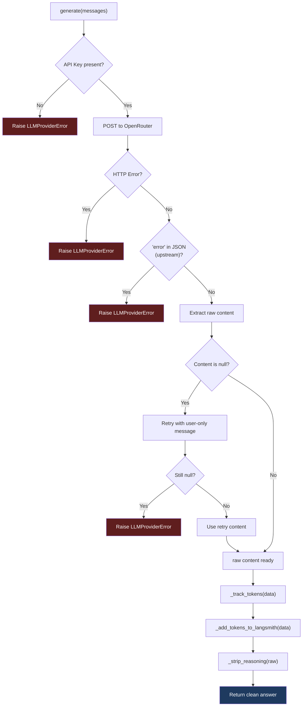
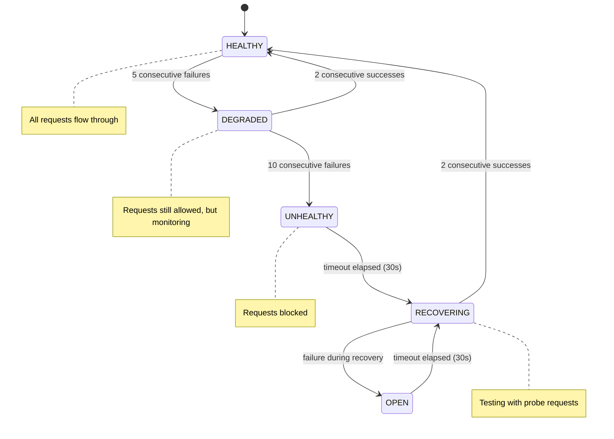
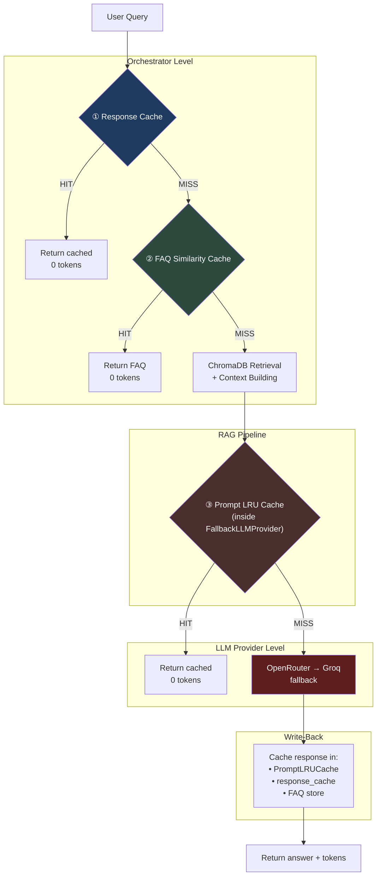
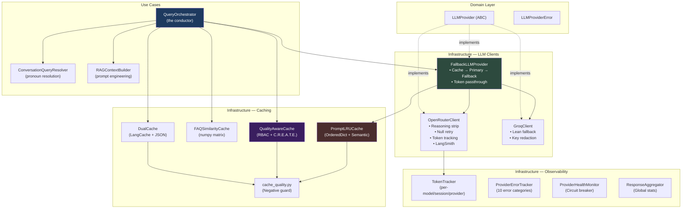

# 🔩 LLM + Caching — Complete Code-Grinder Deep Dive

> **Mode: Driller** — We go through every layer, every design decision, every code path. No hand-waving.

---

## Part 1: The LLM Subsystem

### 1.1 The Contract — `LLMProvider` (Abstract Base Class)

**File:** [llm_provider.py](file:///c:/Users/abhin/OneDrive/Documents/MY%20Coding%20Space/Learning%20Topics/New%20folder/Company_Bot/app/domain/services/llm_provider.py)

Everything starts with 24 lines:

```python
class LLMProviderError(Exception):
    """Raised when an LLM provider cannot generate a response."""

class LLMProvider(ABC):
    @abstractmethod
    def generate(self, messages: List[Dict[str, str]]) -> str:
        raise NotImplementedError
```

**Why this matters:**
- **One method**. Every LLM provider in the system must implement `generate(messages) → str`
- The input is OpenAI-format messages: `[{"role": "system", "content": "..."}, {"role": "user", "content": "..."}]`
- The output is a **plain string** — not a structured object. This keeps the contract dead simple
- `LLMProviderError` is the **only** exception the system expects. All providers must wrap their HTTP errors, timeouts, and auth failures into this single type

> [!IMPORTANT]
> This is a **domain-layer** interface. It lives in `app/domain/services/`, not `app/infrastructure/`. This means the business logic (orchestrator, query resolver) never imports `httpx`, `OpenRouter`, or `Groq` directly — it only knows about `LLMProvider.generate()`. Classic Dependency Inversion.

---

### 1.2 Primary Provider — `OpenRouterClient`

**File:** [openrouter_client.py](file:///c:/Users/abhin/OneDrive/Documents/MY%20Coding%20Space/Learning%20Topics/New%20folder/Company_Bot/app/infrastructure/llm/openrouter_client.py)

This is the **heavyweight** client. Let's drill into what it does that the Groq client doesn't.

#### The HTTP Setup (Connection Reuse)

```python
self._client = httpx.Client(
    timeout=timeout,
    headers={
        "Authorization": f"Bearer {self.api_key}",
        "Content-Type": "application/json",
    },
)
```

The `httpx.Client` is created **once at init**, not per request. This means:
- TCP connection is established once and reused (HTTP keep-alive)
- TLS handshake happens once
- Every subsequent `.post()` saves ~100-200ms of connection overhead

#### The `generate()` Flow



#### The Null-Response Retry (Lines 118-133)

```python
if not raw:
    # Retry once with user-only message (some models return null
    # when the system prompt is too long).
    payload["messages"] = [
        {"role": "user", "content": payload["messages"][-1]["content"]}
    ]
    response = self._client.post(self.BASE_URL, json=payload)
```

**Why?** Some OpenRouter models (especially free-tier) silently fail on long system prompts. Instead of immediately failing, the client retries by **dropping the system prompt** and sending only the user message. This is a practical workaround for unreliable model backends.

#### The Reasoning Stripper (`_strip_reasoning`)

Some "thinking" models (like DeepSeek-R1) emit their internal reasoning before the answer:

```
## Analysis
1. Scan the document context for leave policy
2. Check if information is present
3. Formulate response

The leave policy allows 24 days of paid leave per year.
Would you like to see the references for this?
```

The `_strip_reasoning()` function ([L39-63](file:///c:/Users/abhin/OneDrive/Documents/MY%20Coding%20Space/Learning%20Topics/New%20folder/Company_Bot/app/infrastructure/llm/openrouter_client.py#L39-L63)):
1. Strips `<think>...</think>` XML tags (some models use this)
2. Scans for the **last** header matching "Analysis", "Thinking Process", "Let me check...", etc.
3. Returns everything **after** that header — the actual answer

This is done with two compiled regex patterns:
- `_THINKING_HEADER` — catches "## Analysis", "Reasoning Process", "Let me look..."
- `_INSTRUCTION_ECHO` — catches lines where the model parrots back the instructions

#### Token Tracking (Dual Output)

After a successful call, OpenRouter does **two things** with the token usage:

**1. Global Tracker** at [L148-167](file:///c:/Users/abhin/OneDrive/Documents/MY%20Coding%20Space/Learning%20Topics/New%20folder/Company_Bot/app/infrastructure/llm/openrouter_client.py#L148-L167):
```python
tracker = get_token_tracker()  # Global singleton
tracker.track(
    model=self.model,
    prompt_tokens=prompt_tokens,
    completion_tokens=completion_tokens,
    session_id=self.session_id,
    cache_hit=False,
    provider="openrouter",
)
```

**2. Instance-level storage + LangSmith** at [L169-219](file:///c:/Users/abhin/OneDrive/Documents/MY%20Coding%20Space/Learning%20Topics/New%20folder/Company_Bot/app/infrastructure/llm/openrouter_client.py#L169-L219):
```python
self._last_tokens = {
    "prompt_tokens": prompt_tokens,
    "completion_tokens": completion_tokens,
    "total_tokens": total_tokens,
    "model": self.model,
}
# Also tries to inject into LangSmith run metadata
```

This dual output means:
- The `FallbackLLMProvider` can read `self.primary.get_last_tokens()` to pass tokens upstream
- The `TokenTracker` aggregates across ALL calls for dashboards/reporting
- LangSmith traces get per-call token counts for cost analysis

---

### 1.3 Fallback Provider — `GroqClient`

**File:** [groq_client.py](file:///c:/Users/abhin/OneDrive/Documents/MY%20Coding%20Space/Learning%20Topics/New%20folder/Company_Bot/app/infrastructure/llm/groq_client.py) — Only 71 lines.

**What's different from OpenRouter:**

| Feature | OpenRouterClient | GroqClient |
|---------|-----------------|------------|
| Reasoning strip | ✅ `_strip_reasoning()` | ❌ Not needed (Groq models don't emit reasoning) |
| Null response retry | ✅ Drops system prompt and retries | ❌ Fails immediately |
| Token tracking | ✅ Global tracker + LangSmith | ❌ None |
| `get_last_tokens()` | ✅ Returns last usage dict | ❌ Not implemented |
| Key redaction | ❌ Not in error messages | ✅ `_sanitize_response_body()` |
| Session ID support | ✅ | ❌ |

**The key redaction** is a nice security touch:

```python
def _sanitize_response_body(body: str, max_length: int = 1000) -> str:
    sanitized = re.sub(r"(?i)bearer\s+[a-z0-9._-]+", "Bearer [REDACTED]", sanitized)
    sanitized = re.sub(r"(?i)(?:gsk_|sk-)[a-z0-9_-]+", "[REDACTED_KEY]", sanitized)
    return sanitized
```

If Groq's error response accidentally leaks an API key (it happens with some proxies), this scrubs it before logging.

> [!TIP]
> Groq is intentionally lean — it's the **fallback**. When OpenRouter is down or rate-limited, you want the fastest possible recovery path. No bells and whistles, just `POST → extract content → return`.

---

### 1.4 The Orchestration Layer — `FallbackLLMProvider`

**File:** [fallback_llm_provider.py](file:///c:/Users/abhin/OneDrive/Documents/MY%20Coding%20Space/Learning%20Topics/New%20folder/Company_Bot/app/infrastructure/llm/fallback_llm_provider.py)

This is where **cache meets LLM**. The complete `generate()` flow:

```python
def generate(self, messages):
    # ── STEP 1: Check prompt cache ──
    cached_response = self.cache.get(messages)
    if cached_response is not None:
        self._last_tokens = {"prompt_tokens": 0, ..., "cache_hit": True}
        return cached_response

    # ── STEP 2: Try primary provider ──
    try:
        response = self.primary.generate(messages)
        if hasattr(self.primary, 'get_last_tokens'):
            self._last_tokens = self.primary.get_last_tokens()

    # ── STEP 3: On failure, try fallback ──
    except LLMProviderError:
        try:
            response = self.fallback.generate(messages)
            if hasattr(self.fallback, 'get_last_tokens'):
                self._last_tokens = self.fallback.get_last_tokens()
        except LLMProviderError:
            raise LLMProviderError("Both primary and fallback LLM providers failed.")

    # ── STEP 4: Cache the fresh response ──
    self.cache.put(messages, response)
    return response
```

**Three critical things to notice:**

1. **Cache is checked BEFORE any network call** — the cheapest possible short-circuit
2. **Token metadata flows upward** — `self._last_tokens` is populated from whichever provider succeeded, and the orchestrator reads it via `self.llm.get_last_tokens()`
3. **Cache is populated AFTER success** — only actual LLM responses get cached; errors and exceptions never pollute the cache

The `PromptLRUCache` is constructed with `LLM_CACHE_SIZE` (default 128). We'll drill into it in Part 2.

---

### 1.5 The Query Resolver — LLM-Powered Pronoun Resolution

**File:** [conversation_query_resolver.py](file:///c:/Users/abhin/OneDrive/Documents/MY%20Coding%20Space/Learning%20Topics/New%20folder/Company_Bot/app/use_cases/chat/conversation_query_resolver.py)

Before the RAG pipeline even runs, the system must decide: *"Is this question self-contained, or does it depend on conversation history?"*

```python
_DEPENDENCY_PATTERN = re.compile(
    r"\b(it|this|that|these|those|they|them|their|its|such)\b|"
    r"^\s*(and|also|what about|how about)\b",
    re.IGNORECASE,
)
```

If the user says *"What about their leave policy?"*, the regex detects "their" and triggers rewriting:

```
User: "Tell me about Project Alpha"
Bot: "Project Alpha is a cloud migration initiative..."
User: "What about their leave policy?"
       ↓ _is_dependent() → True
       ↓ LLM rewrites → "What is the leave policy for Project Alpha?"
```

**This IS an LLM call** — the resolver uses `self.llm.generate(messages)` to rewrite. So this query resolution itself goes through the `FallbackLLMProvider` and its cache! If someone keeps asking follow-ups with the same pattern, the rewrite itself gets cached.

> [!WARNING]
> The resolver calls the LLM **before** the main RAG pipeline's LLM call. In the worst case (dependent query + cache miss + primary failure + fallback), a single user question could trigger **3 LLM calls**: 1 for query resolution, 1 for the primary answer attempt (failed), 1 for the fallback answer.

---

### 1.6 The RAG Context Builder — Prompt Engineering

**File:** [rag_context_builder.py](file:///c:/Users/abhin/OneDrive/Documents/MY%20Coding%20Space/Learning%20Topics/New%20folder/Company_Bot/app/use_cases/chat/rag_context_builder.py)

This transforms ChromaDB results into the messages that the LLM actually receives:

```
┌────────────────────────────────────────────────────┐
│ System Prompt                                      │
│ "You are a helpful HR assistant. Your role is..."  │
│ - Answer ONLY using provided context               │
│ - Be concise (2-4 sentences)                       │
│ - If not found, say so                             │
│ - End with "Would you like to see references?"     │
├────────────────────────────────────────────────────┤
│ User Prompt                                        │
│ Document Context:                                  │
│ ==================================================│
│ [Section: Leave Policy]                            │
│ "Employees are entitled to 24 days of paid..."     │
│ (relevance: 92.34%)                                │
│                                                    │
│ [Section: Work From Home]                          │
│ "Remote work requires manager approval..."         │
│ (relevance: 87.12%)                                │
│ ==================================================│
│                                                    │
│ Question: What is the leave policy?                │
│ Instructions: Answer using ONLY the document...    │
└────────────────────────────────────────────────────┘
```

Key details:
- **Context size is capped** at `RAG_MAX_CONTEXT_CHARS` — prevents prompt overflow
- **Metadata headers** like `[Section: Leave Policy]` help the LLM ground its answer
- **Distance → relevance conversion**: `(relevance: {1 - distance:.2%})` — ChromaDB returns distance (lower = better), but humans think in relevance (higher = better)

---

### 1.7 Standardized Response Objects — `LLMResponse`

**File:** [llm_response.py](file:///c:/Users/abhin/OneDrive/Documents/MY%20Coding%20Space/Learning%20Topics/New%20folder/Company_Bot/app/infrastructure/llm/llm_response.py) — 568 lines

This provides a rich, type-safe response structure:

```python
@dataclass
class LLMResponse:
    content: str                              # The actual answer
    status: LLMResponseStatus                 # SUCCESS | CACHED | FAILED | TIMEOUT | RATE_LIMITED
    provider: LLMProviderName                 # OPENROUTER | GROQ | UNKNOWN
    model: str                                # "deepseek/deepseek-r1-0528:free"
    tokens: Optional[LLMTokenUsage]           # {prompt: 340, completion: 120, total: 460}
    latency_ms: float                         # 1234.5
    timestamp: float                          # Unix epoch
    cache_source: Optional[CacheEntrySource]  # RAG_GENERATED | FAQ_MATCHED | LLM_CACHED
    citations: list[dict]                     # [{source: "...", section: "...", text: "..."}]
    metadata: dict[str, Any]                  # Extensible bag of extra data
```

**Three factory methods** for common cases:

```python
# Fresh LLM response
resp = LLMResponse.from_provider_response(content="...", provider=OPENROUTER, model="...", tokens=...)

# Cached response (zero tokens, zero latency)
resp = LLMResponse.from_cache(content="...", cache_source=CacheEntrySource.SEMANTIC_CACHE)

# Error response
resp = LLMResponse.error_response(error_message="Both providers failed", status=FAILED)
```

**The Builder pattern** provides fluent construction:

```python
resp = (LLMResponseBuilder()
    .with_content("The leave policy is...")
    .with_provider("openrouter")
    .with_tokens(prompt_tokens=340, completion_tokens=120)
    .with_latency(1234.5)
    .with_citations([{"source": "HR Handbook", "section": "Leave"}])
    .build())
```

#### ResponseAggregator — Global Statistics Singleton

The `ResponseAggregator` ([L404-568](file:///c:/Users/abhin/OneDrive/Documents/MY%20Coding%20Space/Learning%20Topics/New%20folder/Company_Bot/app/infrastructure/llm/llm_response.py#L404-L568)) collects cross-provider statistics:

```python
aggregator.record_response(response)
stats = aggregator.get_global_stats()
# → {total_requests: 150, success_rate: 94.7%, cache_hit_rate: 31.2%,
#    total_tokens: 45000, avg_latency_ms: 890.3}
```

---

### 1.8 Error Classification — `ProviderErrorTracker`

**File:** [provider_error_tracker.py](file:///c:/Users/abhin/OneDrive/Documents/MY%20Coding%20Space/Learning%20Topics/New%20folder/Company_Bot/app/infrastructure/llm/provider_error_tracker.py) — 490 lines

This classifies every LLM failure into one of **10 categories**:

| Category | Status Codes | Error Message Keywords | Retryable? |
|----------|-------------|----------------------|------------|
| `TIMEOUT` | — | "timeout", "timed out" | ✅ Yes |
| `RATE_LIMIT` | 429 | "rate limit", "too many requests" | ✅ Yes |
| `SERVER_ERROR` | 500-599 | "500", "502", "server error" | ✅ Yes |
| `NETWORK_ERROR` | — | "connection", "dns", "refused" | ✅ Yes |
| `AUTHENTICATION` | 401, 403 | "api key", "unauthorized" | ❌ Fail fast |
| `QUOTA_EXCEEDED` | — | "quota", "insufficient credits" | ❌ Fail fast |
| `INVALID_REQUEST` | 400 | "invalid", "bad request" | ❌ Fail fast |
| `MODEL_UNAVAILABLE` | 404 | "model", "not found" | ❌ Fail fast |
| `CONTEXT_LENGTH` | — | "context length", "too long" | ❌ Fail fast |
| `UNKNOWN` | — | (everything else) | ❌ Fail fast |

**The `RetryPolicy`** at [L75-178](file:///c:/Users/abhin/OneDrive/Documents/MY%20Coding%20Space/Learning%20Topics/New%20folder/Company_Bot/app/infrastructure/llm/provider_error_tracker.py#L75-L178) implements exponential backoff:

```python
delay = initial_delay × (backoff_factor ^ (attempt - 1))
# attempt 1: 1.0s × 2^0 = 1.0s
# attempt 2: 1.0s × 2^1 = 2.0s
# attempt 3: 1.0s × 2^2 = 4.0s
# (capped at max_delay = 10.0s)
```

**Critical state detection** — a provider is "critical" if:
- 10+ total errors **AND**
- A dominant non-UNKNOWN error category **AND**
- Error rate > 5 per minute

---

### 1.9 Circuit Breaker — `ProviderHealthMonitor`

**File:** [provider_health.py](file:///c:/Users/abhin/OneDrive/Documents/MY%20Coding%20Space/Learning%20Topics/New%20folder/Company_Bot/app/infrastructure/llm/provider_health.py) — 377 lines

This is the **state machine** that protects the system from hammering a dead provider:



**Key parameters:**
- `failure_threshold = 5` — 5 consecutive failures → DEGRADED
- `success_threshold = 2` — 2 consecutive successes during RECOVERING → back to HEALTHY  
- `timeout_seconds = 30.0` — wait 30s before attempting recovery

**The `ProviderHealthMonitor`** is a singleton that manages circuit breakers for both OpenRouter and Groq:

```python
monitor = ProviderHealthMonitor()
# Auto-registers both providers on init:
# monitor.register_provider("openrouter")
# monitor.register_provider("groq")

# Smart provider selection:
best = monitor.get_healthy_provider(preferred="openrouter", fallback="groq")
# → "openrouter" if healthy, "groq" if openrouter is unhealthy, None if both down
```

---

### 1.10 Token Tracking — `TokenTracker`

**File:** [token_tracker.py](file:///c:/Users/abhin/OneDrive/Documents/MY%20Coding%20Space/Learning%20Topics/New%20folder/Company_Bot/app/infrastructure/observability/token_tracker.py) — 352 lines

A thread-safe global singleton that records every LLM call's token usage:

```python
tracker.track(
    model="deepseek/deepseek-r1-0528:free",
    prompt_tokens=340,
    completion_tokens=120,
    session_id="sess_abc123",
    cache_hit=False,
    provider="openrouter",
)
```

**Aggregation views:**
- `get_total()` — all-time totals
- `get_by_model("deepseek/...")` — per-model breakdown
- `get_by_session("sess_abc123")` — per-user-session costs
- `get_by_provider("openrouter")` — per-provider comparison
- `get_cache_stats()` — cache hit rate across all calls

---

## Part 2: The Caching Architecture

### 2.1 The Five Cache Layers — How They Stack



### 2.2 Layer ① — Response Cache (The Entry Gate)

**Where:** [query_orchestrator.py L203-236](file:///c:/Users/abhin/OneDrive/Documents/MY%20Coding%20Space/Learning%20Topics/New%20folder/Company_Bot/app/use_cases/chat/query_orchestrator.py#L203-L236)

- **Injected** via `__init__(response_cache=...)` — the orchestrator doesn't care *what* it is
- **Duck-typed**: any object with `.get(question)` and `.put(question, value)` works
- This could be the `DualCache`, the `InMemoryQualityAwareCache`, or anything else
- On hit: returns `{"answer": "...", "citations": [...], "cache_hit": True, "tokens": {all zeros}}`

### 2.3 Layer ② — FAQ Similarity Cache (The Knowledge Shortcut)

**File:** [faq_similarity_cache.py](file:///c:/Users/abhin/OneDrive/Documents/MY%20Coding%20Space/Learning%20Topics/New%20folder/Company_Bot/app/infrastructure/faq/faq_similarity_cache.py)

**On startup:**
```python
# Embed ALL FAQ questions into a single matrix
raw = model.encode(questions, normalize_embeddings=True)  # shape (N, D)
self._matrix = raw.astype(np.float32)
```

**On search:**
```python
query_vec = model.encode([question], normalize_embeddings=True)[0]  # shape (D,)
scores = self._matrix @ query_vec  # shape (N,) — ALL cosine sims in ONE operation
best_idx = int(np.argmax(scores))
```

This is **the fastest cache** — pure numpy, no network, no disk I/O. The matrix multiply computes all N similarities in a single vectorized operation.

> [!NOTE]
> **Read-only at runtime.** FAQs come from a JSON file loaded at startup. New FAQ entries added by the orchestrator (via `self.faq_store.save()`) won't appear until restart. This is by design — FAQ answers are human-curated.

### 2.4 Layer ③ — Prompt LRU Cache (The LLM Shield)

**File:** [prompt_cache.py](file:///c:/Users/abhin/OneDrive/Documents/MY%20Coding%20Space/Learning%20Topics/New%20folder/Company_Bot/app/infrastructure/llm/prompt_cache.py)

Lives **inside** `FallbackLLMProvider`. Two-phase lookup:

```
Phase 1: EXACT MATCH
    key = JSON.stringify(messages)  // deterministic serialization
    OrderedDict.get(key) → HIT or MISS

Phase 2: SEMANTIC FALLBACK (only if Phase 1 misses)
    embed(user content from messages) → query_vector
    for each cached (key, vector) pair:
        score = cosine_similarity(query_vector, cached_vector)
    if best_score ≥ 0.70 → HIT
    else → MISS
```

**Why `OrderedDict`?** It's the Python standard library's built-in LRU mechanism:
- `move_to_end(key)` on every hit — most recently used moves to the tail
- `popitem(last=False)` for eviction — least recently used is at the head
- No external LRU library needed

**The semantic fallback** is the expensive part — it calls `SentenceTransformer.encode()` (~50ms) on every cache miss. But this cost is amortized:
- For identical prompts (same question + same context chunks) → Phase 1 catches it in O(1)
- For paraphrased questions → Phase 2 catches it in O(N) where N ≤ 128

### 2.5 Layer ④ — Dual Cache (Distributed + Resilient)

**File:** [dual_cache.py](file:///c:/Users/abhin/OneDrive/Documents/MY%20Coding%20Space/Learning%20Topics/New%20folder/Company_Bot/app/infrastructure/cache/dual_cache.py)

```
READ:  LangCache (semantic) → JSON fallback (exact)
WRITE: LangCache + JSON (always both)
SYNC:  Background thread every 60s (JSON → LangCache)
```

**Three defensive mechanisms:**
1. **Negative response guard on read** — if a cached response matches `is_negative_response()`, it's silently deleted instead of served
2. **Negative response guard on write** — refuses to store negative responses
3. **Atomic JSON writes** — write to `.tmp` file, then `os.replace()` for crash safety

### 2.6 Layer ⑤ — Quality-Aware Semantic Cache (The Brain)

**File:** [quality_aware_cache.py](file:///c:/Users/abhin/OneDrive/Documents/MY%20Coding%20Space/Learning%20Topics/New%20folder/Company_Bot/app/infrastructure/cache/quality_aware_cache.py) — **1,196 lines**

The most sophisticated cache. Before storing, it runs **7 quality checks** (C.R.E.A.T.E. gate):

```
1. Empty response?              → FAIL
2. Confidence < 0.60?           → FAIL
3. Best evidence distance ≥ 0.85? → FAIL
4. RAG with 0 evidence chunks?  → FAIL
5. Lexical grounding < 0.20?    → FAIL/REVIEW
6. Separation gap < 0.10?       → WARNING
7. is_negative_response()?      → FAIL
```

On read, it enforces **three additional gates**:
- **TTL expiration** — entries older than `ttl_seconds` are evicted
- **RBAC validation** — user's role, project_ids, document_ids must match the cached entry
- **Document freshness** — if any cited document was updated since caching, the entry auto-evicts

---

## Part 3: The Negative Response Guard

**File:** [cache_quality.py](file:///c:/Users/abhin/OneDrive/Documents/MY%20Coding%20Space/Learning%20Topics/New%20folder/Company_Bot/app/core/cache_quality.py)

**7 regex patterns** that detect non-answers:

| # | Pattern | Catches |
|---|---------|---------|
| 1 | Inability | "could not find", "unable to locate", "failed to provide" |
| 2 | No-info | "no relevant information", "no specific details" |
| 3 | Not-in-docs | "not mentioned in the handbook", "not found in documents" |
| 4 | Does-not-contain | "does not provide any information" |
| 5 | Access-denied | "document that you do not have access to" |
| 6 | Direct refusal | "no specific document references are available" |
| 7 | Neither-docs | "neither the provided documents nor" |

**Every cache layer** calls `is_negative_response()` before storing. This is the system's immune system — it prevents caching "I don't know" answers that would be served to users who ask the same question after new documents are ingested.

---

## Part 4: Complete Data Flow — One Request, Traced End-to-End

```
User: "What about their leave policy?"
Session: sess_abc123, History: [{"role":"user","content":"Tell me about Project Alpha"}]

1. QueryOrchestrator.answer(question, history, session_id)
   │
   ├── response_cache.get("What about their leave policy?") → MISS
   │
   ├── faq_cache.search("What about their leave policy?") → MISS (similarity=0.61 < threshold)
   │
   ├── query_resolver.resolve("What about their leave policy?", history)
   │   ├── _is_dependent("What about their leave policy?") → True ("their" matched)
   │   ├── FallbackLLMProvider.generate([system: "Rewrite...", user: "Conversation:..."])
   │   │   ├── PromptLRUCache.get(messages) → MISS
   │   │   ├── OpenRouterClient.generate(messages)
   │   │   │   ├── POST https://openrouter.ai/api/v1/chat/completions
   │   │   │   ├── _strip_reasoning(raw) → "What is the leave policy for Project Alpha?"
   │   │   │   ├── _track_tokens({prompt: 85, completion: 12})
   │   │   │   └── return "What is the leave policy for Project Alpha?"
   │   │   └── PromptLRUCache.put(messages, response) ← cached for future rewrites
   │   └── return "What is the leave policy for Project Alpha?"
   │
   ├── retrieval.retrieve("What is the leave policy for Project Alpha?", top_k=10)
   │   └── ChromaDB → 5 relevant chunks with distances [0.32, 0.45, 0.51, 0.67, 0.82]
   │
   ├── context_builder.build_messages(question, chunks)
   │   └── [system: "You are a helpful HR assistant...", user: "Document Context:..."]
   │
   ├── FallbackLLMProvider.generate(messages)
   │   ├── PromptLRUCache.get(messages) → MISS (different context than rewrite)
   │   ├── OpenRouterClient.generate(messages)
   │   │   ├── POST https://openrouter.ai/api/v1/chat/completions
   │   │   ├── _strip_reasoning(raw) → "Project Alpha follows the standard leave policy..."
   │   │   ├── _track_tokens({prompt: 340, completion: 120})
   │   │   └── return "Project Alpha follows the standard leave policy..."
   │   └── PromptLRUCache.put(messages, response)
   │
   ├── provenance.build_citations(evidence) → [{source: "HR Handbook", section: "Leave"}]
   │
   ├── faq_store.save(question, answer, citations) ← for future FAQ matching
   │
   ├── response_cache.put(question, {answer, citations}) ← for Layer 1 hits
   │
   ├── llm.get_last_tokens() → {prompt: 340, completion: 120, total: 460}
   │
   ├── add_tokens_to_current_run(340, 120, "deepseek/deepseek-r1-0528:free")
   │
   └── return {
         answer: "Project Alpha follows the standard leave policy...",
         citations: [{source: "HR Handbook", section: "Leave"}],
         cache_hit: false,
         tokens: {prompt: 340, completion: 120, total: 460}
       }
```

**Total cost of this request:**
- 2 LLM calls (1 rewrite + 1 answer) = ~$0.002
- 2 embedding operations (FAQ search + prompt cache semantic check)
- 1 ChromaDB query
- 3 cache writes (prompt cache × 2, response cache × 1)
- Next time someone asks the same or similar question → 0 LLM calls, 0 cost

---

## Part 5: Architecture Summary



---

## Part 6: Key Design Decisions — Why It's Built This Way

| Decision | Rationale |
|----------|-----------|
| **5 cache layers, not 1** | Each layer operates at a different granularity: FAQ (pre-computed), prompt (per-message-list), response (per-question), semantic (per-meaning), dual (for resilience) |
| **Cache inside FallbackLLMProvider** | The cache must wrap the fallback logic — otherwise, you'd need to cache at both primary and fallback levels separately |
| **Reasoning strip at client level** | Stripping `<think>` tags must happen before caching, otherwise the cached response includes reasoning artifacts |
| **Negative response guard as shared utility** | Called by 4+ modules — extract once, enforce everywhere |
| **RBAC on cache entries** | Without it, User A's cache hit could leak User B's confidential documents |
| **Document freshness auto-eviction** | Stale answers from updated documents are worse than no cache — users get wrong info with high confidence |
| **Groq is intentionally lean** | The fallback path must be fast and simple — no reasoning strip, no token tracking. Get the answer out |
| **`LLMProvider` is 24 lines** | The interface is deliberately minimal. Adding methods here forces ALL providers to change. Keep it stable |
| **Circuit breaker timeout = 30s** | Long enough to ride out a transient outage, short enough to recover quickly |
| **OrderedDict for LRU** | Standard library, zero dependencies, O(1) for all operations. No need for `cachetools` or Redis |

---

## Part 7: Benefits of LangCache (Distributed Semantic Caching)

In `DualCache` ([dual_cache.py](file:///c:/Users/abhin/OneDrive/Documents/MY%20Coding%20Space/Learning%20Topics/New%20folder/Company_Bot/app/infrastructure/cache/dual_cache.py)), LangCache is configured as the primary remote cache provider. Here is why LangCache is beneficial in a production environment:

| Feature | Local In-Memory / File Cache | LangCache (Distributed Remote Cache) |
| :--- | :--- | :--- |
| **Multi-Worker Scaling** | ❌ Process-isolated. Worker A cannot see Worker B's cache. | ✅ Centralized service shared across all Uvicorn workers and server instances. |
| **Persistence across Restarts** | ❌ In-memory data is lost when FastAPI restarts. | ✅ Remote database persistence; zero cold-start latency after deployment. |
| **Server-Side Semantic Search** | ⚠️ Local CPU computes embeddings & similarity matrices. | ✅ Offloaded managed vector search at the cache service level. |
| **Process RAM Footprint** | ❌ High RAM usage on application workers as cache grows. | ✅ Minimal RAM footprint on the application server. |

> [!NOTE]
> In single-instance local execution, local RAM cache provides ultra-low latency (<1ms vs ~25ms network call). `DualCache` utilizes `JsonFallbackCache` locally when `langcache` is not installed, allowing clean local development without external service dependencies.
