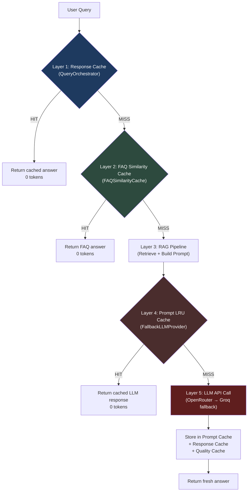
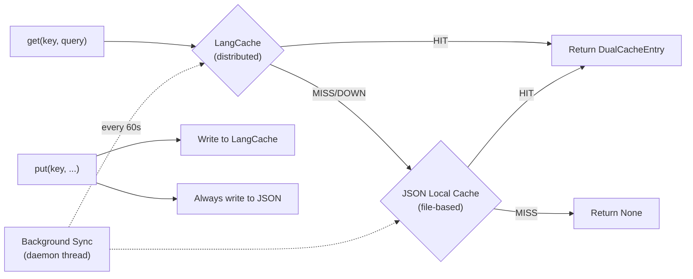

# 🔩 LLM Cache — Code-Grinder Deep Dive

> **What this is:** A Driller-style explainer that cracks open every caching layer in your Company_Bot, traces the exact code paths a query takes, and makes sure you understand *why* each layer exists, not just *what* it does.

---

## 1. The Problem LLM Caching Solves

Every time a user asks "What is the leave policy?", your bot:
1. Embeds the query (~50ms)
2. Searches ChromaDB (~100ms)
3. Builds a prompt from retrieved chunks
4. **Calls an external LLM API (500ms–3s, costs $$)**
5. Returns the answer

If 10 users ask the same question, you pay step 4 **ten times** — same tokens in, same tokens out, same cost. LLM caching eliminates redundant API calls by recognizing "I've answered something like this before" and replaying the stored response.

But here's the twist: **your codebase doesn't have just one cache. It has five distinct caching layers**, stacked like armor plating. Let's drill into each one.

---

## 2. The Five Cache Layers — Bird's Eye View



| Layer | Class | Storage | Match Strategy | Where It Lives |
|-------|-------|---------|----------------|----------------|
| 1 | `response_cache` (generic) | Caller-provided | Exact key | [query_orchestrator.py](file:///c:/Users/abhin/OneDrive/Documents/MY%20Coding%20Space/Learning%20Topics/New%20folder/Company_Bot/app/use_cases/chat/query_orchestrator.py#L203-L236) |
| 2 | `FAQSimilarityCache` | In-memory numpy matrix | Cosine similarity ≥ threshold | [faq_similarity_cache.py](file:///c:/Users/abhin/OneDrive/Documents/MY%20Coding%20Space/Learning%20Topics/New%20folder/Company_Bot/app/infrastructure/faq/faq_similarity_cache.py) |
| 3 | `PromptLRUCache` | In-memory OrderedDict | Exact match → semantic fallback | [prompt_cache.py](file:///c:/Users/abhin/OneDrive/Documents/MY%20Coding%20Space/Learning%20Topics/New%20folder/Company_Bot/app/infrastructure/llm/prompt_cache.py) |
| 4 | `DualCache` | LangCache + JSON file | Semantic (LangCache) + exact (JSON) | [dual_cache.py](file:///c:/Users/abhin/OneDrive/Documents/MY%20Coding%20Space/Learning%20Topics/New%20folder/Company_Bot/app/infrastructure/cache/dual_cache.py) |
| 5 | `InMemoryQualityAwareCache` | In-memory dict + embeddings | Semantic similarity + quality gating | [quality_aware_cache.py](file:///c:/Users/abhin/OneDrive/Documents/MY%20Coding%20Space/Learning%20Topics/New%20folder/Company_Bot/app/infrastructure/cache/quality_aware_cache.py) |

---

## 3. Layer-by-Layer Drill Down

### 🔵 Layer 1: Response Cache (The Entry Gate)

**File:** [query_orchestrator.py L203-236](file:///c:/Users/abhin/OneDrive/Documents/MY%20Coding%20Space/Learning%20Topics/New%20folder/Company_Bot/app/use_cases/chat/query_orchestrator.py#L203-L236)

This is the **first check** when `QueryOrchestrator.answer()` is called:

```python
# ── 1. LRU Response cache check (if configured) ─────────────────
if self.response_cache is not None:
    cached_entry = self.response_cache.get(question)
    if cached_entry is not None:
        # ... return with cache_hit=True, tokens=0
```

**Key details:**
- **Injected from outside** — the orchestrator doesn't create it, it receives it via `__init__(response_cache=...)`
- Uses a **simple `.get(question)`** interface — the cache object decides whether matching is exact or semantic
- On a cache hit, the response includes `"cache_hit": True` and a **zero-token** metadata block
- On a fresh answer, the orchestrator **writes back** to this cache at [L362-369](file:///c:/Users/abhin/OneDrive/Documents/MY%20Coding%20Space/Learning%20Topics/New%20folder/Company_Bot/app/use_cases/chat/query_orchestrator.py#L362-L369):

```python
if self.response_cache is not None:
    try:
        if hasattr(self.response_cache, "put"):
            self.response_cache.put(question, {"answer": answer, "citations": citations})
        elif hasattr(self.response_cache, "set"):
            self.response_cache.set(question, {"answer": answer, "citations": citations})
```

> [!NOTE]
> The `hasattr` duck-typing means any cache object with `.get()` and `.put()` or `.set()` can plug in here — the `DualCache`, the `InMemoryQualityAwareCache`, or even a Redis wrapper.

---

### 🟢 Layer 2: FAQ Similarity Cache (The Knowledge Shortcut)

**File:** [faq_similarity_cache.py](file:///c:/Users/abhin/OneDrive/Documents/MY%20Coding%20Space/Learning%20Topics/New%20folder/Company_Bot/app/infrastructure/faq/faq_similarity_cache.py)

This is a **pre-computed** cache. On startup:

```python
# 1. Load FAQ JSON file
faqs = json.loads(path.read_text(encoding="utf-8"))

# 2. Embed ALL questions at once into a numpy matrix
raw: np.ndarray = model.encode(
    questions,
    convert_to_numpy=True,
    normalize_embeddings=True,  # ← unit vectors for fast dot product
)

self._matrix = raw.astype(np.float32)  # shape (N, D)
```

When `search()` is called:

```python
# Embed the incoming question
query_vec = self._model.encode([question], ...)  # shape (D,)

# Matrix multiply = all cosine similarities at once
scores = self._matrix @ query_vec  # shape (N,)

best_idx = int(np.argmax(scores))
best_score = float(scores[best_idx])

if best_score >= self.threshold:
    return {**self._entries[best_idx], "similarity": round(best_score, 4)}
```

**Why this is brilliant:**
- The matrix multiply `(N, D) @ (D,)` computes **all N similarities in one vectorized operation** — no loop, no per-entry comparisons
- Normalized embeddings mean dot product = cosine similarity (no division needed)
- Zero network calls, zero LLM invocations — pure numpy

**Configuration knobs** (from [settings.py](file:///c:/Users/abhin/OneDrive/Documents/MY%20Coding%20Space/Learning%20Topics/New%20folder/Company_Bot/app/core/settings.py)):
- `FAQ_SIMILARITY_CACHE_ENABLED` — kill switch
- `FAQ_SIMILARITY_THRESHOLD` — how similar must the question be? (default: configurable)
- `FAQ_JSON_PATH` — which FAQ file to load

> [!IMPORTANT]
> This cache is **read-only at runtime**. It's populated from a static JSON file. New FAQs are only picked up on restart. This is intentional — it guarantees human-curated answers for common questions.

---

### 🔴 Layer 3: Prompt LRU Cache (The LLM Shield)

**File:** [prompt_cache.py](file:///c:/Users/abhin/OneDrive/Documents/MY%20Coding%20Space/Learning%20Topics/New%20folder/Company_Bot/app/infrastructure/llm/prompt_cache.py)

This sits **inside** `FallbackLLMProvider.generate()` at [fallback_llm_provider.py L31-42](file:///c:/Users/abhin/OneDrive/Documents/MY%20Coding%20Space/Learning%20Topics/New%20folder/Company_Bot/app/infrastructure/llm/fallback_llm_provider.py#L31-L42):

```python
def generate(self, messages):
    cached_response = self.cache.get(messages)  # ← Check cache BEFORE calling LLM
    if cached_response is not None:
        self._last_tokens = {"prompt_tokens": 0, ..., "cache_hit": True}
        return cached_response

    # ... call primary → fallback ...

    self.cache.put(messages, response)  # ← Store AFTER successful LLM call
    return response
```

**The two-phase lookup inside `PromptLRUCache.get()`:**

```
Phase 1: Exact Match
    key = JSON-serialize(messages)
    if key in OrderedDict → HIT (move to end, return)

Phase 2: Semantic Fallback
    query_vector = embed(user content from messages)
    for each cached entry:
        score = cosine_similarity(query_vector, cached_vector)
    if best_score >= threshold → HIT
    else → MISS
```

**Critical design decisions:**

| Decision | Why |
|----------|-----|
| `OrderedDict` (not `dict`) | Enables LRU eviction — `move_to_end()` on hit, `popitem(last=False)` for eviction |
| Serialize messages to JSON key | Captures the full prompt including system message + context, not just the user question |
| Embed only user content for semantic match | System prompts are boilerplate — the *question* determines if it's a duplicate |
| `maxsize=128` (from `LLM_CACHE_SIZE`) | Bounds memory — at ~768-dim embeddings, 128 entries ≈ 400KB |

> [!WARNING]
> The semantic fallback embeds the question **every time** there's no exact match. That's a sentence-transformer forward pass (~50ms). In a high-throughput scenario, this could become a bottleneck. The exact-match fast path exists specifically to avoid this cost for identical prompts.

---

### 🟡 Layer 4: Dual Cache (Distributed + Local Fallback)

**File:** [dual_cache.py](file:///c:/Users/abhin/OneDrive/Documents/MY%20Coding%20Space/Learning%20Topics/New%20folder/Company_Bot/app/infrastructure/cache/dual_cache.py)

This is an **enterprise-grade** pattern — a primary distributed cache with a local JSON fallback:



**The negative response guard** at [L320-323](file:///c:/Users/abhin/OneDrive/Documents/MY%20Coding%20Space/Learning%20Topics/New%20folder/Company_Bot/app/infrastructure/cache/dual_cache.py#L320-L323):

```python
json_entry = self._json_cache.get(cache_key)
if json_entry:
    if is_negative_response(json_entry.response):
        # ← Self-healing: evict the bad entry instead of serving it
        self._json_cache.delete(cache_key)
        json_entry = None
```

This is a **retroactive quality gate** — if a negative response somehow snuck into the cache (e.g., before the quality rules were added), it gets silently purged on read.

**The write guard** at [L359-361](file:///c:/Users/abhin/OneDrive/Documents/MY%20Coding%20Space/Learning%20Topics/New%20folder/Company_Bot/app/infrastructure/cache/dual_cache.py#L359-L361):

```python
if is_negative_response(response):
    logger.info("dual_cache_skip reason=negative_response key=%s", cache_key)
    return False  # ← Refuse to cache the garbage
```

**Atomic JSON writes** at [L108-118](file:///c:/Users/abhin/OneDrive/Documents/MY%20Coding%20Space/Learning%20Topics/New%20folder/Company_Bot/app/infrastructure/cache/dual_cache.py#L108-L118):
```python
# Write to temp file first, then atomically replace
temp_path = self.file_path.with_name(f"{self.file_path.name}.{os.getpid()}.tmp")
with open(temp_path, 'w') as f:
    json.dump(data, f, indent=2)
os.replace(temp_path, self.file_path)  # ← atomic on same filesystem
```

This prevents corrupt cache files if the process crashes mid-write.

---

### 🟣 Layer 5: Quality-Aware Semantic Cache (The Brain)

**File:** [quality_aware_cache.py](file:///c:/Users/abhin/OneDrive/Documents/MY%20Coding%20Space/Learning%20Topics/New%20folder/Company_Bot/app/infrastructure/cache/quality_aware_cache.py) — **1,196 lines**, the most sophisticated cache in the system.

This is the only cache that asks: **"Is this response *good enough* to cache?"**

#### 5a. The C.R.E.A.T.E. Quality Gate

Before storing any response, `CacheQualityValidator.validate()` runs 7 checks:

```
┌─────────────────────────────────────────────────────────────┐
│  C.R.E.A.T.E. Quality Gate Pipeline                        │
│                                                             │
│  1. Empty response?           → FAIL (never cache blanks)   │
│  2. Confidence < 0.60?        → FAIL                        │
│  3. Best distance >= 0.85?    → FAIL (evidence too weak)    │
│  4. RAG with 0 evidence?      → FAIL                        │
│  5. Lexical grounding < 0.20? → FAIL/REVIEW                 │
│  6. Separation gap < 0.10?    → WARNING only                │
│  7. Negative response?        → FAIL (is_negative_response) │
│                                                             │
│  All checks passed?           → PASS ✅ → Cache it          │
└─────────────────────────────────────────────────────────────┘
```

The **distance classification** system ([L458-468](file:///c:/Users/abhin/OneDrive/Documents/MY%20Coding%20Space/Learning%20Topics/New%20folder/Company_Bot/app/infrastructure/cache/quality_aware_cache.py#L458-L468)):

| Distance | Level | Meaning |
|----------|-------|---------|
| < 0.60 | 🟢 STRONG | Evidence is highly relevant |
| 0.60-0.70 | 🟡 BORDERLINE | Evidence is questionable |
| 0.70-0.85 | 🟠 WEAK | Evidence barely related |
| ≥ 0.85 | 🔴 INVALID | Garbage — don't cache |

#### 5b. RBAC-Aware Cache Isolation

This cache doesn't just store answers — it stores **who can see them**:

```python
entry = QualityAwareCacheEntry(
    cache_key=...,
    response=...,
    assigned_role="hr_manager",        # ← Only HR managers see this
    document_ids=["policy_v2.pdf"],    # ← Requires access to this document
    project_ids=["proj_001"],          # ← Requires project membership
    is_public=False,                   # ← Not open to all
)
```

On retrieval, `_check_rbac_access()` enforces:
1. **Admin bypass** — `is_admin=True` sees everything
2. **Role match** — user's role must match `assigned_role`
3. **Project intersection** — user's project list must overlap entry's project list
4. **Document authorization** — user must have access to ALL cited documents

> [!CAUTION]
> If you return cached answers without RBAC checks, User A could see confidential answers that were generated from documents only User B has access to. This is why the quality-aware cache tracks `document_ids` and `project_ids` on every entry.

#### 5c. Document Freshness Auto-Eviction

The most unique feature — at [L807-849](file:///c:/Users/abhin/OneDrive/Documents/MY%20Coding%20Space/Learning%20Topics/New%20folder/Company_Bot/app/infrastructure/cache/quality_aware_cache.py#L807-L849):

```python
# For each document cited in the cached answer:
for doc_id in entry.document_ids:
    current_doc_updated_at = lookup_fn(doc_id)  # ← What's the doc's latest timestamp?
    cached_ts = entry.metadata.doc_last_updated.get(doc_id)  # ← What was it when we cached?

    if current_doc_updated_at > cached_ts:
        # Document was updated AFTER we cached this answer!
        self._remove_entry(effective_key)  # ← Auto-evict stale answer
        return None  # ← Force a fresh LLM call
```

**Why this matters:** If someone updates the "Leave Policy" document, all cached answers derived from the old version are automatically invalidated. No manual cache-busting needed.

#### 5d. Semantic Matching with Embedding Index

For cache lookups, exact key match is tried first. On miss, it does a full semantic scan at [L754-773](file:///c:/Users/abhin/OneDrive/Documents/MY%20Coding%20Space/Learning%20Topics/New%20folder/Company_Bot/app/infrastructure/cache/quality_aware_cache.py#L754-L773):

```python
# Embed the query
query_emb = self._embed_text(cache_key)

# Linear scan over all stored embeddings
for k, emb in list(self._key_embeddings.items()):
    sim = float(np.dot(query_emb, emb))  # ← Cosine sim (unit vectors)
    if sim > best_sim:
        best_sim = sim
        matched_key = k

if best_sim >= self.semantic_similarity_threshold:
    entry = self._cache.get(matched_key)  # ← Semantic HIT
```

---

## 4. The Negative Response Guard — Cross-Cutting Concern

**File:** [cache_quality.py](file:///c:/Users/abhin/OneDrive/Documents/MY%20Coding%20Space/Learning%20Topics/New%20folder/Company_Bot/app/core/cache_quality.py)

This is a **shared defense** used by multiple cache layers. The `is_negative_response()` function catches answers like:

- *"I could not find that information in the available documents"*
- *"No relevant information was found"*
- *"The document does not contain any details about..."*
- *"Relevant information exists in a document you do not have access to"*

It uses **7 compiled regex patterns** that cover:

| Pattern Category | Example Catch |
|-----------------|---------------|
| Inability phrases | "could not find", "unable to locate" |
| No-info phrases | "no relevant information", "no records" |
| Not-found-in-docs | "not mentioned in the handbook" |
| Does-not-contain | "does not provide any details" |
| Access denied | "document that you do not have access to" |
| Direct refusals | "no specific document references are available" |

> [!TIP]
> Every single cache layer calls `is_negative_response()` before storing. This is the "never cache garbage" invariant. If you add a new cache layer, **you must call this function** or you'll cache non-answers and serve them to users forever.

---

## 5. How It All Flows — Complete Request Lifecycle

```
User: "What is the work from home policy?"
│
├─ QueryOrchestrator.answer()
│   ├─ [1] response_cache.get("What is the work from home policy?")
│   │   └─ MISS (first time asking)
│   │
│   ├─ [2] faq_cache.search("What is the work from home policy?")
│   │   ├─ Embed question → (384-dim vector)
│   │   ├─ Matrix multiply against 50 FAQ embeddings
│   │   ├─ Best match: "What is the WFH policy?" → similarity=0.94
│   │   └─ HIT! Return FAQ answer, zero tokens
│   │
│   └─ (If FAQ missed, continue to RAG pipeline...)
│       ├─ [3] retrieval.retrieve(question) → ChromaDB → top_k chunks
│       ├─ context_builder.build_messages(question, chunks)
│       │
│       ├─ FallbackLLMProvider.generate(messages)
│       │   ├─ [4] PromptLRUCache.get(messages)
│       │   │   ├─ Exact key lookup → MISS
│       │   │   ├─ Semantic search → best_score=0.68 < 0.70 threshold
│       │   │   └─ MISS
│       │   │
│       │   ├─ [5] OpenRouterClient.generate(messages) → "The WFH policy is..."
            └─ PromptLRUCache.put(messages, response)  ← Store for next time
        │
        ├─ response_cache.put(question, {answer, citations})  ← Store at L1
        └─ Return {answer, citations, cache_hit=False, tokens={...}}
```

---

## 6. Configuration Cheat Sheet

| Setting | Default | What It Controls |
|---------|---------|-----------------|
| `LLM_CACHE_SIZE` | `128` | Max entries in `PromptLRUCache` |
| `LLM_CACHE_SIMILARITY_THRESHOLD` | `0.70` | Semantic match threshold for prompt cache |
| `FAQ_SIMILARITY_CACHE_ENABLED` | `true` | Kill switch for FAQ cache |
| `FAQ_SIMILARITY_THRESHOLD` | Configurable | How similar a question must be to match an FAQ |
| `SEMANTIC_CACHE_SIMILARITY_THRESHOLD` | Configurable | Threshold for quality-aware semantic cache |
| `RESPONSE_CACHE_FILE` | `data/response_cache.json` | Path for JSON-persisted cache |

---

## 7. Mental Model: When to Use Which Cache

```
"I want to..."                              → Use this layer
─────────────────────────────────────────────────────────────
Avoid LLM calls for identical prompts       → PromptLRUCache (Layer 3)
Answer common HR questions instantly         → FAQSimilarityCache (Layer 2)
Cache with quality + RBAC enforcement        → InMemoryQualityAwareCache (Layer 5)
Survive restarts with distributed failover   → DualCache (Layer 4)
Generic plug-and-play cache at orchestrator  → response_cache (Layer 1)
```

---

## 8. Key Takeaways

1. **Caching is NOT just "store and lookup"** — your system has quality gates, RBAC, document freshness, negative response filtering, and semantic matching
2. **Semantic matching** (cosine similarity on embeddings) catches *paraphrased* duplicates — "WFH policy" ≈ "work from home policy" → cache hit
3. **Never cache garbage** — every cache layer calls `is_negative_response()` to prevent caching non-answers
4. **RBAC on cached responses** — without it, you'd leak confidential answers across roles
5. **Document freshness** — when a source document is updated, stale cached answers auto-evict
6. **Defense in depth** — if Layer 2 misses, Layer 3 might still catch it; if the LLM is down, Layer 4's JSON fallback keeps working
