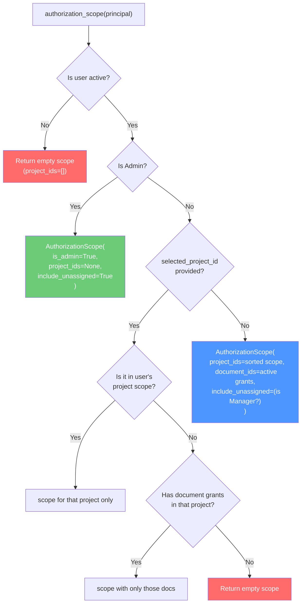

# 🔌 Code-Grinder Deep Dive: `app/domain/ports` & `app/domain/services`

> **Mode**: Topic Driller — we go until you could write these from scratch yourself.

---

## 🗺️ The Territory

```
app/domain/
├── ports/                         ← CONTRACTS (what must exist)
│   ├── authentication_service.py  (9 lines)
│   ├── authorization_service.py   (48 lines)
│   ├── document_repository.py     (11 lines)
│   ├── observability.py           (64 lines)
│   ├── organization_repositories.py (98 lines)
│   ├── retrieval.py               (11 lines)
│   ├── sequence_repository.py     (22 lines)
│   ├── session_store.py           (19 lines)
│   └── unit_of_work.py            (35 lines)
└── services/                      ← IMPLEMENTATIONS (what actually does it)
    ├── authentication_service.py  (80 lines)
    ├── authorization_engine.py    (442 lines) ← THE GIANT
    ├── authorization_service.py   (46 lines)
    ├── business_id_generator.py   (95 lines)
    ├── employee_id_provider.py    (20 lines)
    ├── llm_provider.py            (24 lines)
    ├── organization_errors.py     (23 lines)
    ├── permission_catalog.py      (96 lines)
    └── session_memory_service.py  (11 lines)
```

---

## 🧠 The Mental Model First — Why Ports Exist

Before reading a single line of code, understand the **reason** for this pattern.

Imagine you're building a car. The engine doesn't know or care if the fuel comes from a gas station, a home pump, or a jerry can. The engine only knows about the **fuel nozzle shape** — the contract. Whoever fills the fuel must use that nozzle.

In KnowLayer:

```
                 ┌─────────────────────────────────────┐
                 │           DOMAIN LAYER               │
                 │                                     │
  Business       │   Services only talk to Ports       │
  Logic    ──▶   │   (the fuel nozzle)                 │
                 │                                     │
                 └──────────────┬──────────────────────┘
                                │ implements
                 ┌──────────────▼──────────────────────┐
                 │       INFRASTRUCTURE LAYER           │
                 │                                     │
                 │   SQLAlchemy / ChromaDB / Redis /   │
                 │   OpenRouter / Groq / Langfuse ...  │
                 │   (the actual fuel source)          │
                 └─────────────────────────────────────┘
```

**Result**: The domain layer is 100% testable without a database, without an LLM, without any external service. You inject fakes through the ports.

---

## 📐 The Mechanism — `Protocol` vs `ABC`

Every port in this project uses Python's `typing.Protocol`. Let's understand WHY, not just what.

### ABC (Abstract Base Class) — Old Way

```python
# With ABC: forces explicit inheritance
from abc import ABC, abstractmethod

class UserRepository(ABC):
    @abstractmethod
    def get_by_uid(self, uid: str): ...

class SqliteUserRepo(UserRepository):  # ← MUST inherit. Creates coupling.
    def get_by_uid(self, uid: str):
        return db.query(User).filter_by(uid=uid).first()
```

**Problem**: `SqliteUserRepo` must know about and import `UserRepository`. The infrastructure layer now depends on the domain. Tight coupling.

### Protocol (Structural Typing) — This Project's Way

```python
# With Protocol: no inheritance required
from typing import Protocol

class UserRepository(Protocol):
    def get_by_uid(self, uid: str) -> User | None: ...

class SqliteUserRepo:  # ← No inheritance! No import of the Protocol!
    def get_by_uid(self, uid: str) -> User | None:
        return db.query(User).filter_by(uid=uid).first()

# Python's type checker automatically knows SqliteUserRepo satisfies UserRepository
# because it has the right shape (structural typing = "duck typing + type safety")
```

> [!IMPORTANT]
> **Why this matters**: `SqliteUserRepo` in `app/infrastructure/` never imports anything from `app/domain/`. The infrastructure layer knows **nothing** about the domain layer. This is the strictest form of decoupling possible.

### The `runtime_checkable` Variant

Some ports in this codebase add `@runtime_checkable`:

```python
@runtime_checkable
class TraceSpanPort(Protocol):
    def end(self, outputs=None, error=None) -> None: ...
```

This allows `isinstance(obj, TraceSpanPort)` to work at **runtime** (normally `Protocol` only works for static type checkers). Useful when you need to check "does this object satisfy the port?" dynamically.

---

## 🔌 Every Port — Annotated

### Port 1: `retrieval.py` — The Simplest Port (11 lines)

[retrieval.py](file:///c:/Users/abhin/OneDrive/Documents/MY%20Coding%20Space/Learning%20Topics/New%20folder/Company_Bot/app/domain/ports/retrieval.py)

```python
from typing import Protocol, Sequence

class RetrievalPort(Protocol):
    def query(
        self,
        query_text: str,
        top_k: int = 3,
        project_ids: Sequence[str] | None = None,
    ) -> list[dict]: ...
```

**What it says**: "Anything I call a retrieval system must accept a text query and return a list of dicts." The domain doesn't care if that's ChromaDB, Pinecone, Weaviate, or even a simple in-memory list.

**What currently implements it**: `ChromaVectorStore` in `infrastructure/vector/chroma_client.py`

**What could implement it**: Any vector database — Pinecone, Weaviate, pgvector, FAISS, or even a mock that returns hardcoded documents for tests.

---

### Port 2: `authentication_service.py` — 2 Methods (9 lines)

[authentication_service.py (port)](file:///c:/Users/abhin/OneDrive/Documents/MY%20Coding%20Space/Learning%20Topics/New%20folder/Company_Bot/app/domain/ports/authentication_service.py)

```python
from typing import Protocol
from app.domain.ports.authorization_service import AuthenticatedPrincipal

class AuthenticationService(Protocol):
    def authenticate(self, username: str, password: str) -> AuthenticatedPrincipal: ...
    def change_password(self, principal: AuthenticatedPrincipal, current_password: str, new_password: str) -> None: ...
```

**The contract**: Given credentials → return who you are (`AuthenticatedPrincipal`). Given who you are + old/new passwords → change it.

Notice what's **NOT** in the contract:
- No mention of JWT tokens (implementation detail)
- No mention of password hashing (implementation detail)
- No mention of database queries (implementation detail)

The domain says "authenticate a user." The infrastructure decides HOW.

---

### Port 3: `authorization_service.py` — The Identity Contract (48 lines)

[authorization_service.py (port)](file:///c:/Users/abhin/OneDrive/Documents/MY%20Coding%20Space/Learning%20Topics/New%20folder/Company_Bot/app/domain/ports/authorization_service.py)

```python
@dataclass(frozen=True, slots=True)   # ← frozen = immutable, slots = fast
class AuthenticatedPrincipal:
    uid: str                          # User's unique ID (e.g., "MSS-001")
    token: str | None = None          # JWT token (None for anonymous)
    must_change_password: bool = False

class AuthorizationService(Protocol):
    def authorized_project_ids(self, principal, selected_project_id=None) -> Sequence[str]: ...
    def can_manage_department(self, principal, department_id) -> bool: ...
    def can_manage_project(self, principal, project_id) -> bool: ...
    def can_manage_role(self, principal, role) -> bool: ...
    def roles_for_user(self, uid) -> Sequence[Role]: ...
    def permissions_for_user(self, uid) -> set[str]: ...
    def has_permission(self, principal, permission) -> bool: ...
```

**`AuthenticatedPrincipal` is the passport**. Once authentication succeeds, the domain passes this lightweight, immutable object around instead of the full `User` entity. It's:
- **Immutable** (`frozen=True`): can't be tampered with after creation
- **Fast** (`slots=True`): uses `__slots__` for direct attribute access, no `__dict__`
- **Minimal**: only 3 fields — the domain doesn't need your full profile to check permissions

> [!TIP]
> `frozen=True` on a dataclass also makes it **hashable** — you can put `AuthenticatedPrincipal` in a set or use it as a dict key. Useful for caching.

---

### Port 4: `session_store.py` — Sessions + the Data Object (19 lines)

[session_store.py](file:///c:/Users/abhin/OneDrive/Documents/MY%20Coding%20Space/Learning%20Topics/New%20folder/Company_Bot/app/domain/ports/session_store.py)

```python
@dataclass
class SessionData:
    turns: List[Dict[str, str]] = field(default_factory=list)  # Conversation history
    user_id: Optional[str] = None
    last_activity: datetime = field(default_factory=lambda: datetime.now(timezone.utc))

class SessionStorePort(Protocol):
    def get(self, session_id: str) -> Optional[SessionData]: ...
    def save(self, session_id: str, data: SessionData) -> None: ...
    def delete(self, session_id: str) -> bool: ...
    def purge_expired(self, max_age_hours: float) -> int: ...  # ← Maintenance operation
```

Note that this port **also defines** the `SessionData` dataclass. This is correct — `SessionData` is a domain concept (what is a session?). The port just defines the shape of storage operations.

**What currently implements it**: `InMemorySessionStore` (lost on restart)
**What could implement it**: `RedisSessionStore`, `SqlSessionStore`, `DynamoDbSessionStore`

---

### Port 5: `sequence_repository.py` — Atomic Counters (22 lines)

[sequence_repository.py](file:///c:/Users/abhin/OneDrive/Documents/MY%20Coding%20Space/Learning%20Topics/New%20folder/Company_Bot/app/domain/ports/sequence_repository.py)

```python
class SequenceRepository(Protocol):
    """Persistent, atomic per-key numeric counters for business IDs.

    Each counter is keyed by a stable sequence name (user, department,
    project, document). allocate() must be safe to call from
    concurrent transactions and must never return the same value twice.
    """

    def get(self, sequence_key: str) -> int | None:
        """Return current last allocated value, or None if no counter row."""

    def initialize(self, sequence_key: str, prefix: str, last_value: int) -> None:
        """Create the counter row if missing (captures legacy data)."""

    def allocate(self, sequence_key: str, by: int = 1) -> int:
        """Atomically reserve the next value and return it."""
```

This is a subtle but powerful design. The docstring says `allocate()` **must be atomic** — this is a **business requirement** stated at the domain level. The implementation (SQLite `UPDATE ... RETURNING`) must fulfill this contract. If you implemented this with a non-atomic operation (like `read → increment → write`), you'd violate the port's contract even if Python typed checks passed.

---

### Port 6: `document_repository.py` — 5 Operations (11 lines)

[document_repository.py](file:///c:/Users/abhin/OneDrive/Documents/MY%20Coding%20Space/Learning%20Topics/New%20folder/Company_Bot/app/domain/ports/document_repository.py)

```python
class DocumentRepository(Protocol):
    def get(self, document_id: str) -> Document | None: ...
    def get_by_internal_id(self, internal_id: int) -> Document | None: ...
    def list(self) -> Sequence[Document]: ...
    def save(self, document: Document) -> Document: ...
    def delete(self, document_id: str) -> None: ...
```

**Two ways to look up a document**:
- `get(document_id)` — business ID like `"DOC-007"` (human-readable)
- `get_by_internal_id(internal_id)` — auto-increment integer PK from the database

Why both? Some operations know the business ID (user input, API paths), while others know the database ID (foreign key joins in SQL). Both lookups need to be efficient.

---

### Port 7: `organization_repositories.py` — 9 Repository Contracts (98 lines)

[organization_repositories.py](file:///c:/Users/abhin/OneDrive/Documents/MY%20Coding%20Space/Learning%20Topics/New%20folder/Company_Bot/app/domain/ports/organization_repositories.py)

This file defines **9 repository protocols** in one place:

| Repository | Entity | Key Operations |
|-----------|--------|---------------|
| `UserRepository` | `User` | get by uid/username/email/employee_id, list, save, delete |
| `DepartmentRepository` | `Department` | get, list, save |
| `ProjectRepository` | `Project` | get, get_by_internal_id, list, list_active, save |
| `DocumentRepository` | `Document` | get, get_by_internal_id, list, save, delete |
| `MembershipRepository` | `UserProject` | get, list_for_user, list_for_project, save, revoke |
| `DepartmentMemberRepository` | `DepartmentMember` | get, list_for_user, list_for_department, save |
| `PermissionRepository` | `Permission` | get, get_by_name, list, save |
| `RoleRepository` | `Role` | get, get_by_name, list, save, delete, permissions_for_role, set_permissions |
| `ProjectGrantRepository` | `ProjectGrant` | get, get_by_id, list_for_project, **project_ids_for_principal**, list, save, delete |
| `DocumentGrantRepository` | `DocumentGrant` | get, for_document, **document_ids_for_principal**, list, save, delete |

The **two bold methods** are the most important:

```python
class ProjectGrantRepository(Protocol):
    def project_ids_for_principal(
        self,
        user_id: str,
        role_ids: Sequence[int],
    ) -> Sequence[str]: ...
```

This asks: "Given this user's ID AND all their role IDs, which projects do they have explicit grant access to?" This is a **domain-level query** — not just "get by ID", but "resolve access for a composite identity." The implementation does a SQL `WHERE (user_id = ? OR role_id IN (?,...))`.

---

### Port 8: `unit_of_work.py` — The Transaction Envelope (35 lines)

[unit_of_work.py](file:///c:/Users/abhin/OneDrive/Documents/MY%20Coding%20Space/Learning%20Topics/New%20folder/Company_Bot/app/domain/ports/unit_of_work.py)

```python
class UnitOfWork(Protocol):
    # 11 repositories bundled together:
    users: UserRepository
    departments: DepartmentRepository
    projects: ProjectRepository
    documents: DocumentRepository
    memberships: MembershipRepository
    department_members: DepartmentMemberRepository
    roles: RoleRepository
    permissions: PermissionRepository
    project_grants: ProjectGrantRepository
    document_grants: DocumentGrantRepository
    sequences: SequenceRepository

    # Context manager protocol:
    def __enter__(self) -> "UnitOfWork": ...
    def __exit__(self, exc_type, exc_value, traceback) -> None: ...
    def commit(self) -> None: ...
    def rollback(self) -> None: ...
```

**The Unit of Work (UoW) pattern** — the most important design pattern in the domain layer. It ensures that every operation within a `with uow:` block is **atomic**:

```python
# Pattern used everywhere in use_cases and domain services:
with self.unit_of_work_factory() as uow:
    # STAGE 1: READ
    user = uow.users.get_by_uid(actor_uid)

    # STAGE 2: VALIDATE
    if user is None:
        raise ForbiddenError("User not found")

    # STAGE 3: MUTATE
    user.name = new_name
    uow.users.save(user)

    # STAGE 4: COMMIT (or auto-rollback if an exception escaped)
    uow.commit()
# ← __exit__ called here. If exception: rollback. If clean: done.
```

> [!WARNING]
> If you call `uow.users.save(user)` but forget `uow.commit()`, the change is **not persisted**. The `__exit__` on an exception calls `rollback()`. On a clean exit WITHOUT commit, SQLAlchemy also rolls back the session. **You must explicitly commit.**

---

### Port 9: `observability.py` — Vendor-Neutral Tracing (64 lines)

[observability.py](file:///c:/Users/abhin/OneDrive/Documents/MY%20Coding%20Space/Learning%20Topics/New%20folder/Company_Bot/app/domain/ports/observability.py)

```python
@dataclass(frozen=True)
class TokenUsage:
    """Standardized token representation across ANY LLM provider."""
    prompt_tokens: int = 0
    completion_tokens: int = 0
    total_tokens: int = 0

    def __post_init__(self) -> None:
        # Auto-calculate total if not provided but parts are
        if self.total_tokens == 0 and (self.prompt_tokens > 0 or self.completion_tokens > 0):
            object.__setattr__(self, "total_tokens", self.prompt_tokens + self.completion_tokens)
            # ↑ object.__setattr__ required because frozen=True prevents normal assignment
```

The `__post_init__` trick: `frozen=True` blocks `self.total_tokens = ...`, so you must bypass it with `object.__setattr__()` — the one escape hatch Python provides for frozen dataclasses.

```python
@runtime_checkable
class BaseObservabilityProvider(Protocol):
    def create_trace(self, name, session_id=None, user_id=None, metadata=None) -> TraceSpanPort: ...
    def record_llm_call(self, model, token_usage, latency_ms=0.0, metadata=None) -> None: ...
    def flush(self) -> None: ...

# Type alias — just a rename for Hexagonal naming consistency:
ObservabilityPort = BaseObservabilityProvider
```

**What currently implements it**: `LangfuseProvider`, `LangSmithProvider`, `PhoenixProvider`, `NullProvider` (no-op for dev)

---

## ⚙️ Every Service — Annotated

### Service 1: `organization_errors.py` — The Error Taxonomy (23 lines)

[organization_errors.py](file:///c:/Users/abhin/OneDrive/Documents/MY%20Coding%20Space/Learning%20Topics/New%20folder/Company_Bot/app/domain/services/organization_errors.py)

```python
class OrganizationError(Exception):
    """Base exception for ALL organization domain failures."""

class NotFoundError(OrganizationError): pass   # → HTTP 404
class ConflictError(OrganizationError): pass   # → HTTP 409 (duplicate)
class ForbiddenError(OrganizationError): pass  # → HTTP 403 (not allowed)
class AuthenticationError(OrganizationError): pass  # → HTTP 401
class PersistenceError(OrganizationError): pass  # → HTTP 500
```

**Why a hierarchy?** Because the API layer does this:

```python
def _error(error):
    if isinstance(error, ConflictError):   return HTTPException(409, ...)
    if isinstance(error, NotFoundError):   return HTTPException(404, ...)
    if isinstance(error, ForbiddenError):  return HTTPException(403, ...)
    return HTTPException(400, ...)  # catch-all for any OrganizationError
```

The domain can raise `NotFoundError("Department not found")` without knowing anything about HTTP. The API layer translates. This is **clean separation of concerns**.

> [!TIP]
> Because all domain errors inherit from `OrganizationError`, you can also catch the base class to handle ALL domain failures in one handler:
> ```python
> try:
>     service.create_user(...)
> except OrganizationError as e:
>     logger.warning("Domain error: %s", e)
>     raise
> ```

---

### Service 2: `llm_provider.py` — The Abstract LLM Contract (24 lines)

[llm_provider.py](file:///c:/Users/abhin/OneDrive/Documents/MY%20Coding%20Space/Learning%20Topics/New%20folder/Company_Bot/app/domain/services/llm_provider.py)

```python
class LLMProviderError(Exception):
    """Raised when an LLM provider cannot generate a response."""

class LLMProvider(ABC):   # ← Note: this uses ABC, not Protocol!
    """Provider-independent contract for generating LLM responses."""

    @abstractmethod
    def generate(self, messages: List[Dict[str, str]]) -> str:
        """
        Generate an LLM response from chat messages.
        messages: Chat messages using roles: system, user, assistant.
        Returns: Generated assistant response.
        """
        raise NotImplementedError
```

**Why `ABC` here instead of `Protocol`?** Notice that `LLMProvider` uses `ABC` (Abstract Base Class), not `Protocol`. This is the one exception in the domain layer. The reason: `LLMProvider` is designed to be **explicitly inherited** by infrastructure classes (`OpenRouterClient(LLMProvider)`, `GroqClient(LLMProvider)`). This gives them:

1. The ability to call `super().__init__()` for shared setup (if needed)
2. An `isinstance(obj, LLMProvider)` check that works without `@runtime_checkable`
3. A clearer "you MUST implement `generate()`" constraint enforced at class definition time

**What implements it**:
- `OpenRouterClient(LLMProvider)` — Primary provider → Claude 3.5 Sonnet
- `GroqClient(LLMProvider)` — Fallback → Llama 3.1 8B
- `FallbackLLMProvider(LLMProvider)` — Meta-provider that wraps both with failover + LRU cache

---

### Service 3: `session_memory_service.py` — Thin Adapter (11 lines)

[session_memory_service.py](file:///c:/Users/abhin/OneDrive/Documents/MY%20Coding%20Space/Learning%20Topics/New%20folder/Company_Bot/app/domain/services/session_memory_service.py)

```python
class SessionMemoryService:
    """Thin domain wrapper over the session store port."""

    def __init__(self, store: SessionStorePort | None = None):
        from app.infrastructure.session.in_memory_store import InMemorySessionStore
        self._store = store or InMemorySessionStore()

    def get_history(self, session_id: str) -> list[dict]:
        data = self._store.get(session_id)
        return data.turns if data else []

    def save_turn(self, session_id: str, user_msg: str, assistant_msg: str) -> None:
        data = self._store.get(session_id) or SessionData()
        data.turns.append({"role": "user", "content": user_msg})
        data.turns.append({"role": "assistant", "content": assistant_msg})
        data.last_activity = datetime.now(timezone.utc)
        self._store.save(session_id, data)
```

**This is a Facade** — a simplified interface over the `SessionStorePort`. Instead of exposing raw `SessionData` objects, it offers domain-friendly methods: `get_history()`, `save_turn()`. The `QueryOrchestrator` uses this to load/save conversation context for multi-turn questions.

---

### Service 4: `business_id_generator.py` — Concurrency-Safe ID Factory (95 lines)

[business_id_generator.py](file:///c:/Users/abhin/OneDrive/Documents/MY%20Coding%20Space/Learning%20Topics/New%20folder/Company_Bot/app/domain/services/business_id_generator.py)

This is the most **algorithmically interesting** domain service. Let's break it fully:

```python
@dataclass(frozen=True)
class BusinessIdSequence:
    """One counter family configuration."""
    key: str           # "user", "department", "project", "document"
    prefix: str        # "MSS", "DEPT", "PROJ", "DOC"
    existing_ids: Callable[[UnitOfWork], Sequence[str]]
    # ↑ Lambda that queries current IDs for bootstrap seeding
```

**The Generator class:**

```python
class BusinessIdGenerator:
    def __init__(self):
        self._sequences: dict[str, BusinessIdSequence] = {}
        self._lock = threading.Lock()  # Thread-safe registry access

    def register(self, sequence: BusinessIdSequence) -> "BusinessIdGenerator":
        with self._lock:
            self._sequences[sequence.key] = sequence
        return self  # ← Enables fluent chaining: .register(...).register(...)

    def next(self, uow, key: str) -> str:
        with self._lock:
            sequence = self._sequences[key]

        # BOOTSTRAP: On first call, seed counter from existing data
        if uow.sequences.get(sequence.key) is None:
            uow.sequences.initialize(
                sequence.key,
                sequence.prefix,
                highest_existing_suffix(sequence.existing_ids(uow), sequence.prefix),
            )
            # Example: if DB already has "MSS-001" through "MSS-007",
            # seed the counter at 7 so next call gives "MSS-008"

        # ALLOCATE: Atomically get the next number
        value = uow.sequences.allocate(sequence.key)

        # FORMAT: Zero-padded 3-digit suffix
        return f"{sequence.prefix}-{value:03d}"  # "MSS-001", "PROJ-042"
```

**The Bootstrap Helper:**

```python
def highest_existing_suffix(existing_ids: Sequence[str], prefix: str) -> int:
    """Find the highest numeric suffix already used for this prefix."""
    highest = 0
    separator = f"{prefix}-"     # "MSS-"
    for raw in existing_ids:
        if not raw or not raw.startswith(separator):
            continue
        suffix = raw[len(separator):]   # "001" → "007"
        if suffix.isdigit():
            highest = max(highest, int(suffix))
    return highest
```

**The Factory Function:**

```python
def build_business_id_generator(
    *, user_prefix, department_prefix, project_prefix, document_prefix
) -> BusinessIdGenerator:
    return (
        BusinessIdGenerator()
        .register(BusinessIdSequence(
            "user", user_prefix,
            lambda uow: [u.employee_id for u in uow.users.list() if u.employee_id]
        ))
        .register(BusinessIdSequence(
            "department", department_prefix,
            lambda uow: [d.department_id for d in uow.departments.list()]
        ))
        .register(BusinessIdSequence(
            "project", project_prefix,
            lambda uow: [p.project_id for p in uow.projects.list()]
        ))
        .register(BusinessIdSequence(
            "document", document_prefix,
            lambda uow: [d.document_id for d in uow.documents.list()]
        ))
    )
```

> [!NOTE]
> The `existing_ids` lambdas are only called **once** — during bootstrap initialization, when no counter row exists yet. After that, the `SequenceRepository.allocate()` is the source of truth. This prevents the dreaded "ID reuse after deletion" bug.

**The Three Guarantees:**
1. **No duplicates**: `allocate()` is an atomic SQL `UPDATE ... RETURNING`
2. **No reuse**: counter only increases, even after entities are deleted
3. **Thread-safe**: `threading.Lock()` protects the in-memory registry

---

### Service 5: `permission_catalog.py` — The RBAC Seed (96 lines)

[permission_catalog.py](file:///c:/Users/abhin/OneDrive/Documents/MY%20Coding%20Space/Learning%20Topics/New%20folder/Company_Bot/app/domain/services/permission_catalog.py)

```python
PERMISSION_DEFINITIONS = (
    ("USER_VIEW",    "View users"),
    ("USER_CREATE",  "Create users"),
    ("USER_UPDATE",  "Update users"),
    ("USER_DELETE",  "Deactivate or delete users"),
    ("DEPARTMENT_VIEW",    "View departments"),
    ("DEPARTMENT_CREATE",  "Create departments"),
    ("DEPARTMENT_UPDATE",  "Update departments"),
    ("DEPARTMENT_ASSIGN_USERS", "Assign users to departments"),
    ("PROJECT_VIEW",           "View projects"),
    ("PROJECT_CREATE",         "Create projects"),
    ("PROJECT_UPDATE",         "Update projects"),
    ("PROJECT_DELETE",         "Delete projects"),
    ("PROJECT_MANAGE_MEMBERS", "Manage project members"),
    ("PROJECT_LEAVE",          "Leave a project"),
    ("DOCUMENT_VIEW",          "View documents"),
    ("DOCUMENT_UPLOAD",        "Upload documents"),
    ("DOCUMENT_UPDATE",        "Update documents"),
    ("DOCUMENT_DELETE",        "Delete documents"),
    ("DOCUMENT_QUERY",         "Query documents"),
    ("DOCUMENT_MANAGE_ACCESS", "Manage document access"),
    ("ROLE_VIEW",              "View roles and permissions"),
    ("ROLE_CREATE",            "Create roles"),
    ("ROLE_UPDATE",            "Update roles"),
    ("ROLE_DELETE",            "Delete roles"),
    ("PERMISSION_MANAGE",      "Manage role permission assignments"),
)
# 25 permissions total, organized by resource type
```

**The Initial Roles:**

```python
INITIAL_ROLE_DEFINITIONS = (
    {
        "name": "Admin",
        "scope": "global",
        "permissions": "*",   # ← ALL 25 permissions
    },
    {
        "name": "Manager",
        "scope": "global",
        "permissions": (      # ← 18 specific permissions (no USER_DELETE, no ROLE_DELETE)
            "USER_VIEW", "USER_CREATE", "USER_UPDATE",
            "DEPARTMENT_VIEW", "DEPARTMENT_ASSIGN_USERS",
            "PROJECT_VIEW", "PROJECT_CREATE", "PROJECT_UPDATE",
            "PROJECT_MANAGE_MEMBERS", "PROJECT_LEAVE",
            "DOCUMENT_VIEW", "DOCUMENT_UPLOAD", "DOCUMENT_UPDATE",
            "DOCUMENT_QUERY", "DOCUMENT_MANAGE_ACCESS",
            "ROLE_VIEW", "ROLE_CREATE", "ROLE_UPDATE",
        ),
    },
    # Developer: 8 perms (view + document CRUD, no admin ops)
    # Tester: 5 perms (view + query only)
    # Solution Architect: 11 perms (view + project management + document access)
)

def resolve_role_permissions(permission_names):
    if permission_names == "*":
        return ALL_PERMISSION_NAMES   # ← Expands the wildcard
    return tuple(permission_names)
```

> [!NOTE]
> The docstring of this file explicitly states: **"Nothing here is consulted when authorizing a request."** This data is only used at first-startup to seed the DB. Runtime authorization reads from the database — which admins can modify through the API.

---

### Service 6: `authentication_service.py` — JWT + PBKDF2 (80 lines)

[authentication_service.py (service)](file:///c:/Users/abhin/OneDrive/Documents/MY%20Coding%20Space/Learning%20Topics/New%20folder/Company_Bot/app/domain/services/authentication_service.py)

This is a **domain service** (not pure domain — it uses `jwt` library) that implements the `AuthenticationService` port.

**Full annotated `authenticate()` method:**

```python
def authenticate(self, username: str, password: str) -> AuthenticatedPrincipal:
    with self.unit_of_work_factory() as uow:

        # Step 1: Try username lookup
        user = uow.users.get_by_username(username)

        # Step 2: Fallback to email lookup (username is the input field)
        if user is None:
            user = uow.users.get_by_email(username)

        # Step 3: User not found → same error as wrong password
        if user is None:
            raise AuthenticationError("Invalid credentials")
            # ↑ SECURITY: Never say "user not found" — that reveals valid usernames

        # Step 4: Inactive account → same error
        if user.status != "active":
            raise AuthenticationError("Invalid credentials")
            # ↑ SECURITY: Don't reveal that the account exists but is inactive

        # Step 5: Password verification (constant-time comparison)
        if not self.password_hasher.verify(password, user.password_representation):
            raise AuthenticationError("Invalid credentials")

        # Step 6: Generate JWT (HS256, only {sub: uid})
        token = jwt.encode({"sub": user.uid}, self.secret_key, algorithm="HS256")

        return AuthenticatedPrincipal(user.uid, token, user.must_change_password)
```

**Security insight**: Steps 3, 4, and 5 all raise **the same error message** ("Invalid credentials"). This prevents **username enumeration** — an attacker can't tell if an account doesn't exist vs. exists but is inactive vs. has a wrong password.

**The `resolve_token()` method** (used on every authenticated request):

```python
def resolve_token(self, token: str) -> AuthenticatedPrincipal:
    try:
        payload = jwt.decode(token, self.secret_key, algorithms=["HS256"])
        uid = payload.get("sub")
        if not uid:
            raise AuthenticationError("Invalid token")
        return AuthenticatedPrincipal(uid, token)
        # ↑ Note: does NOT re-verify the user exists in DB.
        # That's intentional — token validation is separate from user lookup.
    except jwt.InvalidTokenError as error:
        raise AuthenticationError("Invalid token") from error
```

**Admin password change** (the elevated path):

```python
def admin_change_password(self, actor: AuthenticatedPrincipal, target_uid: str, new_password: str):
    with self.unit_of_work_factory() as uow:
        admin = uow.users.get_by_uid(actor.uid)
        target = uow.users.get_by_uid(target_uid)

        # Admin must be active AND have role "admin" (case-insensitive)
        if admin is None or admin.status != "active" or admin.role.casefold() != "admin":
            raise ForbiddenError("Admin access required")

        target.password_representation = self.password_hasher.hash(new_password)
        target.must_change_password = True  # ← Force user to change on next login
        uow.users.save(target)
        uow.commit()
```

---

### Service 7: `authorization_service.py` — The Facade (46 lines)

[authorization_service.py (service)](file:///c:/Users/abhin/OneDrive/Documents/MY%20Coding%20Space/Learning%20Topics/New%20folder/Company_Bot/app/domain/services/authorization_service.py)

```python
class OrganizationAuthorizationService:
    """Thin facade over the AuthorizationEngine.

    Kept so that all existing call sites and dependency wiring stay the same;
    every decision is delegated to the single AuthorizationEngine.
    """

    def __init__(self, unit_of_work: UnitOfWork):
        self.unit_of_work = unit_of_work
        self.engine = AuthorizationEngine(lambda: self.unit_of_work)
        # ↑ Wraps the UoW in a lambda so the engine gets a factory, not the instance

    def authorized_project_ids(self, principal, selected_project_id=None):
        return self.engine.authorized_project_ids(principal, selected_project_id)

    def is_admin(self, principal) -> bool:
        return self.engine.is_admin(principal)

    # ... 8 more delegation methods, all the same pattern
```

**Why this exists**: The `AuthorizationEngine` accepts a `unit_of_work_factory` (callable). The `OrganizationAuthorizationService` holds a single `UnitOfWork` instance. This facade bridges the two — it wraps the UoW as `lambda: self.unit_of_work` to satisfy the factory interface.

It's also a **Facade pattern** — it hides the complexity of the engine and exposes only what the use_cases need.

---

### Service 8: `authorization_engine.py` — The Permission Brain (442 lines)

[authorization_engine.py](file:///c:/Users/abhin/OneDrive/Documents/MY%20Coding%20Space/Learning%20Topics/New%20folder/Company_Bot/app/domain/services/authorization_engine.py)

This is the **most important** and **largest** domain file. Let's dissect it section by section.

#### Section 1: Action → Permission Mapping

```python
ACTION_PERMISSIONS = {
    "view_users":            "USER_VIEW",
    "create_user":           "USER_CREATE",
    "update_user":           "USER_UPDATE",
    "deactivate_user":       "USER_DELETE",
    "view_departments":      "DEPARTMENT_VIEW",
    "create_department":     "DEPARTMENT_CREATE",
    # ... 21 more entries
    "query_documents":       "DOCUMENT_QUERY",
    "manage_document_access": "DOCUMENT_MANAGE_ACCESS",
}
```

This table bridges **human-readable action names** to **RBAC permission strings**. Instead of scattering permission strings throughout the codebase, all mapping is here. The `can(principal, "create_user")` method uses this table.

#### Section 2: AuthorizationScope — The RAG Access Passport

```python
@dataclass(frozen=True, slots=True)
class AuthorizationScope:
    is_admin: bool = False
    project_ids: Optional[list[str]] = None   # None = ALL projects (admin only)
    document_ids: Optional[list[str]] = None  # Explicit per-doc grants
    include_unassigned: bool = False           # Can see "orphan" docs?
```

**The four possible states of `project_ids`:**

| Value | Meaning | Who gets it |
|-------|---------|------------|
| `None` | No restriction — see everything | Admins only |
| `["PROJ-001", "PROJ-003"]` | Specific projects | Regular users |
| `[]` (empty list) | See nothing from projects | Blocked users / no projects |
| (+ `document_ids` override) | Mixed: some by project, some by direct grant | Users with explicit grants |

#### Section 3: The Private Helper Methods

```python
@staticmethod
def _roles_for_user(uow, uid: str) -> list[Role]:
    """Resolves ALL roles for a user: system role + department membership roles."""
    user = uow.users.get_by_uid(uid)
    candidates = []

    # Source 1: The user's own "role" field (e.g., "Manager")
    if user.role:
        named = uow.roles.get_by_name(user.role)
        if named: candidates.append((named, user.department_id))

    # Source 2: Department membership roles (e.g., "Solution Architect" in Dept A)
    for member in uow.department_members.list_for_user(uid):
        role = uow.roles.get_by_name(member.membership_role)
        if role: candidates.append((role, member.department_id))

    # Deduplicate and filter by scope
    roles = []
    seen = set()
    for role, department_id in candidates:
        if role.status != "active" or role.role_id in seen:
            continue
        # Department-scoped roles only apply in their department
        if role.scope == "department" and role.department_id not in (department_id, user.department_id):
            continue
        seen.add(role.role_id)
        roles.append(role)
    return roles
```

```python
def _project_access_scope(self, uow, user: User) -> set[str]:
    """The complete set of project IDs the user can access for document retrieval."""
    project_ids = set()

    # Source 1: Active project memberships
    project_ids.update(
        m.project_id for m in uow.memberships.list_for_user(user.uid)
        if m.status == "active"
    )

    # Source 2: Projects the user leads or manages
    for project in uow.projects.list_active():
        if self._can_manage_project(uow, user, project):
            project_ids.add(project.project_id)

    # Source 3: Explicit ProjectGrant entries (role-based or user-based)
    project_ids.update(
        uow.project_grants.project_ids_for_principal(user.uid, self._role_ids(uow, user))
    )
    return project_ids
```

#### Section 4: The Public API — 12 Permission-Check Methods

```python
# Simple permission checks:
engine.is_admin(principal)                    → bool
engine.has_permission(principal, "ROLE_CREATE") → bool
engine.can(principal, "create_user")          → bool (uses ACTION_PERMISSIONS table)

# Management checks:
engine.can_manage_department(principal, dept_id)  → bool
engine.can_manage_project(principal, project_id)  → bool
engine.can_manage_role(principal, role)           → bool

# Document access checks:
engine.can_read_document(principal, doc_id)    → bool
engine.can_manage_document(principal, doc_id)  → bool
engine.can_upload_document(principal, proj_id) → bool

# Retrieval scope for RAG:
engine.authorization_scope(principal, selected_project_id) → AuthorizationScope

# Contact info for access-request messages:
engine.project_access_contact(project_id)  → {"project_name": ..., "manager_name": ...}
```

**The `authorization_scope` method — full logic:**



---

## 🔗 Port → Service → Infrastructure Mapping

```
PORT                           DOMAIN SERVICE          INFRASTRUCTURE IMPL
─────────────────────────────────────────────────────────────────────────────
AuthenticationService     ←── AuthenticationServiceImpl  ←── (uses PasswordHasher)
AuthorizationService      ←── OrganizationAuthorizationService
                               └── AuthorizationEngine  ←── (queries DB directly)
LLMProvider (ABC)         ←── FallbackLLMProvider      ←── OpenRouterClient
                                                            GroqClient
RetrievalPort             ←── (used by RetrievalService) ←── ChromaVectorStore
SessionStorePort          ←── SessionMemoryService      ←── InMemorySessionStore
ObservabilityPort         ←── (wired in observability/  ←── LangfuseProvider
                                manager.py)                 LangSmithProvider
                                                            PhoenixProvider
                                                            NullProvider
UnitOfWork                ←── (no domain service wraps  ←── SqlAlchemyUnitOfWork
                               it — used directly)
SequenceRepository        ←── BusinessIdGenerator       ←── (SQLite impl in sqlalchemy/)
UserRepository            ←── UserManagementService     ←── SqlAlchemyUserRepo
DocumentRepository        ←── DocumentManagementService ←── SqlAlchemyDocumentRepo
... (all 9 repos)
```

---

## 🔥 Drill Questions

### Q1: Why do 8 of 9 ports use `Protocol` but `LLMProvider` uses `ABC`?
> **A**: `LLMProvider` uses `ABC` because infrastructure classes **explicitly inherit** from it (`class OpenRouterClient(LLMProvider)`). The class hierarchy is intentional — it documents the "this IS an LLM provider" relationship explicitly. The other ports use `Protocol` (structural typing) so that infrastructure classes DON'T need to import from the domain. `LLMProvider` made a different tradeoff: clarity of inheritance over decoupling, perhaps because there's less risk of circular imports at the LLM level.

### Q2: `AuthenticatedPrincipal` is `frozen=True`. Why not just use a dict?
> **A**: Three reasons. (1) **Immutability** — once created from a verified JWT, the identity can't be tampered with by accident. (2) **Type safety** — `Depends(get_current_principal)` returns a typed object, not `dict`. Typos in key names are caught at type-check time. (3) **Hashability** — `frozen=True` makes it hashable, usable as a dict key or in a set. Caching "which user has which permissions" becomes possible.

### Q3: The `authorization_engine.py` opens a DB transaction for EVERY method call. Is that bad?
> **A**: Yes and no. It's **correct** (ensures fresh data, prevents stale reads) but **inefficient** if called many times per request. In production at scale you'd add a request-scoped permission cache (Redis or in-memory within a request context). For this application's scale (company bot with hundreds of users, not millions), the simplicity of "always fresh from DB" is acceptable. The tradeoff is explicit.

### Q4: `unit_of_work.py` defines the `UnitOfWork` Protocol with 11 repository attributes. What happens if you add a 12th repository to the database but forget to add it to this Protocol?
> **A**: Python's type checker (mypy/pyright) will flag the `SqlAlchemyUnitOfWork` implementation as "does not satisfy `UnitOfWork` Protocol." At runtime, no error occurs until something tries to access `uow.new_repository` — then you get `AttributeError`. This is why the Protocol is the "single source of truth" for what a UoW must expose.

### Q5: Trace exactly what happens — at the code level — when a new user is created and gets the ID `MSS-008`.
> **A**:
> 1. `POST /api/users` hits `routes/organization.py` → `create_user(payload, principal, service)`
> 2. `service = UserManagementService` (from `Depends(get_user_management_service)`)
> 3. Inside `create_user()`: `employee_id = self.business_id_generator.next(uow, "user")`
> 4. In `BusinessIdGenerator.next()`: `uow.sequences.get("user")` → returns `7` (current counter)
> 5. `value = uow.sequences.allocate("user")` → SQL: `UPDATE sequences SET last_value = 8 WHERE key = 'user' RETURNING last_value` → returns `8`
> 6. Returns `f"MSS-{8:03d}"` → `"MSS-008"`
> 7. `user = User(uid, name, email, ..., employee_id="MSS-008")`
> 8. `uow.users.save(user)` → SQLAlchemy INSERT
> 9. `uow.commit()` → `session.commit()`

### Q6: What's the difference between `employee_id_provider.py` in `domain/services/` and `database_employee_id_provider.py` in `infrastructure/logging/`?
> **A**: `domain/services/employee_id_provider.py` defines the **abstract contract** (a tiny Protocol-like class describing "given a uid, return an employee_id"). `infrastructure/logging/database_employee_id_provider.py` **implements** it using a real DB query. This split lets the `ConversationLogger` accept any provider — including the `MockEmployeeIdProvider` used in tests (which returns a hardcoded value without touching the database).

---

## 📖 Glossary of Patterns Used

| Pattern | Where in This Codebase | What It Solves |
|---------|----------------------|----------------|
| **Port (Protocol)** | `domain/ports/*.py` | Defines contracts without forcing inheritance |
| **Adapter** | `infrastructure/**/*.py` | Fulfills a Port using a real technology |
| **Unit of Work** | `domain/ports/unit_of_work.py` + `infrastructure/persistence/sqlalchemy/unit_of_work.py` | Atomic multi-step DB operations |
| **Repository** | `domain/ports/*_repositories.py` | Abstracts data access per entity type |
| **Facade** | `authorization_service.py` (the service, not port) | Simplifies the complex AuthorizationEngine interface |
| **Factory Method** | `build_business_id_generator()`, `create_unit_of_work()` | Deferred construction of complex objects |
| **Chain of Responsibility** | `FallbackLLMProvider` (primary → fallback) | Ordered attempt of providers |
| **Strategy** | `LLMProvider` ABC with `OpenRouterClient` / `GroqClient` | Swappable algorithms |
| **Domain Error Hierarchy** | `organization_errors.py` | Typed exceptions mapping to HTTP codes |
| **Value Object** | `AuthenticatedPrincipal` (frozen dataclass) | Immutable identity that's safe to pass around |
| **Structural Typing** | `Protocol` classes | Duck typing with static type checking |
