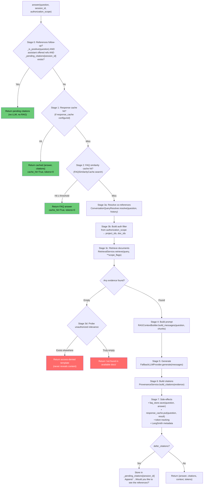

# ⚙️ Code-Grinder Deep Dive: `app/use_cases`

> **Mode**: Topic Driller — use cases are where business logic lives. No infrastructure. No HTTP. Just what the system does.

---

## 🗺️ The Territory — 3 Subdirectories, 21 Files

```
app/use_cases/
├── chat/                              ← The AI brain (9 files)
│   ├── query_orchestrator.py          (505 lines) — THE conductor
│   ├── retrieval_service.py           (321 lines) — Document fetcher + quality scorer
│   ├── query_intent_classifier.py     (293 lines) — 6-intent semantic router
│   ├── query_normalizer.py            (820 lines) — 10-stage NLP pipeline
│   ├── rag_context_builder.py         (6.9 KB)    — Prompt assembly
│   ├── conversation_query_resolver.py  (51 lines) — Co-reference resolution
│   ├── retrieval_quality.py           (22.8 KB)   — Quality-aware caching
│   ├── provenance_service.py          (432 B)     — Citation builder
│   └── session_memory.py             (513 B)     — History wrapper
│
├── organization/                      ← The CRUD brain (10 files)
│   ├── user_management.py             (177 lines) — Users + departments
│   ├── role_management.py             (218 lines) — Roles + permissions
│   ├── document_management.py         (6.7 KB)    — Document lifecycle
│   ├── document_access.py             (4.7 KB)    — Per-doc grants
│   ├── project_management.py          (6.6 KB)    — Project lifecycle
│   ├── project_access.py              (4.4 KB)    — Per-project grants
│   ├── membership_management.py       (4.2 KB)    — Project membership
│   ├── department_membership.py       (4.9 KB)    — Department membership
│   ├── profile.py                     (6.5 KB)    — Self-service profile
│   └── organization_explorer.py       (8.0 KB)    — Read-only org views
│
└── ingestion/                         ← The upload brain (2 files)
    ├── document_processing.py         (3.3 KB)    — Upload + chunk + embed
    └── informational_word_extractor.py (21.9 KB)  — Domain vocab extractor
```

---

## 🧠 The Mental Model First

The use-cases layer is the **application logic** — it knows WHAT to do, but not HOW (that's infrastructure) or WHO asked (that's API). It coordinates domain services and infrastructure ports to achieve business goals.

```
API Layer (WHO asked)
    ↓ calls
USE CASE Layer (WHAT to do)   ← YOU ARE HERE
    ↓ orchestrates
Domain Services (BUSINESS RULES: AuthorizationEngine, BusinessIdGenerator...)
    ↓ persists via
Infrastructure Adapters (HOW to do it: SQLAlchemy, ChromaDB, LLM clients...)
```

**Rule**: Use case files import from `domain/` and `infrastructure/`. They never import from `api/`. They are the last layer that "knows" business logic before hitting raw storage.

---

## 🤖 Part 1: Chat Use Cases — The AI Pipeline

### The Full `answer()` Pipeline — 7 Stages



### Stage 0 Deep Drill — The Deferred Citations System

```python
# Module-level dict — persists across requests, keyed by session_id
_pending_citations: dict[str, list] = {}

_POSITIVE_REPLY = re.compile(
    r"\b(yes|yeah|yep|yup|sure|please|show|go ahead|ok|okay|of course|"
    r"absolutely|definitely|affirmative|why not|do it|send|display|give)\b",
    re.IGNORECASE,
)

def _last_assistant_offered_references(history: list[dict]) -> bool:
    """Return True if the MOST RECENT assistant message mentioned references."""
    for msg in reversed(history or []):
        if msg.get("role") == "assistant":
            content = msg.get("content", "")
            return "reference" in content.lower() or "source" in content.lower()
    return False
```

**The 3-condition gate:**
```python
if (
    _is_positive(question)                           # User said "yes" / "show me"
    and _last_assistant_offered_references(history)  # Assistant previously asked
    and session_id in _pending_citations             # We have stored citations
):
    citations = _pending_citations.pop(session_id)  # ← pop: one-time retrieval
    return {"answer": "Here are the references...", "citations": citations}
```

> [!NOTE]
> `_pending_citations` is a **module-level dict**, making it effectively an in-process singleton. This means it's lost on restart and not safe across multiple processes (e.g., multiple uvicorn workers). For a single-process dev setup this works fine — in production with multiple workers you'd need Redis.

### Stage 3d Deep Drill — The Access-Denied Probe

This is one of the most subtle pieces of logic in the codebase:

```python
def _probe_unauthorized_relevance(self, retrieval_query, retrieval_kwargs, scope_flags):
    """Detect: does relevant content exist OUTSIDE the authorized scope?"""
    probe = getattr(self.retrieval, "detect_unauthorized_relevance", None)
    if probe is None:
        return None

    # Run same query but WITHOUT the authorization filter
    hits = probe(
        retrieval_query,
        authorized_project_ids=scope_flags.get("authorized_project_ids"),
        authorized_document_ids=scope_flags.get("authorized_document_ids"),
        include_unassigned=scope_flags.get("include_unassigned", True),
        top_k=retrieval_kwargs.get("top_k"),
    )
    if not hits:
        return None
    return self._access_denied_response(hits[0])

def _access_denied_response(self, hit) -> dict:
    """Templated response — NEVER reveals document content."""
    project_id = hit.get("project_id")
    contact = None
    if project_id and project_id != "unassigned" and self.project_contact_lookup:
        contact = self.project_contact_lookup(project_id)
    if contact and contact.get("project_name"):
        return {
            "answer": (
                "Relevant information exists in a project document that you do "
                "not currently have access to. Please contact "
                f"{contact.get('manager_name') or 'the project manager'}, "
                f"the manager of {contact['project_name']}, to request access."
            ),
            "citations": [],
        }
    # Generic fallback (no project contact available)
    return {
        "answer": "Relevant information exists in a document that you do not "
                  "currently have access to. Please contact the relevant project "
                  "manager to request access.",
        "citations": [],
    }
```

**Why this matters**: Without this probe, the bot would say "I couldn't find that information" for a question that HAS an answer — it's just in a restricted project. That's both useless and potentially misleading. The probe runs a second, **unrestricted** vector query to check if the information EXISTS but is restricted, then returns a helpful "you need to request access" message instead. The actual document content is never leaked.

---

### Chat Service 2: `ConversationQueryResolver` — Co-reference Resolution (51 lines)

```python
class ConversationQueryResolver:
    """Resolve dependent follow-ups into standalone retrieval queries."""

    _DEPENDENCY_PATTERN = re.compile(
        r"\b(it|this|that|these|those|they|them|their|its|such)\b|"
        r"^\s*(and|also|what about|how about)\b",
        re.IGNORECASE,
    )
```

**The problem it solves**: RAG systems search for documents by vector similarity to the query. If the query is "What about it?" or "And the exceptions?" — the vector embedding is meaningless without context. These questions DEPEND on the prior turn.

**The solution:**

```python
def resolve(self, question: str, history: list | None = None) -> str:
    recent_history = self.memory.get_recent_messages(history or [])

    # Fast path: no history OR question is independent
    if not recent_history or not self._is_dependent(question):
        return question   # ← Return unchanged

    # Slow path: has history AND detected dependency pronouns/openers
    history_text = "\n".join(f"{msg['role']}: {msg['content']}" for msg in recent_history)

    messages = [
        {"role": "system", "content":
            "Rewrite a dependent follow-up as one standalone search query. "
            "Use only context in the conversation. Do not answer, add facts, "
            "or change an independent question. Return only the query."},
        {"role": "user", "content": f"Conversation:\n{history_text}\nCurrent question: {question}"},
    ]
    try:
        rewritten = self.llm.generate(messages).strip()
    except Exception:
        return question   # ← Fallback: return original if LLM fails

    return rewritten or question
```

**Example**:
- History: `assistant: "Annual leave is 18 days per year."`
- Question: `"What about sick leave?"`
- `_is_dependent("What about sick leave?")` → `True` (matches `"what about"`)
- LLM rewrites to: `"How many sick leave days are provided per year?"`
- This standalone query is what gets sent to ChromaDB

> [!TIP]
> `_is_dependent()` is a `@classmethod` — it doesn't need `self` and can be called as `ConversationQueryResolver._is_dependent("What about it?")` without instantiating the class. This is ideal for a pure predicate that has no state.

---

### Chat Service 3: `RetrievalService` — Quality-Aware Document Selector (321 lines)

The `RetrievalService` is NOT just a thin wrapper over `ChromaVectorStore.query()`. It implements a sophisticated **quality scoring** pipeline:

**Step 1: Multi-part query execution**

```python
def retrieve(self, query_text: str, top_k=RAG_CANDIDATE_COUNT, ...):
    candidates = []
    for part_index, retrieval_query in enumerate(self._query_parts(query_text)):
        # Each "part" of the query is run separately
        # e.g., "What is the WFH policy and sick leave entitlement?"
        # → part 0: "What is the WFH policy"
        # → part 1: "sick leave entitlement"
        for candidate in self.store.query(retrieval_query, **query_kwargs):
            candidates.append({**candidate, "_query_part_index": part_index})
```

**Step 2: `select_relevant()` — The Quality Gate**

```python
def select_relevant(self, query_text, candidates, max_evidence, distance_threshold, max_context_chars):
    if not candidates:
        return []

    # Sort by vector distance (lower = more similar = better)
    sorted_candidates = sorted(candidates, key=lambda x: x.get("distance", 1.0))

    best_distance = sorted_candidates[0].get("distance", 1.0)
    cutoff = best_distance + RAG_DISTANCE_RELAXATION   # e.g., best=0.3 + relax=0.15 → cutoff=0.45

    selected = []
    total_chars = 0

    for candidate in sorted_candidates:
        dist = candidate.get("distance", 1.0)

        # Hard threshold: reject if distance too large
        if dist > distance_threshold:
            break

        # Relaxation cutoff: reject if significantly worse than best
        if dist > cutoff:
            break

        # Gap detection: big jump in quality = stop
        if selected and dist - selected[-1].get("distance", 0) > RAG_MIN_DISTANCE_GAP:
            break

        # Context budget: stop if adding this chunk exceeds max chars
        text = candidate.get("text", "")
        if total_chars + len(text) > max_context_chars:
            break

        selected.append(candidate)
        total_chars += len(text)

        if len(selected) >= max_evidence:
            break

    return selected
```

**The 5 termination conditions for evidence selection:**

| Condition | Why |
|-----------|-----|
| `dist > distance_threshold` | Absolute quality floor — reject clearly irrelevant chunks |
| `dist > cutoff` | Relative quality — don't include chunks much worse than the best |
| `dist - prev_dist > RAG_MIN_DISTANCE_GAP` | Quality cliff — sudden jump means remaining chunks are much worse |
| `total_chars > max_context_chars` | Token budget — LLMs have limited context windows |
| `len(selected) >= max_evidence` | Count cap — don't overwhelm the prompt with too many sources |

> [!IMPORTANT]
> ChromaDB returns **distance** (lower = more similar). These thresholds are tuned based on your embedding model's distance distribution. If you swap `EMBEDDING_MODEL`, you may need to recalibrate `RAG_DISTANCE_THRESHOLD` in `.env`.

---

### Chat Service 4: `QueryIntentClassifier` — The Zero-LLM Router (293 lines)

This classifier is explicitly engineered to be **sub-millisecond** — pure regex, no LLM, no model loading.

**The 6 Intents:**

| Intent | Example Query | Cache Prefix | Confidence |
|--------|--------------|-------------|-----------|
| `PERSONAL_BALANCE` | "How many leaves do I have?" | `bal:` | 0.95 |
| `PROCEDURAL` | "How do I apply for WFH?" | `proc:` | 0.95 |
| `POLICY_ENTITLEMENT` | "How many annual leave days per year?" | `entitle:` | 0.90 |
| `DIRECTORY_LOOKUP` | "Who is the manager of DevOps?" | `dir:` | 0.90 |
| `POLICY_GENERAL` | "What is the carry forward rule?" | `policy:` | 0.85 |
| `GENERAL_FAQ` | (default, no pattern matched) | `faq:` | 0.60 |

**Priority order matters critically:**

```python
def classify(self, query: str) -> IntentClassificationResult:
    # 1. PERSONAL_BALANCE FIRST — prevents collapse
    for pat in self.PERSONAL_BALANCE_PATTERNS:
        if pat.search(query):
            return IntentClassificationResult(intent=QueryIntent.PERSONAL_BALANCE, ...)
    
    # 2. PROCEDURAL
    for pat in self.PROCEDURAL_PATTERNS:
        if pat.search(query):
            return IntentClassificationResult(intent=QueryIntent.PROCEDURAL, ...)
    
    # 3. POLICY_ENTITLEMENT
    # 4. DIRECTORY_LOOKUP
    # 5. POLICY_GENERAL
    # 6. Default: GENERAL_FAQ
```

**Why PERSONAL_BALANCE must come first** — the "context collapse" problem:

```
Query: "How many leave days do I have?"

Pattern matches:
  PERSONAL_BALANCE: "how many ... do I have"  ← CORRECT
  POLICY_ENTITLEMENT: "how many ... annual leave days"  ← ALSO MATCHES!

If ENTITLEMENT ran first, we'd return "18 days per year per company policy"
But the user wants their PERSONAL balance!

With PERSONAL_BALANCE first: correctly routes to HRMS portal guidance.
```

**The `prompt_directive` field** is genius — it injects intent-specific instructions INTO the LLM system prompt:

```python
INTENT_PROMPT_DIRECTIVES = {
    QueryIntent.PERSONAL_BALANCE: (
        "The user is asking about their personal leave balance. "
        "State the company's standard annual policy entitlement "
        "(e.g., 18 Annual Leave days per calendar year), and explicitly "
        "inform the user that live, individualized remaining balances must "
        "be viewed on the internal company HRMS portal."
    ),
    QueryIntent.PROCEDURAL: (
        "Focus strictly on the step-by-step application workflow, approval "
        "requirements, and portal submission steps."
    ),
}
```

And the **intent-namespaced cache key:**

```python
def generate_intent_aware_cache_key(self, base_cache_key: str, query: str) -> str:
    result = self.classify(query)
    prefix = result.cache_prefix or "faq"   # "bal", "proc", "entitle", etc.
    clean_base = base_cache_key.strip().lower()
    if clean_base.startswith(f"{prefix}:"):
        return clean_base    # Already prefixed
    return f"{prefix}:{clean_base}"
    # "how many leaves do i have" → "bal:how_many_leaves_do_i_have"
    # "how many annual leave days" → "entitle:how_many_annual_leave_days"
    # Different cache keys → no cross-contamination!
```

---

### Chat Service 5: `QueryNormalizer` — 10-Stage NLP Pipeline (820 lines)

This is the most feature-rich use-case file. It runs BEFORE the vector search to clean and standardize the query.

**The 10 Pipeline Stages (in order):**

```
Stage 1: Text Cleaning
         ├── Strip HTML tags: <b>leave</b> → leave
         ├── Remove control characters (\x00-\x1f)
         └── Strip emoji: 🏖️ → (removed)

Stage 2: Unicode Normalization
         ├── NFKD decomposition: "é" → "e" + combining accent
         └── Remove combining chars: → "e"

Stage 3: Case Normalization
         └── Lowercase everything

Stage 4: Whitespace Normalization
         └── Collapse multiple spaces: "leave  policy" → "leave policy"

Stage 5: Punctuation Handling
         ├── Strip leading/trailing: "leave?" → "leave"
         └── Remove special chars: "WFH!" → "WFH"

Stage 5b: Word Boundary Fixing
         ├── CamelCase: "leavePolicy" → "leave Policy"
         ├── Number-letter: "leave2026" → "leave 2026"
         └── Conjoined known words: "leavesavailable" → "leaves available"

Stage 6: Keyboard Correction
         └── QWERTY mistakes: "teh" → "the", "hw" → "how"

Stage 7a: Typo Dictionary
         └── Common typos: "poliocy" → "policy", "anual" → "annual"

Stage 7b: Spellcheck (pyspellchecker + Levenshtein)
         ├── Domain fuzzy match: "polcy" → "policy" (edit distance 1)
         └── General dictionary: "wrogn" → "wrong"

Stage 8: Entity Preservation
         └── Flag month/day names, company names to avoid altering

Stage 9: Domain Vocabulary Mapping
         ├── Longer phrases first: "paid time off" → "paid time off"
         ├── Abbreviations: "pto" → "paid time off", "wfh" → "work from home"
         └── Synonyms: "wages" → "salary", "supervisor" → "manager"

Stage 10: Lemmatization (NLTK)
         └── "applying" → "apply", "employees" → "employee"

Final: Cache key generation
       └── "what is the annual leave policy?" → "what_is_the_annual_leave_policy"
```

**The Word Boundary Algorithm** (Stage 5b) — the most algorithmic piece:

```python
def _fix_word_boundaries(self, query: str) -> tuple[str, list[str]]:
    for word in query.split():
        clean_w = word.lower().strip()
        if len(clean_w) < 6 or clean_w in do_not_split:
            corrected_words.append(word)
            continue

        # Try ALL split points from index 3 to len-3
        split_found = False
        for i in range(3, len(clean_w) - 2):
            left = clean_w[:i]
            right = clean_w[i:]
            # Both halves must be in the known word set
            if left in self._known_words and right in self._known_words:
                corrected_words.append(f"{left} {right}")  # "leavesavailable" → "leaves available"
                split_found = True
                break
        if not split_found:
            corrected_words.append(word)
```

**`_known_words`** is the union of:
- Domain keywords from `DOMAIN_VOCABULARY` ("leave", "policy", "salary", ...)
- Common HR query words ("available", "balance", "apply", ...)

The split only happens if BOTH halves are recognized — "leavesavailable" → `left="leaves"` ∈ known, `right="available"` ∈ known → SPLIT.

**The `learn_document()` method — dynamic vocabulary expansion:**

```python
def learn_document(self, doc_input, file_name=None) -> list[str]:
    """Extract unique informational words from any document and register them dynamically."""
    from app.use_cases.ingestion.informational_word_extractor import get_unique_informational_words
    unique_words = get_unique_informational_words(doc_input, file_name=file_name)
    self.add_vocabulary(unique_words)
    return unique_words
```

When a new document is uploaded, the normalizer can learn its specialized vocabulary. A document about "ESOP allocations" would add "esop", "allocation", "vesting" to the spellchecker and domain keyword set — preventing them from being "corrected" away.

---

## 🏢 Part 2: Organization Use Cases — The CRUD Pattern

Every organization use case follows the exact same 4-stage formula:

```python
# THE UNIVERSAL PATTERN — memorize this:

def create_X(self, actor_uid, ...):
    # ── STAGE 1: AUTHORIZE ──────────────────────────────────
    # Check permission via authorization service (BEFORE opening UoW)
    self._require(actor_uid, "X_CREATE")   # → ForbiddenError if no permission

    with self.unit_of_work_factory() as uow:
        # ── STAGE 2: VALIDATE ──────────────────────────────
        actor = self._require_active(uow, actor_uid)  # → ForbiddenError if inactive
        # Business rule checks:
        if uow.x_repository.get_by_name(name) is not None:
            raise ConflictError("X already exists")
        if uow.parent_repository.get(parent_id) is None:
            raise NotFoundError("Parent not found")

        # ── STAGE 3: EXECUTE ───────────────────────────────
        entity = X(None, name, ...)
        entity = uow.x_repository.save(entity)

        # ── STAGE 4: COMMIT ────────────────────────────────
        uow.commit()
        return entity
```

### Service: `UserManagementService` — Layered Authorization Checks (177 lines)

`create_user()` has the most nuanced authorization logic — 5 layered checks:

```python
def create_user(self, actor_uid, uid, name, email, role, department_id, ...):
    with self.unit_of_work_factory() as uow:
        # CHECK 1: Actor must exist and be active
        actor = uow.users.get_by_uid(actor_uid)
        if actor is None or actor.status != "active":
            raise ForbiddenError("Active authenticated user required")

        # CHECK 2: No duplicates on any unique field
        if uow.users.get_by_uid(uid) or uow.users.get_by_email(email) or uow.users.get_by_username(username):
            raise ConflictError("User UID or email already exists")

        # CHECK 3: Target department must exist
        if not uow.departments.get(department_id):
            raise NotFoundError("Department not found")

        # CHECK 4: Manager can only create users in their OWN department
        if actor.role.casefold() != "admin" and actor.department_id != department_id:
            raise ForbiddenError("User is outside manager scope")

        # CHECK 5: Only admins can create admin users (privilege escalation protection)
        if role and role.casefold() == "admin" and actor.role.casefold() != "admin":
            raise ForbiddenError("Only administrators can create admin users")

        # Generate business ID if not provided
        employee_id = employee_id or self.business_id_generator.next(uow, "user")

        user = User(uid, name, email, role, department_id,
                    password_representation=self.password_hasher.hash(initial_password or DEFAULT_USER_PASSWORD),
                    must_change_password=True,
                    employee_id=employee_id)
        uow.users.save(user)
        uow.commit()
        return user
```

**Check 4 + 5 together prevent two attack vectors:**

| Attack | Prevention |
|--------|-----------|
| Manager creates user in another department to gain cross-dept visibility | Check 4: `actor.department_id != department_id → ForbiddenError` |
| Manager promotes themselves to admin by creating an "admin" user | Check 5: `role == "admin" AND actor != "admin" → ForbiddenError` |

**`update_user()` — the "error message leaks info" decision:**

```python
def update_user(self, actor_uid, uid, changes):
    with self.unit_of_work_factory() as uow:
        actor = uow.users.get_by_uid(actor_uid)
        if actor is None or actor.status != "active":
            raise ForbiddenError("Active authenticated user required")
        user = uow.users.get_by_uid(uid)
        if user is None:
            if actor.role.casefold() == "admin":
                raise NotFoundError("User not found")   # Admin: tell truth
            raise ForbiddenError("User is outside manager scope")  # Non-admin: hide existence
```

> [!IMPORTANT]
> **Information hiding**: If a non-admin tries to update a user in another department and we return `NotFoundError`, we've revealed that the user doesn't exist. Instead, returning `ForbiddenError("User is outside manager scope")` is truthful AND doesn't leak whether the user exists. Only admins get the truthful `NotFoundError`.

### Service: `RoleManagementService` — Two-Level Permission Guard (218 lines)

This service has a unique dual-guard pattern:

```python
class RoleManagementService:
    def __init__(self, unit_of_work_factory, authorization_service=None):
        self.authorization_service = authorization_service or OrganizationAuthorizationService(unit_of_work_factory())
        # ↑ Holds a persistent UoW for permission checks (separate from operation UoWs)

    def _require(self, actor_uid, permission):
        """Guard 1: RBAC permission check (uses the authorization_service's UoW)"""
        if not self.authorization_service.has_permission(AuthenticatedPrincipal(actor_uid), permission):
            raise ForbiddenError(f"Missing required permission: {permission}")

    @staticmethod
    def _require_active(unit_of_work, actor_uid):
        """Guard 2: Active status check (uses the operation's UoW)"""
        actor = unit_of_work.users.get_by_uid(actor_uid)
        if actor is None or actor.status != "active":
            raise ForbiddenError("Active authenticated user required")
        return actor
```

**Every method calls BOTH guards:**

```python
def list_roles(self, actor_uid):
    self._require(actor_uid, "ROLE_VIEW")         # ← Guard 1: has ROLE_VIEW permission?
    with self.unit_of_work_factory() as unit_of_work:
        actor = self._require_active(unit_of_work, actor_uid)   # ← Guard 2: still active?
        if actor.role.casefold() == "admin":
            return list(unit_of_work.roles.list())   # Admin: see ALL roles
        return [
            role for role in unit_of_work.roles.list()
            if role.scope == "global" or role.department_id == actor.department_id
        ]   # Non-admin: see global + own department's roles only
```

**Why two guards instead of one?**

- `_require()` uses the `authorization_service`'s cached/persistent UoW — it's fast, no new DB connection opened.
- `_require_active()` uses the SAME connection as the operation — it's in the same transaction, so if a user gets deactivated between when they made the request and when it's processed, this catches it.

**The `_ensure_visible` vs `_ensure_manage` distinction:**

```python
@staticmethod
def _ensure_visible(actor, role):
    """Can this actor SEE the role? (read operations)"""
    if actor.role.casefold() == "admin": return    # Admin sees all
    if role.scope == "global": return               # Global roles visible to all
    if role.department_id == actor.department_id: return  # Own dept role visible
    raise ForbiddenError("Role is outside manager scope")

@staticmethod
def _ensure_manage(actor, role):
    """Can this actor MANAGE the role? (write operations)"""
    if actor.role.casefold() == "admin": return    # Admin manages all
    if role.scope == "department" and role.department_id == actor.department_id: return
    raise ForbiddenError("Only administrators can manage global roles")
```

A manager CAN see a global role (`_ensure_visible` passes) but CANNOT modify it (`_ensure_manage` fails). Reading is broader than writing — this is the principle of least privilege.

**`delete_role()` — the referential integrity check:**

```python
def delete_role(self, actor_uid, role_id):
    self._require(actor_uid, "ROLE_DELETE")
    with self.unit_of_work_factory() as unit_of_work:
        actor = self._require_active(unit_of_work, actor_uid)
        role = unit_of_work.roles.get(role_id)
        if role is None:
            raise NotFoundError("Role not found")
        self._ensure_manage(actor, role)

        # ← Business rule: can't delete a role currently assigned to users
        if any(user.role == role.name for user in unit_of_work.users.list()):
            raise ConflictError("Role is assigned to users and cannot be deleted")

        unit_of_work.roles.delete(role_id)
        unit_of_work.commit()
```

This check happens IN the application layer, not just in the DB. Why? Because SQLite's `ON DELETE CASCADE` would silently remove `role_permissions` rows but not unassign users (the `users.role` column is a plain string, not a FK). Application-level enforcement is the only guard here.

---

### The Full Organization Service Map

```
Service                    Methods                            Auth Guard
──────────────────────────────────────────────────────────────────────────────
UserManagementService   create_department    Admin only (casefold check)
                        update_department    Admin only
                        create_user          Active + scope check
                        get_user             Active + scope check
                        update_user          Active + scope + info hiding
                        deactivate_user      → update_user(status="inactive")

RoleManagementService   list/get roles       ROLE_VIEW + active + scope visibility
                        create_role          ROLE_CREATE + global→admin only
                        update_role          ROLE_UPDATE + _ensure_manage
                        set_permissions      PERMISSION_MANAGE + _ensure_manage
                        delete_role          ROLE_DELETE + in-use check

DocumentManagement      create_document      DOCUMENT_UPLOAD + project membership
                        update_document      DOCUMENT_UPDATE + authz
                        delete_document      DOCUMENT_DELETE + authz

DocumentAccess          grant_access         DOCUMENT_MANAGE_ACCESS
                        revoke_access        DOCUMENT_MANAGE_ACCESS
                        list_grants          DOCUMENT_VIEW

ProjectManagement       create_project       PROJECT_CREATE
                        update_project       PROJECT_UPDATE + manager-only check
                        delete_project       PROJECT_DELETE + admin

ProjectAccess           grant_project        DOCUMENT_MANAGE_ACCESS (grants access)
                        revoke_project       DOCUMENT_MANAGE_ACCESS

MembershipManagement    add_member           PROJECT_MANAGE_MEMBERS + project scope
                        remove_member        PROJECT_MANAGE_MEMBERS
                        leave_project        PROJECT_LEAVE (self-service)

DepartmentMembership    add_member           DEPARTMENT_ASSIGN_USERS
                        remove_member        DEPARTMENT_ASSIGN_USERS

Profile (self-service)  get_profile          No RBAC — own profile only
                        update_profile       Own profile + password change
                        change_password      Own credentials

OrganizationExplorer    list_projects        DOCUMENT_QUERY (read-only views)
                        list_documents       DOCUMENT_VIEW + scope filter
                        get_project_details  PROJECT_VIEW
```

---

## 📥 Part 3: Ingestion Use Cases

### `DocumentProcessingService` — The Upload Pipeline (3.3 KB)

```python
class DocumentProcessingService:
    def __init__(self, vector_store=None, text_extractor=None):
        self.vector_store = vector_store or ChromaVectorStore()
        self.text_extractor = text_extractor or DocumentTextExtractor()

    def process(self, document: Document, file_path: str) -> int:
        # Step 1: Extract text from file (PDF → text, DOCX → text, TXT → text)
        text = self.text_extractor.extract(file_path)

        # Step 2: Chunk the text into segments
        chunks = self._chunk_text(text)

        # Step 3: Embed and store each chunk in ChromaDB
        ids = []
        for i, chunk in enumerate(chunks):
            chunk_id = f"{document.document_id}_chunk_{i}"
            self.vector_store.add(
                chunk_id,
                chunk,
                metadata={
                    "document_id": document.document_id,
                    "document_name": document.document_name,
                    "project_id": document.project_id or "unassigned",
                    "chunk_index": i,
                },
            )
            ids.append(chunk_id)
        return len(ids)
```

The `project_id` metadata on each chunk is what enables the authorization filter in `RetrievalService`. Every chunk knows which project it belongs to, so ChromaDB can filter `{"project_id": {"$in": ["PROJ-001", "PROJ-003"]}}`.

### `InformationalWordExtractor` — The Vocabulary Miner (21.9 KB)

This feeds the `QueryNormalizer.learn_document()` method. It extracts domain-specific words from uploaded documents:

```python
def get_unique_informational_words(doc_input, file_name=None) -> list[str]:
    """Extract words from a document that would be valuable for spell/query normalization."""
    # 1. Extract raw text from the document
    # 2. Tokenize into words
    # 3. Filter out:
    #    - Common English words ("the", "and", "is", ...)
    #    - Very short words (< 3 chars)
    #    - Numbers and pure symbols
    #    - Words already in the base domain vocabulary
    # 4. Return unique informational words (e.g., "esop", "vesting", "tranche")
```

---

## 🔗 Cross-Cutting Use Case Patterns

| Pattern | Where | Purpose |
|---------|-------|---------|
| **4-stage AUTHORIZE → VALIDATE → EXECUTE → COMMIT** | All 10 org services | Uniform correctness guarantee |
| **Pre-UoW permission check** | `RoleManagementService._require()` | Fast-fail before opening DB connection |
| **In-UoW active status check** | `_require_active(uow, actor_uid)` | Catches users deactivated mid-session |
| **Information hiding** | `update_user()` error routing | Non-admins get ForbiddenError instead of NotFoundError |
| **Scope visibility vs. manageability** | `_ensure_visible` / `_ensure_manage` | Read-write separation for non-admins |
| **In-use referential check** | `delete_role()` user loop | Application-level FK enforcement |
| **Module-level singleton state** | `_pending_citations`, `_intent_classifier` | Cross-request state without a database |
| **Graceful degradation** | `ConversationQueryResolver` try/except | LLM failure returns original question |
| **Probe before "not found"** | `_probe_unauthorized_relevance()` | Distinguish "doesn't exist" from "you can't see it" |

---

## 🔥 Drill Questions

### Q1: `QueryOrchestrator.answer()` has `response_cache` AND `faq_cache`. What's the difference between them, and when is each checked?

> **A**: `response_cache` (checked first, Stage 1) stores **arbitrary question → answer** mappings — it's populated when the full RAG + LLM pipeline runs successfully. `faq_cache` (checked second, Stage 2) is a **semantic similarity cache** over a pre-loaded FAQ JSON file, using the `FAQSimilarityCache`'s numpy matrix dot product. `faq_cache` only runs if `response_cache` is not configured or misses. Both exist because: the `response_cache` is dynamic (learns from usage), while `faq_cache` is static (pre-loaded from a file, extremely fast for known HR questions).

### Q2: `ConversationQueryResolver` uses an LLM to rewrite queries. What happens if the LLM is down?

> **A**: The `resolve()` method wraps `self.llm.generate(messages)` in `try/except Exception` and returns `question` (the original) on any error. This is intentional graceful degradation — a dependent question like "What about sick leave?" gets sent to ChromaDB as-is, which may return suboptimal results, but the chat never crashes. The fallback is explicit: `return rewritten or question` — even if LLM returns an empty string, the original question is used.

### Q3: `RetrievalService.select_relevant()` has 5 termination conditions. If you remove the distance GAP check, what breaks?

> **A**: Without the gap check (`dist - prev_dist > RAG_MIN_DISTANCE_GAP → break`), the service would include chunks that are much worse than the top results. Example: if the top 3 chunks have distances [0.25, 0.27, 0.28] and chunk 4 is 0.58 — a huge quality cliff — the gap check stops at chunk 3. Without it, chunk 4 (likely irrelevant noise) gets included in the prompt, consuming token budget AND potentially misleading the LLM with unrelated content.

### Q4: `RoleManagementService._require()` checks permissions BEFORE opening a UoW. `UserManagementService.create_user()` checks authorization INSIDE the UoW. Which approach is better and why?

> **A**: `RoleManagementService._require()` (outside UoW) is faster — fails immediately without opening a DB connection. `UserManagementService.create_user()` (inside UoW) checks the actor's CURRENT DB state — catching mid-session deactivations. Both have merit. `_require()` uses the `authorization_service`'s own UoW (which it manages separately), so it's still hitting the DB — just with a different connection. The best pattern would be: fast RBAC check outside UoW for coarse authorization, then active-status check inside UoW for fine-grained validation. `RoleManagementService` does exactly this (`_require` + `_require_active`).

### Q5: `delete_role()` does `if any(user.role == role.name for user in unit_of_work.users.list()):`. This loads ALL users into memory. What's the problem at scale, and how would you fix it?

> **A**: At scale (100,000 users), this loads every `UserRecord` into memory just to check one field. The fix: add a repository method `user_repository.exists_with_role(role_name)` that executes `SELECT EXISTS(SELECT 1 FROM users WHERE role = ?)` — a single DB round-trip returning a boolean. Currently the domain model enforces this check at the application layer because the `UserRepository` Protocol doesn't define such a method. Adding it would require: (1) adding `exists_with_role(role_name: str) -> bool` to `UserRepository` Protocol, (2) implementing it in `SqlAlchemyUserRepository` with a COUNT query.

### Q6: `QueryNormalizer.DOMAIN_VOCABULARY` maps multi-word phrases like `"paid time off"` to `"paid time off"` (same value). Why keep these identity mappings?

> **A**: For two reasons: (1) **Alias normalization** — the same entry also maps `"pto"` → `"paid time off"`, ensuring that "pto" becomes canonical. Having `"paid time off"` → `"paid time off"` means a query containing "paid time off" is recognized as ALREADY canonical, preventing downstream stages from altering it. (2) **Domain word registration** — all keys and values in `DOMAIN_VOCABULARY` are loaded into `_domain_keywords` (the spellchecker's allowed word list). This prevents the spellchecker from "correcting" "paid" → "said" or "pto" → "pro".

### Q7: The `_pending_citations` dict is module-level, not a class attribute. What happens when you deploy 3 uvicorn workers?

> **A**: Each worker is a separate Python process with its own memory. Worker 1 stores `_pending_citations["session-A"] = [...]`. Worker 2 handles the "yes, show me references" follow-up from the same user — but Worker 2's `_pending_citations` is empty (different process). The user sees "No specific document references are available for that answer." The fix: use a distributed store (Redis SETEX with TTL) for `_pending_citations`. In the current single-worker setup, this works correctly.
