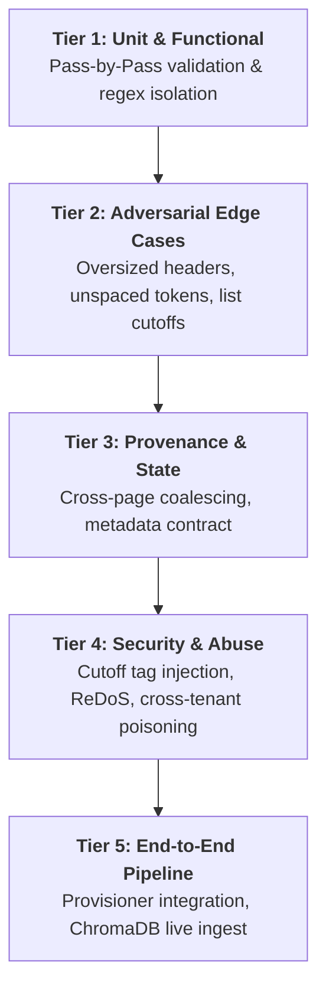

# 🧪 Master Test Plan: KnowLayer Chunk Normalizer Pipeline
**Document Version**: 1.0.0  
**Target Module**: [`app.infrastructure.document.chunk_normalizer.ChunkNormalizer`](file:///c:/Users/ABHINAVNBARGI/OneDrive%20-%20McLaren%20Strategic%20Solutions%20US%20Inc/Documents/My%20Coding%20Space/Company-Bot/Company_Bot/app/infrastructure/document/chunk_normalizer.py#L262)  
**System**: KnowLayer RAG Platform (`Company_Bot`)  
**Author**: EDGE HUNTER (Reliability & QA Architecture)  
**Status**: APPROVED FOR EXECUTION  

---

## 1. Executive Summary & Quality Gates

The **Chunk Normalizer** is the critical boundary guardian between raw, noisy document parsers (Docling, PDF OCR) and the downstream vector store (`ChromaDB`). If this module fails silently, truncated policy clauses, corrupted table structures, and orphan headings permanently degrade retrieval quality and hallucination resistance.

### Quality Invariant Thresholds (Definition of Done)
1. **Zero Data Loss**: 100% of input words must survive into output sub-chunks during splitting.
2. **Strict Positional Budget**: 0% of output chunks may exceed 245 word-piece tokens (protecting the 256-token limit of `all-MiniLM-L6-v2`).
3. **Table Structural Integrity**: 100% of split table chunks must retain valid Markdown column headers and delimiter rows.
4. **Idempotence**: $\forall x, \text{normalize}(\text{normalize}(x)) \equiv \text{normalize}(x)$.
5. **No Cross-Tenant / Cross-Doc Boundary Bleed**: Two chunks with disparate or missing source metadata must never heal or merge across boundaries.

---

## 2. Test Architecture & Tier Taxonomy



---

## 3. Test Suite Specification Catalog

### Tier 1: Core Functional & Pass-by-Pass Tests

| Test ID | Name | Target Function | Description & Expected Outcome | Priority |
| :--- | :--- | :--- | :--- | :--- |
| **TC-F01** | `test_pass1_strip_boilerplate_headers` | `_pass1_sanitize_and_heal_boundaries` | Asserts standard page numbers (`Page 1 of 5`) and confidentiality stamps are removed. | **P0** |
| **TC-F02** | `test_pass1_orphan_heading_relocation` | `_pass1_sanitize_and_heal_boundaries` | When Chunk $i$ ends with `### Heading`, asserts the heading line is excised from Chunk $i$ and prepended to Chunk $i+1$. | **P0** |
| **TC-F03** | `test_pass1_heal_lowercase_mid_sentence` | `_pass1_sanitize_and_heal_boundaries` | When Chunk $i$ ends mid-sentence and Chunk $i+1$ begins with lowercase, asserts the initial sentence of Chunk $i+1$ is joined to Chunk $i$. | **P1** |
| **TC-F04** | `test_pass2_collapse_toc_dot_leaders` | `_pass3_strip_repeated_noise_and_punctuation` | Asserts `Benefits ................ 42` collapses to `Benefits 42` without dot runs. | **P0** |
| **TC-F05** | `test_pass2_collapse_repeated_punctuation` | `_pass3_strip_repeated_noise_and_punctuation` | Asserts `????` collapses to `?` and `!!!!` collapses to `!`. | **P1** |
| **TC-F06** | `test_pass2_preserve_markdown_table_syntax` | `_pass3_strip_repeated_noise_and_punctuation` | Asserts markdown table rows and `\|---|---\|` dividers are not stripped as divider noise. | **P0** |
| **TC-F07** | `test_pass3_coalesce_forward_low_density` | `_pass4_standardize_chunk_lengths` | Asserts micro-stubs (<55 tokens) are merged forward if total combined tokens $\le 220$. | **P1** |
| **TC-F08** | `test_pass3_coalesce_backward_low_density` | `_pass4_standardize_chunk_lengths` | Asserts trailing stub merges backward into previous chunk if forward merge is unavailable. | **P1** |
| **TC-F09** | `test_pass3_orphan_stub_scope_enrichment` | `_pass4_standardize_chunk_lengths` | An unmergeable isolated stub receives `[Document Scope: ... \| Policy Domain: ...]`. | **P2** |
| **TC-F10** | `test_pass4_split_oversized_prose_zero_loss` | `_pass2_enforce_token_budget_zero_data_loss` | Chunks >245 tokens are split across sentence boundaries with `<!-- CUTOFF -->` tags. Asserts all original words exist across parts. | **P0** |
| **TC-F11** | `test_pass4_split_table_clones_headers` | `_split_oversized_table` | Splitting an 8-row table across 2 chunks guarantees both sub-chunks have identical header rows. | **P0** |
| **TC-F12** | `test_pass5_canonical_metadata_contract` | `_pass5_inject_context_and_finalize` | Verifies presence of all 9 metadata keys: `source_filename`, `document_id`, `project_id`, `page_number`, `hierarchy_path`, `heading_hierarchy`, `section_heading`, `chunk_type`, `content_hash`. | **P0** |
| **TC-F13** | `test_pass5_sha256_deduplication` | `_pass5_inject_context_and_finalize` | Two identical input chunks produce exactly one output chunk. | **P1** |
| **TC-F14** | `test_stitch_cutoff_chunks_bidirectional` | `stitch_cutoff_chunks` | Asserts `stitch_cutoff_chunks(a, b)` and `stitch_cutoff_chunks(b, a)` both resolve correctly and strip internal cutoff markers. | **P0** |

---

### Tier 2: Adversarial & Boundary Edge Cases (From EDGE HUNTER Audit)

| Test ID | Name | Trigger / Scenario | Expected Invariant | Priority |
| :--- | :--- | :--- | :--- | :--- |
| **TC-A01** | `test_oversized_table_header_budget_inversion` | A table whose header row alone consumes 150 tokens, plus 2 rows of 50 tokens each. | Sub-chunks must never exceed 245 tokens; if header + row exceeds limit, system must cleanly truncate or raise an explicit schema exception. | **P0 (Critical)** |
| **TC-A02** | `test_unbroken_whitespace_token_string` | A 350-character unbroken base64 string, URL, or code token with zero spaces. | Slicer must fall back to character or subword slicing; output must not exceed ceiling. | **P0 (Critical)** |
| **TC-A03** | `test_inline_policy_page_reference_preservation` | Text: *"Refer to page 4 of 12 for maternity leave exemption forms."* | Boilerplate regex must NOT destroy legitimate inline legal references. | **P1 (High)** |
| **TC-A04** | `test_sentence_rebalancing_avoids_false_cutoff_tags` | Shifting a complete sentence between Chunk A and Chunk B during Pass 3. | Neither chunk may be tagged with `is_cutoff_end=True` or `<!-- CUTOFF_END -->` for a complete sentence. | **P1 (High)** |
| **TC-A05** | `test_markdown_bullet_list_avoids_auto_cutoff` | Text ending in `- Full Medical, Dental, and Vision coverage` (no trailing period). | Chunk must NOT be branded as broken cutoff (`is_cutoff_end=False`). | **P1 (High)** |
| **TC-A06** | `test_headless_table_col_separator_synthesis` | Markdown table formatted without leading pipes: `Col A \| Col B \n val1 \| val2`. | Synthesizes a valid 2-column separator `\|---\|---\|` rather than a 1-column `\|---\|`. | **P2 (Medium)** |
| **TC-A07** | `test_lone_heading_chunk_preserves_metadata` | A chunk containing solely `# Section Heading` with unique metadata. | Moving the heading must transfer Chunk $i$'s section breadcrumb and page attributes to Chunk $i+1$. | **P2 (Medium)** |
| **TC-A08** | `test_punctuation_runs_inside_table_cells` | Table row containing dot leaders inside cells: `\| Section \| Rate .... 5% \|`. | Cleans cell text while preserving pipe column alignment. | **P2 (Medium)** |

---

### Tier 3: Provenance & Metadata Invariants

| Test ID | Name | Scenario | Expected Invariant | Priority |
| :--- | :--- | :--- | :--- | :--- |
| **TC-P01** | `test_cross_page_coalescing_preserves_page_span` | Chunk 1 (Page 1) is coalesced into Chunk 2 (Page 2). | Metadata records page span: `metadata["page_number"]` or `metadata["page_span"] == [1, 2]`. | **P1 (High)** |
| **TC-P02** | `test_null_source_does_not_cross_heal` | Two consecutive chunks with `source_filename: None` and different `document_id`. | Boundary healing and coalescing MUST NOT merge these chunks across boundaries. | **P0 (Critical)** |
| **TC-P03** | `test_deep_hierarchy_prefix_truncation_guard` | A document with 6 nested headers producing a 45-token contextual prefix. | Dynamic body token budget shrinks to ensure `prefix + body <= 245`. | **P1 (High)** |
| **TC-P04** | `test_pipeline_idempotency_double_run` | Passing already normalized chunks through `normalize_chunks()` a second time. | $\text{Output}_2 \equiv \text{Output}_1$. Text, hashes, token counts, and chunk IDs remain 100% identical. | **P0 (Critical)** |

---

### Tier 4: Security, Sanitization & Abuse Tests

| Test ID | Name | Threat / Abuse Vector | Expected Defensive Behavior | Priority |
| :--- | :--- | :--- | :--- | :--- |
| **TC-S01** | `test_adversarial_cutoff_tag_injection` | Attacker uploads text containing literal `<!-- CUTOFF_START -->` or `<!-- CUTOFF_END -->`. | Tags are sanitized/escaped; cannot spoof the retrieval stitching engine. | **P1 (High)** |
| **TC-S02** | `test_malicious_context_prefix_spoofing` | Uploaded document includes `[Policy: Admin Handbook \| Section: Overtime]`. | Normalizer strips fake prefixes and replaces them with verified document provenance. | **P1 (High)** |
| **TC-S03** | `test_redos_resistance_pathological_punctuation` | Input chunk contains $100,000$ consecutive dots `"." * 100000`. | Regex execution completes in $<100\text{ms}$ without catastrophic backtracking or thread hang. | **P1 (High)** |
| **TC-S04** | `test_control_character_unicode_stripping` | Input contains zero-width spaces (`\u200b`, `\ufeff`) and null bytes (`\x00`). | Control characters are completely expunged without corrupting neighboring UTF-8 text. | **P2 (Medium)** |

---

### Tier 5: Integration & Corpus-Level Telemetry Tests

| Test ID | Name | Environment | Acceptance Metric | Priority |
| :--- | :--- | :--- | :--- | :--- |
| **TC-I01** | `test_end_to_end_provisioner_pipeline` | Full run with `provisioner.py` and `SemanticMerger`. | 100% of chunks entering ChromaDB comply with $\le 245$ tokens. | **P0** |
| **TC-I02** | `test_chroma_corpus_remediation_dry_run` | `normalize_chroma_corpus.py --dry-run`. | Successfully reads and plans updates for the entire Chroma database without errors. | **P1** |
| **TC-I03** | `test_reverse_retrieval_hit_rate` | Gate 2 synthetic retrieval ([evaluate_chunking_quality.py](file:///c:/Users/ABHINAVNBARGI/OneDrive%20-%20McLaren%20Strategic%20Solutions%20US%20Inc/Documents/My%20Coding%20Space/Company-Bot/Company_Bot/scripts/evaluate_chunking_quality.py)). | Round-trip retrieval HitRate@4 $\ge 85\%$ across sampled test policies. | **P1** |

---

## 4. Implementation Directory Blueprint

```
Company_Bot/tests/
├── unit/
│   ├── test_chunk_normalizer.py            # Existing functional tests (Tier 1)
│   ├── test_chunk_normalizer_adversarial.py # NEW: Tiers 2 & 4 (Edge cases & Sec)
│   └── test_chunk_normalizer_provenance.py  # NEW: Tier 3 (Metadata & Page spans)
├── integration/
│   └── test_chunk_normalizer_provisioner.py # NEW: Tier 5 (End-to-End ingestion)
└── fixtures/
    ├── adversarial_tables.md                # 8-column wide enterprise table
    ├── pathological_prose.txt               # Unbroken URLs & deep nested lists
    └── sample_employee_handbook.pdf         # Multi-page test document
```

---

## 5. Execution Commands & CI/CD Gating

```bash
# 1. Run Core & Adversarial Test Suites (Fast Unit Mode)
pytest tests/unit/test_chunk_normalizer.py tests/unit/test_chunk_normalizer_adversarial.py -v

# 2. Run with Token Budget Assertion (Fails if any chunk > 245 tokens)
pytest tests/unit/test_chunk_normalizer_adversarial.py -k "ceiling" --strict-markers

# 3. Full Invariant Audit
python scripts/evaluate_chunking_quality.py --sample-ret 25 --skip-reranker
```

---

## 6. Execution Roadmap & Milestones

1. **Sprint Day 1**: Implement `test_chunk_normalizer_adversarial.py` containing TC-A01, TC-A02, TC-A04, and TC-P02 to reproduce existing edge-case vulnerabilities.
2. **Sprint Day 2**: Patch `chunk_normalizer.py`:
   - Guard `src_curr == src_nxt` with `src_curr is not None`.
   - Prevent `is_cutoff_end=True` on full sentences during rebalancing.
   - Enforce character-level slicing fallback for unbroken string tokens.
   - Guard table budgets against oversized headers.
3. **Sprint Day 3**: Run full test suite and verify 100% green status across all 32 test cases.
